# Food Pickup roadmap

From the single-store V0 to a multi-store, multi-branch pickup platform with real escrowed payments, restaurant and
platform dashboards, background jobs and production hosting on AWS. This file is the plan for every item in the
product roadmap (`Roadmap.pdf`, 33 items). It covers the target design (HLD), the detailed design of each feature
(LLD) and the build order as small, verifiable steps.

> **Status: proposal.** Nothing described as _target_ exists yet. [`docs/`](docs/) describes the app as it is today,
> and when the two disagree the code wins (CLAUDE.md). When a phase ships, its owning docs (CLAUDE.md §6) become the
> source of truth for it, and this file keeps only the checklist and the links.
>
> **Companion:** [PAYMENT_OPTIONS.md](PAYMENT_OPTIONS.md) is the payment research record: provider rankings, fee
> models, the model A vs B requirements and trade-offs, the fallback ladder and the switching options.

Roadmap items are cited as **R1**–**R33** in the PDF's order, with sub-items such as **R4.1** and **R11.2**. Phases are
**P0**–**P10** and steps are numbered like **P5.3**. [Traceability](#traceability) maps every item to the steps that
deliver it.

## Contents

- [How to use this roadmap](#how-to-use-this-roadmap)
- [Where we start](#where-we-start)
- [Traceability](#traceability)
- [Phases and milestones](#phases-and-milestones)
- [Design principles](#design-principles)
- [Target architecture (HLD)](#target-architecture-hld)
- [P0 — Foundations and guardrails](#p0--foundations-and-guardrails)
- [P1 — Platform core](#p1--platform-core)
- [P2 — Multi-store and multi-branch](#p2--multi-store-and-multi-branch)
- [P3 — Catalog, menu management and media](#p3--catalog-menu-management-and-media)
- [P4 — Payment aggregator research and selection](#p4--payment-aggregator-research-and-selection)
- [P5 — Payments, escrow and refunds](#p5--payments-escrow-and-refunds)
- [P6 — Order experience](#p6--order-experience)
- [P7 — Insights and engagement](#p7--insights-and-engagement)
- [P8 — Infrastructure and delivery](#p8--infrastructure-and-delivery)
- [P9 — Pilot readiness and launch](#p9--pilot-readiness-and-launch)
- [P10 — Scale after the pilot](#p10--scale-after-the-pilot)
- [Testing strategy](#testing-strategy)
- [Docs and rule changes](#docs-and-rule-changes)
- [Risks](#risks)
- [Decisions needed](#decisions-needed)
- Appendices: [A1 Hardcoded values](#a1-hardcoded-values-inventory) ·
  [A2 Settings registry](#a2-settings-registry) · [A3 Error codes](#a3-new-error-codes) ·
  [A4 Endpoints](#a4-endpoint-inventory) · [A5 Domain events](#a5-domain-events) · [A6 Glossary](#a6-glossary)

## How to use this roadmap

- **Order.** Phases run in dependency order (see [Phases and milestones](#phases-and-milestones)). Two phases are
  parallel tracks:
  - **P4** (payment aggregator research) starts right after P0, because commercial terms and KYC onboarding take
    weeks. It must finish before P5.
  - **P8** (infrastructure) must reach a staging environment before P5's webhook work starts.

  Within a phase the steps are in build order, and each one is sized to be roughly one pull request.

- **Each step** says what to build and where it lives, plus its migration, API change, UI, tests and the docs to
  update. It ends with a "Done when" check.
- **The execution loop** for every step reuses the project's own workflow (CLAUDE.md §15–§17):
  1. Run `/before-write <intent>` (reuse-scout + schema-guard) before any new table, column, endpoint, component,
     hook or service, and record the verdict in the PR.
  2. Follow the `/db-migration` and `/new-endpoint` recipes for schema and endpoint work.
  3. Write the failing test first for business rules: state machines, money and stock.
  4. Run the gate, `npm run typecheck && npm run lint && npm test`, in every touched package.
  5. Run `/post-change` for major changes; every product step here is one.
  6. Record a version intent ([P0.3](#p03-semantic-versioning-with-change-intents)) and update the owning docs in
     the same change (CLAUDE.md §6).
- **Production is never touched by an agent** (CLAUDE.md §2). The user runs every step tagged **(user)**:
  production migrations, production seeds, live payment keys and DNS.
- **Backward compatibility** with the deployed client holds on every step (CLAUDE.md §2): add fields, and never rename
  or remove anything the client reads. The rare breaking moment goes through the client-version gate from
  [P0.7](#p07-health-readiness-and-client-version).
- **Numbers** in this file (timeouts, windows, limits, weights) are proposed defaults. Each one becomes a setting (see
  [A2](#a2-settings-registry)), not a constant ([R3](#p04-configuration-registry-and-no-hardcoding)).
- **Sizes** are rough guides for a team of two or three: **S** under a week, **M** 1–2 weeks, **L** 2–4 weeks,
  **XL** more than 4 weeks. Dates are for the team to set.

## Where we start

What V0 does today, with the file that proves it, and which roadmap items change it.

| Area                 | Today (V0)                                                                                                                                                                                                   | Roadmap           |
| -------------------- | ------------------------------------------------------------------------------------------------------------------------------------------------------------------------------------------------------------ | ----------------- |
| Stores               | One `stores` row, read with `limit(1)` (`server/src/services/store.service.ts`); `GET /api/store` and `GET /api/menu` assume it                                                                              | R1                |
| Payment              | `simulatePayment()` returns `PAID` synchronously before `place_order` runs (`server/src/services/payment.service.ts`)                                                                                        | R2, R4, R5        |
| Order lifecycle      | `PLACED → PREPARING → READY → COLLECTED`, with `CANCELLED` from `PLACED`/`PREPARING` (`ALLOWED_TRANSITIONS` in `order.service.ts`); stock is taken and restored inside `place_order` / `update_order_status` | R4, R5, R12, R15  |
| Order snapshots      | `order_items` snapshots `name` and `unit_price`, but the line photo and the store name are live joins (`selectOrders()` in `utils/serializers.ts`)                                                           | R23               |
| Roles                | `profiles.role` is `CUSTOMER`, `STAFF` or `ADMIN` and applies site-wide: staff see every order, and admins edit `site_settings`                                                                              | R11, R14          |
| Settings             | `site_settings`: a singleton holding two list limits                                                                                                                                                         | R3, R14           |
| Constants            | About 20 business values live in code (full list in [A1](#a1-hardcoded-values-inventory))                                                                                                                    | R3                |
| Background work      | None; everything happens inside the request                                                                                                                                                                  | R28, R29          |
| Logging              | pino with request ids, redaction and one log per failure (`docs/LOGGING.md`)                                                                                                                                 | R6, R27           |
| Tests                | Vitest + Supertest against local Supabase, with the edge-case matrix (`docs/TESTING.md`); no CI                                                                                                              | R9, R19, R32      |
| Versioning           | Both packages are at `0.1.0` and have never been bumped                                                                                                                                                      | R8                |
| Hosting              | None beyond the Supabase projects; Docker and nginx are only a note in `docs/DEPLOYMENT.md`                                                                                                                  | R16–R18, R20, R21 |
| Images               | Bundled in `client/public/images/` with 400px thumbnails (`client/scripts/optimize-images.py`)                                                                                                               | R17               |
| Live updates         | Polling (4 s order, 8 s list, 4 s staff) with ETag 304s                                                                                                                                                      | R13               |
| Abuse protection     | None in the API (Supabase Auth rate-limits its own endpoints)                                                                                                                                                | R33               |
| Hours and wait time  | A single `stores.is_open` switch, and `estimated_ready_at = now() + prep_time_max_minutes`                                                                                                                   | R25, R26, R31     |
| Pickup               | The global `order_number` identity (from 1001), read out at the counter                                                                                                                                      | R15               |
| Insight & engagement | No analytics, feedback, recommendations or costs                                                                                                                                                             | R7, R10, R22, R30 |

What we keep, because later phases lean on it:

- **Correctness lives in the database.** Stock races are settled by conditional updates inside one SQL function per
  transition, and expected failures come back as `P0001` with the API code as the message (`raisedByDatabase`).
  Every new state machine follows the same pattern.
- **Locked-down data.** RLS is on with no policies, the publishable key can touch nothing, and the API scopes every
  query. Multi-tenancy builds on this model rather than replacing it.
- **One error envelope** (`{ error: { code, message, details? } }`), with messages that are safe to show.
- **Mobile-first budgets** (CLAUDE.md §2b) and the caching policy (§2c) remain gates for every phase.
- **Docs discipline**: one owner per topic, updated in the same change.

## Traceability

Every roadmap item, and the steps that deliver it.

| Item   | Roadmap item (short)                                                                                      | Delivered by                                                                                                                                                                                                                                                                                                                                 |
| ------ | --------------------------------------------------------------------------------------------------------- | -------------------------------------------------------------------------------------------------------------------------------------------------------------------------------------------------------------------------------------------------------------------------------------------------------------------------------------------- |
| R1     | Multiple stores, including multi-branch, with proper LLD                                                  | [P2](#p2--multi-store-and-multi-branch) (all steps), [P3.1](#p31-catalog-for-multi-branch-brands)                                                                                                                                                                                                                                            |
| R2     | Real payment gateway (the PDF names Razorpay; the provider is chosen in P4)                               | [P4](#p4--payment-aggregator-research-and-selection) (research and selection), [P5.1](#p51-payment-gateway-port-and-adapter), [P5.3](#p53-checkout-v2), [P5.4](#p54-webhooks-inbox-and-payment-state), [P5.11](#p511-go-live-from-test-mode-to-live), [P5.12](#p512-switching-providers-after-the-promotion)                                 |
| R3     | No hardcoded values anywhere                                                                              | [P0.4](#p04-configuration-registry-and-no-hardcoding), [P2.3](#p23-store-scoped-orders-and-settings), [P8.6](#p86-secrets-and-configuration), [A1](#a1-hardcoded-values-inventory), [A2](#a2-settings-registry)                                                                                                                              |
| R4     | Prepay, hold the money, credit the vendor on collection                                                   | [P5.2](#p52-order-lifecycle-v2-and-stock-holds), [P5.6](#p56-ledger-and-escrow), [P5.9](#p59-sla-breaches-and-pickup-windows)                                                                                                                                                                                                                |
| R4.1   | Refunds: not ready past the buffer, restaurant refuses, stock mismatch                                    | [P5.5](#p55-restaurant-acceptance-for-limited-items), [P5.7](#p57-refunds), [P5.9](#p59-sla-breaches-and-pickup-windows)                                                                                                                                                                                                                     |
| R4.2   | Still pay the restaurant when the customer does not collect in the window                                 | [P5.9](#p59-sla-breaches-and-pickup-windows)                                                                                                                                                                                                                                                                                                 |
| R4.2.1 | Restaurant resells at full price or as a limited-time discounted item                                     | [P3.6](#p36-surplus-and-limited-time-deals), [P5.9](#p59-sla-breaches-and-pickup-windows)                                                                                                                                                                                                                                                    |
| R5     | Limited-quantity items need the restaurant's acceptance, else refund                                      | [P5.5](#p55-restaurant-acceptance-for-limited-items)                                                                                                                                                                                                                                                                                         |
| R6     | Clean error logging                                                                                       | [P0.5](#p05-error-logging-clean-up), [P8.7](#p87-observability)                                                                                                                                                                                                                                                                              |
| R7     | Feedback and ratings per dish and restaurant                                                              | [P7.5](#p75-feedback-and-ratings)                                                                                                                                                                                                                                                                                                            |
| R8     | Semantic versioning; Claude records FE/BE increments in a temp file, a script bumps                       | [P0.3](#p03-semantic-versioning-with-change-intents)                                                                                                                                                                                                                                                                                         |
| R9     | CI: lint, build, perf, load testing                                                                       | [P0.2](#p02-continuous-integration), [P9.1](#p91-load-testing-from-100-to-1000-concurrent)                                                                                                                                                                                                                                                   |
| R10    | "Your usuals" category, like Swiggy                                                                       | [P7.6](#p76-your-usuals)                                                                                                                                                                                                                                                                                                                     |
| R11    | Restaurant dashboard, staff and admin separate                                                            | [P2.2](#p22-memberships-and-store-roles), [P3.4](#p34-restaurant-admin-menu-and-stock), [P6.4](#p64-staff-dashboard-v2), [P7.3](#p73-restaurant-analytics-dashboard)                                                                                                                                                                         |
| R11.1  | Staff: statuses, collection, order list and summary, details with a call button                           | [P6.4](#p64-staff-dashboard-v2)                                                                                                                                                                                                                                                                                                              |
| R11.2  | Admin: menu, stock (staff may too), analytics                                                             | [P3.4](#p34-restaurant-admin-menu-and-stock), [P3.5](#p35-staff-stock-updates), [P7.3](#p73-restaurant-analytics-dashboard)                                                                                                                                                                                                                  |
| R12    | Cancellation policies customisable by the restaurant                                                      | [P5.8](#p58-cancellation-policies)                                                                                                                                                                                                                                                                                                           |
| R13    | Proper notification system                                                                                | [P6.3](#p63-notifications)                                                                                                                                                                                                                                                                                                                   |
| R14    | Platform admin dashboard: onboarding, analytics, load, site settings                                      | [P7.4](#p74-platform-admin-dashboard)                                                                                                                                                                                                                                                                                                        |
| R15    | Order tokens, possibly a pickup QR                                                                        | [P6.2](#p62-pickup-tokens-and-qr-verification)                                                                                                                                                                                                                                                                                               |
| R16    | Dockerise FE and BE separately                                                                            | [P0.6](#p06-docker-images-and-local-compose), [P8.2](#p82-container-registry-and-image-pipeline)                                                                                                                                                                                                                                             |
| R17    | Images on S3                                                                                              | [P3.3](#p33-images-on-s3), [P8.3](#p83-media-bucket-and-cdn)                                                                                                                                                                                                                                                                                 |
| R18    | Deploy on EC2 + ECR + S3                                                                                  | [P8.1](#p81-aws-foundation-with-terraform)–[P8.4](#p84-compute-on-ec2)                                                                                                                                                                                                                                                                       |
| R19    | Load testing, 100 then 1000 concurrent                                                                    | [P9.1](#p91-load-testing-from-100-to-1000-concurrent)                                                                                                                                                                                                                                                                                        |
| R20    | Kubernetes after the pilot, if load needs it                                                              | [P10.1](#p101-kubernetes-migration)                                                                                                                                                                                                                                                                                                          |
| R21    | Continuous deployment                                                                                     | [P8.5](#p85-continuous-deployment)                                                                                                                                                                                                                                                                                                           |
| R22    | Recommender: similarity, popularity, other users' orders                                                  | [P7.7](#p77-recommender-v1), [P10.2](#p102-recommender-v2)                                                                                                                                                                                                                                                                                   |
| R23    | Snapshot orders for history instead of referencing the live menu                                          | [P1.5](#p15-order-snapshots-v2)                                                                                                                                                                                                                                                                                                              |
| R24    | Customisations and modifiers (+₹x extra cheese)                                                           | [P3.2](#p32-modifiers)                                                                                                                                                                                                                                                                                                                       |
| R25    | Wait time from store base, item offsets, analytics, rush hours and a buffer                               | [P6.1](#p61-eta-engine)                                                                                                                                                                                                                                                                                                                      |
| R26    | Temporarily pause accepting orders                                                                        | [P2.5](#p25-pause-accepting-orders)                                                                                                                                                                                                                                                                                                          |
| R27    | Audit logging                                                                                             | [P1.3](#p13-audit-log)                                                                                                                                                                                                                                                                                                                       |
| R28    | Async jobs: notifications, analytics, expired holds and pickups, reconciliation, refunds, recommendations | [P1.2](#p12-background-jobs-outbox-queues-and-scheduler) (engine); consumers in [P6.3](#p63-notifications), [P7.1](#p71-analytics-pipeline), [P5.2](#p52-order-lifecycle-v2-and-stock-holds), [P5.9](#p59-sla-breaches-and-pickup-windows), [P5.10](#p510-payment-reconciliation-service), [P5.7](#p57-refunds), [P7.7](#p77-recommender-v1) |
| R29    | A separate service just for payment reconciliation                                                        | [P5.10](#p510-payment-reconciliation-service)                                                                                                                                                                                                                                                                                                |
| R30    | COGS for expenditure analytics                                                                            | [P7.2](#p72-cogs-and-expenses)                                                                                                                                                                                                                                                                                                               |
| R31    | Operating hours, special occasions, extra hours, festivals                                                | [P2.4](#p24-operating-hours-and-special-schedules)                                                                                                                                                                                                                                                                                           |
| R32    | Failure and recovery testing                                                                              | [P9.2](#p92-failure-and-recovery-testing)                                                                                                                                                                                                                                                                                                    |
| R33    | Rate limiting and abuse protection                                                                        | [P1.6](#p16-rate-limiting-and-abuse-protection-v1), [P9.3](#p93-edge-protection-and-security-review)                                                                                                                                                                                                                                         |

## Phases and milestones

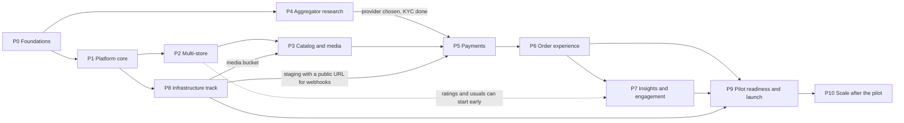

| Milestone            | Exit criteria                                                                                                                                                   | Phases        | Size |
| -------------------- | --------------------------------------------------------------------------------------------------------------------------------------------------------------- | ------------- | ---- |
| M0 Gated repo        | CI is required on every PR; versions bump from change intents; the FE and BE images build and run locally in compose; no new business constant lands in code    | P0            | M    |
| M1 Platform core     | Events leave every state change through the outbox; audit, idempotency, snapshots, rate limits and feature flags are live                                       | P1            | L    |
| M2 Many stores       | Two brands, one with two branches, run on staging with store-scoped staff, hours, pause and per-store carts; legacy clients still work                          | P2            | L    |
| M3 Real menus        | Managers edit catalog, modifiers, photos (S3), stock and deals from the dashboard                                                                               | P3 (+ P8.3)   | L    |
| M4 Aggregator chosen | Aggregator chosen on measured fees, integration and escrow fit; ADR-003 accepted; merchant KYC submitted; sandbox spike merged behind the gateway port          | P4            | M    |
| M5 Real money        | Test mode end to end on staging with the chosen aggregator: holds, acceptance, refunds, escrow, policies, reconciliation; live payments behind a per-store flag | P5 (+ P8.4–5) | XL   |
| M6 Pickup flow       | ETA engine, tokens + QR verification, notifications and staff dashboard v2 are live                                                                             | P6            | L    |
| M7 Insights          | Store and platform analytics, COGS, ratings, "Your usuals" and recommendations are live                                                                         | P7            | L    |
| M8 Pilot live        | Production on AWS, load-tested to 1000 concurrent, failure drills done, runbooks and alerts in place; versions go to 1.0.0                                      | P8, P9        | L    |
| M9 Scale             | The Kubernetes decision gate has been evaluated and acted on; recommender v2 if the data supports it                                                            | P10           | L–XL |

## Design principles

These apply to every phase. Most of them extend a rule the codebase already follows.

1. **The server decides money, stock and status.** Prices, totals, refunds and payouts come from the database, and the
   client only displays them (existing rule).
2. **One transaction per transition.** Every multi-step state change is one SQL function, with `p_` parameters,
   expected failures raised as `P0001` and conditional updates for races (existing pattern). This covers
   `create_checkout`, `confirm_payment`, `accept_order`, `collect_order`, `request_refund` and `post_journal`.
3. **Transactional outbox.** A state change that needs a side effect (a notification, a payout, an analytics update)
   writes its domain event in the same transaction. Background work never runs off a "fire and forget" call made
   after commit.
4. **Idempotent at every boundary.** Client writes carry an `Idempotency-Key`; webhooks are deduplicated by event id;
   job handlers are safe to repeat; gateway calls carry our own reference and are checked before they are retried.
5. **Explicit state machines.** Orders, payments, refunds and payouts each have one transition table on the server,
   written as a pure, exhaustively tested function, and the SQL guards enforce it. The client only maps states to
   labels (as `orderStatus.ts` does today).
6. **Snapshot at commitment.** Anything that can change after the customer commits is copied onto the order: names,
   prices, photos, modifiers, the cancellation policy, the commission rate and the promised ready time.
7. **Expand → migrate → contract.** Add the new column or endpoint, move readers and writers over, then remove the old
   one in a later release. Migrations stay append-only (CLAUDE.md §2).
8. **Configuration over constants.** There are three tiers: environment (deployment), site settings (platform) and
   store settings (restaurant). Every setting has a default and bounds, and one reader.
9. **Tenant isolation by construction.** Every store-scoped query goes through a scoping helper that adds the store
   filter, and another store's resource answers 404, as another user's order does today.
10. **Ports and adapters for integrations.** Payments, storage, push, SMS and email sit behind interfaces, with an
    in-memory fake used in tests, local development and load tests.
11. **Observable by default.** Logs carry request, job and event ids; each state transition emits a metric; traces
    cross API → queue → worker.
12. **Lean infrastructure.** New infrastructure (Redis, Kubernetes, a second database) arrives only when a
    measurement says so, and each such item states the trigger that justifies it (the ponytail rule).
13. **Budgets are gates.** The low-end Android budgets in CLAUDE.md §2b apply to every customer screen. Dashboards and
    payment scripts are lazy, and every new dependency is priced in gzip bytes before it lands.
14. **Reuse before build, docs in the same change** (CLAUDE.md §5, §6, §15).

## Target architecture (HLD)

The end state after P9. Each part is designed in detail in the phase that builds it.

### System context

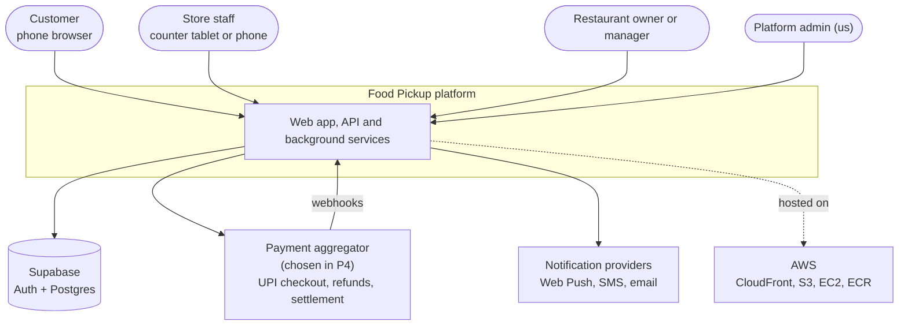

Four kinds of people use one web app, and each gets a different surface:

- **Customer:** discovery, menus, the cart, checkout and tracking.
- **Store staff:** the order board.
- **Restaurant owner or manager:** the `/manage` dashboard.
- **Platform admin:** the `/admin` console.

Supabase stays the system of record for identities and data. A payment aggregator, chosen on evidence in
[P4](#p4--payment-aggregator-research-and-selection), moves the money.

### Containers and processes

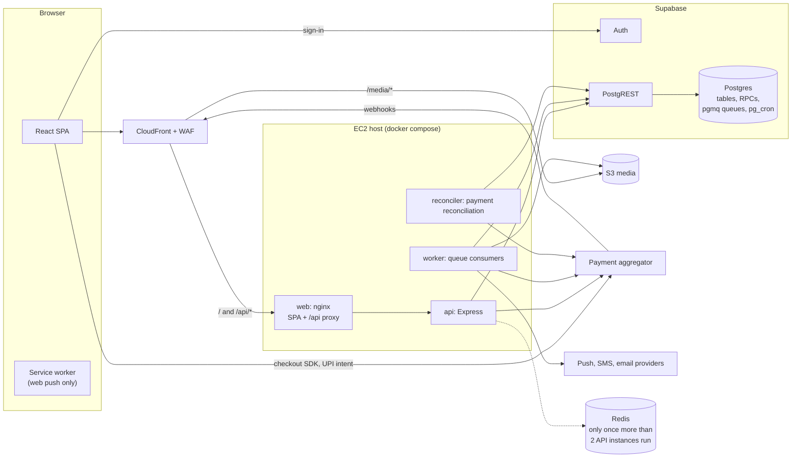

| Process      | Entry point (target)        | Does                                                                                                                        | Scales                                                             |
| ------------ | --------------------------- | --------------------------------------------------------------------------------------------------------------------------- | ------------------------------------------------------------------ |
| `web`        | `client/Dockerfile` (nginx) | serves the SPA with the cache headers from DEPLOYMENT.md, and proxies `/api/*` to `api` so calls stay same-origin, as today | with `api`                                                         |
| `api`        | `server/src/server.ts`      | HTTP: every request/response endpoint and the payment webhook receiver; no long-running work                                | horizontally; stateless                                            |
| `worker`     | `server/src/worker.ts`      | consumes the pgmq queues: notifications, analytics, payment side effects, refunds, media, recommendations                   | horizontally; each queue's visibility timeout prevents double work |
| `reconciler` | `server/src/reconciler.ts`  | payment reconciliation only (R29): stuck-state sweeps, daily settlement matching, ledger integrity                          | one active instance, held by a database lease                      |
| scheduler    | `pg_cron` inside Postgres   | time-based transitions (expired holds, acceptance timeouts, SLA breaches, pickup windows), and enqueues periodic jobs       | runs in the database                                               |

**One codebase, three processes.** `api`, `worker` and `reconciler` share `server/` (its domain logic, SQL functions
and serializers) but deploy and fail independently. Each gets its own container, command, environment and scaling.
That meets "a separate service for reconciliation" without a monorepo migration. See ADR-005 in
[Architecture decisions](#architecture-decisions).

### Deployment on AWS (pilot)

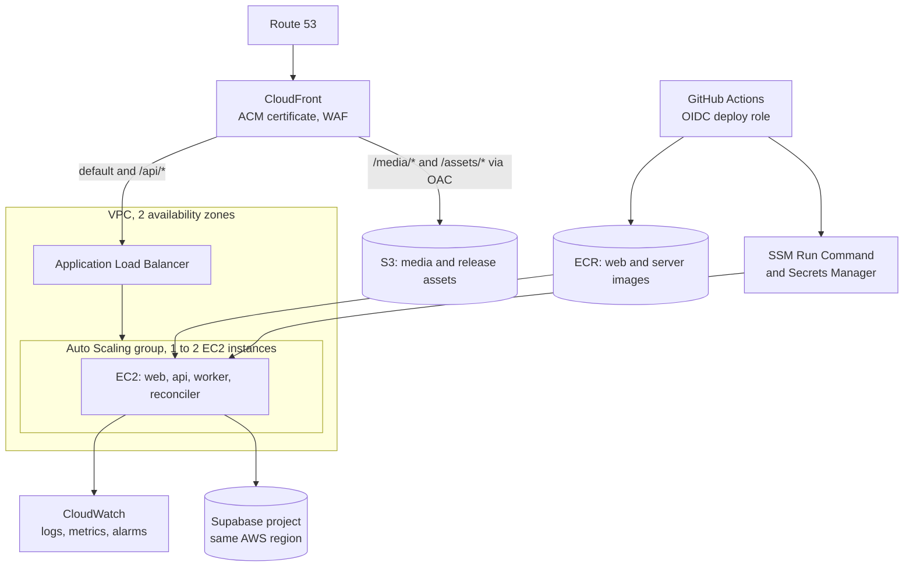

- **Region.** Keep the EC2 hosts in the same AWS region as the Supabase project. Every request makes one to four
  database round trips, so cross-region latency would multiply.
- **Same origin.** The browser only ever talks to one origin. CloudFront routes `/api/*` to the load balancer, and
  `/media/*` and `/assets/*` to S3. This keeps `services/api.ts`'s relative `/api` base and a strict CSP.
- **Pilot sizing.** One or two small instances. [P9.1](#p91-load-testing-from-100-to-1000-concurrent) measures the
  real numbers, and [P10.1](#p101-kubernetes-migration) decides whether Kubernetes is warranted.

### Server module map

The layering from CLAUDE.md §4 stays as it is: routes → validate → controllers → services → serializers. It gains
three folders:

- `src/domain/`: pure logic with no I/O (state machines, pricing, ETA, schedules, the policy engine, ledger posting
  rules).
- `src/jobs/`: the worker's queue handlers.
- `src/integrations/`: adapters behind ports (`payments/<provider>/`, `s3/`, `push/`, `sms/`, `email/`).

| Module          | Owns (tables)                                                                                              | Main services / domain files                                                         | Emits                           |
| --------------- | ---------------------------------------------------------------------------------------------------------- | ------------------------------------------------------------------------------------ | ------------------------------- |
| identity        | `profiles`                                                                                                 | `auth.service.ts` (existing)                                                         | –                               |
| tenancy         | `brands`, `stores`, `store_settings`, `store_memberships`, `store_invites`                                 | `store.service.ts`, `membership.service.ts`, `domain/permissions.ts`                 | `store.*`, `membership.*`       |
| schedule        | `store_hours`, `store_schedule_exceptions`                                                                 | `schedule.service.ts`, `domain/schedule.ts`                                          | `store.paused`, `store.resumed` |
| catalog         | `menu_categories`, `catalog_items`, `menu_items`, `modifier_*`, `deals`, `surplus_lots`, `stock_movements` | `catalog.service.ts`, `stock.service.ts`, `deal.service.ts`, `domain/pricing.ts`     | `menu.changed`, `stock.low`     |
| media           | `media_uploads`                                                                                            | `media.service.ts`, `integrations/s3`, `jobs/media.ts`                               | `media.processed`               |
| ordering        | `orders`, `order_items`, `order_item_modifiers`, `stock_reservations`, `store_token_counters`              | `checkout.service.ts`, `order.service.ts`, `domain/orderMachine.ts`, `domain/eta.ts` | `order.*`                       |
| payments        | `payments`, `payment_attempts`, `payment_events`, `refunds`                                                | `payment.service.ts`, `refund.service.ts`, `integrations/payments`                   | `payment.*`, `refund.*`         |
| ledger          | `ledger_accounts`, `ledger_transactions`, `ledger_entries`, `payout_accounts`, `payout_transfers`          | `ledger.service.ts`, `payout.service.ts`, `domain/postings.ts`                       | `payout.*`                      |
| policies        | `cancellation_policies`                                                                                    | `policy.service.ts`, `domain/cancellation.ts`                                        | `policy.changed`                |
| notifications   | `notifications`, `notification_deliveries`, `notification_preferences`, `push_subscriptions`               | `notification.service.ts`, `jobs/notify.ts`                                          | –                               |
| reviews         | `store_reviews`, `item_ratings`, `rating_aggregates`                                                       | `review.service.ts`                                                                  | `review.submitted`              |
| analytics       | `analytics_*` rollups, `eta_stats`, `catalog_item_costs`, `store_expenses`                                 | `analytics.service.ts`, `jobs/analytics.ts`                                          | –                               |
| recommendations | `item_associations`, `item_popularity`                                                                     | `recommendation.service.ts`, `jobs/recommendations.ts`                               | –                               |
| platform        | `site_settings`, `feature_flags`, `audit_log`, `idempotency_keys`, `domain_events`, `leases`               | `settings.service.ts`, `flags.service.ts`, `audit.service.ts`                        | `settings.changed`              |
| reconciliation  | `recon_runs`, `recon_items`, `recon_exceptions`                                                            | `reconciler.ts`, `jobs/reconcile.ts`                                                 | `recon.exception`               |

### Data model (target)

The three diagrams below show the target schema's entities and keys. Every table follows the existing rules: RLS on
with no policies, all privileges revoked from `anon` and `authenticated`, an FK index on every foreign key, and a
`set_updated_at` trigger where a row is edited.

**Tenancy and catalog**

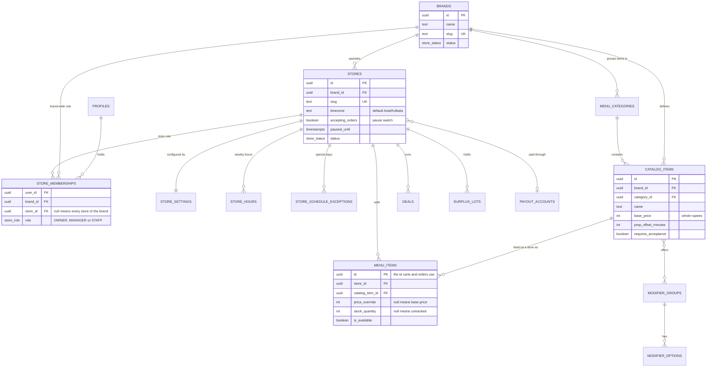

**Ordering, payments and money**

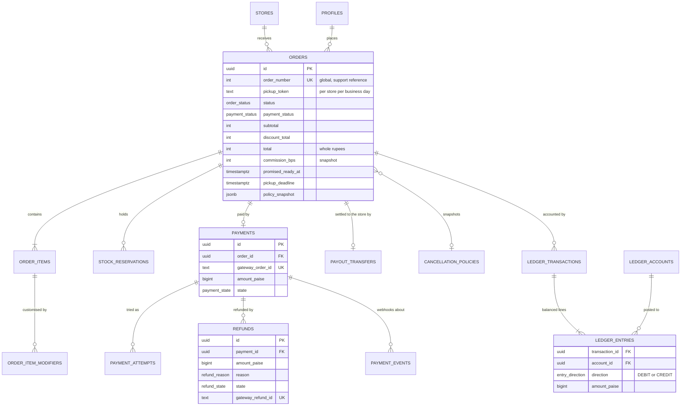

**Engagement and operations**

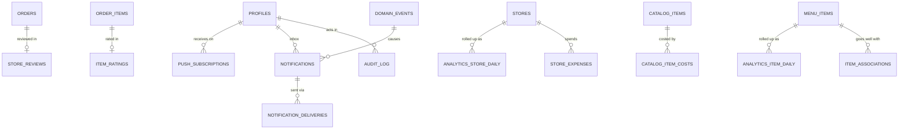

Money: menu and order amounts stay in **whole rupees** (`integer`), as today, so the API contract does not change.
The payments and ledger domain uses **paise** (`bigint`), because commissions and fees are fractional. Only one
module, `server/src/utils/money.ts`, converts between the two (ADR-004). Each gateway adapter converts paise to its
provider's own unit.

### Key flows

**Checkout to confirmed order.** It is designed in detail in [P5.3](#p53-checkout-v2).

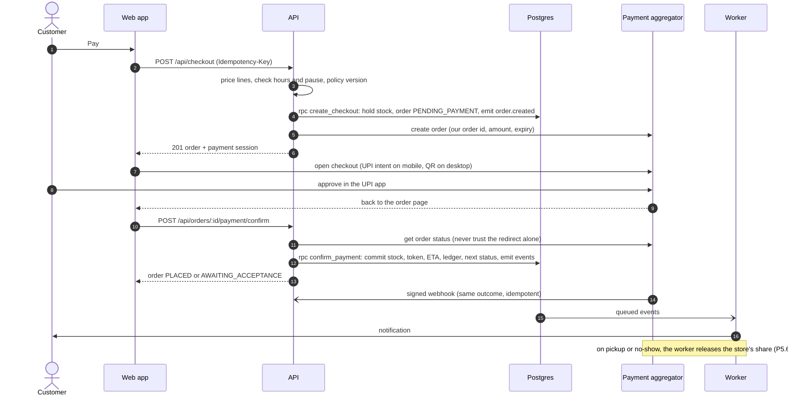

**Every side effect goes through the outbox.** It is designed in detail in
[P1.2](#p12-background-jobs-outbox-queues-and-scheduler).

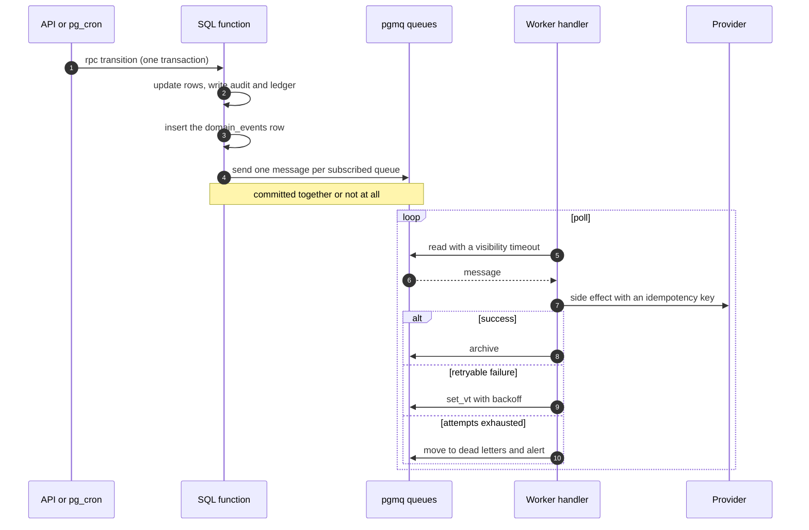

**Where the money sits** (R4). It is compared in [P4.4](#p44-money-model-options) and designed in detail in
[P5.6](#p56-ledger-and-escrow).

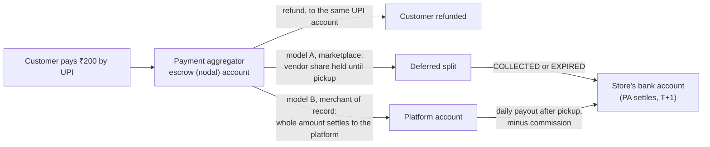

The PDF's "money is stored with us" (R4) has two lawful shapes, and P4 chooses between them with a CA and counsel:

- **Model A: a marketplace.** The money is held **in the aggregator's escrow**, and the store's share is released
  on pickup through a split-with-hold feature. RBI's 2025 Payment Aggregator Directions expect a marketplace to
  leave sellers' money with the PA, not in its own bank account.
- **Model B: merchant of record.** The platform is the seller. The money is its own revenue, and it pays restaurants
  as suppliers after pickup.

In both models, money goes back to a customer only as a **refund through the aggregator's API, to the original UPI
account**, never as a separate transfer.

### Configuration model

| Tier           | Where it lives                                                                                | Who changes it                              | Examples                                                                              |
| -------------- | --------------------------------------------------------------------------------------------- | ------------------------------------------- | ------------------------------------------------------------------------------------- |
| Environment    | env vars read only by `server/src/utils/env.ts`; client runtime env (`/runtime-env.js`, P0.6) | deploy pipeline, from Secrets Manager / SSM | ports, origins, keys, `PUBLIC_READ_TTL_MS`, `TRUST_PROXY_HOPS`, `PAYMENT_PROVIDER`    |
| Site settings  | the `site_settings` row (typed columns with check constraints)                                | platform admin (`/admin`)                   | reservation TTL, poll intervals, default commission, refund speed, min client version |
| Store settings | the `store_settings` row per store (typed, bounded)                                           | store owner or manager (`/manage`)          | max quantity per item, acceptance timeout, pickup window, SLA buffer, ETA parameters  |
| Feature flags  | `feature_flags` rows (key, enabled, rules for stores, roles and percent)                      | platform admin                              | `multi_store_ui`, `real_payments`, `acceptance_flow`, `pickup_qr`, `recommendations`  |

Reads go through one function per tier (`env`, `getSettings()`, `getStoreSettings(storeId)`, `isEnabled(flag, ctx)`),
each cached like the existing settings read, and every write invalidates its cache key. The client gets what it needs
from the API: store rules come with the menu, and global config and flags from `GET /api/config`. The full list is in
[A2](#a2-settings-registry).

### Roles and permissions (target)

| Role                          | Stored in                                     | Scope                  | Can                                                                                                               |
| ----------------------------- | --------------------------------------------- | ---------------------- | ----------------------------------------------------------------------------------------------------------------- |
| anonymous                     | –                                             | –                      | browse stores and menus, register, sign in                                                                        |
| `CUSTOMER`                    | `profiles.role` (default)                     | own data               | order, pay, cancel by policy, track, review own orders                                                            |
| `STAFF`                       | `store_memberships.role`                      | one store              | order board, accept/reject, status changes, pickup verification, stock (when the store allows it)                 |
| `MANAGER`                     | `store_memberships.role`                      | one store              | everything staff can, plus menu listings, stock, deals, hours, pause, policy, settings, analytics, team           |
| `OWNER`                       | `store_memberships.role` with `store_id` null | every store of a brand | everything a manager can at every branch, plus the brand catalog, payout account, brand analytics                 |
| `ADMIN` (platform)            | `profiles.role`                               | whole platform         | onboarding, site settings, flags, support views (read-only across stores), refunds console, reconciliation, audit |
| worker / reconciler / webhook | process identity (service key)                | system                 | the transitions their jobs own; every write audited with `actor_type`                                             |

Rules carried over:

- The role always comes from the database, never from the token (CLAUDE.md §10).
- Another store's orders answer 404.
- `ADMIN` gets no kitchen powers. Support actions an admin can take (a manual refund, suspending a store) are
  explicit, audited endpoints ([P7.4](#p74-platform-admin-dashboard)).

The legacy `profiles.role = 'STAFF'` is migrated to memberships in [P2.2](#p22-memberships-and-store-roles).

### Architecture decisions

Each of these is written up in P0.8 as an ADR in `docs/adr/` (context, options, decision, consequences).

| ADR | Decision                                                                                                                                                                                                                                                                                                                                                                                                                                                             | Main alternative rejected, and why                                                                                                                                                                                |
| --- | -------------------------------------------------------------------------------------------------------------------------------------------------------------------------------------------------------------------------------------------------------------------------------------------------------------------------------------------------------------------------------------------------------------------------------------------------------------------- | ----------------------------------------------------------------------------------------------------------------------------------------------------------------------------------------------------------------- |
| 001 | Brands own stores (branches). A brand catalog feeds per-store listings (price override, stock, availability). Store roles are memberships                                                                                                                                                                                                                                                                                                                            | Per-store menus only: every chain edit becomes N edits, and cross-branch analytics has no key                                                                                                                     |
| 002 | Background work: transactional outbox into **pgmq** queues in the existing Postgres, a Node worker, and **pg_cron** for time triggers                                                                                                                                                                                                                                                                                                                                | BullMQ/Redis or SQS: a dual write (commit, then enqueue) plus new infrastructure                                                                                                                                  |
| 003 | The payment aggregator and money model are **chosen on evidence in P4**. The proposal is Cashfree with Easy Split and 0% UPI in writing, with a fallback ladder. Every design choice here holds for any provider: UPI intent and QR; payment captured, then refunded on rejection; server-side status plus signed webhooks as the truth; refunds via the PA API to the original method; one payout port for model A (deferred split) and model B (scheduled payouts) | Razorpay at list price (a 2% UPI platform fee, and Route needs ₹40 lakh of turnover); holding marketplace money in our own account (RBI PA Directions); returning money by separate transfer (no dispute linkage) |
| 004 | Order and menu money stays in whole rupees. Payments and ledger use paise in `bigint`. One conversion module                                                                                                                                                                                                                                                                                                                                                         | Moving everything to paise now: a breaking API change for no user benefit yet                                                                                                                                     |
| 005 | One codebase, three processes (`api`, `worker`, `reconciler`): a modular monolith                                                                                                                                                                                                                                                                                                                                                                                    | Separate repos or services per domain: network hops, and duplicated auth and scoping code                                                                                                                         |
| 006 | Media in S3 behind CloudFront on the app's own origin. Uploads by presigned POST, variants by the worker (replaces the Supabase Storage plan in CLAUDE.md §9)                                                                                                                                                                                                                                                                                                        | Supabase Storage: the roadmap asks for S3, and the CDN and hosting are on AWS anyway                                                                                                                              |
| 007 | Pilot on EC2 with docker compose behind ALB + CloudFront, images in ECR, deploys via SSM. Kubernetes (EKS) only after a measured gate                                                                                                                                                                                                                                                                                                                                | Kubernetes first: the operational cost arrives before any load justifies it                                                                                                                                       |
| 008 | Semantic versioning per package from committed change-intent files, applied by a bump script at release                                                                                                                                                                                                                                                                                                                                                              | Bumping in every PR: version-line merge conflicts between parallel branches                                                                                                                                       |
| 009 | Rate limiting: in-process token buckets (switchable to Redis) plus DB-enforced business limits, with WAF rules at the edge                                                                                                                                                                                                                                                                                                                                           | IP-only limits: campus Wi-Fi puts thousands of students behind a handful of NAT IPs                                                                                                                               |
| 010 | Live updates: keep polling with ETags, and add Web Push for the moments that matter. SSE only if load tests show polling cost                                                                                                                                                                                                                                                                                                                                        | WebSockets now: a new stateful component for a need polling already meets                                                                                                                                         |

## P0 — Foundations and guardrails

**Goal:** every later change is gated, versioned, configurable and containerised. **Items:** R3 (start), R6, R8, R9
(lint, build, perf), R16. **Depends on:** nothing. **Size:** M.

### P0.1 Toolchain pinning

- [ ] Add `.node-version` containing the active LTS major (`24` today; move to `26` once it enters LTS in October
      2026). fnm and nvm both read it, and CI reads it through `actions/setup-node`'s `node-version-file`.
- [ ] Add `"engines": { "node": ">=24" }` to `client/package.json` and `server/package.json`.
- [ ] Add a root `package.json` (`"private": true`, no dependencies) for repository-level scripts only: `change`,
      `release` and `release:dry` from P0.3, and `check:bundle` from P0.2. It is not a workspace root; each package
      keeps its own lockfile.
- [ ] README prerequisites: "Node from `.node-version` (`fnm use` or `nvm use`)".

**Done when** a fresh clone picks the pinned version via `fnm use` and CI builds with the same major.

### P0.2 Continuous integration

GitHub Actions, one workflow per concern. Every job is required on pull requests to `main`; turning on branch
protection is a **(user)** step.

| Workflow       | Trigger                                                           | Jobs                                                                                                                                                                                                                                                                                                                                                                                                                                        |
| -------------- | ----------------------------------------------------------------- | ------------------------------------------------------------------------------------------------------------------------------------------------------------------------------------------------------------------------------------------------------------------------------------------------------------------------------------------------------------------------------------------------------------------------------------------- |
| `ci.yml`       | every PR, and pushes to `main`                                    | `client`: `npm ci`, typecheck, lint, `format:check`, test, `build:staging`, bundle budget. `server-static`: `npm ci`, typecheck, lint, `format:check`, build. `server-tests`: Supabase CLI, `supabase start` (without the services the tests do not use, such as Studio, Storage and Realtime), `cp .env.example .env`, seed, `npm test`. `migrations`: append-only and ordering checks, and generated-types drift. `version-intent` (P0.3) |
| `perf.yml`     | PRs touching `client/**`, and nightly                             | Lighthouse CI on the preview build against the CI stack: `/` and a store menu at 360×640, Slow 4G, 4× CPU, three runs, median                                                                                                                                                                                                                                                                                                               |
| `security.yml` | PRs, and weekly                                                   | `npm audit --omit=dev --audit-level=high` per package, gitleaks secret scan, CodeQL (GitHub default setup)                                                                                                                                                                                                                                                                                                                                  |
| `docker.yml`   | PRs touching a Dockerfile, `client/**` or `server/**` (from P0.6) | build both images without pushing, `hadolint`, and a Trivy scan (warn at first, then fail on HIGH/CRITICAL)                                                                                                                                                                                                                                                                                                                                 |

**LLD details**

- **Concurrency.** `concurrency: { group: ci-${{ github.ref }}, cancel-in-progress: true }`, so a new push cancels
  the old run.
- **Caching.** `actions/setup-node` caches npm, keyed on each lockfile.
- **Supabase in CI.** `supabase/setup-cli` runs the same `server/supabase/config.toml` as local, so the test-target
  guard sees `APP_ENV=local` and a `127.0.0.1` URL and runs every suite. `run-lock.ts` needs nothing extra, because
  one job runs one test process.
- **Generated-types drift.** Run `supabase gen types typescript --local > src/types/database.ts`, then
  `git diff --exit-code`. It fails when a migration landed without `npm run db:types`.
- **Append-only migrations.** `git diff --name-status origin/main...HEAD -- server/supabase/migrations/` may contain
  only `A` (added) rows, and every added file's timestamp must sort after the newest one on `main`. This enforces
  CLAUDE.md §2 mechanically. It also catches the silent out-of-order case that `merge-conflict-resolver` looks for.
- **Bundle budget.** `scripts/ci/check-bundle.mjs` reads `client/dist/.vite/manifest.json` (turn on
  `build.manifest` in `vite.config.ts`). It takes the entry chunk plus its static imports (the modulepreload set),
  gzips each at level 9, sums them, and compares the total with `client/perf-budget.json` (`{ "initialJsGzipKb": 170 }`).
  The budget lives in a file, not in the script. It prints a table and exits 1 when over. Lazy chunks are listed for
  information only.
- **Lighthouse CI.** `client/lighthouserc.json` sets `formFactor: mobile`, a 360×640 screen,
  `throttling: { rttMs: 150, throughputKbps: 1638, cpuSlowdownMultiplier: 4 }` and `numberOfRuns: 3`. Assertions:
  LCP ≤ 2500 ms and CLS ≤ 0.1 are errors, and total blocking time ≤ 200 ms is a warning (it stands in for INP, which a
  lab run cannot measure). Every assertion starts as a warning for the first two weeks while CI noise is calibrated.
  `docs/PERF_BASELINE.md` (owned by `perf-auditor`) records the CI numbers next to the manual ones.
- **Dependencies.** `.github/dependabot.yml` covers npm in `client/` and `server/`, GitHub Actions and Docker,
  weekly and grouped by minor/patch.
- **Load tests** join CI in [P9.1](#p91-load-testing-from-100-to-1000-concurrent) (a k6 smoke run on PRs, full runs
  on a schedule).

**Done when** a PR that breaks lint, types, a test, the build, the bundle budget, migration order or the generated
types cannot merge, and the whole `ci.yml` run takes under 15 minutes.

### P0.3 Semantic versioning with change intents

R8 asks for semantic versions for the frontend and backend, where Claude stores each change's version increment in
a temp file and a script applies the bump.

**Design**

- **Versions.** `client/package.json` and `server/package.json` keep independent semver lines. They are at `0.1.0`
  today, and both go to `1.0.0` at the pilot launch ([P9.5](#p95-launch-checklist-and-runbooks)).
- **The temp store.** It is the `.changes/` folder: one small committed file per change, consumed and deleted by the
  release script. One file per change, rather than one shared file, means two parallel branches never conflict on
  the same lines. This is the Changesets pattern without its workspace requirement.

  ```md
  ---
  client: minor
  server: patch
  ---

  Store list and per-store menus behind the multi_store_ui flag.
  ```

- **Level rules.** They go into CLAUDE.md in a new "Versioning" section:

  | Package | major                                                                                                                                                   | minor                                                                    | patch                                    |
  | ------- | ------------------------------------------------------------------------------------------------------------------------------------------------------- | ------------------------------------------------------------------------ | ---------------------------------------- |
  | server  | a breaking contract change for the deployed client (a field removed or renamed, a changed meaning or error code); should not happen, given CLAUDE.md §2 | a new endpoint, field, error code, setting or migration adding behaviour | a fix, performance, refactor, logging    |
  | client  | a removed route, or persisted storage (`fp_cart`, `fp_cache`) reset without a migration                                                                 | a new user-visible feature or screen                                     | a fix, copy, style or performance change |

  Docs-only changes need no intent.

- **How Claude records it.** When a change touches `client/src`, `server/src`, `server/scripts`,
  `server/supabase/migrations` or a `package.json`, Claude runs
  `npm run change -- --client minor --server patch "summary"` before finishing. Three places enforce this:
  - a CLAUDE.md rule;
  - an added step at the end of `/post-change` (record the intent if one is missing);
  - `.claude/hooks/major-change-gate.js`, which reminds once per set of files when source changed but no new
    `.changes/*.md` exists.
- **Scripts** (Node, no dependencies), in `scripts/version/`:
  - `change.mjs` writes `.changes/<yyyymmdd>-<random-words>.md` and validates the levels.
  - `release.mjs` reads every intent, takes the highest level per package (major > minor > patch), and runs
    `npm version <level> --no-git-tag-version` in each package, which updates `package.json` and
    `package-lock.json`. It prepends `## <version> — <date>` with the summaries to `client/CHANGELOG.md` and
    `server/CHANGELOG.md`, deletes the consumed files, and writes `release.json` with the tags to create
    (`client-v0.4.0`, `server-v0.5.3`). `--dry-run` only prints the plan. Before 1.0.0 it refuses a `major` without
    `--allow-major`, because a major is a red flag under the backward-compatibility rule.
  - `check.mjs` is the CI job: it fails when package source changed without a new intent file, unless the PR has the
    `no-release` label.
- **When the bump happens.** At release time, never in each PR: the CD workflow on `main`
  ([P8.5](#p85-continuous-deployment)) runs it, or the user runs `npm run release`. Claude never commits or tags
  (CLAUDE.md §12).
- **At runtime.** The versions are visible (P0.7): `GET /api/health` returns the server version, and the client sends
  `X-Client-Version` and shows its version in Profile.

**Steps**

- [ ] Add `.changes/README.md` (the format and the level rules), the three scripts, and the root `package.json`
      scripts.
- [ ] Add the CLAUDE.md "Versioning" section, the `/post-change` step and the reminder in `major-change-gate.js`,
      with its `--self-test` extended for the new check.
- [ ] Add the `version-intent` CI job.
- [ ] Record the first intent for P0 itself.

**Done when** two branches that both record intents merge without conflict, and `npm run release:dry` shows one
combined bump per package.

### P0.4 Configuration registry and no hardcoding

**Policy (R3).** It goes into CLAUDE.md §11 and the new `docs/CONFIGURATION.md`:

- **Business rules and operational limits** (quantities, windows, timeouts, thresholds, fees, intervals) live in
  site or store settings, with a default and bounds.
- **Deployment values** (ports, URLs, keys, TTLs, trust-proxy hops) are environment variables, read through
  `utils/env.ts` on the server and runtime env on the client (P0.6).
- **Presentation constants** (animation milliseconds, layout pixels, design tokens, regexes, storage key names) stay
  as named constants next to their use. They are not "hardcoding" under this policy.
- **Seed and demo data** live in fixture files, not code.
- **The client never mirrors a server rule.** It reads the rule from the API. The one allowed copy is
  `client/src/config/fallbacks.json`, used only for the very first paint, and a test keeps it equal to the server's
  defaults.

**Design**

- **`GET /api/config`** (public; `cached('config')`; the client uses `useResource({ key: 'config', persist: true })`
  through a new `useConfig()`) returns:

  ```ts
  interface ConfigDto {
    serverVersion: string;
    minClientVersion: string;
    features: Record<string, boolean>; // flags marked client_visible (P1.7)
    payment: { provider: string; publicKey: string | null } | null; // the P4 choice, or 'fake'; P5
    limits: {
      maxLinesPerOrder: number;
      nameMaxLength: number;
      noteMaxLength: number;
      phoneDigits: { min: number; max: number };
      password: { min: number; max: number };
    };
    polling: { orderMs: number; ordersMs: number; staffBoardMs: number };
    session: { idleDays: number };
  }
  ```

  It loads in parallel with the page's own data (no waterfall). Until it arrives, and on the first visit only, the
  client uses the fallbacks.

- **Store rules travel with the menu.** `MenuResponse.rules = { maxQuantityPerItem, lowStockThreshold }` is an
  additive field. That covers the cart without an extra request, and these rules become per-store in P2.3.
- **Polling is server-driven.** Order and list responses carry `pollAfterMs` (additive), and the client's
  `pollInterval` uses it, falling back to config. The server can then back off under load without shipping a client.
- **Two bounds for each configurable limit.** zod keeps a fixed sanity bound (for example, at most 100 lines, to cap
  payloads). The configurable business bound (`max_lines_per_order`) is enforced in the service with the same
  `VALIDATION_ERROR` message style. The schema stays static and the business rule stays editable.
- **Settings storage.** New typed `site_settings` columns with check constraints, matching the existing pattern
  (schema-guard: prefer a column to a new table). `store_settings` arrives in P2.3.

**Steps**

- [ ] Migration: add `max_lines_per_order` (30, 1–100), `order_poll_ms` (4000), `orders_poll_ms` (8000),
      `staff_board_poll_ms` (4000), all bounded to 2000–60000, plus `session_idle_days` (7, 1–90) and
      `min_client_version` (`'0.0.0'`). Then `db:types`, the serializer, and `SiteSettingsDto` plus the admin form
      fields.
- [ ] Add `GET /api/config` (route, controller, service, cache key, invalidated by `updateSettings`). Add the
      `useConfig()` hook and `client/src/config/fallbacks.json`, plus a server test comparing the served defaults
      with that file.
- [ ] Move every [A1](#a1-hardcoded-values-inventory) row to its destination. Each one is a small PR with its tests.
- [ ] Move the seed data to `server/scripts/seed-data/*.json`, validated with zod at load. Seeding behaviour does not
      change.
- [ ] Read ports from env: `vite.config.ts` proxies to `VITE_API_PROXY_TARGET` (default `http://localhost:8000`), and
      `start.sh` reads `PORT` from `server/.env`. The defaults live in the `.env.example` files only.
- [ ] Lint guard: ESLint `no-magic-numbers` scoped to `server/src/services/**`, `server/src/domain/**` and
      `client/src/features/**/*Rules.ts` (ignore `0`, `1`, `-1` and `100`, plus default values). Add a CI check that
      fails on duration-looking literals (`\b\d+_000\b`) in those paths.
- [ ] Write `docs/CONFIGURATION.md` (the registry: key, tier, type, default, bounds, reader, editor) and add its row
      to CLAUDE.md §6.

**Done when** every A1 row is resolved, the parity test and lint guard run in CI, and changing a setting in `/admin`
changes the behaviour with no deploy.

### P0.5 Error logging clean-up

R6. The logging base is already good (`docs/LOGGING.md`). This step makes errors classifiable and traceable across
processes, and brings client-side crashes into view.

- [ ] **Error classes** in `server/src/utils/errors.ts`:
  - `AppError`: expected, 4xx (existing).
  - `IntegrationError`: `provider`, `operation`, `retryable`, `cause`. It maps to 503 `UPSTREAM_UNAVAILABLE`, or
    502 `PAYMENT_UNAVAILABLE` for the gateway.
  - `InvariantError`: a programmer error. It answers 500 and logs at `error` with `invariant: true`.

  The `errorHandler` maps all three, and still logs each failure once.

- [ ] **Log shape.** `err` carries the cause chain (pino's `errWithCause` serializer). Every line carries `route`,
      `code`, `status`, and `userId` and `storeId` (ids only). The worker (P1.2) logs `jobId`, `eventId`,
      `eventType`, `queue` and `attempt` the same way. Nothing personal goes into message strings (existing rule).
- [ ] **Redaction.** Add the gateway's signature and checksum fields (`signature`, `checksum`, `x-verify` and the
      like, named once P4 picks the provider), `key_secret`, `webhookSecret`, `vpa`, `pickupCode`,
      `customerPhone`, `customer_phone` and outgoing `authorization` headers to `REDACT_PATHS`, with cases in
      `logging.safe.test.ts`.
- [ ] **Client error reporting** (no new dependency). `client/src/lib/errorReporter.ts` listens to `error`,
      `unhandledrejection`, `PageBoundary` and a new root `AppErrorBoundary`. It sends a batch to
      `POST /api/client-errors`: at most 5 per page load and 4 KB each, sampled by a site setting, with query strings
      and anything token-like stripped, and with `X-Client-Version` and the route. The server validates the report,
      caps it (rate-limited properly once P1.6 lands), and logs `warn` `Client error`.
- [ ] Update `docs/LOGGING.md` with the error classes, the client reporting path and the job log fields.

**Done when**

- an upstream failure logs once, with its cause chain, and answers the 503 envelope;
- a thrown render error on a phone appears in the server log with the client version, the route and a stack;
- a test proves that none of the new secret or PII keys reaches output.

Sentry is an option, but it adds a runtime host (CLAUDE.md §9) and about 25 KB gzip; see
[Decisions needed](#decisions-needed).

### P0.6 Docker images and local compose

R16: the frontend and backend each get their own image.

**`server/Dockerfile`** (one image; the command picks the process)

```dockerfile
FROM node:24-alpine AS deps
WORKDIR /app
COPY package.json package-lock.json ./
# The supabase CLI devDependency downloads a binary in postinstall; the build does not need it.
RUN npm ci --ignore-scripts

FROM deps AS build
COPY . .
RUN npm run build

FROM node:24-alpine AS runtime
ENV NODE_ENV=production
WORKDIR /app
COPY package.json package-lock.json ./
RUN npm ci --omit=dev --ignore-scripts && npm cache clean --force
COPY --from=build /app/dist ./dist
USER node
EXPOSE 8000
HEALTHCHECK CMD wget -qO- http://127.0.0.1:8000/api/health || exit 1
CMD ["node", "dist/src/server.js"]
```

`worker` and `reconciler` use the same image with `command: ["node", "dist/src/worker.js"]` (and
`dist/src/reconciler.js`). When `sharp` arrives (P3.3), its install scripts must run for the platform binary, so drop
`--ignore-scripts` for it or use `npm rebuild sharp`.

**`client/Dockerfile`** (build once, promote the same image to staging and production)

- **Stage 1:** `node:24-alpine`, `npm ci`, `vite build`. The Supabase values are not baked in (see runtime env
  below).
- **Stage 2:** `nginxinc/nginx-unprivileged:alpine`, serving `dist/` with `client/nginx/default.conf.template`:
  - `try_files $uri /index.html` (SPA fallback);
  - `location /api/ { proxy_pass ${API_UPSTREAM}; }` (same-origin API, so the browser needs no CORS);
  - the cache headers already planned in DEPLOYMENT.md: `/assets/*` gets `public, max-age=31536000, immutable`,
    `index.html` gets `no-cache`, and `/images/*` gets a week;
  - gzip on;
  - security headers: CSP with `default-src 'self'` plus the hosts CLAUDE.md §9 allows, `X-Content-Type-Options`,
    `Referrer-Policy`, and a `Permissions-Policy` with `camera=(self)` for the staff QR scanner.
- **Runtime env.** On container start, `client/nginx/runtime-env.sh` writes `/runtime-env.js`
  (`window.__RUNTIME_ENV__ = { SUPABASE_URL, SUPABASE_PUBLISHABLE_KEY, LOG_LEVEL }`). `index.html` loads it as a
  classic `<script src>` before the module bundle: it is same-origin, about 200 bytes and never blocks the bundle
  download. `lib/supabase.ts` and `lib/logger.ts` read `window.__RUNTIME_ENV__` first and then `import.meta.env`.
  Development keeps `client/.env.<mode>` through an empty `client/public/runtime-env.js`. `vite.config.ts` keeps its
  "missing variables" check for `vite` and `build` modes that are not container builds.

**`compose.yaml`** (repository root, production-like local runs)

- **Services:** `web` (port 8080), `api`, and later `worker`, `reconciler` and `minio` (P3.3).
- **Supabase** stays `supabase start` on the host, and the containers reach it at `host.docker.internal:54321`
  (`extra_hosts: ["host.docker.internal:host-gateway"]` on Linux).
- **Day-to-day development** keeps `./start.sh`, for Vite HMR and `tsx watch`. Compose is for end-to-end, load and
  failure tests.

**Steps**

- [ ] Add both Dockerfiles, their `.dockerignore`s, the nginx template and entry script, and runtime env in
      `lib/supabase.ts` and `lib/logger.ts` (with a unit test for the precedence).
- [ ] Add `compose.yaml` and the `docker.yml` CI job.
- [ ] Update `docs/DEPLOYMENT.md`: replace "Future: Docker + nginx" with a "Containers" section, and add a README
      line.

**Done when**

- `docker compose up web api` serves the app on `http://localhost:8080` against local Supabase;
- the README demo script passes there;
- both images run as non-root with passing health checks;
- the web image is under 50 MB and the server image under 200 MB.

### P0.7 Health, readiness and client version

- [ ] **Health and version.** `GET /api/health` returns `{ ok: true, version, commit }` (additive). The version is
      read from `package.json` at build time, and the commit comes from the `GIT_COMMIT` build argument.
- [ ] **Readiness.** `GET /api/ready` checks one cheap database round trip with a 1 s timeout. It answers 200
      `{ ready: true }`, or 503 when the database cannot be reached. The load balancer checks this endpoint; liveness
      stays `/health`, so a database blip never restarts containers.
- [ ] **Keep-alive.** `server.keepAliveTimeout` is 65 s and `headersTimeout` 66 s (both env, with defaults). They
      must exceed the ALB's 60 s idle timeout, or the load balancer reuses closed sockets and returns sporadic 502s.
- [ ] **Client version.** Vite `define` injects `__APP_VERSION__` and `__APP_COMMIT__`. `services/api.ts` sends
      `X-Client-Version` on every request, and Profile shows the version.
- [ ] **Client-version gate.** Middleware reads `X-Client-Version`; a missing header counts as the legacy `0.1.0`. It
      compares that with `site_settings.min_client_version` and answers 426 `CLIENT_OUTDATED`: "A new version of Food
      Pickup is available. Refresh the page to continue." The deployed client already shows server messages as they
      are, so even a V0 tab says the right thing. It exempts `/health`, `/ready`, `/config` and webhooks. From here
      on, any release the old client cannot survive ships with a `min_client_version` bump.
- [ ] **Defensive rendering.** `STATUS_META[status] ?? FALLBACK_STATUS_META`, and the same for every enum-keyed map,
      so an unknown future value renders as a neutral "Updating…" instead of crashing.
- [ ] **Access lines** carry `clientVersion` (pino-http `customProps`).

**Done when**

- raising `min_client_version` makes an older build show the refresh message;
- `/api/ready` answers 503 while local Supabase is stopped, and `/api/health` still answers 200;
- Profile shows the version.

### P0.8 Architecture decision records

- [ ] Add `docs/adr/0000-template.md` (context, options, decision, consequences, status), and write ADR-001 to ADR-010
      from [Architecture decisions](#architecture-decisions) with status `Proposed`.
- [ ] Add a CLAUDE.md §6 row: "a decision worth recording → `docs/adr/NNN-title.md`" (with
      `agent-skills:documentation-and-adrs`).
- [ ] The user reviews them: each ADR moves to `Accepted`, or is amended.

**Done when** all ten ADRs are accepted or amended, and every later phase links to the ADRs it depends on.

## P1 — Platform core

**Goal:** give every later feature the shared machinery it needs: background jobs, audit, idempotency, snapshots,
rate limits and flags. **Items:** R23, R27, R28 (engine), R33 (v1). **Depends on:** P0. **Size:** L.

### P1.1 Error details and codes

Today `AppError.details` can only be `ItemErrorDetails`. Later phases need details for payments, policies, rate
limits and pickups.

- [ ] Widen `AppError.details` to a discriminated union, and mirror it in `client/src/types/api.ts`. The shape stays
      `details?`, and existing item errors keep exactly today's fields, so the change is compatible.

  ```ts
  type ErrorDetails =
    | { kind?: 'item'; menuItemId: string; name?: string; available: number } // today's shape, unchanged
    | { kind: 'rateLimit'; retryAfterSeconds: number }
    | { kind: 'policy'; policyVersion: number; refundPercent: number }
    | { kind: 'order'; orderNumber: number; status: string }
    | { kind: 'checkout'; expiresAt: string };
  ```

- [ ] Add each new code to `ErrorCode` as its phase lands (the list is in [A3](#a3-new-error-codes)), each with a
      factory in `utils/errors.ts` and a row in `docs/API.md`'s error table.

**Done when** `errorHandler` passes any details kind through untouched and the client narrows on `kind`.

### P1.2 Background jobs: outbox, queues and scheduler

R28 needs asynchronous work for notifications, analytics, expired holds and pickups, reconciliation, refund retries
and recommendations. ADR-002 chooses three pieces:

- **pgmq** (Supabase Queues) inside the existing Postgres, so that enqueuing is part of the same transaction as the
  state change;
- **a Node worker process** to consume the queues;
- **pg_cron** (Supabase Cron) for time-based triggers.

Nothing is added outside Supabase. Verify that both extensions are available on the Supabase plan tier and in the
local CLI stack before starting.

**Schema**

```sql
create extension if not exists pgmq;     -- check Supabase's docs for the schema each extension must live in
create extension if not exists pg_cron;

-- The durable event log: audit trail, replay source, analytics input.
create table public.domain_events (
  id uuid primary key default gen_random_uuid(),
  type text not null,                     -- 'order.ready'
  aggregate_type text not null,           -- 'order'
  aggregate_id uuid not null,
  store_id uuid references public.stores (id),
  payload jsonb not null,
  actor jsonb,                            -- { "type": "USER" | "WORKER" | ..., "id": uuid }
  request_id text,
  occurred_at timestamptz not null default now()
);
create index domain_events_aggregate_idx on public.domain_events (aggregate_type, aggregate_id, occurred_at);
create index domain_events_type_occurred_idx on public.domain_events (type, occurred_at);

-- Fan-out: an event type goes to every subscribed queue (pgmq is point-to-point).
create table public.event_subscriptions (
  event_type text not null,               -- 'order.ready', or a family such as 'order.*'
  queue_name text not null,
  primary key (event_type, queue_name)
);

-- Dead letters, for the admin console.
create table public.job_failures (
  id bigint generated always as identity primary key,
  queue_name text not null,
  message jsonb not null,
  attempts integer not null,
  last_error text not null,
  failed_at timestamptz not null default now(),
  resolved_at timestamptz,
  resolved_by uuid references public.profiles (id) on delete set null
);
```

- **`emit_event(p_type, p_aggregate_type, p_aggregate_id, p_store_id, p_payload, p_actor, p_request_id)`**
  inserts the `domain_events` row. It then calls `pgmq.send()` once for every queue subscribed to the exact type or to
  its family. Every transition function calls it before returning, so the state change and its events commit
  together or not at all.
- **Queue wrappers.** `queue_read(p_queue, p_vt_seconds, p_qty)`, `queue_archive(p_queue, p_msg_id)`,
  `queue_retry(p_queue, p_msg_id, p_delay_seconds)` (via `pgmq.set_vt`) and
  `queue_dead_letter(p_queue, p_msg_id, p_error)` are `security definer` functions with `search_path = ''`, and
  `EXECUTE` goes to `service_role` only. That follows the existing lockdown rather than exposing the `pgmq_public`
  schema.
- **Queues** are created in the migration: `q_notifications`, `q_analytics`, `q_payments`, `q_media`,
  `q_recommendations`, `q_reconciliation` and `q_maintenance`.

**Worker** (`server/src/worker.ts` plus `server/src/jobs/*.ts`)

```ts
interface JobHandler<T> {
  queue: QueueName;
  concurrency: number; // env WORKER_CONCURRENCY_<QUEUE>, with a default
  visibilityTimeoutSec: number; // longer than the slowest expected run
  maxAttempts: number; // then dead-letter
  handle(message: QueueMessage<T>, ctx: JobContext): Promise<void>; // throws RetryableError | PermanentError
}
```

- **The loop, per queue.** Read a batch. When the queue is empty, back off from 1 s to 5 s. Each message is handled
  with a child logger that carries `jobId`, `eventId`, `eventType`, `queue` and `attempt`. Then:
  - on success, `queue_archive`;
  - on a retryable error, `queue_retry`, with a delay of `min(max, base × 2^(attempt−1))` ±20% jitter (base 5 s,
    max 15 min, per handler);
  - on a permanent error or the last attempt, `queue_dead_letter` plus one `error` log line.

  It logs once at that boundary and never logs and rethrows (CLAUDE.md §19).

- **Delivery is at least once.** Handlers must be idempotent through natural unique keys: one notification per
  (event, user, channel), one refund per (order, reason), and gateway calls carry our own reference and are looked up
  before any retry. A small `event_handled (event_id, handler)` table lets a handler skip cheaply, but it is only an
  optimisation, never the guarantee.
- **Operations.**
  - SIGTERM stops reading and waits for in-flight messages.
  - `GET :WORKER_HEALTH_PORT/health` reports the last successful poll per queue.
  - Metrics: processed, failed and dead-lettered counts, handler duration, and queue depth and oldest-message age
    (from `pgmq.metrics`).
- **Local development.** `start.sh` starts the worker next to the API with `npm run dev:worker`
  (`tsx watch src/worker.ts`). CLAUDE.md §18 lists it as a long-running process.

**Scheduler (pg_cron)**

- **Registered by migrations**, for example
  `select cron.schedule('expire-holds', '* * * * *', $$select public.expire_holds()$$)`. Each schedule either calls
  a SQL transition function (for work that needs no external call) or enqueues a message (for work that does, such
  as reconciliation).
- **Testable time.** Every time-based SQL function takes `p_now timestamptz default now()`. Tests call it with a
  chosen time instead of sleeping or back-dating rows. `cron.job_run_details` feeds a "cron job failed" alarm
  ([P8.7](#p87-observability)).

**Job catalog (R28)** — the engine lands here; each consumer lands with its feature.

| Job                                                                                                                       | Trigger                                                                         | Runs in                                            | Idempotency key                              | Phase                                           |
| ------------------------------------------------------------------------------------------------------------------------- | ------------------------------------------------------------------------------- | -------------------------------------------------- | -------------------------------------------- | ----------------------------------------------- |
| Notifications                                                                                                             | `order.*`, `refund.*`, `review.*` events → `q_notifications`                    | worker `jobs/notify.ts`                            | (event id, user, channel)                    | [P6.3](#p63-notifications)                      |
| Analytics aggregation                                                                                                     | terminal `order.*` events mark (store, day) dirty; nightly rebuild of yesterday | worker `jobs/analytics.ts`, SQL rebuild functions  | (store, business date)                       | [P7.1](#p71-analytics-pipeline)                 |
| Expired stock holds                                                                                                       | pg_cron every minute                                                            | SQL `expire_holds()`                               | the hold row's state                         | [P5.2](#p52-order-lifecycle-v2-and-stock-holds) |
| Expired pickup windows                                                                                                    | pg_cron every minute                                                            | SQL `expire_pickup_windows()`, then payout release | the order's state                            | [P5.9](#p59-sla-breaches-and-pickup-windows)    |
| Payment reconciliation                                                                                                    | pg_cron every 10 minutes, plus nightly settlement recon                         | the `reconciler` service                           | (run type, window)                           | [P5.10](#p510-payment-reconciliation-service)   |
| Refund retries                                                                                                            | `refund.requested` → `q_payments`, with backoff                                 | worker `jobs/refunds.ts`                           | the refund id (our reference at the gateway) | [P5.7](#p57-refunds)                            |
| Recommendation updates                                                                                                    | `order.collected` (incremental), nightly rebuild                                | worker `jobs/recommendations.ts`                   | (store, day)                                 | [P7.7](#p77-recommender-v1)                     |
| Also: acceptance timeouts, SLA breach detection, payout release, media variants, deal expiry, cleanup of idempotency keys | pg_cron / events                                                                | SQL functions / worker                             | per job                                      | P5, P3                                          |

**Steps**

- [ ] Migration: the extensions, `domain_events`, `event_subscriptions`, `job_failures`, `event_handled`, the queues,
      `emit_event` and the queue wrappers, with grants to `service_role` only and RLS on.
- [ ] Worker skeleton: the loop, registry, backoff, dead-lettering, health, metrics, shutdown, plus
      `npm run dev:worker` and `start:worker`.
- [ ] A first real consumer to prove the pipe: `order.placed` → an `info` log line, with a test that places an order
      and sees the message consumed.
- [ ] Emit `order.placed` and `order.status_changed` from today's `place_order` and `update_order_status` (additive:
      only a `perform public.emit_event(...)` line in a new version of each function).
- [ ] Add `docs/JOBS.md` (new doc: queues, subscriptions, schedules, handlers, retry policy, runbook links), and CLAUDE.md
      §6, §17 and §18 updates.

**Done when**

- killing the worker mid-message redelivers the message after its visibility timeout, and it is processed exactly
  once in effect;
- a handler that always fails lands in `job_failures` after `maxAttempts`, with one `error` log line;
- a transaction that raises leaves no event behind.

### P1.3 Audit log

R27. This is the business record of who changed what, which the operational logs are not.

```sql
create type public.actor_type as enum ('USER', 'WORKER', 'RECONCILER', 'WEBHOOK', 'SCHEDULER', 'SYSTEM');

create table public.audit_log (
  id bigint generated always as identity primary key,
  occurred_at timestamptz not null default now(),
  actor_type public.actor_type not null,
  actor_id uuid,                 -- profiles.id for USER, null for system actors
  actor_role text,               -- CUSTOMER / STAFF / MANAGER / OWNER / ADMIN at the time
  store_id uuid,                 -- for per-store audit views
  action text not null,          -- 'order.status_changed', 'menu_item.price_changed', 'store.paused', ...
  entity_type text not null,
  entity_id text not null,
  changes jsonb,                 -- { field: [old, new] }, PII fields masked
  reason text,
  request_id text
);
create index audit_log_entity_idx on public.audit_log (entity_type, entity_id, occurred_at desc);
create index audit_log_store_idx on public.audit_log (store_id, occurred_at desc);
create index audit_log_actor_idx on public.audit_log (actor_id, occurred_at desc);
```

- **Append-only.** Revoke `update, delete, truncate` on `audit_log` from `service_role`, so the API can only insert,
  and add a trigger that raises on update or delete as a second guard. Verify that service_role's privileges behave
  this way on hosted Supabase.
- **Where rows come from.**
  - Transition functions take `p_actor jsonb` and `p_request_id`, and call `audit(...)` in the same transaction.
  - A generic `audit_row_change()` trigger on sensitive tables records the diff: `stores`, `store_settings`,
    `catalog_items`, `menu_items` (price, availability, stock), `store_memberships`, `cancellation_policies`,
    `site_settings`, `feature_flags` and `payout_accounts`. It reads the actor from
    `current_setting('app.actor', true)`, which the RPCs set with `set_config(..., true)`. Route every audited write
    through an RPC, so no audited change can arrive without an actor.
- **What to audit.**
  - role and membership changes;
  - store settings, hours, pause and resume;
  - menu, price and stock changes;
  - order transitions, with actor and reason;
  - cancellations, refunds and payout releases;
  - site settings and flags;
  - policy versions;
  - when staff open a customer's phone number (privacy; [P6.4](#p64-staff-dashboard-v2));
  - admin support actions.
- **Reading it.** `GET /api/admin/audit?entityType&entityId&storeId&actorId&from&to&cursor` (platform `ADMIN`), and
  `GET /api/stores/:storeId/audit` (`MANAGER`/`OWNER` of that store). Both are cursor-paginated and never cached.
- **Retention.** 13 months online. Add monthly partitions once the table passes about 10M rows, and an optional export
  to S3.

**Done when** each listed action produces exactly one audit row with its actor and request id, and an `update` on
`audit_log` fails.

### P1.4 Idempotency keys

On a flaky 3G connection, a tap that timed out may still have succeeded. Every write that creates something or moves
money must be safe to retry.

```sql
create type public.idempotency_state as enum ('IN_PROGRESS', 'COMPLETED');
create table public.idempotency_keys (
  user_id uuid not null references public.profiles (id) on delete cascade,
  scope text not null,                 -- 'checkout', 'order.cancel', 'refund.manual', ...
  key text not null check (char_length(key) between 8 and 128),
  request_hash text not null,          -- sha256 of the canonical body
  state public.idempotency_state not null default 'IN_PROGRESS',
  response_status integer,
  response_body jsonb,
  locked_until timestamptz not null,   -- lease for IN_PROGRESS
  created_at timestamptz not null default now(),
  expires_at timestamptz not null,     -- 24 h
  primary key (user_id, scope, key)
);
```

- **Middleware.** `idempotent(scope)` runs after `requireAuth` and `validate`. It requires the `Idempotency-Key`
  header on its routes and claims the row with `insert ... on conflict`:
  - an existing `COMPLETED` row with the same hash → replay the stored status and body;
  - the same key with a different hash → 422 `IDEMPOTENCY_KEY_REUSED`;
  - `IN_PROGRESS` inside its lease → 409 `REQUEST_IN_PROGRESS`;
  - `IN_PROGRESS` with an expired lease → take it over. The business write underneath must itself be idempotent,
    for example `orders.idempotency_key` is unique, so a retry finds the order the crashed attempt created.
- **Routes:** `POST /api/checkout`, payment confirm and retry, order cancel, reject and accept, manual refunds, and
  reviews.
- **Client.** `request()` gains an `idempotencyKey` option. Checkout makes one UUID per payment attempt and keeps it in
  `sessionStorage` until the attempt resolves, so a retry after a timeout reuses it.
- **Cleanup.** pg_cron deletes expired rows daily.

**Done when** two identical `POST /api/checkout` calls made at the same moment with the same key produce one order,
and the second returns the first's response.

### P1.5 Order snapshots v2

R23. Order history must never change when the restaurant edits its menu.

Today `order_items` already snapshots `name` and `unit_price`, but `selectOrders()` joins `menu_items (image_url)` for
the line photo and `stores (id, name)` for the store name, so both change later.

- [ ] **Migration: new columns.**
  - `order_items.image_url`, `order_items.category`, and later `base_unit_price`, `deal_id` and `catalog_item_id`;
  - `orders.store_name`, `orders.store_slug` and `orders.currency` (default `'INR'`);
  - `orders.subtotal` and `orders.discount_total` (0 until deals), for receipts.

  Backfill `order_items.image_url` from the current `menu_items.image_url` (the best copy left) and `orders.store_name`
  from `stores`.

- [ ] **Writers.** A new version of `place_order` writes the snapshots. Later, `create_checkout`
      ([P5.2](#p52-order-lifecycle-v2-and-stock-holds)) also snapshots modifiers, deals, policy and commission.
- [ ] **Readers.** `selectOrders()` reads the snapshot columns and drops the `menu_items (image_url)` join, which is
      also a query saving. `OrderItemDto.imageUrl` keeps its name, but its meaning becomes "the photo at order time"
      (compatible; recorded in API.md).
- [ ] **Soft delete.** Menu items are archived instead of deleted (`menu_items.archived_at`): history keeps its FK
      targets, the menu hides archived rows, and `place_order` refuses them as `ITEM_NOT_FOUND`.
- [ ] **Media lifecycle** ([P3.3](#p33-images-on-s3)) never deletes an image variant that an order line references.

**Done when** changing an item's price, name and photo, and the store's name, after an order was placed leaves that
order's API response byte-for-byte the same (tested).

### P1.6 Rate limiting and abuse protection v1

R33, first layer. Campus Wi-Fi puts thousands of students behind a few NAT addresses, so per-IP limits must be
generous, and the real limits are per user.

- [ ] **Trust proxy.** Set `app.set('trust proxy', env.TRUST_PROXY_HOPS)`: 0 locally, and the number of proxies in
      front of the API in AWS (CloudFront + ALB + nginx). `req.ip` is then the real client, and a spoofed
      `X-Forwarded-For` is ignored when the hop count is 0 (tested).
- [ ] **Limiter.** Use `rate-limiter-flexible`, with an in-memory store now and a Redis store later, chosen by
      `RATE_LIMIT_STORE=memory|redis`. It is token buckets per key, and every limit is a setting (A2):

  | Bucket                    | Key        | Default                                             |
  | ------------------------- | ---------- | --------------------------------------------------- |
  | All API requests          | IP         | 600 per minute (NAT-friendly)                       |
  | `POST /api/auth/register` | IP         | 10 per hour                                         |
  | Checkout                  | user       | 10 per minute, 60 per day                           |
  | Payment confirm and retry | user       | 30 per minute                                       |
  | Pickup-code verification  | staff user | 20 per minute, plus a lock per order after 5 misses |
  | Reviews                   | user       | 10 per day                                          |
  | `POST /api/client-errors` | IP         | 30 per minute                                       |

- [ ] **Limits in the database** where correctness matters more than speed: at most N `PENDING_PAYMENT` orders per user
      (setting `max_active_checkouts_per_user`, default 2), checked inside `create_checkout`, so nobody can hoard
      limited stock with unpaid holds.
- [ ] **Response.** 429 `RATE_LIMITED` with `Retry-After`, `RateLimit-Policy` and `RateLimit` headers, and
      `details: { kind: 'rateLimit', retryAfterSeconds }`. The server logs `warn` once per key per window, not once
      per request.
- [ ] **Failure mode.** When the limiter's store is unavailable, reads fail open and auth and money writes fail closed
      (ADR-009).

**Done when** a burst past each bucket gets 429 with correct headers, other users are unaffected, and 1000 simulated
users behind one IP stay under the IP bucket during the P9.1 load test.

The edge layer (WAF) is [P9.3](#p93-edge-protection-and-security-review).

### P1.7 Feature flags

```sql
create table public.feature_flags (
  key text primary key check (key ~ '^[a-z][a-z0-9_]{2,63}$'),
  description text not null,
  enabled boolean not null default false,
  client_visible boolean not null default false,
  rules jsonb not null default '{}',   -- { "storeIds": [...], "roles": [...], "percent": 0-100 }
  updated_at timestamptz not null default now(),
  updated_by uuid references public.profiles (id) on delete set null
);
```

- **Evaluation.** `isEnabled(key, { userId, role, storeId })` runs on the server. It checks `enabled`, then the store
  and role lists, then a stable percentage (`hash(key + userId) mod 100`). It is cached like settings, and
  invalidated on write.
- **Client.** It gets the `client_visible` flags, already evaluated for the caller, through `GET /api/config`. A
  signed-in caller's flags come from `GET /api/me/config`, which is not persisted, because it is user-specific.
- **Planned flags:**
  - `multi_store_ui` (P2)
  - `modifiers` (P3)
  - `real_payments` (per store, P5)
  - `acceptance_flow`, `cancellation_by_customer` (P5)
  - `pickup_qr`, `notifications_push` (P6)
  - `reviews`, `usuals`, `recommendations` (P7)
- **Admin.** Flags are edited through SQL until the admin console gets its flags page ([P7.4](#p74-platform-admin-dashboard)).
  Every change is audited.

**Done when** a flag limited to one store changes behaviour for that store only, and the audit log shows who flipped
it.

## P2 — Multi-store and multi-branch

**Goal:** many restaurants, some of them chains with several branches, each with its own staff, hours, stock and
settings, served by one app. **Items:** R1, R3 (store settings), R26, R31, and the role split R11 depends on.
**Depends on:** P1. **Size:** L. **Flag:** `multi_store_ui`.

### Design (HLD)

- **Brands own stores.** A **brand** is the business (and, by default, the payee). A **store** is one physical pickup
  point: a branch, with its own address, hours, pause switch, stock, staff and settings. A single café is a brand with
  one store, so today's data migrates as exactly that.
- **Roles are memberships.** Store roles move out of `profiles.role` into memberships, scoped to a store or to a whole
  brand. `profiles.role` keeps only platform-level meaning: `CUSTOMER` or `ADMIN`. `STAFF` survives for the transition
  (P2.7).
- **Every store-scoped route names its store** (`/api/stores/:storeId/...`). One middleware resolves the caller's
  memberships and permissions for that store, and every query inside goes through a scoping helper that adds
  `store_id`.
- **Legacy endpoints keep working.** `GET /api/store`, `GET /api/menu`, `POST /api/orders` and
  `PATCH /api/orders/:id/status` serve a configured default store until the contract step.

### P2.1 Brands and stores v2

```sql
create type public.store_status as enum ('DRAFT', 'ACTIVE', 'SUSPENDED', 'ARCHIVED');

create table public.brands (
  id uuid primary key default gen_random_uuid(),
  name text not null check (char_length(name) between 2 and 80),
  slug text not null unique check (slug ~ '^[a-z0-9](?:[a-z0-9-]{0,58}[a-z0-9])?$'),
  description text not null default '',
  logo_url text,
  status public.store_status not null default 'DRAFT',
  created_at timestamptz not null default now(),
  updated_at timestamptz not null default now()
);

alter table public.stores
  add column brand_id uuid references public.brands (id),
  add column slug text unique,
  add column status public.store_status not null default 'ACTIVE',
  add column timezone text not null default 'Asia/Kolkata',
  add column address_line text,
  add column area text,                              -- grouping on the discovery page ("North campus")
  add column latitude numeric(9, 6),
  add column longitude numeric(9, 6),
  add column contact_phone text,
  add column fssai_license_no text,                  -- shown on the store page; check FSSAI e-commerce rules
  add column created_at timestamptz not null default now(),
  add column updated_at timestamptz not null default now();
create index stores_brand_id_idx on public.stores (brand_id);

alter table public.site_settings add column default_store_id uuid references public.stores (id) on delete set null;
```

- **Migration order (expand).**
  1. Add the columns as nullable.
  2. Backfill: create one brand for the existing store (with its name and slug), set `stores.brand_id` and `slug`, and
     point `site_settings.default_store_id` at it.
  3. A second migration sets `brand_id` and `slug` to `not null`.
- **Public DTOs (additive).** `StoreDto` gains `slug`, `brand: { id, name, slug }`, `area`, `address`,
  `openState` (from P2.4), `nextChangeAt`, `etaMinutes` (P6.1) and `rating` (P7.5). The new
  `StoreSummaryDto` is the lean card for lists.
- **Endpoints (public, cached, persisted on the client).**
  - `GET /api/stores?area=` → `{ stores: StoreSummaryDto[] }`, cache key `stores:list`.
  - `GET /api/stores/:storeRef`, where `storeRef` is an id or a slug → `{ store }`, key `store:<id>`.
  - `GET /api/stores/:storeRef/menu` → `MenuResponse` plus `rules`, key `menu:<storeId>`.

  Every write that changes one of them invalidates its key (CLAUDE.md §2c), and each cached read ships with the test
  that fails without its invalidation, as `menu-cache.test.ts` does today.

- **Legacy.** `GET /api/store` and `GET /api/menu` return the default store's data (documented as deprecated in
  API.md, with the removal release).
- **Seed.** Two brands: one with a single café, and one chain with two branches in different areas. Also memberships,
  hours and one closed-day exception, so every P2 flow can be demonstrated.

### P2.2 Memberships and store roles

```sql
create type public.store_role as enum ('OWNER', 'MANAGER', 'STAFF');

create table public.store_memberships (
  id uuid primary key default gen_random_uuid(),
  user_id uuid not null references public.profiles (id) on delete cascade,
  brand_id uuid not null references public.brands (id) on delete cascade,
  store_id uuid references public.stores (id) on delete cascade,   -- null = every store of the brand
  role public.store_role not null,
  created_at timestamptz not null default now(),
  created_by uuid references public.profiles (id) on delete set null,
  unique nulls not distinct (user_id, brand_id, store_id)
);
create index store_memberships_user_id_idx on public.store_memberships (user_id);
create index store_memberships_store_id_idx on public.store_memberships (store_id);

create table public.store_invites (         -- invite by email or phone; accepted on the next sign-in
  id uuid primary key default gen_random_uuid(),
  brand_id uuid not null references public.brands (id) on delete cascade,
  store_id uuid references public.stores (id) on delete cascade,
  role public.store_role not null,
  email text, phone text,
  token_hash text not null unique,
  expires_at timestamptz not null,
  accepted_at timestamptz,
  created_by uuid references public.profiles (id) on delete set null,
  check (num_nonnulls(email, phone) = 1)
);
```

**Permissions** (`server/src/domain/permissions.ts`) are one capability map, the single source of truth, unit-tested
as a matrix:

| Capability                                                                          | STAFF                       | MANAGER   | OWNER (brand-wide) | Platform ADMIN |
| ----------------------------------------------------------------------------------- | --------------------------- | --------- | ------------------ | -------------- |
| `orders.view`, `orders.transition`, `pickup.verify`                                 | ✓                           | ✓         | ✓                  | view only      |
| `orders.viewCustomerPhone` (audited)                                                | ✓                           | ✓         | ✓                  | ✗              |
| `stock.update`                                                                      | when `staff_can_edit_stock` | ✓         | ✓                  | ✗              |
| `store.pause`                                                                       | ✓                           | ✓         | ✓                  | ✓ (support)    |
| `listings.edit`, `deals.edit`, `hours.edit`, `policy.edit`, `settings.edit`         | ✗                           | ✓         | ✓                  | ✗              |
| `team.manage`                                                                       | ✗                           | own store | ✓                  | ✓              |
| `catalog.edit`, `payouts.view`, `analytics.brand`                                   | ✗                           | ✗         | ✓                  | view           |
| `analytics.store`, `reviews.manage`, `audit.store`                                  | ✗                           | ✓         | ✓                  | ✓              |
| `stores.onboard`, `stores.suspend`, `settings.site`, `flags.edit`, `refunds.manual` | ✗                           | ✗         | ✗                  | ✓              |

- **Middleware.** `requireAuth` loads the profile and the memberships in one query, into `req.user.memberships`.
  `requireStore(capability)` reads `:storeId` and answers:
  - a store that does not exist → 404;
  - a caller with no capability there → 403 `FORBIDDEN` (store existence is public);
  - otherwise it sets `req.store`.

  Inside, resources of another store, such as an order id that belongs elsewhere, answer 404, never 403 (CLAUDE.md
  §10).

- **Scoping helper.** `scoped(req).from('orders')` returns a builder that already has `.eq('store_id', req.store.id)`.
  An ESLint `no-restricted-syntax` rule flags `supabaseAdmin.from('orders' | 'menu_items' | ...)` outside the service
  files that own those tables.
- **Where users land.** `homeFor(user)` sends platform admins to `/admin`, owners and managers to `/manage`, staff to
  `/staff`, and customers to `/`. With several stores, the page opens with a store switcher.
- **Team API** (`team.manage`). `GET /api/stores/:storeId/members` and `POST .../invites` (email or phone, role).
  `DELETE .../members/:membershipId`. Invites are accepted through `POST /api/me/invites/:token/accept`. Every change
  is audited, and nobody can remove the brand's last owner.

### P2.3 Store-scoped orders and settings

```sql
create type public.acceptance_mode as enum ('AUTO', 'LIMITED_ITEMS', 'ALL');   -- used from P5.5

create table public.store_settings (
  store_id uuid primary key references public.stores (id) on delete cascade,
  max_quantity_per_item integer not null default 10 check (max_quantity_per_item between 1 and 50),
  low_stock_threshold integer not null default 5 check (low_stock_threshold between 0 and 50),
  staff_order_list_limit integer not null default 100 check (staff_order_list_limit between 1 and 500),
  staff_can_edit_stock boolean not null default true,
  last_order_minutes_before_close integer not null default 15 check (last_order_minutes_before_close between 0 and 120),
  -- P5, P6 and P3.6 add their own columns (acceptance, pickup window, SLA, ETA, tokens, surplus); see A2.
  updated_at timestamptz not null default now(),
  updated_by uuid references public.profiles (id) on delete set null
);
```

- **Settings.** One row per store, created by the same transaction that creates the store. It is read through
  `getStoreSettings(storeId)` (cached per store, invalidated on write), and edited with
  `PATCH /api/stores/:storeId/settings` (`settings.edit`; zod bounds that mirror the check constraints).
- **Orders.**
  - `GET /api/stores/:storeId/orders?status=` is the new staff list, scoped and capped by
    `staff_order_list_limit`.
  - The customer's `GET /api/orders` keeps listing their own orders across stores, with an optional `storeId`
    filter.
  - `GET /api/orders/:id` stays owner-or-member.
  - Legacy staff clients calling `GET /api/orders` with `role = 'STAFF'` get the orders of every store they belong
    to, until the contract step.
- **Transitions.** `PATCH /api/stores/:storeId/orders/:orderId/status` checks membership. The legacy
  `PATCH /api/orders/:id/status` resolves the order's store and applies the same check.
- **Rules come from the store.** `MenuResponse.rules` now reads `store_settings`. `createOrder`'s quantity cap and
  the client's `lineLimit` both come from it, so the `MAX_QUANTITY_PER_ITEM` / `MAX_LINE_QUANTITY` pair is gone
  ([A1](#a1-hardcoded-values-inventory)).
- **Index** for store-scoped lists: `orders (store_id, status, created_at desc)`.

### P2.4 Operating hours and special schedules

R31: weekly hours, several intervals a day (lunch and dinner), intervals past midnight, and exceptions for festivals,
exam weeks, extra hours or closures.

```sql
create table public.store_hours (
  id uuid primary key default gen_random_uuid(),
  store_id uuid not null references public.stores (id) on delete cascade,
  day_of_week smallint not null check (day_of_week between 1 and 7),   -- ISO: 1 = Monday
  opens_at time not null,
  closes_at time not null,              -- closes_at <= opens_at means the interval runs past midnight
  check (opens_at <> closes_at)
);
create index store_hours_store_day_idx on public.store_hours (store_id, day_of_week);

create type public.schedule_exception_kind as enum ('CLOSED', 'SPECIAL_HOURS');
create table public.store_schedule_exceptions (
  id uuid primary key default gen_random_uuid(),
  store_id uuid not null references public.stores (id) on delete cascade,
  starts_on date not null,
  ends_on date not null check (ends_on >= starts_on),
  kind public.schedule_exception_kind not null,
  opens_at time,
  closes_at time,
  label text not null check (char_length(label) between 2 and 60),     -- "Diwali", "Exam week late hours"
  check ((kind = 'CLOSED') = (opens_at is null and closes_at is null))
);
create index store_schedule_exceptions_store_dates_idx on public.store_schedule_exceptions (store_id, starts_on, ends_on);
```

**Rule** (`server/src/domain/schedule.ts`, a pure function):
`openState(store, hours, exceptions, now) → { state, nextChangeAt, label }`.

- For the local date in the store's `timezone`:
  - any `CLOSED` exception covering it closes the day;
  - otherwise the `SPECIAL_HOURS` exceptions covering it replace the weekly intervals. Extra hours are expressed as
    a special-hours day that includes them.
- Yesterday's past-midnight interval also counts.
- The states are `OPEN`, `CLOSING_SOON` (display only), `CLOSED`, `PAUSED` (P2.5) and `UNAVAILABLE` (store not
  `ACTIVE`).
- New orders are accepted while `OPEN` or `CLOSING_SOON`, and only until `closes_at - last_order_minutes_before_close`.
- Time zones are computed on the server only, with `date-fns-tz` (server dependency, zero client bytes). The client
  shows `openState` and `nextChangeAt` exactly as it receives them.

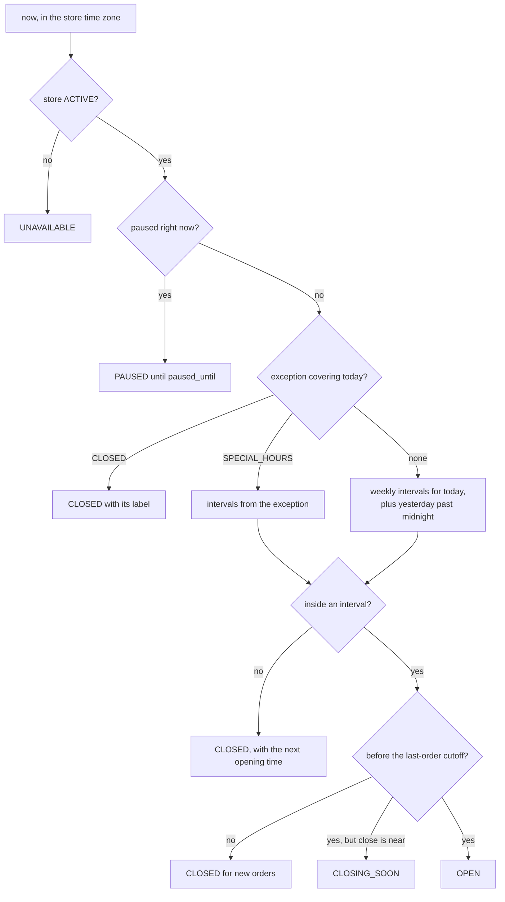

- **API.** `GET /api/stores/:storeId/hours` is public (weekly hours plus upcoming exceptions).
  `PUT /api/stores/:storeId/hours` replaces the weekly set atomically in one RPC.
  `POST` and `DELETE /api/stores/:storeId/schedule-exceptions` add and remove exceptions (`hours.edit`). Every write
  invalidates `store:<id>` and `stores:list`, and is audited.
- **Placing orders.** The check service computes `openState` and refuses with `STORE_CLOSED`, now carrying
  `nextChangeAt` in the message, such as "Campus Cafe opens at 9:00 AM".
- **Migration.** `stores.is_open` becomes a manual "closed now" override (an emergency close that is not a pause),
  so `StoreDto.isOpen` keeps its meaning: it is now computed as `openState ∈ {OPEN, CLOSING_SOON}`.
- **UI.**
  - The `/manage` hours editor has a week grid with add and remove interval, a copy-to-all-days shortcut, and a
    special-day list with presets ("Closed for Holi", "Late hours").
  - Store cards and the store page show the state: "Closes at 9 PM", "Opens tomorrow at 8 AM", "Closed for Diwali".
- **Tests** (property-based with `fast-check`):
  - intervals past midnight, exceptions over weekly hours, CLOSED over SPECIAL_HOURS;
  - the day of a clock change, even though India does not change clocks (the code is generic);
  - `nextChangeAt` always in the future;
  - the cutoff boundary to the minute.

### P2.5 Pause accepting orders

R26.

```sql
alter table public.stores
  add column accepting_orders boolean not null default true,
  add column paused_until timestamptz,          -- null while paused = until someone resumes
  add column pause_reason text check (char_length(pause_reason) <= 120),
  add column paused_by uuid references public.profiles (id) on delete set null;
```

- **API.** `POST /api/stores/:storeId/pause { minutes | until, reason? }` and `POST .../resume` (`store.pause`,
  audited, both emitting events). The presets are 15, 30 and 60 minutes, and "until I resume".
- **Placing orders.** The checkout service refuses a paused store with 409 `STORE_PAUSED`: "Campus Cafe has paused
  new orders. Back at 3:40 PM." `place_order` and later `create_checkout` re-check
  `accepting_orders or paused_until < now()` inside the transaction, so a pause that lands during a checkout can
  never slip an order through on a stale cache (the per-instance cache TTL only delays the badge).
- **Paid orders are honoured.** A pause stops new checkouts only. Orders already paid, and holds already started,
  complete normally.
- **Auto-resume.** It is derived, and needs no job to lift the pause. A pg_cron sweep emits `store.resumed` when
  `paused_until` passes, for notifications and analytics only.
- **UI.**
  - The staff header gets a pause toggle with the presets and the remaining time.
  - Customers see "Paused · back at 3:40 PM" on the card and store page, and checkout is disabled with that reason.
  - Carts are kept.

### P2.6 Store discovery and per-store cart

- **Routes** (`App.tsx` routes plus `SHELL_BY_ROUTE`):
  - `/` → the store list (`StoreCard` gains a compact variant: photo, name, open state, ETA, rating), grouped by
    `area`. When only one store is active, it goes straight to today's single-store Home.
  - `/s/:storeSlug` → the store page, and `/s/:storeSlug/menu` → its menu.
  - The legacy `/menu` redirects to the default store's menu.
  - `/staff` (with a store switcher) and `/staff/:storeSlug`.
- **Data hooks.** `useStores()` and `useStoreMenu(storeRef)` are `useResource` with `persist: true`, keyed
  `stores` and `menu:<storeId>`. Bump `CACHE_PREFIX` to `fp_cache:v2:`, because the menu shape gains `rules`.
- **Cart.** `cartStore` moves to v2 (`fp_cart`, version 2):
  - It holds `{ storeId, storeSlug, storeName, lines }`, and `migrate` gives v1 carts the default store.
  - Adding an item from another store opens a sheet: "Start a new cart? Your cart has items from Campus Cafe"
    (Replace or Keep).
  - `Order Again` switches to the order's store, after the same confirmation.
- **Budgets.**
  - The store list is the new LCP candidate on `/`, so its first card photo loads eagerly with a 400px `srcset`, and
    the rest lazily.
  - The `/` payload stays under about 8 KB of JSON for 20 stores (lean `StoreSummaryDto`).
  - perf-auditor re-baselines `/`.

### P2.7 Compatibility and contract

Clients from before P2 keep working until the contract release:

| Legacy call                          | Serves until the contract release                                           |
| ------------------------------------ | --------------------------------------------------------------------------- |
| `GET /api/store`, `GET /api/menu`    | the default store                                                           |
| `POST /api/orders` without `storeId` | an order at the default store                                               |
| `GET /api/orders` as `STAFF`         | orders of every store the caller is a member of                             |
| `PATCH /api/orders/:id/status`       | the membership-checked transition                                           |
| `UserDto.role = 'STAFF'`             | still reported for migrated staff, so the V0 client routes them to `/staff` |

**Contract release**, after the new client has run for at least one release and the access logs show no legacy calls
for 14 days:

- [ ] Raise `min_client_version` to the first client version that uses the new routes.
- [ ] Remove the legacy endpoints (their removal is announced in API.md's deprecation list).
- [ ] Migrate each `profiles.role = 'STAFF'` user to `CUSTOMER`, since the membership now holds their access.
- [ ] Remove `requireStaff`.
- [ ] Record a server minor bump with a CHANGELOG note. It is not a major, because no current client calls the
      removed routes.

**Tests for P2**

- **Tenant isolation.** Staff of store A get 404 for store B's orders and 403 on store B's management endpoints. A
  brand owner reaches every branch, and a store manager reaches one.
- **Roles.** The capability matrix is covered cell by cell.
- **Legacy.** Every legacy endpoint still passes its old suite unchanged.
- **Pause race.** A pause during an in-flight checkout either lets it complete or refuses it with `STORE_PAUSED`,
  never half-done.
- **Schedule.** The property tests in P2.4.
- **Cart.** Migration from v1, and replacing the cart across stores.

**Docs:** ARCHITECTURE (multi-store flows, ER diagram), API (new endpoints, deprecations), SCHEMA, PERMISSIONS
(memberships and the matrix), FRONTEND_STRUCTURE (routes, stores), BACKEND_STRUCTURE, COMPONENTS (`StoreCard`
variant), CONFIGURATION (store settings), README (demo script for two stores).

## P3 — Catalog, menu management and media

**Goal:** restaurants run their own menus (items, photos, customisations, stock, deals) from the dashboard, and chains
edit an item once for every branch. **Items:** R1 (multi-branch catalog), R4.2.1, R11.2 (menu and stock), R17, R24.
**Depends on:** P2, and P8.3 for the staging bucket. **Size:** L. **Flag:** `modifiers`.

### P3.1 Catalog for multi-branch brands

What the brand sells is separate from what a branch has today.

```sql
create table public.menu_categories (
  id uuid primary key default gen_random_uuid(),
  brand_id uuid not null references public.brands (id) on delete cascade,
  name text not null check (char_length(name) between 1 and 40),
  sort_order integer not null default 0,
  unique (brand_id, name)
);

create type public.diet_marker as enum ('VEG', 'NON_VEG', 'EGG');   -- the customary Indian menu marker

create table public.catalog_items (
  id uuid primary key default gen_random_uuid(),
  brand_id uuid not null references public.brands (id) on delete cascade,
  category_id uuid not null references public.menu_categories (id),
  name text not null check (char_length(name) between 2 and 80),
  description text not null default '' check (char_length(description) <= 300),
  base_price integer not null check (base_price >= 0),              -- whole rupees
  image_url text,
  image_variants jsonb,                                             -- { "400": url, "900": url } from P3.3
  diet public.diet_marker,
  prep_offset_minutes integer not null default 0 check (prep_offset_minutes between 0 and 120),   -- P6.1
  requires_acceptance boolean not null default false,                                             -- P5.5
  archived_at timestamptz,
  created_at timestamptz not null default now(),
  updated_at timestamptz not null default now()
);
create index catalog_items_brand_category_idx on public.catalog_items (brand_id, category_id);

alter table public.menu_items                 -- becomes the per-store listing; its id stays the cart/order id
  add column catalog_item_id uuid references public.catalog_items (id),
  add column price_override integer check (price_override >= 0),
  add column archived_at timestamptz;          -- added in P1.5 if not already present
create index menu_items_catalog_item_id_idx on public.menu_items (catalog_item_id);
```

- **The API shape does not change.** `MenuItemDto` keeps its fields and gains `diet` and `imageSrcSet`. The
  serializer flattens the data: `name`, `description` and the photo come from the catalog item, and
  `price = coalesce(price_override, base_price)`. Stock, availability, popularity and sort order come from the store
  listing. Carts and orders keep using `menu_items.id`, so nothing on the client or in order history changes.
- **Expand/contract.**
  1. Add the tables and columns, and backfill one category per distinct `menu_items.category` and one catalog item
     per menu item.
  2. Move every reader (menu service, `place_order`) to the catalog join.
  3. Keep writing both copies through the admin API for one release.
  4. A later contract migration drops `menu_items.name`, `description`, `category`, `image_url` and `price`.
- **Branch overrides.** A chain decides per branch: availability, stock, price, sort order and popularity. Adding a
  catalog item offers "List at: all branches / pick branches".
- **Analytics** gain a cross-branch key (`catalog_item_id`) for free.

### P3.2 Modifiers

R24, for example "Extra cheese +₹20" or a milk choice.

```sql
create table public.modifier_groups (
  id uuid primary key default gen_random_uuid(),
  brand_id uuid not null references public.brands (id) on delete cascade,
  name text not null check (char_length(name) between 1 and 40),    -- "Add-ons", "Size", "Milk"
  min_select integer not null default 0 check (min_select >= 0),
  max_select integer not null default 1 check (max_select >= 1),
  sort_order integer not null default 0,
  archived_at timestamptz,
  check (min_select <= max_select)
);
create table public.modifier_options (
  id uuid primary key default gen_random_uuid(),
  group_id uuid not null references public.modifier_groups (id) on delete cascade,
  name text not null check (char_length(name) between 1 and 40),
  price_delta integer not null default 0 check (price_delta between -10000 and 10000),  -- "Small -₹20" is allowed
  is_default boolean not null default false,
  is_available boolean not null default true,
  sort_order integer not null default 0,
  archived_at timestamptz
);
create table public.catalog_item_modifier_groups (
  catalog_item_id uuid not null references public.catalog_items (id) on delete cascade,
  group_id uuid not null references public.modifier_groups (id) on delete cascade,
  sort_order integer not null default 0,
  primary key (catalog_item_id, group_id)
);
create table public.order_item_modifiers (          -- snapshots, like order_items
  id uuid primary key default gen_random_uuid(),
  order_item_id uuid not null references public.order_items (id) on delete cascade,
  modifier_option_id uuid references public.modifier_options (id),
  group_name text not null,
  option_name text not null,
  price_delta integer not null
);
create index order_item_modifiers_order_item_id_idx on public.order_item_modifiers (order_item_id);
alter table public.order_items add column base_unit_price integer;   -- price before modifiers, for receipts
```

- **Pricing** (`server/src/domain/pricing.ts`, pure and property-tested) is one function, used by the checkout quote
  and by checkout itself.
  - `unitPrice = listingPrice + Σ selected price_delta`, and the result must be ≥ 0.
  - `lineTotal = unitPrice × quantity`.
  - Every attached group needs `min_select ≤ selected ≤ max_select`. Each option must belong to one of the item's
    groups and be available.
  - When a required group has no selection and has a default option, the default applies. This keeps old clients
    working.
  - Otherwise 400 `MODIFIER_REQUIRED` ("Choose a size for Cold Coffee"), with details naming the item.
  - `order_items.unit_price` includes the modifiers, so totals and `line_total` keep today's meaning.
- **Cart line identity.** `lineKey = menuItemId + ':' + sortedOptionIds.join(',')`. Two Cold Coffees with different
  milk are two lines. **Stock limits apply per menu item across all its lines**: `cartRules.lineLimit` works from
  the item's remaining allowance, not the line's. This is a subtle rule; test it.
- **Checkout request (additive).** `items[].modifierOptionIds?: string[]`. `mergeDuplicateItems` merges by
  `lineKey`, not by `menuItemId`.
- **Menu payload.** Modifier groups are listed once at the top level (`modifierGroups: { [id]: group }`), and items
  refer to them by id, which keeps `GET /menu` lean when many items share "Add-ons". Menu JSON for a 60-item store
  stays under about 25 KB before gzip.
- **UI.**
  - `ItemDetailSheet` gains a `ModifierPicker`: radio buttons when `max_select = 1`, checkboxes otherwise. It shows a
    live price and inline "Choose one" errors, with 44px targets.
  - An item with required choices shows "Customisable" under its price. Its `AddControl` opens the sheet instead of
    adding directly.
  - Cart lines, the checkout summary, `OrderCard` and the order page list the chosen options under the line.
  - `useReorder` re-adds the same options when they are still available and names the ones it had to drop.
- **Admin.** `/manage` edits modifier groups (brand-wide) and attaches them to items. The endpoints are
  `GET/POST/PATCH /api/brands/:brandId/modifier-groups` and
  `PUT /api/brands/:brandId/catalog-items/:itemId/modifier-groups`.

### P3.3 Images on S3

R17. Photos move from the bundle to S3, and restaurants upload their own.

- **Bucket and CDN** ([P8.3](#p83-media-bucket-and-cdn)): the private bucket `food-pickup-media-<env>` is served
  through CloudFront (OAC) at `/media/*` **on the app's own origin**. `img-src 'self'` still holds, and no new runtime
  host is needed for viewing.
- **Keys are content-addressed**: `brands/<brandId>/items/<catalogItemId>/<sha256-prefix>-<width>.webp`. Each object
  gets `Cache-Control: public, max-age=31536000, immutable`, so a new photo is a new URL and nothing is ever stale.

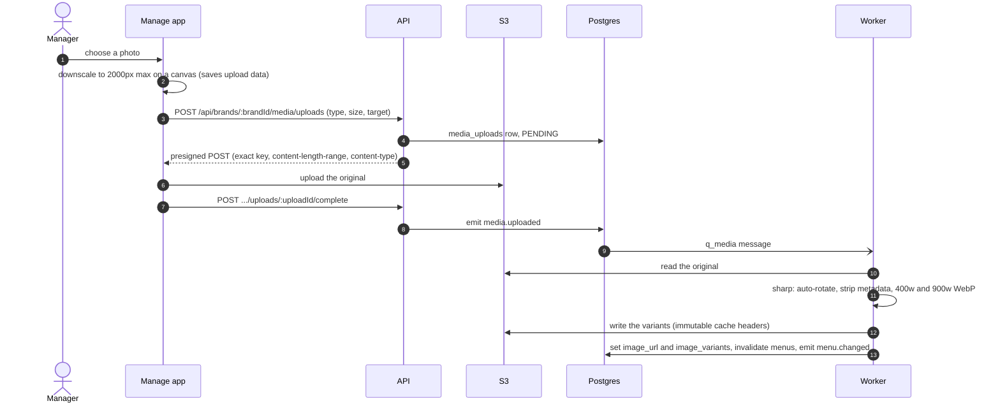

- **Validation.**
  - Allowed input types are JPEG, PNG, WebP and HEIC (iPhone), at most 8 MB, checked by the presign policy.
  - The worker re-checks the real type from the bytes with `sharp` metadata.
  - SVG is rejected (script payloads).
  - The maximum is 6000×6000 px.
  - Re-encoding strips hidden payloads and EXIF location data.
- **Upload CSP.** The browser uploads straight to the bucket's S3 endpoint, which is one new `connect-src` /
  `form-action` host (a CLAUDE.md §9 change, see [Docs and rule changes](#docs-and-rule-changes)). The alternative,
  proxying uploads through the API, avoids the host but puts upload bandwidth on the API instances. Decide in
  [Decisions needed](#decisions-needed).
- **Serving.** `MenuItemDto.imageSrcSet` is built by the server from `image_variants`
  (`"/media/...-400.webp 400w, /media/...-900.webp 900w"`). `FoodPhoto` takes a `srcSet` prop and still falls back
  to `photoSrcSet(src)` for bundled photos during the transition. The `sizes` rule from CLAUDE.md §2c is unchanged.
- **Migrating bundled photos.** `server/scripts/migrate-media.ts` uploads every `client/public/images/*.jpg`
  original, builds the variants, and rewrites `image_url` for one environment per run. The user runs it for
  production **(user)**. Remove the bundled photos only once every environment has migrated; `lib/photo.test.ts`
  then becomes a variant check.
- **Local development.** Add a `minio` service to `compose.yaml` (S3-compatible). Vite proxies `/media` to MinIO in
  development, so the same-origin rule holds locally too.
- **Lifecycle.**
  - A job deletes `PENDING` uploads older than 24 h.
  - It deletes an old variant only when no catalog item **and no order line** references it (P1.5).
  - Bucket versioning is on for recovery.

### P3.4 Restaurant admin: menu and stock

R11.2 (menu and stock). The analytics dashboard comes later, in [P7.3](#p73-restaurant-analytics-dashboard).

- **Routes** (lazy; `RequireMembership`; mobile-first because owners run menus from phones):
  - `/manage` picks the brand and store.
  - `/manage/:storeSlug/menu`, `/stock`, `/deals`, `/hours`, `/settings` and `/team`.
  - Later: `/analytics`, `/payouts`, `/reviews`, `/policy`.
- **Screens.**
  - **Menu list:** search, filter by category, availability toggles and drag to reorder (with up/down buttons for
    accessibility).
  - **Item editor:** a sheet on phones and a side panel on desktop, with name, description, price, category, diet,
    photo, modifiers, prep offset, "needs acceptance" and branch listings.
  - **Stock screen:** a list with quick −/+ and "Set", a "Sold out" toggle, and low-stock highlighting.

  Every view has Skeleton, EmptyState and ErrorState (CLAUDE.md §5).

- **API** (brand-scoped catalog, store-scoped listings; never cached; every write audited, invalidates
  `menu:<storeId>` for the affected stores, and emits `menu.changed`):

  | Method + path                                               | Capability      | Does                                                                     |
  | ----------------------------------------------------------- | --------------- | ------------------------------------------------------------------------ |
  | `GET /api/brands/:brandId/catalog`                          | `catalog.edit`  | items with categories, modifiers and branch listings, including archived |
  | `POST`/`PATCH /api/brands/:brandId/catalog-items[/:itemId]` | `catalog.edit`  | create or edit; `DELETE` archives                                        |
  | `PUT /api/brands/:brandId/categories/order`                 | `catalog.edit`  | reorder categories                                                       |
  | `GET /api/stores/:storeId/listings`                         | `listings.edit` | this store's listings, with stock and overrides                          |
  | `PATCH /api/stores/:storeId/listings/:menuItemId`           | `listings.edit` | availability, price override, popular, sort order                        |
  | `POST /api/stores/:storeId/listings/bulk`                   | `listings.edit` | bulk availability (for example, "sold out: all juices")                  |
  | `PATCH /api/stores/:storeId/listings/:menuItemId/stock`     | `stock.update`  | `{ set: n \| null }` or `{ adjust: ±n }`, with a `reason`                |

- **Stock is always atomic and explained.**
  `adjust_stock(p_store_id, p_menu_item_id, p_set, p_delta, p_reason, p_actor)` does one conditional update (never
  negative) and writes a `stock_movements` row:

  ```sql
  create type public.stock_reason as enum
    ('SALE', 'HOLD_RELEASED', 'CANCEL_RESTORE', 'MANUAL_SET', 'MANUAL_ADJUST', 'WASTE', 'SURPLUS');
  create table public.stock_movements (
    id bigint generated always as identity primary key,
    store_id uuid not null references public.stores (id),
    menu_item_id uuid not null references public.menu_items (id),
    delta integer not null,
    resulting_quantity integer,
    reason public.stock_reason not null,
    order_id uuid references public.orders (id),
    actor_id uuid references public.profiles (id) on delete set null,
    created_at timestamptz not null default now()
  );
  create index stock_movements_item_time_idx on public.stock_movements (menu_item_id, created_at desc);
  ```

  "Set to N" means N available now. Holds were already subtracted when they were taken (P5.2), so the number the
  staff type is the number customers can buy. Every stock change, including ones made by `place_order`,
  `create_checkout` and hold releases, writes a movement, which gives waste and sell-through analytics
  ([P7.1](#p71-analytics-pipeline)) an exact trail.

- **Client behaviour.** Edits are optimistic and roll back on error. After each mutation, `reload()`/`mutate()` runs
  on every resource it affects (CLAUDE.md §8).

### P3.5 Staff stock updates

R11.2 says staff may also update stock.

- The `stock.update` capability goes to `STAFF` when `store_settings.staff_can_edit_stock` is on (the default).
- On the staff board:
  - a Stock tab with the same quick controls;
  - "Mark sold out" on any order line in the order detail ([P6.4](#p64-staff-dashboard-v2)).

  Both call the same endpoint.

- The audit log and `stock_movements` record who changed what.

### P3.6 Surplus and limited-time deals

R4.2.1: after a no-show the restaurant has already been paid (P5.9), and can resell the food at full price to
someone who ordered the same item, or list it as a discounted, limited-time deal.

```sql
create type public.surplus_status as enum ('AVAILABLE', 'LISTED', 'USED', 'SOLD_OUT', 'DISCARDED', 'EXPIRED');
create table public.surplus_lots (
  id uuid primary key default gen_random_uuid(),
  store_id uuid not null references public.stores (id),
  menu_item_id uuid not null references public.menu_items (id),
  source_order_id uuid references public.orders (id),
  quantity integer not null check (quantity > 0),
  quantity_left integer not null check (quantity_left between 0 and quantity),
  expires_at timestamptz not null,            -- food-safety window: store setting surplus_shelf_minutes
  status public.surplus_status not null default 'AVAILABLE',
  created_at timestamptz not null default now()
);
create table public.deals (
  id uuid primary key default gen_random_uuid(),
  store_id uuid not null references public.stores (id),
  menu_item_id uuid not null references public.menu_items (id),
  surplus_lot_id uuid references public.surplus_lots (id),   -- null = a plain promotion using regular stock
  deal_price integer not null check (deal_price >= 0),
  quantity integer not null check (quantity > 0),
  quantity_left integer not null check (quantity_left between 0 and quantity),
  starts_at timestamptz not null default now(),
  ends_at timestamptz not null,
  created_by uuid references public.profiles (id) on delete set null,
  cancelled_at timestamptz,
  check (ends_at > starts_at)
);
create index deals_store_active_idx on public.deals (store_id, ends_at) where cancelled_at is null;
```

- **After a no-show.** An expired order ([P5.9](#p59-sla-breaches-and-pickup-windows)) creates one surplus lot per
  line (when `create_surplus_on_no_show` is on), and staff get a prompt with three choices:
  - **Use for the next order** (resale at full price). While a lot is `AVAILABLE`, a new order containing that item
    shows the chip "1 ready from surplus — use it". Tapping it (`POST /api/stores/:storeId/orders/:orderId/use-surplus`)
    consumes the lot, and the order can go straight to `READY`. Money is unaffected: the new customer pays list
    price as usual.
  - **Put on a deal.** `POST /api/stores/:storeId/deals` sets a price at or below list, a quantity no larger than
    the lot, and an end time no later than the lot's expiry. The menu gains a "Limited-time deals" section at the
    top (store open only), and a deal line's price is the deal price, snapshotted with `list_unit_price` for
    "You saved ₹X".
  - **Discard**, which records a `WASTE` stock movement.
- **Reservation.** Deal lines reserve against `deals.quantity_left`, with the same conditional-decrement pattern as
  stock. Deals backed by surplus never touch regular stock. Surplus-backed deal lines skip acceptance and preparation
  (the food is ready).
- **Expiry.** pg_cron's `expire_surplus_and_deals()` expires lots past their shelf time (a `WASTE` movement) and ends
  deals.
- **Guardrails (settings).** `max_active_deals` per store, a deal price no higher than list, and a deal no longer than
  its lot's shelf time.

**Tests for P3:**

- the catalog flattening gives byte-identical `MenuItemDto`s before and after the migration;
- the pricing properties, and the per-item stock limit across modifier lines;
- the upload validation cases, and variants never deleted while referenced;
- `adjust_stock` concurrency, which never goes below zero;
- deal overselling under `Promise.all`.

**Docs:** SCHEMA, API, COMPONENTS (`ModifierPicker`, the `StoreCard` variant, the `FoodPhoto` `srcSet` prop),
FRONTEND_STRUCTURE (`/manage` routes), DEPLOYMENT (media migration, MinIO), CLAUDE.md §9 (S3 replaces the Supabase
Storage plan).

## P4 — Payment aggregator research and selection

**Goal:** choose the payment aggregator (PA) and the money model on evidence, before any payment code is written.
The product owner set three constraints:

- Razorpay's ~2% per transaction is not viable.
- **99% of payments will be UPI, and 99% will be under ₹2,000.**
- The pilot may run for 6–12 months on a temporary 0% rate before switching.

**Items:** R2, and where the money sits for R4. **Depends on:** P0. It runs in parallel with P1–P3, because sales,
KYC and legal review take weeks. **Blocks:** P5. **Size:** M.

**Output:**

- ADR-003 accepted, naming the provider, the money model and the hold mechanism;
- a UPI rate in writing;
- the merchant application submitted;
- a sandbox spike merged behind the gateway port;
- the CA's and lawyer's view on file;
- DLT registration for SMS started (P6.3).

**The research lives in [PAYMENT_OPTIONS.md](PAYMENT_OPTIONS.md)**, gathered on 28 September 2026. It holds the
requirements, regulatory facts, provider rankings, fee models, the model A vs B requirements and trade-offs, the
fallback ladder and the switching options. This phase is the plan for turning that research into a signed decision,
and the summaries below link to it.

### P4.1 Requirements and scoring

**Must-haves:**

1. an RBI-authorised PA;
2. UPI intent on mobile web, with QR on desktop;
3. a server-side status API and signed webhooks;
4. refunds by API to the original payment method;
5. a sandbox.

**Weights:**

| Criterion                  | Weight |
| -------------------------- | ------ |
| UPI fee under ₹2,000       | 40%    |
| Holding the vendor's share | 20%    |
| Mobile-web UPI checkout    | 15%    |
| API quality                | 10%    |
| Onboarding                 | 10%    |
| Regulatory standing        | 5%     |

Details: [Requirements](PAYMENT_OPTIONS.md#requirements).

### P4.2 Findings

- **UPI up to ₹2,000 carries zero MDR, and still will after 15 October 2026.** The new 0.4% MDR applies only above
  ₹2,000.
- **The ~2% is each PA's own platform fee** (all plus GST):

  | PA       | UPI platform fee |
  | -------- | ---------------- |
  | Razorpay | 2%               |
  | PayU     | 2%               |
  | Paytm    | 1.99%            |
  | PhonePe  | 1.99%            |
  | Cashfree | 1.95%            |

  **No RBI-authorised PA publishes a permanent 0% online UPI rate.** 0% comes only as:
  - **Cashfree:** the first ₹20 lakh GMV, cumulative, for new merchants, with Easy Split excluded;
  - **Razorpay:** 90 days or ₹5 lakh;
  - **PhonePe:** terms not public;
  - a negotiated contract.

  The lowest permanent published rate is **Zoho Payments at 0.5%**, which offers no split or hold.

- **Google Pay is a UPI app, not a gateway.** Every PA's UPI intent already reaches its users.
- **Hold-then-release is documented at four providers:**
  - Cashfree (Easy Split: up to 45 days, then released to the vendor automatically);
  - Paytm (`POST_TXN`; a lapsed hold goes to the platform);
  - PayU (`release_settlement`);
  - Razorpay (Route, behind a ₹40 lakh turnover gate).

  PhonePe only markets it.

- **RBI's Payment Aggregator Directions:**
  - refunds go to the original payment method;
  - a marketplace keeps sellers' money in the PA's escrow;
  - payouts from escrow to third parties require ₹40 lakh of turnover.

Full tables: [Provider ranking](PAYMENT_OPTIONS.md#provider-ranking) and
[Regulatory facts](PAYMENT_OPTIONS.md#regulatory-facts).

### P4.3 Cost model

At 99% UPI and a ₹200 average order:

| Case                                 | 3,000 orders a month | 10,000 orders a month |
| ------------------------------------ | -------------------- | --------------------- |
| List prices (2.35–2.6% of GMV)       | ₹14–16k              | ₹47–53k               |
| Written 0% UPI, model A (0.1% split) | ₹779                 | ₹2,596                |
| Written 0% UPI, model B              | ₹142 + payouts       | ₹472 + payouts        |
| Zoho at 0.5%                         | ₹3,646               | ₹12,154               |

Each 0.1% of UPI fee costs about ₹700 a month at 3,000 orders. **Negotiating the UPI rate is the whole game.** For
promotion coverage by volume, payout costs and refund costs, see [Fees](PAYMENT_OPTIONS.md#fees).

### P4.4 Money model options

- **A. Marketplace with the PA's deferred split.** The long-term model. The money stays in the PA's escrow. It needs:
  - split activation, where turnover gates are likely;
  - every restaurant's KYC at the PA;
  - GST under s.9(5), and 194-O TDS.
- **B. Merchant of record with scheduled payouts.** The pilot model, if the CA and a lawyer agree.
  - It works with any plain gateway.
  - The platform is the seller, with the seller's GST, FSSAI and consumer liability.
  - Switching providers is cheap.
  - It is the only way to use Cashfree's promotion, which excludes Easy Split.
- **C. The proposal read literally** (collect into our own account, return money by payout): **no.** It may be direct
  aggregation, and a payout does not close a UPI dispute, so a complaint can still become a chargeback and the
  customer is refunded twice. Keep "pay the restaurant after pickup"; drop "refund by payout".
- **In both A and B, money goes back only as a refund through the PA's API, to the original payment method.**

Requirements and trade-offs per model: [Money models A and B](PAYMENT_OPTIONS.md#money-models-a-and-b) and
[Refunds, not payouts](PAYMENT_OPTIONS.md#refunds-not-payouts). [P5.6](#p56-ledger-and-escrow) builds both models
behind one payout interface.

### P4.5 Recommendation and fallback ladder

**Pilot strategy** (the product owner's direction): 6–12 months on a temporary 0%, then pivot.

1. **Pick the promotion by its coverage at the pilot's volume.** Cashfree's ₹20 lakh cap covers 6 months at up to
   about 1,650 orders a month, but its end date (31 March or 31 May 2027) may come first. Ask for an extension to the
   pilot's length.
2. **Run the pilot on model B,** if the CA and the lawyer agree. Cashfree's promotion excludes Easy Split, and
   switching providers is cheap under B.
3. **Build for the switch from day one** ([P5.12](#p512-switching-providers-after-the-promotion)).
4. **Negotiate 60 days before the promotion ends,** with the pilot's numbers in hand.

**Long-term first choice:** Cashfree, under model A with Easy Split or under model B, signed with a written UPI rate
(target 0%) and a split fee of at most 0.1%.

- **Paytm** is the fallback, if it contracts 0% on online UPI.
- **PhonePe** is negotiated in parallel.

**If a true 0% cannot be had:**

- **Model B:** direct bank UPI (0% by law, more integration work), then Zoho Payments at 0.5%.
- **Model A:** the lowest written UPI rate with a safe hold (Cashfree, then PayU, then Paytm, then Razorpay). If
  fees still stay high, move to model B or add a small flat per-order fee.

The full ladder with its trade-offs is in
[Pilot strategy and fallback ladder](PAYMENT_OPTIONS.md#pilot-strategy-and-fallback-ladder), and the switching paths
(provider to provider, B → A, A → B, promotion stacking) are in [Switching options](PAYMENT_OPTIONS.md#switching-options).

### P4.6 Validation steps

- [ ] **Sales and contracts.** Send the questions in [Open questions](PAYMENT_OPTIONS.md#open-questions) and get
      written answers, above all:
  - the post-promotion UPI rate;
  - Cashfree's promotion terms: a cumulative or monthly cap, an end date of 31 March or 31 May 2027, what the Easy
    Split exclusion covers, and an extension to 6–12 months;
  - split fees and turnover gates, and hold behaviour;
  - refund fees and payout pricing.
- [ ] **CA and lawyer:**
  - model A or B, and whether our merchant-of-record structure is real;
  - whether model C would be direct aggregation;
  - GST under s.9(5) vs as the seller, 194-O, GST cascading, and invoicing;
  - the FSSAI licence.
- [ ] **Sandbox spike** (a week per provider, for the top two) on a throwaway branch that implements
      `PaymentGateway` ([P5.1](#p51-payment-gateway-port-and-adapter)):
  1. create order → checkout (lazy SDK) → UPI intent into PhonePe, Google Pay and Paytm on a low-end Android phone
     with a throttled network → return → status check → webhook;
  2. a full and a partial refund;
  3. a split after payment (model A only).

  Record the time from tap to UPI app, the script weight (gzip), the failure-path behaviour and any gaps in the
  docs. Under model B, include a bank's UPI merchant API if it is still a candidate.

- [ ] **Applications:**
  - the platform's merchant KYC, with the website policy pages first (Terms, Privacy, Refund and Cancellation,
    Contact), because every PA asks for them;
  - split activation (model A);
  - DLT registration for SMS (P6.3).

### P4.7 Decision and ADR-003

- [ ] Score the finalists against P4.1 with the written numbers, and record ADR-003: the provider, the plan and its
      rate, the money model (A or B), the hold mechanism, the pilot's promotion and its end date, and the reasons.
      ADR-003 cites [PAYMENT_OPTIONS.md](PAYMENT_OPTIONS.md). Keep that file current whenever a term changes.
- [ ] Update everything that depends on the choice:
  - the P5 adapters and the `PAYMENT_PROVIDER` / `active_payment_provider` values;
  - the env names (P8.6) and the CSP hosts (CLAUDE.md §9);
  - README's "What V0 deliberately leaves out".

**Done when**

- ADR-003 is accepted with a written UPI rate or promotion terms;
- the CA's and lawyer's views are on file;
- the spike has run on a real low-end Android phone;
- the merchant application has been submitted.

## P5 — Payments, escrow and refunds

**Goal:** real prepaid orders through the aggregator chosen in P4:

- the money is held until pickup;
- the customer is refunded whenever the restaurant is at fault;
- the restaurant is paid on collection, and on a no-show;
- every rupee is reconciled.

**Items:** R2, R4, R4.1, R4.2, R5, R12, R28.3–R28.6, R29. **Depends on:** P4 (the provider and the money model), P2,
P3, and P8's staging environment (a public webhook URL). **Size:** XL. **Flags:** `real_payments` (per store),
`acceptance_flow`, `cancellation_by_customer`.

Provider details below use P4's recommendation (Cashfree) as the worked example. The gateway port keeps the other
finalists a configuration change.

### P5.1 Payment gateway port and adapter

```ts
// server/src/integrations/payments/port.ts
interface PaymentGateway {
  readonly provider: 'cashfree' | 'paytm' | 'phonepe' | 'razorpay' | 'bank_upi' | 'fake';
  createOrder(input: {
    orderId: string;
    amountPaise: number;
    customer: { id: string; phone?: string };
    returnUrl: string;
    notifyUrl: string;
    expiresAt: Date;
  }): Promise<{ gatewayOrderId: string; session: CheckoutSession }>;
  getOrderStatus(gatewayOrderId: string): Promise<GatewayOrderStatus>; // the server-side truth
  verifyWebhook(rawBody: Buffer, headers: IncomingHttpHeaders): VerifiedEvent | null;
  refund(input: {
    gatewayOrderId: string;
    refundId: string;
    amountPaise: number;
    note: string;
  }): Promise<GatewayRefund>;
  getRefund(gatewayOrderId: string, refundId: string): Promise<GatewayRefund>;
  listSettlements(range: { from: Date; to: Date }): Promise<GatewaySettlement[]>;
}

// Model A only (P5.6): the PA holds the vendor's share until we release it.
interface VendorSplits {
  onboardVendor(profile: PayoutProfile): Promise<{ vendorId: string; kycStatus: VendorKycStatus }>;
  splitAfterPayment(input: {
    gatewayOrderId: string;
    vendorId: string;
    amountPaise: number;
    ref: string;
  }): Promise<SplitResult>;
  vendorBalance(vendorId: string): Promise<{ pendingPaise: number; settledPaise: number }>;
}
```

- **Adapters.**
  - `cashfree/`, per P4.
  - `fake/`: in-memory and deterministic. It posts signed test webhooks to our own route, and serves tests, local
    development and load tests.
  - The fallback adapter, only if P4 keeps one alive.

  The port is the common shape of every finalist: a server-created order, a checkout session the client opens, status
  looked up by the server, signed webhooks, and refunds carrying our own refund id.

- **Money units.** `utils/money.ts` converts rupees ↔ paise. The adapter alone converts paise to the provider's unit:
  Cashfree and Paytm take decimal rupees, and Razorpay takes paise.
- **HTTP.**
  - `fetch` with a 10 s timeout. Only idempotent reads (status, refund lookup) are retried, on 5xx or network
    errors, with backoff.
  - Every call logs the provider, operation, latency and outcome, with no PII.
  - Failures throw `IntegrationError` (P0.5).
- **Environment** ([P8.6](#p86-secrets-and-configuration)): `PAYMENT_PROVIDER`, the provider's client id and secret,
  its webhook secret, and the API base (sandbox or production). Guards: production refuses sandbox keys and the fake,
  and every other environment refuses production keys.
- **Several providers at once.**
  - Each `payments` row records its `provider`. Refunds, status checks and reconciliation always use that payment's
    provider, never the current default.
  - The provider for new checkouts is a site setting, `active_payment_provider`, with an optional per-store override
    so a switch can go one store at a time ([P5.12](#p512-switching-providers-after-the-promotion)).
  - Every provider configured in the environment keeps its adapter loaded.

### P5.2 Order lifecycle v2 and stock holds

R4 (prepay first) and R28.3 (expired holds).

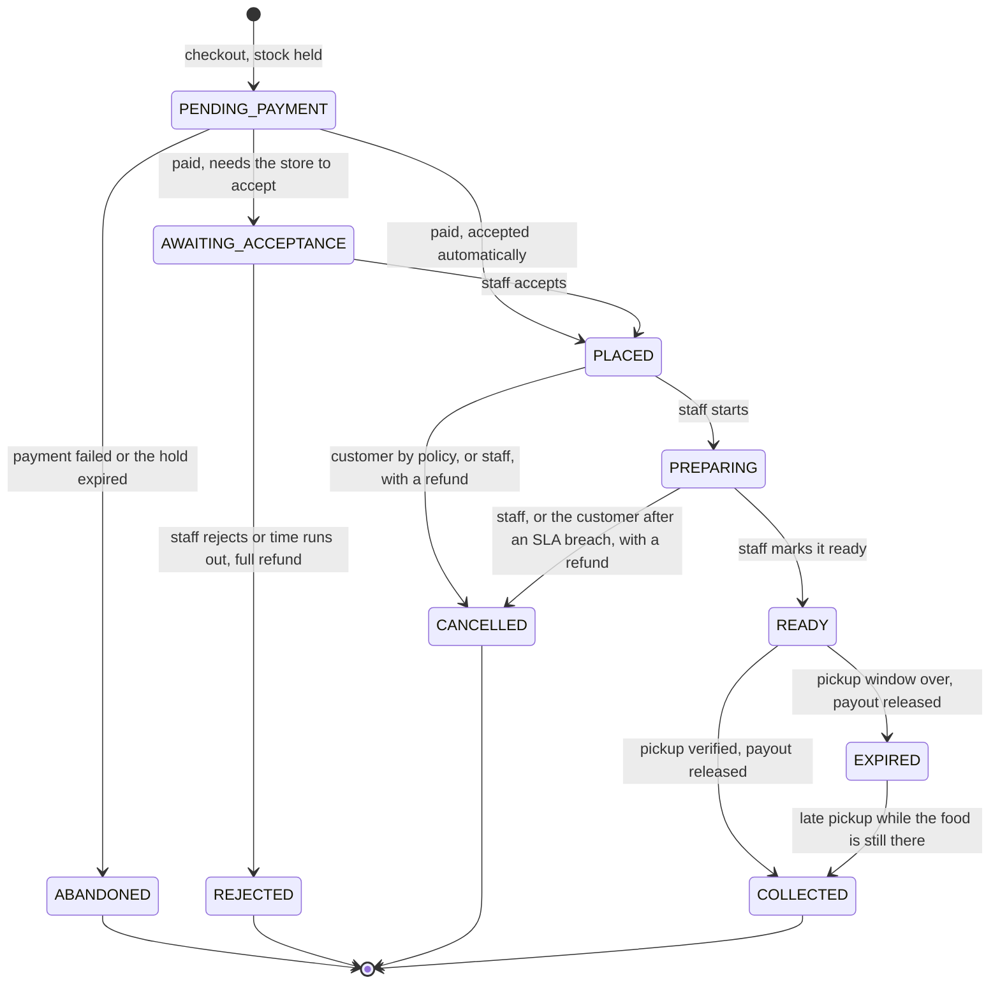

- **Enum.** New `order_status` values: `PENDING_PAYMENT`, `AWAITING_ACCEPTANCE`, `REJECTED`, `EXPIRED` and
  `ABANDONED`. They go in their own migration, because Postgres does not allow a new enum value to be used in the
  transaction that adds it, as the `20260927094610` migration already notes. `payment_status` gains `FAILED`,
  `PARTIALLY_REFUNDED` and `REFUNDED`.
- **One source of truth.** `server/src/domain/orderMachine.ts` holds the transition table, with who may trigger each
  transition and its side effects. It replaces `ALLOWED_TRANSITIONS`. The SQL functions enforce the same table with
  conditional updates (`where status = any(...)`), as `update_order_status` does today. Each transition has its own
  function: `accept_order`, `reject_order`, `start_order`, `ready_order`, `collect_order`, `cancel_order`,
  `expire_order` and `abandon_checkout`. Each one audits and emits its event.
- **Holds.**

  ```sql
  create type public.hold_status as enum ('HELD', 'COMMITTED', 'RELEASED');
  create table public.stock_reservations (
    id uuid primary key default gen_random_uuid(),
    order_id uuid not null references public.orders (id) on delete cascade,
    menu_item_id uuid references public.menu_items (id),
    deal_id uuid references public.deals (id),
    quantity integer not null check (quantity > 0),
    status public.hold_status not null default 'HELD',
    expires_at timestamptz not null,
    released_at timestamptz,
    release_reason text,
    check (num_nonnulls(menu_item_id, deal_id) = 1)
  );
  create index stock_reservations_expiry_idx on public.stock_reservations (expires_at) where status = 'HELD';
  create index stock_reservations_order_id_idx on public.stock_reservations (order_id);
  ```

  - `create_checkout` takes stock with today's conditional decrement (in `menu_item_id` order, never negative), writes
    `HELD` rows expiring `hold_ttl_seconds` from now, and inserts the order as `PENDING_PAYMENT`. The available
    count the menu shows is therefore always `stock_quantity`, with holds already subtracted.
  - `confirm_payment` locks the order row and commits the holds. If they had already expired, it tries to take the
    stock again. When that fails, the order goes to `REJECTED` with the reason `STOCK_UNAVAILABLE_AFTER_PAYMENT`, and
    a refund is requested automatically.
  - `expire_holds(p_now)` runs every minute from pg_cron. It releases expired holds (stock back, `HOLD_RELEASED`
    movements), marks their orders `ABANDONED` and emits `order.abandoned`. The row lock on the order serialises it
    against a late payment.

- **Stock returns.** Cancelling or rejecting before preparation returns the stock. After `PREPARING` the food exists,
  so nothing returns unless `restore_stock_on_prep_cancel` is on. This is a deliberate change from V0, which restores
  stock on cancellation from `PREPARING` as well; document it in API.md.
- **Hidden from the V0 client.** `PENDING_PAYMENT` and `ABANDONED` orders are not customer-visible and never appear
  on staff boards. The customer sees them only through "Payment not completed — Try again", on the order they were
  just paying for.
- **Compatibility.** The v2 lifecycle ships together with a `min_client_version` bump (P0.7), so a stale V0 tab is
  asked to refresh instead of meeting a status it cannot render. The new client also renders unknown statuses safely
  (P0.7).

### P5.3 Checkout v2

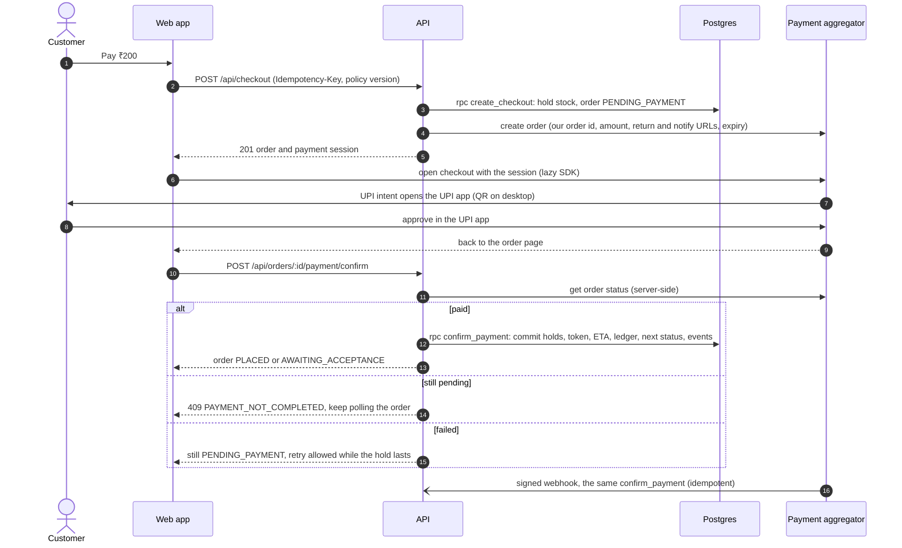

- **`POST /api/checkout/quote`** has no side effects. It prices the lines (pricing module), estimates the ETA
  (P6.1; the current prep window until then), and returns the policy summary and version and the store's open state.
  The final pay screen is drawn from it.
- **`POST /api/checkout`** requires `Idempotency-Key`. The body is
  `{ storeId, items[{ menuItemId | dealId, quantity, modifierOptionIds? }], customerName?, customerPhone?, note?, policyVersion }`.
  The server:
  1. applies the rate limit, the open and pause checks, pricing, and the policy-version check (409 `POLICY_CHANGED`);
  2. calls the `create_checkout` RPC, and then `gateway.createOrder` outside that transaction;
  3. if the gateway call fails, calls `abandon_checkout`, which releases the hold at once, and answers 502
     `PAYMENT_UNAVAILABLE`. If the process dies between the two calls, the hold simply expires (P5.2);
  4. answers `{ order, payment: { provider, session, expiresAt } }`.
- **Client** (`pages/Checkout.tsx`):
  - **SDK loading.** It loads the provider's JS SDK lazily when the checkout page mounts: preloaded, never in the
    initial bundle, with its gzip cost checked. A timeout plus `ErrorState unreachable` with Retry covers a failed
    script load.
  - **Opening checkout.** It uses the SDK's modal or redirect mode, whichever the P4 spike showed works best for UPI
    intent on low-end Android browsers.
  - **After the payment**, it goes **straight to the order page in a "Confirming your payment…" state**. It calls
    confirm, and keeps polling the order until it leaves `PENDING_PAYMENT`. It never asks the customer to pay again
    without checking the status first (P9.2, drill 11).
  - **The cart is cleared** only once the order is confirmed, not when checkout starts.
  - **"Payment not completed"** offers:
    - **Try again:** the same order, with a new session if the gateway needs one, while the hold lasts.
    - **Cancel:** `POST /api/orders/:id/abandon`, which returns the stock now.

    After the hold expires, the answer is 409 `CHECKOUT_EXPIRED` and the customer goes back to the cart, which is
    still intact.

  - **Copy.** "Payment is simulated…" goes. "No taxes or fees" stays only while the quote says it is true.
- **CSP and CLAUDE.md §9.** Add the provider's SDK and checkout hosts, the exact list taken from its docs. They are
  the only new runtime hosts payments need.
- **Retiring the old endpoint.** The simulated `POST /api/orders` retires with the `min_client_version` bump that
  ships lifecycle v2 (P0.7). The fake gateway keeps tests and local development off real money.

### P5.4 Webhooks inbox and payment state

```sql
create type public.payment_state as enum
  ('CREATED', 'PENDING', 'PAID', 'FAILED', 'EXPIRED', 'PARTIALLY_REFUNDED', 'REFUNDED');
create table public.payments (
  id uuid primary key default gen_random_uuid(),
  order_id uuid not null unique references public.orders (id),
  provider text not null,
  gateway_order_id text not null unique,
  amount_paise bigint not null check (amount_paise > 0),
  state public.payment_state not null default 'CREATED',
  method text,                         -- 'upi', 'card', ... for analytics; no card or VPA data is stored
  paid_at timestamptz,
  refunded_paise bigint not null default 0 check (refunded_paise >= 0),
  created_at timestamptz not null default now(),
  updated_at timestamptz not null default now(),
  check (refunded_paise <= amount_paise)
);
create table public.payment_events (
  id uuid primary key default gen_random_uuid(),
  provider text not null,
  provider_event_id text not null,     -- the provider's event id, or a hash of type + payload when it has none
  event_type text not null,
  gateway_order_id text,
  payload jsonb not null,              -- PII fields stripped before insert
  received_at timestamptz not null default now(),
  processed_at timestamptz,
  outcome text,
  unique (provider, provider_event_id)
);
```

- **The route.** `POST /api/webhooks/:provider` is mounted **before** `express.json()`, with
  `express.raw({ type: 'application/json', limit: '256kb' })`. It has no auth and no rate limit, and it is exempt from
  the WAF rules (P9.3).
- **Signature check.** `gateway.verifyWebhook(raw, headers)` applies the provider's scheme:
  - Cashfree: base64 HMAC-SHA256 over the timestamp plus the raw body;
  - Paytm: a checksum;
  - Razorpay: hex HMAC over the raw body.

  The comparison uses `crypto.timingSafeEqual`. A bad signature gets 400, a `warn` log line, and nothing stored.

- **Processing.**
  1. A valid event is inserted into `payment_events`; a duplicate is ignored through the unique key.
  2. It emits `payment.webhook_received` and answers 200 within a second.
  3. On `q_payments`, the worker runs the handler for the event type. The handler calls the same SQL function the
     confirm path uses (`confirm_payment`, `mark_payment_failed`, `mark_refund_processed`, …), guarded by the current
     state, so duplicate or out-of-order events change nothing.
- **The browser redirect is never trusted alone.** Confirm always re-reads the status from the gateway, and the
  webhook and the reconciler (P5.10) are the backstops.

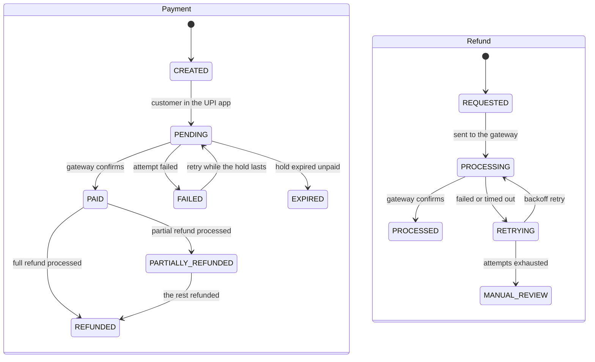

- **A payment after the hold expired.** The order is `ABANDONED`, so `confirm_payment` tries to take the stock again.
  If it cannot, the order becomes `REJECTED` with the reason `STOCK_UNAVAILABLE_AFTER_PAYMENT`, and a full refund is
  requested automatically.
- **Local development.** The fake gateway posts signed webhooks to the same route. A tunnel (cloudflared) to a laptop
  is needed only for testing the real sandbox; staging has a public URL (P8).

### P5.5 Restaurant acceptance for limited items

R5: items with limited quantity must be accepted by the restaurant first, and the order only goes ahead then;
otherwise the customer is refunded.

- **Which orders need acceptance** (`domain/acceptance.ts`). It depends on `acceptance_mode`:
  - `ALL`: every order.
  - `LIMITED_ITEMS` (the default): any line whose listing tracks stock (`stock_quantity` not null at checkout), or
    whose catalog item has `requires_acceptance` set.
  - `AUTO`: never.

  Deal lines backed by surplus never need acceptance, because the food already exists.

- **Flow.**
  1. After payment the order is `AWAITING_ACCEPTANCE`, with
     `acceptance_deadline = now() + acceptance_timeout_seconds`.
  2. Staff get a push and a sound, and the ticket sits in the top lane with a countdown.
  3. **Accept** (`accept_order`) → `PLACED`.
  4. **Reject** with a reason (`OUT_OF_STOCK`, `TOO_BUSY`, `CLOSING`, `OTHER`, plus a note) → `REJECTED` and a 100%
     refund. `OUT_OF_STOCK` offers to mark the items sold out in the same tap.
  5. **Timeout:** `expire_acceptance(p_now)`, every minute, moves the order to `REJECTED` with the reason
     `ACCEPTANCE_TIMEOUT`, requests the refund and alerts staff.
- **Partial acceptance** (a follow-up step), for a stock mismatch on one line. Staff mark a line unavailable
  (`POST .../orders/:orderId/lines/:lineId/unavailable`). That line is refunded, the order continues, and the customer
  is told which item was dropped and how much comes back. The same action is available until `READY`, for stock
  found missing while preparing (R4.1).
- **Customer copy:** "Waiting for Campus Cafe to confirm (2:31 left). Limited items need the café's OK. If they can't
  make it, you get a full refund automatically."
- **Metric:** time to accept, per store (P7.1), which feeds the acceptance timeout chosen for each store.

### P5.6 Ledger and escrow

It has two parts: an internal double-entry ledger, which always exists, and a payout strategy chosen by the money
model ([P4.4](#p44-money-model-options)).

```sql
create type public.ledger_account_type as enum
  ('GATEWAY_CLEARING', 'CUSTOMER_FUNDS', 'VENDOR_PAYABLE', 'PLATFORM_REVENUE', 'GATEWAY_FEES', 'REFUNDS_PAYABLE');
create table public.ledger_accounts (
  id uuid primary key default gen_random_uuid(),
  type public.ledger_account_type not null,
  store_id uuid references public.stores (id),        -- set for VENDOR_PAYABLE only
  unique nulls not distinct (type, store_id)
);
create table public.ledger_transactions (
  id uuid primary key default gen_random_uuid(),
  kind text not null,          -- PAYMENT_CONFIRMED, ORDER_SETTLED, REFUND_REQUESTED, REFUND_PROCESSED, VENDOR_PAID, FEE_RECORDED, ...
  order_id uuid references public.orders (id),
  external_ref text,           -- gateway payment, refund, split or payout id
  idempotency_key text not null unique,
  occurred_at timestamptz not null default now()
);
create table public.ledger_entries (
  id bigint generated always as identity primary key,
  transaction_id uuid not null references public.ledger_transactions (id),
  account_id uuid not null references public.ledger_accounts (id),
  direction text not null check (direction in ('DEBIT', 'CREDIT')),
  amount_paise bigint not null check (amount_paise > 0)
);
create index ledger_entries_account_idx on public.ledger_entries (account_id);
create index ledger_entries_transaction_idx on public.ledger_entries (transaction_id);
```

- **The only writer.** `post_journal(p_kind, p_order_id, p_lines jsonb, p_idempotency_key, p_external_ref)`:
  - it refuses unbalanced lines (Σ debits ≠ Σ credits) with a `P0001` error;
  - it is idempotent by key;
  - it is called inside the transition functions, so an order's state and its money move in one transaction.

  `ledger_entries` is append-only, like the audit log. Balances come from a view (`ledger_balances`), which is
  materialised later only if it gets slow.

- **Posting rules.** The commission comes from `orders.commission_bps`, snapshotted at payment. The example is a
  ₹200 order at 10%, in paise:

  | Event                                       | Debit                         | Credit                                                                  |
  | ------------------------------------------- | ----------------------------- | ----------------------------------------------------------------------- |
  | payment confirmed                           | `GATEWAY_CLEARING` 20000      | `CUSTOMER_FUNDS` 20000                                                  |
  | order COLLECTED or EXPIRED                  | `CUSTOMER_FUNDS` 20000        | `VENDOR_PAYABLE(store)` 18000, `PLATFORM_REVENUE` 2000                  |
  | full refund requested (before settling)     | `CUSTOMER_FUNDS` 20000        | `REFUNDS_PAYABLE` 20000                                                 |
  | refund processed                            | `REFUNDS_PAYABLE` 20000       | `GATEWAY_CLEARING` 20000                                                |
  | vendor paid (split released or payout sent) | `VENDOR_PAYABLE(store)` 18000 | `GATEWAY_CLEARING` 18000                                                |
  | gateway fee (from the settlement report)    | `GATEWAY_FEES` n              | `GATEWAY_CLEARING` n                                                    |
  | cancellation with a 50% fee kept            | `CUSTOMER_FUNDS` 20000        | `REFUNDS_PAYABLE` 10000, `VENDOR_PAYABLE` 9000, `PLATFORM_REVENUE` 1000 |

- **Payout strategy**, one interface with two implementations:

  ```ts
  interface PayoutStrategy {
    release(order: OrderRef): Promise<void>; // on order.collected or order.expired
    onRefund(order: OrderRef, refund: RefundRef): Promise<void>; // after a refund is processed
  }
  ```

  - **Model A: `SplitHoldPayouts`** (for example Cashfree Easy Split).
    - The order is created with no split. On `order.collected` or `order.expired`, the worker calls
      split-after-payment for the vendor share (amount minus commission), carrying our reference so the call is
      idempotent.
    - It records `payout_transfers (order_id unique, provider_ref, amount_paise, state)`, and posts `VENDOR_PAID`
      once the PA confirms. The PA then settles the vendor on its schedule (T+1).
    - A refund before release needs nothing more. After release, the PA recovers the share from the vendor's next
      settlement, and the ledger mirrors that.
    - **Watchdog.** The reconciler alerts days before a provider's hold cap. Cashfree releases to the vendor
      automatically after 45 days, and a lapsed Paytm hold goes to the platform. Orders are normally released within
      minutes of pickup, so a cap only matters when our release is broken.
  - **Model B: `ScheduledBankPayouts`** (merchant of record).
    - The whole payment settles to the platform. A daily pg_cron `payout.run`, at a store-setting time, sums each
      store's `VENDOR_PAYABLE` for orders collected or expired up to the cut-off, minus refunds and adjustments since
      the last run.
    - It sends one bank transfer per store through a `PayoutSender` adapter (a payouts API or the bank), posts
      `VENDOR_PAID`, and gives the store a downloadable statement.
    - Restaurants' bank accounts are verified by penny drop during onboarding.
  - **Both share the ledger, the payouts view and reconciliation.** Moving from B to A is configuration plus
    onboarding every store as a PA vendor, not a rewrite. A test runs one order history through both strategies and
    asserts identical ledger balances.

- **Payout accounts.**
  `payout_accounts (id, brand_id, store_id, model, provider_vendor_id, bank_last4, ifsc, penny_drop_verified_at, kyc_status, status)`.
  Only the last 4 digits of an account number are kept, plus the provider's reference. For model B, where the platform
  itself sends the transfers, full account numbers live in an encrypted column, or at the payouts provider if it can
  hold them.
- **Invariants,** checked by property tests and nightly:
  - money is conserved in every transaction;
  - a store is paid only for COLLECTED or EXPIRED orders;
  - refunds never exceed payments;
  - vendor share + commission = order total − refunds.
- **Restaurant view** (`/manage/:storeSlug/payouts`): held (paid, not yet collected), payable (collected, not yet
  paid out), paid out (with provider references), refunds and fees, and downloadable statements.

### P5.7 Refunds

- **Always through the PA's refund API, to the original payment method,** never a separate transfer. See P4.4 for
  why: RBI's directions, dispute linkage, speed and cost.
- **Table.** `refunds (id, order_id, payment_id, amount_paise, reason, state, gateway_refund_id unique, attempts, last_error, requested_by, created_at, processed_at)`.
  The reasons are `REJECTED_BY_STORE`, `ACCEPTANCE_TIMEOUT`, `STOCK_UNAVAILABLE`, `SLA_BREACH`, `STORE_CANCELLED`,
  `CUSTOMER_CANCELLED`, `LINE_UNAVAILABLE`, `LATE_PAYMENT` and `ADMIN_ADJUSTMENT`.
- **Requesting one.** `request_refund(p_order_id, p_amount_paise, p_reason, p_actor)`:
  - locks the payment row;
  - refuses anything above what remains refundable (the amount, minus what has been refunded, minus pending
    refunds);
  - inserts the row as `REQUESTED`, posts the ledger lines, and emits `refund.requested`.

  The transition functions call it in their own transaction.

- **Executing one** (worker `jobs/refunds.ts`):
  1. Look up existing refunds at the gateway by our refund id first, so retries stay idempotent.
  2. Create the refund; its state is `PROCESSING`.
  3. The webhook or a status poll marks it `PROCESSED`, and the customer is notified.
  4. On failure, retry with backoff (at most 8 times, over about 24 h), then `MANUAL_REVIEW`, with an alert and an
     entry in the admin console.
- **Amounts** come from the policy engine (P5.8): 100% when the restaurant is at fault, the snapshot policy's figure
  for a customer cancellation, and per line for an unavailable item.
- **Customer copy.** "₹200 refund started. UPI refunds usually arrive within a day; bank processing times vary." It
  never promises a fixed time, and it shows the refund reference.
- **Cost.** At list prices the original fee is not returned on a refund, so each one costs about 2.4% of the order;
  at a negotiated 0% UPI rate it costs nothing. Rejections and SLA breaches are measured per store (P7.1) because each
  one is a cost.

### P5.8 Cancellation policies

R12: cancellation policies each restaurant can customise.

```sql
create table public.cancellation_policies (
  id uuid primary key default gen_random_uuid(),
  store_id uuid not null references public.stores (id) on delete cascade,
  version integer not null,
  template text not null check (template in ('FLEXIBLE', 'STANDARD', 'STRICT', 'CUSTOM')),
  rules jsonb not null,            -- validated by zod before insert; evaluated by domain/cancellation.ts
  summary text not null,           -- the customer-facing sentence, generated from the rules
  is_active boolean not null default false,
  created_by uuid references public.profiles (id) on delete set null,
  created_at timestamptz not null default now(),
  unique (store_id, version)
);
create unique index cancellation_policies_one_active_idx on public.cancellation_policies (store_id) where is_active;
alter table public.orders
  add column cancellation_policy_id uuid references public.cancellation_policies (id),
  add column policy_snapshot jsonb;           -- the rules as they were when the customer paid
```

- **Rules.** The first matching rule wins.

  ```ts
  type PolicyRule = {
    stage: 'AWAITING_ACCEPTANCE' | 'PLACED' | 'PREPARING' | 'READY';
    withinMinutesOfPayment?: number; // e.g. a free cancellation within 2 minutes
    customerMayCancel: boolean;
    refundPercent: number; // 0-100, whole percent
  };
  ```

  | Template | Before acceptance | Placed                      | Preparing    | Ready      |
  | -------- | ----------------- | --------------------------- | ------------ | ---------- |
  | Flexible | 100%              | 100%                        | no           | no         |
  | Standard | 100%              | 100% within 2 min, then 50% | no           | no         |
  | Strict   | 100%              | no                          | no           | no         |
  | Custom   | 100% (fixed)      | configurable                | configurable | no (fixed) |

- **Platform guardrails** that no policy can override (`domain/cancellation.ts`):
  - **Restaurant fault always refunds 100%**: rejection, a store cancellation, an SLA breach, a stock mismatch or a
    late payment losing its stock.
  - Before acceptance the customer can always cancel for free, because no food has been committed.
  - At `READY` there is no customer cancellation; the no-show path applies (P5.9).
  - The fee never exceeds `max_cancellation_fee_percent`.
- **Evaluation.** `evaluateCancellation(policySnapshot, order, actor, now)` returns
  `{ allowed, refundPercent, refundAmount, reasonCode }`. It is pure, property-tested, and uses the snapshot taken at
  payment, never the current policy (principle 6).
- **API.**
  - `GET /api/stores/:storeRef/cancellation-policy` (public: the summary and rules).
  - `PUT /api/stores/:storeId/cancellation-policy` (`policy.edit`): creates a new version and activates it, audited.
  - `GET /api/orders/:id/cancel-preview` returns "You'll get ₹195 back (50%)".
  - `POST /api/orders/:id/cancel` (idempotent) transitions the order and requests the refund.
- **Consent.** The quote carries `policyVersion` and the checkout sends it back. If the policy changed in between,
  checkout answers 409 `POLICY_CHANGED` with the new summary, so the customer always agrees to the rules that apply.
  The pay button shows `Cancellation: <summary> · View policy`.
- **The fee.** The vendor keeps the fee minus commission, and the rest is refunded. The postings are in P5.6, and the
  split is a decision.

### P5.9 SLA breaches and pickup windows

R4.1: a refund when the order is not ready past the expected wait plus a buffer. R4.2: the restaurant is still paid
when the customer does not collect within the window. R28.4: expired pickup windows.

- **The promise.** `confirm_payment` sets `promised_ready_at` from the ETA engine (P6.1; until P6 ships, from today's
  `prep_time_max_minutes`) and `sla_deadline = promised_ready_at + sla_buffer_minutes`.
- **Breach.** `detect_sla_breaches(p_now)`, every minute, finds `PLACED`/`PREPARING` orders past `sla_deadline` that
  are not flagged yet. It sets `sla_breached_at` and emits `order.sla_breached`. The customer is notified with a
  "Cancel for a full refund" action, and the ticket shows a late badge.
  - A customer cancelling after a breach is refunded 100% whatever the policy says (restaurant fault).
  - With `auto_cancel_after_breach_minutes` set, the order is cancelled and refunded automatically after that long.
    It is off by default, because the food is often a minute away.
- **Pickup window.**
  - `ready_order` sets `pickup_deadline = ready_at + pickup_window_minutes`.
  - A reminder goes out 10 minutes before the deadline, as a delayed queue message.
  - `expire_pickup_windows(p_now)`, every minute, moves `READY` orders past their deadline to `EXPIRED` and emits
    `order.expired`. The consumers:
    - release the vendor's payout (P5.6), so the vendor is paid;
    - create surplus lots (P3.6);
    - tell the customer: "Not collected. The café has been paid; if you're on your way, show your code at the
      counter."
  - **Late pickup:** `EXPIRED → COLLECTED` stays possible until the surplus has been used or discarded. No money
    moves, and the lot is marked used.
- **Why the vendor is paid on a no-show.** The food was made to order. Both rules are shown at checkout ("Collect
  within 30 minutes of it being ready").

### P5.10 Payment reconciliation service

R29: a separate service, `server/src/reconciler.ts`, in its own container. One instance is active at a time, held by
the `reconciler` lease (P8.4).

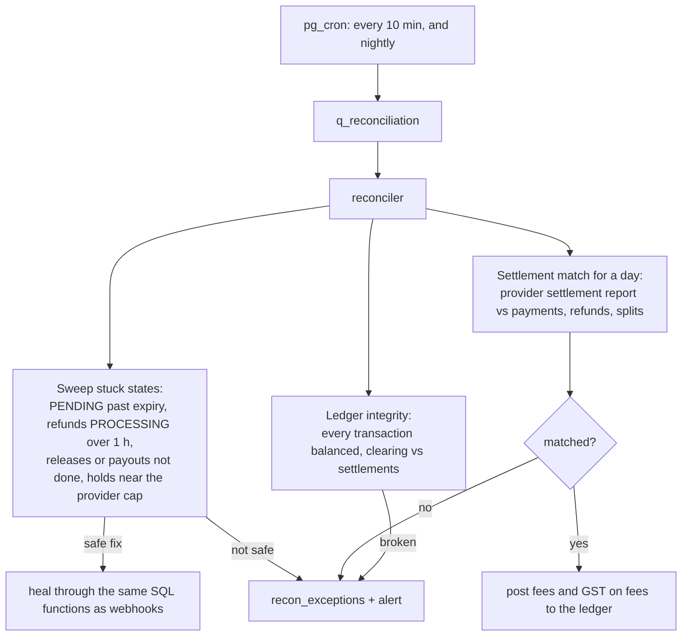

- **Sweeps, every 10 minutes:**
  - payments `CREATED`/`PENDING` past their hold, with a gateway order: look up the status, then confirm (a missed
    webhook) or expire;
  - refunds `PROCESSING` for more than an hour: look them up;
  - orders collected or expired for 15 minutes with no release or payout: run it again;
  - `REJECTED`/`CANCELLED` orders with no refund row: create one and alert (a bug detector);
  - model A holds within 7 days of the provider's cap: alert.
- **Daily settlement match.** Each finalist provides a settlement report (Cashfree, for example, has a settlements
  API). The day's report is matched item by item against `payments`, `refunds` and `payout_transfers`:
  - `recon_runs (id, provider, day, status, totals)`;
  - `recon_items (run_id, entity, ref, ours_paise, theirs_paise, status)`, where the status is `MATCHED`,
    `MISSING_OURS`, `MISSING_THEIRS`, `AMOUNT_MISMATCH` or `STATE_MISMATCH`.

  Matched fees, and the GST on them, are posted to the ledger. A mismatch goes to `recon_exceptions`, into the admin
  console queue (P7.4), and raises an alarm.

- **Rules.**
  - Each run is idempotent per (provider, day).
  - Only safe cases that a rule covers are healed automatically, such as a missed confirmation or a stuck release;
    anything else waits for a person.
  - Every action is audited with `actor_type = RECONCILER`.
- **Why a separate process.** It makes long, rate-limited provider calls, and must neither starve nor be starved by
  the API.

### P5.11 Go-live from test mode to live

- [ ] **Merchant KYC pages:** Terms, Privacy, Refund and Cancellation, and Contact, as static `/legal/*` routes.
- [ ] **Provider dashboard:**
  - live keys **(user)**;
  - a webhook URL and secret per environment, and the events subscribed;
  - settlement and split settings as ADR-003 decides.
- [ ] **Test-mode plan on staging:**
  - success, failure, pending-then-success, and abandoned payments;
  - duplicate and out-of-order webhooks;
  - full and partial refunds, and a refund after release;
  - a store's share released on collection, and on a no-show;
  - a dry-run reconciliation of the test days.
- [ ] **Live pilot:**
  - `real_payments` on for one store;
  - one small internal test order;
  - watch the payment-success and webhook-lag alarms (P8.7);
  - a person reads the daily reconciliation for the first two weeks.
- [ ] **CA sign-off** on invoicing and tax for the chosen money model (P9.4).

### P5.12 Switching providers after the promotion

The pilot runs on a temporary 0% ([P4.5](#p45-recommendation-and-fallback-ladder)), so the move to the next provider
is planned rather than improvised.

- [ ] **Watch the promotion.** The admin console (P7.4) shows how much of it is used: GMV against the cap from
      `payments` per provider, and the days left to its end date. An alarm fires at 80% of the cap, and again 60 days
      before the end date.
- [ ] **Decide 60 days ahead.** Either negotiate with the current provider using the pilot's data, or pick the next
      rung of the ladder (P4.5). Record the choice in a new ADR that supersedes ADR-003.
- [ ] **Prepare the new provider:**
  - its merchant KYC;
  - under model A, onboarding every store again as its vendor, which takes the longest;
  - its adapter and webhook route (`/api/webhooks/<provider>`) deployed dark;
  - test mode on staging.
- [ ] **Switch gradually.** Move one store with the per-store `active_payment_provider` override, watch payment
      success for a few days, then move the rest.
- [ ] **Run both until the old provider drains.** Refunds on old payments go back through the provider that took them
      (refund to source), so the old account stays active, with its webhooks and reconciliation, until its refund
      window closes and every model A hold there has been released. Only then close it.
- [ ] **Customers notice only a different payment screen.** Carts, orders and order history are unaffected, because
      nothing in the order model depends on the provider.

**Tests for P5:**

- the state-machine matrix, including the new states;
- `create_checkout` and `confirm_payment` races: `Promise.all` on the last unit, and a payment after its hold
  expired;
- idempotent checkout and confirm;
- webhook signatures per adapter, against the provider's fixtures: valid, invalid, replayed and out of order;
- refund amount limits, retries, and the gateway lookup before a retry;
- ledger conservation (property test), with both payout strategies giving identical balances;
- reconciliation matching with injected mismatches;
- the policy engine's properties;
- the legacy client gated with `CLIENT_OUTDATED`.

**Docs:**

- new `docs/PAYMENTS.md`: the gateway, flows, webhooks, ledger postings, refunds, payouts, reconciliation, and
  runbook links;
- ARCHITECTURE (lifecycle v2, money flow), API, SCHEMA, PERMISSIONS, JOBS;
- DEPLOYMENT (provider env and webhook setup);
- CLAUDE.md §9 (hosts) and §10 (payment rules).

## P6 — Order experience

**Goal:** an honest wait time, a pickup that cannot hand food to the wrong person, notifications at the moments that
matter, and a staff board built for a rush. **Items:** R11.1, R13, R15, R25, R28.1. **Depends on:** P5 (the v2
lifecycle). **Size:** L. **Flags:** `pickup_qr`, `notifications_push`.

### P6.1 ETA engine

R25: the estimate combines a store baseline, per-item offsets, store analytics, a rush-hour adjustment and a buffer.

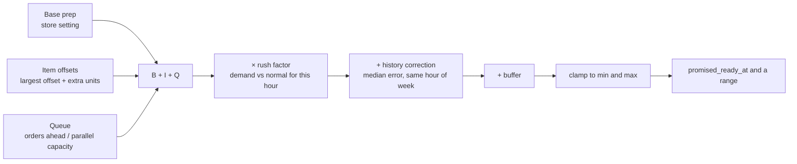

`server/src/domain/eta.ts` is pure and explainable. Its output is
`estimate(inputs) → { minutes, rangeMinutes: [low, high], breakdown }`.

| Term        | Formula                                                                                                                                                                                                            | Source                                                                     |
| ----------- | ------------------------------------------------------------------------------------------------------------------------------------------------------------------------------------------------------------------ | -------------------------------------------------------------------------- |
| Base `B`    | `base_prep_minutes`                                                                                                                                                                                                | store setting, seeded from today's `prep_time_max_minutes`                 |
| Items `I`   | `max(prep_offset_minutes of the lines) + extra_item_minutes × max(0, units − 1)`                                                                                                                                   | `catalog_items.prep_offset_minutes`, store setting                         |
| Queue `Q`   | `ceil(active_orders_ahead / parallel_capacity) × per_order_queue_minutes`, where active means `PLACED` or `PREPARING`                                                                                              | live count (one indexed query), store settings                             |
| Rush `R`    | `clamp(1 + rush_sensitivity × (demand_index − 1), 1, max_rush_factor)`, where `demand_index = orders in the last 15 min / normal orders per 15 min for this hour of the week`; manual rush windows can set a floor | `analytics_store_hourly` ([P7.1](#p71-analytics-pipeline)), store settings |
| History `H` | the median of `actual_ready − predicted_ready` over the last 4 weeks for this store and hour of the week, used only with at least `eta_min_samples` samples, clamped to ±`eta_max_correction_minutes`              | `eta_stats`, rebuilt nightly                                               |
| Buffer `F`  | `eta_buffer_minutes`                                                                                                                                                                                               | store setting                                                              |
| Result      | `clamp(round((B + I + Q) × R + H + F), eta_min_minutes, eta_max_minutes)`; the range adds the p90–p50 spread (or `F`) on top                                                                                       | –                                                                          |

- **Where it is used.**
  - **Before checkout:** `GET /api/stores/:storeRef` includes `etaMinutes: { low, high }` for a typical one-item
    order. It is cached for 30 s under `store_eta:<id>` (not user-specific).
  - **For the actual cart:** `POST /api/checkout/quote` (P5.3) returns the ETA, together with the priced lines and
    the policy.
  - **At confirmation:** `confirm_payment` stores `promised_ready_at`, which anchors the SLA (P5.9), and
    `eta_breakdown jsonb` (for explainability and tuning).
  - **Live:** `estimated_ready_at` is recomputed for a store's active orders by a debounced
    `eta.refresh_store` job whenever an order ahead changes state. Customers see the live estimate; the SLA uses the
    promise.
- **Accuracy is a KPI.** The mean absolute error, and the share of orders ready inside the shown range, per store and
  per week, appear on the platform analytics ([P7.4](#p74-platform-admin-dashboard)), so the weights get tuned
  against data instead of guesses.
- **Tests (properties):**
  - the estimate never falls below `B + F` before clamping;
  - it rises monotonically with queue length and with demand;
  - corrections are clamped;
  - a store with no history gets exactly the rule-based value.

### P6.2 Pickup tokens and QR verification

R15. The token is what the counter calls out, and the code is what proves the order is yours.

```sql
create table public.store_token_counters (
  store_id uuid not null references public.stores (id) on delete cascade,
  business_date date not null,
  last_value integer not null default 0,
  primary key (store_id, business_date)
);
alter table public.orders
  add column business_date date,
  add column pickup_token text,                  -- "A-017"
  add column pickup_verified_at timestamptz,
  add column pickup_method text check (pickup_method in ('QR', 'CODE', 'MANUAL'));
create unique index orders_store_day_token_idx on public.orders (store_id, business_date, pickup_token)
  where pickup_token is not null;
```

- **Token.** It is assigned in `confirm_payment`, so only paid orders consume tokens and there are no gaps from
  abandoned checkouts. The counter update is
  `insert ... on conflict (store_id, business_date) do update set last_value = last_value + 1 returning last_value`,
  which the row lock makes safe under concurrency. The token is formatted as `token_prefix` plus a three-digit number.
  `business_date` is the local date in the store's time zone, rolled over at `business_day_start` (default 04:00, so
  a shift past midnight keeps its numbering). The global `order_number` stays as the support reference.
- **Pickup code.** It is 6 digits, derived rather than stored:
  `code = HMAC-SHA256(PICKUP_CODE_SECRET, order_id)` truncated to 6 decimal digits.
  - The owner's order DTO includes it (`pickup: { token, code, qrPayload }`). Staff DTOs never carry it; staff only
    verify it.
  - A database leak reveals no codes, and rotating the secret between business days invalidates only stale ones.
- **QR** encodes `fp1:<orderId>:<code>`. It is rendered on the customer's order page by a small encoder loaded
  lazily with the pickup card (its gzip cost is checked, target under 10 KB, and it is never in the initial bundle).
  The page raises screen brightness where it can, and shows the token and code in large type as the fallback.
- **Verification.**

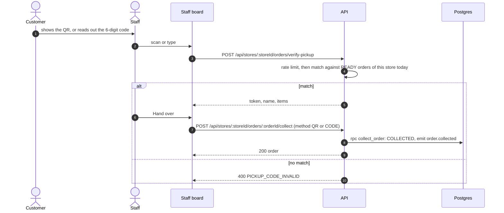

- **Matching a typed code.** A typed code is matched by computing the codes of the store's `READY` (and still
  recoverable `EXPIRED`) orders for today, a small bounded set, never by searching every order.
- **Brute-force protection.** Rate limit per staff user (P1.6), plus a lock per order after 5 wrong codes.
- **Manual override.** "Verified by name and phone" records `pickup_method = MANUAL`, which is audited.
- **Scanning** uses the browser's `BarcodeDetector` where it exists (Chrome on Android). The fallback is a decoder
  loaded lazily on the staff route only. Camera access is allowed by `Permissions-Policy: camera=(self)` (P0.6).
- **Optional counter display.** `/display/:storeSlug` is a public "Now serving" screen for a TV at the counter. It
  shows `READY` tokens only (no names), polls every 5 s with ETags, and hides tokens once they are collected.

### P6.3 Notifications

R13 and R28.1.

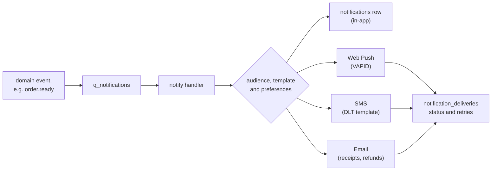

- **Channels, in priority order:**
  - In-app (the order page, plus a small inbox).
  - **Web Push**, opt-in: customers and staff on Android Chrome. On iOS it needs the app installed to the home screen
    (16.4+), so add a `manifest.webmanifest`, which staff tablets want anyway.
  - **SMS**, for critical moments only: `order.ready`, `order.rejected` and `refund.processed`. It needs India's DLT
    registration of the sender and templates, a **long-lead item to start in P4**.
  - Email for receipts and refunds (Amazon SES).
  - WhatsApp is a later option through the same port.
- **Events and audiences:**

  | Event                        | Customer                                        | Staff                                                  |
  | ---------------------------- | ----------------------------------------------- | ------------------------------------------------------ |
  | `order.awaiting_acceptance`  | in-app ("waiting for the café")                 | push + in-page sound: "Accept order A-017 (4:00 left)" |
  | `order.placed` / `.accepted` | in-app, push                                    | in-page (new ticket)                                   |
  | `order.rejected`             | push, SMS: "refund on its way"                  | –                                                      |
  | `order.sla_breached`         | push: "running late, cancel for a full refund?" | in-page alert                                          |
  | `order.ready`                | push, SMS: "A-017 is ready at the counter"      | –                                                      |
  | pickup window closing (T−10) | push reminder                                   | –                                                      |
  | `order.expired`              | in-app: "not collected, the café was paid"      | surplus prompt (P3.6)                                  |
  | `refund.processed`           | push, email                                     | –                                                      |

- **Schema.**
  - `notification_preferences (user_id, channel, event_group, enabled)`.
  - `push_subscriptions (id, user_id, endpoint unique, p256dh, auth, user_agent, created_at, last_seen_at, revoked_at)`.
  - `notifications (id, user_id, store_id, event_id, type, title, body, data jsonb, created_at, read_at)`, unique on
    `(event_id, user_id)` for idempotency.
  - `notification_deliveries (id, notification_id, channel, status, provider_message_id, attempts, last_error, sent_at)`,
    unique on `(notification_id, channel)`.
- **Handler.**
  1. Map the event to its audience and template.
  2. Check preferences and quiet rules. For example, skip a "ready" push when the order is already collected, and
     skip anything stale by more than 10 minutes.
  3. Create the in-app row.
  4. Deliver on each channel through adapters (`web-push` with VAPID keys from env; an SMS provider behind
     `SmsSender`; SES).
  5. Retry with backoff. A 404 or 410 from a push service revokes that subscription.
- **Templates** are typed and live in code, one per event and channel, ready for i18n. An SMS template carries its
  registered DLT template id and must match the registered text exactly.
- **Client.**
  - A minimal hand-written service worker (`sw.js`) handles **push and notification clicks only**. It does not cache
    anything, which respects CLAUDE.md §2c.
  - The permission is asked at a moment of intent: after the first successful payment ("Get a ping when it's
    ready?").
  - Subscriptions go through `POST /api/me/push-subscriptions` and `DELETE /api/me/push-subscriptions/:id`.
  - Staff can switch on in-page sound and vibration (browsers need a gesture before playing audio).
- **Cost and consent.** SMS is limited by a per-user daily cap, and every channel is opt-in with toggles in Profile
  (consent under India's DPDP Act). Delivery success rate per channel is a dashboard metric.

### P6.4 Staff dashboard v2

R11.1: statuses, collection, a list of every order with a short summary, and an order detail with a call button.

- **Layout.** Tablet first, and still usable on phones. It reuses `StaffHeader`, `StaffFilters`, `StaffBoard` and
  `StaffOrderCard`, extended through variants per CLAUDE.md §5.
  - **Header:** store switcher, pause control (P2.5), sound toggle, clock and the offline badge.
  - **Lanes:** Needs acceptance (with a countdown), New, Preparing, Ready and Done. Search by token or name.
  - **Ticket:** token, name, item summary with modifiers, note, time since payment, an ETA or "late" badge, and the
    payment state.
  - **Detail sheet**, opened by tapping a ticket:
    - items and modifiers, and the note;
    - a timeline (paid, accepted, preparing, ready, collected, each with its actor);
    - the customer's name, and their phone number masked until the call button is pressed;
    - the **Call button** (a `tel:` link);
    - actions: accept, reject with a reason, start, ready, verify pickup, cancel with a reason, and mark a line
      unavailable (a partial refund, P5.5);
    - the refund status.
- **Privacy.** The list payload never carries phone numbers. `GET /api/stores/:storeId/orders/:orderId` returns
  `customerPhone` only when the caller has `orders.viewCustomerPhone`, and each reveal is audited. Masked calling
  through a telephony provider is a possible later improvement.
- **API.** Commands replace the generic status patch, because each has its own payload and permission:
  `POST /api/stores/:storeId/orders/:orderId/{accept,reject,start,ready,collect,cancel}`. Each is idempotent (P1.4)
  and calls exactly one SQL transition function. The legacy `PATCH .../status` maps onto them during compatibility.
- **Lean polling.**
  - `GET /api/stores/:storeId/orders?since=<cursor>` returns only orders changed since the cursor, plus
    `pollAfterMs`, so a busy board costs a few hundred bytes every 4 s.
  - A full refresh runs every 60 s, and whenever the board becomes visible again.
- **Offline.** Actions are disabled with a reason while offline, and retried with the same idempotency key. The board
  never guesses at state.

### P6.5 Customer order page v2

- **States and copy** come from `orderStatus.ts`, extended with the new lifecycle states:
  - awaiting acceptance: a countdown, and "you'll get a full refund if they can't make it";
  - late: a banner with "Cancel for a full refund";
  - ready: the pickup card with the token, the QR and the code;
  - expired: "not collected — the café has been paid; talk to them if you're on your way";
  - rejected or cancelled: the refund amount and its status.
- **Also:** the live ETA and its range, and Cancel with a preview (P5.8). The receipt shows modifiers and deal savings
  from the snapshots. After collection comes the rating prompt ([P7.5](#p75-feedback-and-ratings)).
- **Polling** follows the server's `pollAfterMs`, and stops at terminal states, as today.
- **Budgets.** The QR encoder and rating sheet are lazy, so the order page's LCP stays within the §2b budgets on the
  throttled 360px profile.

**Tests for P6:**

- the ETA properties;
- token uniqueness under 50 concurrent confirmations for the same store and day;
- the pickup-code match, lockout and manual override;
- notification idempotency when an event is delivered twice;
- the "ready" push skipped once the order is collected;
- a staff delta poll never misses a change (it carries an `updated_at` cursor, and a full refresh runs every 60 s);
- phone reveals audited.

**Docs:** ARCHITECTURE (pickup and notification flows), API, SCHEMA, COMPONENTS (pickup card, lanes, detail sheet),
JOBS (notification and ETA jobs), PERMISSIONS (phone reveal), DEPLOYMENT (VAPID keys, SMS provider env).

## P7 — Insights and engagement

**Goal:** restaurants and the platform see what is happening, and customers find what they want faster.
**Items:** R7, R10, R11.2 (analytics), R14, R22, R28.2, R28.7, R30. **Depends on:** P5 for money figures. P7.5 and
P7.6 can start right after P2. **Size:** L. **Flags:** `reviews`, `usuals`, `recommendations`.

### P7.1 Analytics pipeline

R28.2. Rollup tables are rebuilt per store per day, so they are idempotent and self-healing, and no late or replayed
event can double-count.

```sql
create table public.analytics_store_daily (
  store_id uuid not null references public.stores (id),
  business_date date not null,                 -- store-local, same rule as tokens (P6.2)
  orders_paid integer not null default 0,
  orders_collected integer not null default 0,
  orders_expired integer not null default 0,
  orders_cancelled integer not null default 0,
  orders_rejected integer not null default 0,
  gross_sales integer not null default 0,      -- whole rupees
  refunds integer not null default 0,
  net_sales integer not null default 0,
  commission_paise bigint not null default 0,
  cogs_paise bigint not null default 0,        -- P7.2
  avg_accept_seconds integer,
  avg_prep_minutes numeric(6, 2),
  p90_prep_minutes numeric(6, 2),
  sla_breaches integer not null default 0,
  unique_customers integer not null default 0,
  new_customers integer not null default 0,
  rebuilt_at timestamptz not null default now(),
  primary key (store_id, business_date)
);
-- analytics_item_daily   (store_id, menu_item_id, catalog_item_id, business_date, qty_sold, gross_sales, qty_refunded, cogs_paise)
-- analytics_store_hourly (store_id, business_date, hour, orders, avg_prep_minutes)   -- rush patterns and the ETA inputs
-- eta_stats              (store_id, hour_of_week, p50_error_minutes, p90_error_minutes, samples, rebuilt_at)
-- analytics_platform_daily (business_date, gmv, orders, active_customers, new_customers, active_stores,
--                           refund_rate, sla_breach_rate, eta_mae_minutes)
```

- **Rebuild.** `rebuild_store_day(p_store_id, p_date)` recomputes one store-day from the source tables (orders,
  order items, refunds, ledger, `stock_movements`) and upserts it. A store-day is a few hundred rows, so a rebuild
  takes milliseconds.
- **Triggers.**
  - Terminal `order.*`, `refund.*` and review events mark `(store, business_date)` dirty in `analytics_dirty`.
  - A worker job rebuilds dirty days every minute.
  - A nightly pg_cron run rebuilds yesterday for every store (late events, time-zone edges) and refreshes `eta_stats`.
  - `npm run analytics:backfill -- --from <date>` rebuilds history.
- **Reading.** Monthly figures are summed from the daily rows at query time, so no monthly tables are needed.
  "Least popular" left-joins every listing active in the range, so an item that sold nothing appears with zero.
- **Read APIs** (never cached across users; each costs one indexed range scan):
  - `GET /api/stores/:storeId/analytics/summary?from&to&granularity=day|month` (`analytics.store`);
  - `.../analytics/items?from&to&sort=top|bottom`;
  - `.../analytics/hours?from&to`;
  - `GET /api/brands/:brandId/analytics/summary` (`analytics.brand`, which rolls up the branches);
  - `GET /api/admin/analytics/overview` and `.../stores?sort=` (platform).
- **CSV export.** Streamed `GET .../analytics/export.csv` for the same ranges.

### P7.2 COGS and expenses

R30: expenditure analytics from restaurant-entered costs.

```sql
create table public.catalog_item_costs (
  id uuid primary key default gen_random_uuid(),
  catalog_item_id uuid not null references public.catalog_items (id) on delete cascade,
  store_id uuid references public.stores (id) on delete cascade,     -- null = the brand default
  unit_cost_paise bigint not null check (unit_cost_paise >= 0),      -- costs are often fractional
  effective_from date not null,
  created_by uuid references public.profiles (id) on delete set null,
  created_at timestamptz not null default now(),
  unique nulls not distinct (catalog_item_id, store_id, effective_from)
);
-- modifier_option_costs: the same shape, for add-ons ("Extra cheese" costs ₹8)

create type public.expense_category as enum
  ('RENT', 'SALARIES', 'UTILITIES', 'INGREDIENTS', 'PACKAGING', 'MAINTENANCE', 'MARKETING', 'OTHER');
create table public.store_expenses (
  id uuid primary key default gen_random_uuid(),
  store_id uuid not null references public.stores (id),
  category public.expense_category not null,
  amount_paise bigint not null check (amount_paise >= 0),
  incurred_on date not null,
  recurrence text not null default 'ONE_TIME' check (recurrence in ('ONE_TIME', 'MONTHLY')),
  note text check (char_length(note) <= 200),
  created_by uuid references public.profiles (id) on delete set null,
  created_at timestamptz not null default now(),
  deleted_at timestamptz
);
```

- **Effective dating, not order snapshots.** A cost applies from `effective_from`, with a store override taking
  precedence over the brand default. Costs are often entered after the fact, and rebuilding the affected days
  (P7.1) makes a late entry correct history.
- **Figures.**
  - **COGS** for a day = Σ quantity × the unit cost in effect that day (item plus modifiers).
  - **Gross margin** = net sales − COGS.
  - **Operating result** = gross margin − commission − expenses (monthly expenses are spread evenly across the
    month's days).
  - The UI shows "based on the costs you entered" whenever items lack costs.
- **Privacy.** Costs and expenses are `MANAGER`/`OWNER` only. They never appear in a public DTO; they have their own
  endpoints and never share a menu serializer. Every edit is audited.
- **Out of scope:** recipe-level costing and ingredient inventory.

### P7.3 Restaurant analytics dashboard

R11.2 analytics: daily and monthly orders, the most and least popular items, daily and monthly sales, and
expenditure.

- **Views** under `/manage/:storeSlug/analytics` (lazy, `analytics.store`):
  - **Today:** live counts by state, sales so far, average acceptance and prep time, and late orders.
  - **Days and Months:** orders, gross, refunds, net, and a trend.
  - **Items:** top and bottom by quantity, revenue and margin.
  - **Hours:** a heatmap of rush patterns, which feeds staffing and the ETA's manual rush windows.
  - **Customers:** new vs repeat, and the rating trend.
  - **Expenditure:** COGS, expenses, gross margin and operating result.
  - **Payouts:** from the ledger (P5.6): held, released and settled, with downloadable statements.
  - Brand owners get the same views across branches, with a branch column.
- **Charts** are hand-rolled SVG components in `components/charts/` (`Sparkline`, `BarChart`, `Heatmap`): no charting
  library, a few KB, and accessible (`<title>`, a data table fallback). A library is added only if a chart needs
  something these cannot do, after a gzip check (CLAUDE.md §2b).
- **Mobile-first.** Stacked cards, and horizontally scrollable tables with a sticky first column. Money uses
  `formatPrice`, and paise are converted in one place.

### P7.4 Platform admin dashboard

R14: onboard restaurants, view app analytics and usage load, and change site settings such as wait times. It grows
today's `/admin` settings page into a console, lazy per section.

| Section        | Does                                                                                                                                                                                                                                                                                                                          |
| -------------- | ----------------------------------------------------------------------------------------------------------------------------------------------------------------------------------------------------------------------------------------------------------------------------------------------------------------------------- |
| Overview       | GMV, orders, active customers, checkout conversion (checkouts started → paid), refund rate, SLA breach rate, ETA accuracy, and a per-store table                                                                                                                                                                              |
| Onboarding     | A wizard: brand → stores (address, hours, settings) → invite the owner → payout account (model A: vendor onboarding and KYC with the aggregator; model B: bank details verified by penny drop) → menu import (CSV) → go-live checklist (hours set, at least N items, payout active, policy set, test order passed) → activate |
| Stores         | Activate, suspend or archive (audited), and a read-only "view as" of any store's board and menu for support                                                                                                                                                                                                                   |
| Users          | Search by email or phone (audited), block or unblock (`profiles.blocked_at`; `requireAuth` refuses with 403 `ACCOUNT_BLOCKED`), memberships                                                                                                                                                                                   |
| Settings       | Every site setting from A2, with its bounds: hold TTL, polling, default acceptance timeout and pickup window, default commission, refund speed, `min_client_version`, recommendation weights                                                                                                                                  |
| Flags          | Feature flags and their rules (P1.7)                                                                                                                                                                                                                                                                                          |
| Payments       | Refund search and retry, manual refunds (reason required, audited; a second admin approves above a threshold), disputes                                                                                                                                                                                                       |
| Reconciliation | Runs, exceptions, and actions: resolve, retry, adjust (P5.10)                                                                                                                                                                                                                                                                 |
| Jobs           | Queue depth, oldest-message age, dead letters with retry or discard (P1.2)                                                                                                                                                                                                                                                    |
| Usage and load | Requests per second, p95 latency, error rate, active users (last 5 minutes), queue depth and database connections, from `GET /api/admin/metrics/summary`, which reads the metrics backend (P8.7)                                                                                                                              |
| Audit          | The audit viewer (P1.3)                                                                                                                                                                                                                                                                                                       |

- **Hardening.** Admin accounts use Supabase MFA (TOTP), and `requireAdmin` requires the token's `aal` claim to be
  `aal2`, so a leaked password alone opens nothing. Destructive actions ask for a typed confirmation.

### P7.5 Feedback and ratings

R7: ratings for each dish and each restaurant.

```sql
create table public.store_reviews (
  id uuid primary key default gen_random_uuid(),
  order_id uuid not null unique references public.orders (id),
  store_id uuid not null references public.stores (id),
  user_id uuid not null references public.profiles (id) on delete cascade,
  rating smallint not null check (rating between 1 and 5),
  comment text check (char_length(comment) <= 500),
  tags text[] not null default '{}',          -- from a fixed list: 'late', 'cold', 'great_taste', ...
  status text not null default 'PUBLISHED' check (status in ('PUBLISHED', 'FLAGGED', 'HIDDEN')),
  created_at timestamptz not null default now(),
  updated_at timestamptz not null default now()
);
create table public.item_ratings (
  id uuid primary key default gen_random_uuid(),
  order_item_id uuid not null unique references public.order_items (id),
  menu_item_id uuid not null references public.menu_items (id),
  catalog_item_id uuid references public.catalog_items (id),
  store_id uuid not null references public.stores (id),
  user_id uuid not null references public.profiles (id) on delete cascade,
  rating smallint not null check (rating between 1 and 5),
  created_at timestamptz not null default now()
);
create table public.rating_aggregates (
  entity_type text not null check (entity_type in ('store', 'catalog_item')),
  entity_id uuid not null,
  rating_count integer not null,
  rating_sum integer not null,
  display_rating numeric(3, 2) not null,       -- Bayesian average
  updated_at timestamptz not null default now(),
  primary key (entity_type, entity_id)
);
```

- **Eligibility.** A review needs a `COLLECTED` order by the same user, within `review_window_days` (7). There is one
  review per order, editable for 24 h. Only verified purchases count, which is the main defence against fake reviews.
- **Flow.** After collection, the order page shows the rating card, and a push goes out 30 minutes later if the user
  opted in. The sheet has store stars, per-dish thumbs (mapped to 5 and 1, which keeps it one tap per dish), tag chips
  and an optional comment.
- **Display.**
  - The shown value is `display_rating = (C × m + Σ ratings) / (C + n)`, with the prior `m` and weight `C` as
    settings. It appears only once `n ≥ rating_min_count`, so one early 1-star review cannot sink a new café.
  - The store card shows "4.3 ★ (120)". The item card shows "92% liked" beside the text, never on the photo
    (CLAUDE.md §7).
- **Moderation.**
  - A word-list filter flags comments (`FLAGGED` is hidden until an admin reviews it).
  - Restaurants can report a review, and replies can come later.
  - Reviews are rate-limited (P1.6).
- **API.**
  - `POST /api/orders/:id/review` (idempotent).
  - `GET /api/stores/:storeRef/reviews?cursor`: public, published only; the author is shown as first name and
    initial.
  - `GET /api/stores/:storeId/reviews/manage` (`reviews.manage`).
  - Aggregates are updated by a debounced analytics job.

### P7.6 Your usuals

R10: a separate category at the top of the menu that repeats the items this user orders most, like Swiggy.

- **Query.** `user_top_items(p_user_id, p_store_id, p_limit)` scores each item the user got from `COLLECTED` orders
  at this store in the last 90 days as `Σ exp(−age_days / half_life_days)`. That is recency-weighted frequency:
  "often, and lately". It keeps items ordered on at least `usuals_min_orders` (2) separate orders, joins the current
  listing, drops unavailable items, and returns at most 6. It is served by a new index,
  `orders (user_id, store_id, created_at desc)`.
- **API.** `GET /api/me/stores/:storeId/usuals` requires sign-in. It is user-specific, so it is **never** put through
  `cached()` and never persisted on the client (CLAUDE.md §2c). It loads after the public menu and never blocks it.
- **UI.** A "Your usuals" rail above Popular, holding the same `MenuItem` objects as their real categories, so
  adding to the cart and stock limits behave identically, with an "Ordered 5 times" hint. It is hidden when empty or
  signed out, and its skeleton matches the rail 1:1 so nothing shifts.

### P7.7 Recommender v1

R22 (similarity, popularity, other users' orders) and R28.7 (recommendation updates).

- **Signals.**
  - **Popularity:** per store and daypart, from `analytics_item_daily` and `analytics_store_hourly`.
  - **Co-occurrence** ("people who ordered X also ordered Y"): counted over order pairs across all users, anonymous
    and aggregate only.
  - **Personal affinity:** from usuals and category preferences.
  - **Content similarity:** same category, tags and diet.
  - **Novelty:** a boost for new items.
  - Only items currently available are recommended.
- **Tables.**
  - `item_associations (store_id, item_id, related_item_id, co_orders, support, confidence, lift, updated_at)`, with
    the primary key `(store_id, item_id, related_item_id)`. It keeps only pairs above minimum support and lift.
  - `item_popularity (store_id, item_id, daypart, score, updated_at)`.
- **Jobs.** `order.collected` increments pair counts (incremental). A nightly rebuild recomputes the last 90 days with
  decay (R28.7).
- **Serving.**
  - **Not personal, so cacheable:** `GET /api/stores/:storeRef/recommendations?context=item:<id>` for "Goes well
    with" in the item sheet, and `?context=cart:<ids>` for the cart's "Add something?" (at most 3). Cache key
    `recs:<storeId>:<context>`, TTL 10 min.
  - **Personal, never cached:** `GET /api/me/stores/:storeId/recommendations` for the menu's "Recommended for you"
    rail. Its score, minus anything already in the cart, is:

    `w_affinity × affinity + w_popularity × popularity(daypart) + w_cooccurrence × cooccurrence + w_novelty × novelty`

    where `cooccurrence` is measured against the user's usuals, and the weights are site settings. Each result carries a reason code ("Popular at lunch", "Often ordered with Cold Coffee").
- **Measuring.**
  - Offline: hit rate at 5 on the last week's orders against a popularity-only baseline.
  - Online: rollout by flag percentage, with impressions, taps and add-to-cart from batched, anonymous events
    (`POST /api/events/recs`).
  - v2 ([P10.2](#p102-recommender-v2)) arrives only when v1 beats the baseline and data volume justifies it.
- **Privacy.** No customer ever sees another customer's history. Co-occurrence is aggregate, with a minimum support
  threshold so a pair from one person never surfaces.

**Tests for P7:**

- a day rebuilt twice gives identical rows;
- a late refund moves yesterday's net figure;
- effective-dated costs pick the right cost on boundary dates;
- review eligibility (only your own collected orders, one per order, window);
- the Bayesian display value;
- usuals never include another user's items;
- the minimum-support privacy threshold.

**Docs:** SCHEMA, API, COMPONENTS (charts, rating sheet, rails), JOBS (analytics and recommendation jobs), PERMISSIONS
(costs, analytics, admin MFA), a new `docs/ANALYTICS.md` for metric definitions (with its CLAUDE.md §6 row).

## P8 — Infrastructure and delivery

**Goal:** reproducible staging and production on AWS, with every change deployed by a pipeline. This is a parallel
track. P8.1–P8.5 for **staging** must be ready before P5.4 (webhooks need a public HTTPS URL), and the rest before the
pilot. **Items:** R16, R17, R18, R21, R3 (secrets), R6 (observability), R14 (usage load). **Depends on:** P0.6.
**Size:** L.

### P8.1 AWS foundation with Terraform

- **Accounts.** Separate AWS accounts for staging and production under AWS Organizations (the blast radius stops at
  the account), with budgets and billing alarms on both.
- **Region.** The AWS region of the Supabase projects. Confirm each project's region and put the EC2 hosts there.
- **Terraform** (`infra/terraform/`):
  - `modules/{network, ecr, media, compute, alb, cdn, iam, secrets, observability}` and
    `envs/{staging, production}`;
  - remote state in S3 with locking;
  - CI runs `terraform fmt -check`, `validate`, `tflint` and `checkov`, and posts a `plan` on the PR;
  - `apply` runs from the pipeline with approval **(user)** for production.
- **IAM.**
  - A GitHub OIDC provider and a deploy role limited to: push to ECR, `ssm:SendCommand` on instances tagged
    `app=food-pickup`, and read the release artefacts bucket. There are no long-lived access keys anywhere.
  - An instance role for ECR pull, SSM, CloudWatch logs and metrics, its own environment's secrets, and read/write on
    the media bucket for the worker.
- **Network.**
  - A VPC across 2 AZs.
  - Public subnets for the ALB and the EC2 hosts. The hosts have public IPs for outbound traffic only, because a NAT
    gateway costs more than the whole pilot compute; security groups accept inbound traffic from the ALB only.
  - Private subnets reserved for later (ElastiCache, EKS nodes).
  - An S3 gateway endpoint (free).

### P8.2 Container registry and image pipeline

- ECR repositories `food-pickup/web` and `food-pickup/server`, with **immutable tags** (git SHA, plus the semver from
  P0.3 at release). A lifecycle policy keeps the last 30 images, and every push is scanned (Inspector).
- `docker/build-push-action` with layer caching, SBOM and provenance attestations. Images are built for the instance
  architecture (arm64, if the cheaper Graviton instances are chosen).
- Every image is built once and then promoted: the same digest goes from staging to production. The web image takes
  its environment at start (P0.6).

### P8.3 Media bucket and CDN

- **S3 bucket** `food-pickup-media-<env>`:
  - public access blocked, SSE-S3 encryption, versioning on;
  - CORS for presigned POST from the app origin;
  - lifecycle rules: `tmp/` uploads expire after 1 day, and old noncurrent versions after 30 days.
- **CloudFront**, one distribution per environment, with an ACM certificate (`us-east-1`), Route 53 records and HTTP/3:
  - **Default behaviour** → the ALB, for the SPA from the web container.
  - **`/api/*`** → the ALB with caching disabled. `Authorization` and every query string are forwarded, which matches
    the API's own `no-cache` + ETag behaviour (CLAUDE.md §2c).
  - **`/assets/*`** → the release-assets bucket via OAC, cached for a year. Every release uploads its hashed
    `client/dist/assets/` there, and old releases' chunks are kept for 30 days. A tab left open across a deploy can
    then still load its lazy chunks, instead of relying on `PageBoundary`'s reload.
  - **`/media/*`** → the media bucket via OAC, cached for a year (content-addressed keys, P3.3).
  - The WAF web ACL is attached ([P9.3](#p93-edge-protection-and-security-review)).

### P8.4 Compute on EC2

R18.

- **Auto Scaling group.** Minimum 1 and maximum 2 hosts for the pilot. The launch template uses Amazon Linux 2023. Its
  user data installs Docker, the compose plugin and the CloudWatch agent, and fetches `compose.prod.yml`.
- **Services** on each host: `web`, `api`, `worker` and `reconciler`. The reconciler runs on every host, but only the
  holder of the `reconciler` lease works: a `leases (name, holder, expires_at)` row with `acquire_lease` and
  `renew_lease` RPCs, renewed every 30 s.
- **Environment.** A start script renders each service's environment from Secrets Manager and SSM
  (`/food-pickup/<env>/*`) into a tmpfs file. Secrets never go into images or onto disk.
- **ALB.** A target group points at the `web` container on each host. Its health check is `GET /api/ready` through
  nginx. The deregistration delay is 30 s, and the idle timeout is 60 s, below the API's 65 s keep-alive (P0.7).
- **Deploys.** The SSM Run Command document `food-pickup-deploy (tags)` runs on one host at a time:
  1. Deregister the host from the ALB.
  2. `docker compose pull && up -d`.
  3. Wait for `/api/ready`.
  4. Register it again, then move to the next host.

  Rolling back means running the same command with the previous tags. Because every schema change is
  expand/contract, a rollback never needs a database rollback.

- **Starting size.** `t4g.small` (2 vCPU, 2 GB). [P9.1](#p91-load-testing-from-100-to-1000-concurrent) sets the real
  size and count. ECS on EC2 is an acceptable variant if the team prefers managed deploys (ADR-007).
- **Backups.** Check the Supabase plan's daily backups, and add PITR for production. S3 versioning covers media.

### P8.5 Continuous deployment

R21.

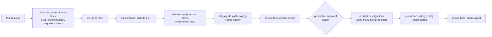

- **`deploy.yml`**, on push to `main`, once `ci.yml` has passed:
  1. Build and push the images.
  2. **Release:** `npm run release` from P0.3. It applies the intents and commits
     `chore(release): client vX, server vY`, then tags both, as the GitHub Actions bot. Branch protection lets the bot do this, and it is the only
     automated commit.
  3. Upload the web assets to S3.
  4. `supabase db push` to **staging**.
  5. SSM deploy to staging.
  6. Smoke: a Playwright golden path using the payment test mode, a k6 smoke run, and `/api/ready` on every host.
  7. **Production** runs in a GitHub Environment with a required reviewer: the user.
- **Production migrations.** CLAUDE.md §2 keeps `db:push:production` a user-only step. The production job therefore
  **stops and waits** while the user runs `npm run db:push:production`. Moving it into the pipeline behind the
  approval is the user's decision, and it would be recorded in an ADR.
- **Order of changes.** Every PR that touches the schema states its expand/contract stage. Contract migrations ship
  only in a release after the code stopped using the old shape (a PR template checkbox).
- **Decoupling.** Feature flags separate deploying from releasing. A deploy ships dark, and a flag turns it on per
  store.

### P8.6 Secrets and configuration

R3, for deployments.

- **Where secrets live.** Secrets Manager per environment:
  - `SUPABASE_SECRET_KEY`;
  - the payment aggregator's secret and webhook secret (P4 decides which);
  - `PICKUP_CODE_SECRET`;
  - `VAPID_PRIVATE_KEY`;
  - SMS and email provider keys.

  Non-secret configuration goes in SSM Parameter Store.

- **One reader.** `utils/env.ts` stays the only reader on the server. Each new variable gets zod validation, a
  `.env.example` entry and a DEPLOYMENT.md row in the same change (CLAUDE.md §6). The client gets its runtime
  environment through `/runtime-env.js` (P0.6).
- **Guards**, as `SUPABASE_SECRET_KEY` already has:
  - production refuses test-mode payment keys, and every other environment refuses live keys;
  - `PAYMENT_PROVIDER=fake` is refused on production;
  - the webhook secret must be set whenever real payments are on.
- **Rotation runbooks** ([P9.5](#p95-launch-checklist-and-runbooks)). The webhook secret rotates with an overlap
  window (both secrets accepted for 24 h). The Supabase key and the VAPID keys rotate with a redeploy.

### P8.7 Observability

R6 in production, and R14's "usage load".

- **Logs.** pino JSON goes to stdout, then through Docker's `awslogs` driver into CloudWatch Logs, one group per
  service and environment. Retention is 30 days in production and 7 in staging. Saved Logs Insights queries cover:
  errors by code, the slowest routes, a request-id lookup across api and worker, and dead letters.
- **Metrics.** CloudWatch Embedded Metric Format lines: no agent and no new library, just structured log lines that
  CloudWatch turns into metrics.
  - **HTTP:** `http_requests{route, status}` and `http_duration_ms`.
  - **Business:** `orders_paid{store}`, `payment_success_rate`, `accept_latency_s`, `prep_minutes`,
    `sla_breaches{store}`, `refunds{reason}` and `refunds_failed`.
  - **Pipeline:** `webhook_lag_s`, `queue_depth{queue}`, `queue_oldest_age_s{queue}`, `job_failures{handler}`,
    `recon_exceptions` and `rate_limited{bucket}`.
- **Tracing** (optional for the pilot): OpenTelemetry for Node (http, express, fetch) through the ADOT collector to
  X-Ray. The `traceparent` travels inside event payloads, so a trace spans api → queue → worker.
- **Real-user performance.** The small `web-vitals` library (about 2 KB) samples LCP, INP and CLS from 10% of real
  sessions (a setting) into `POST /api/client-metrics`. That measures the actual target, low-end Android phones on
  real networks, next to the lab budgets.
- **Dashboards:** API, business, pipeline, infrastructure, and the admin console's usage-and-load section (P7.4).
- **Alarms** go through SNS to email or chat:

  | Condition                                        | Window |
  | ------------------------------------------------ | ------ |
  | 5xx rate above 2%                                | 5 min  |
  | p95 latency above 1 s                            | 10 min |
  | payment success below 90% (at least 20 attempts) | 15 min |
  | webhook lag above 5 min                          | –      |
  | any dead letter                                  | –      |
  | any reconciliation exception                     | –      |
  | oldest queue message older than 5 min            | –      |
  | a failed cron run                                | –      |
  | an unhealthy host                                | –      |
  | a certificate expiring within 21 days            | –      |

- **SLOs for the pilot:**
  - availability 99.5% a month;
  - checkout success 99%, excluding payments the customer abandoned;
  - p95 of 300 ms for reads and 1.5 s for checkout API calls;
  - p75 LCP at or under 2.5 s from real-user data.

## P9 — Pilot readiness and launch

**Goal:** prove that the system holds 1000 concurrent users and recovers from failures, then launch a pilot with
one or two stores. **Items:** R9 (load in CI), R19, R32, R33 (edge). **Depends on:** P5, P6, P7 and P8. **Size:** L.

### P9.1 Load testing from 100 to 1000 concurrent

R19, plus R9's load checks.

- **Tool.** k6. Scripts live in `loadtest/`:
  - `scenarios/browse.js` (store list and menus: cache hits);
  - `track.js` (polling one active order at the server's `pollAfterMs`);
  - `checkout.js` (quote → checkout → confirm);
  - `staff.js` (a board polling with delta cursors, plus transitions);
  - `race.js` (many users buying the last units of one item, and one deal);
  - `mixed.js` (the realistic blend).
- **Environment**, never production:
  - a load-test stack sized like production;
  - a **dedicated Supabase project on the same compute tier as production**, seeded with 20 stores, their menus and
    5,000 test users made through the admin API;
  - `PAYMENT_PROVIDER=fake`, because a real test mode rate-limits and is not ours to load;
  - notification providers faked;
  - rate limits keyed per test user.
- **Workload for 1000 concurrent users:**
  - 70% browsing, with 3–10 s think times;
  - 20% tracking an active order;
  - 5% checking out;
  - 5% staff boards (one per store).

  The run ramps 100 (10 min) → 250 → 500 → 1000, holds for 20 min, spikes to 1500 for 2 min, then ramps down. There
  is also a 2 h soak at 500 users to catch leaks.

- **Thresholds**, which fail the run:
  - `http_req_failed < 1%` and checks at 99% or better;
  - p95 under 500 ms for reads and under 1.5 s for checkout;
  - queue lag under 30 s.
- **Post-run invariants**, checked with SQL:
  - no negative stock;
  - no oversold deal;
  - every hold released or committed;
  - every ledger transaction balanced;
  - one token per paid order.
- **What to watch:**
  - Supabase CPU, connections and the PostgREST pool;
  - Node event-loop lag and memory;
  - nginx upstream time;
  - lock waits on `place_order`/`create_checkout` for hot items.

  Polling is the expected hot spot. Express computes an ETag from the body, so a 304 still runs the query.

- **Decisions this step triggers.** Each is written down with its numbers, and none is made in advance.

  | If the test shows…                    | Then                                                                                                                                         |
  | ------------------------------------- | -------------------------------------------------------------------------------------------------------------------------------------------- |
  | more than 2 API instances needed      | the Redis store for rate limits and a shared cache (ADR-009)                                                                                 |
  | order polling dominating database CPU | a lightweight status endpoint, or SSE ([P10.3](#p103-realtime-updates-if-polling-costs-too-much)); this may need a CLAUDE.md §2c rule change |
  | Supabase is the bottleneck            | a compute upgrade, a read replica for analytics, or moving the worker to a direct pooled connection                                          |
  | lock waits on hot items               | shorter transactions, or pre-reserving deal stock                                                                                            |

- **In CI** (R9): a k6 smoke run (20 virtual users for 2 min, thresholds on) on PRs that touch checkout, orders or
  polling code, against the CI compose stack. A full run happens weekly, and from `workflow_dispatch`, against the
  load-test stack. Results are kept as artefacts and compared with `docs/LOAD_BASELINE.md`, a new doc owned like
  `PERF_BASELINE.md`.

**Done when** 1000 concurrent users meet every threshold with every invariant intact, the capacity per host is
written down, and the pilot sizing in P8.4 is updated from it.

### P9.2 Failure and recovery testing

R32. Game days in staging, each with an expected outcome, run before launch and then every quarter.

| #   | Fault                                                | Expected behaviour                                                                                                                                        |
| --- | ---------------------------------------------------- | --------------------------------------------------------------------------------------------------------------------------------------------------------- |
| 1   | An API host is killed mid-checkout                   | The client retries with the same `Idempotency-Key`, and exactly one order exists; the ALB drains the host                                                 |
| 2   | Supabase is unreachable for 2 minutes                | The API answers 503 quickly (with timeouts) while liveness stays green; clients show `ErrorState unreachable` and retry; it recovers without intervention |
| 3   | Payment API timeouts                                 | Checkout answers 502 `PAYMENT_UNAVAILABLE` quickly and releases holds; refunds retry with backoff                                                         |
| 4   | Webhooks delayed an hour, duplicated or out of order | The client's confirm path or the reconciler's sweep confirms orders; duplicates change nothing                                                            |
| 5   | The worker is down for 30 minutes                    | The queue backs up and drains afterwards; nothing is lost; notifications older than 10 minutes are dropped rather than sent late                          |
| 6   | A pg_cron job fails                                  | The alarm fires; the runbook's manual run catches up (the functions are idempotent)                                                                       |
| 7   | S3 or CloudFront `/media` is down                    | Photos show placeholders; ordering works                                                                                                                  |
| 8   | A bad deploy                                         | Rollback to the previous tags takes under 10 minutes, with no database rollback needed                                                                    |
| 9   | Data loss                                            | A restore drill from backup or PITR into a new Supabase project, verified; targets RPO ≤ 5 min with PITR, RTO ≤ 2 h for the pilot                         |
| 10  | Secret rotation                                      | Webhook secret rotated during traffic with the overlap window; no webhook lost                                                                            |
| 11  | The phone goes offline right after paying            | The order page shows "Confirming your payment…", then the true state on reconnect; the customer is never asked to pay twice                               |
| 12  | A reconciler exception (injected mismatch)           | It lands in the console with an alarm; nothing is fixed automatically without a rule for it                                                               |

- **Tooling.** Toxiproxy in compose (latency, timeouts and resets between the API and Supabase or the aggregator
  sandbox), `docker kill`, AWS FIS in staging (instance termination), and Playwright scripts for the client-side
  cases.
- **Output.** Each drill's result and fixes go into `docs/RUNBOOKS.md`.

### P9.3 Edge protection and security review

R33 at the edge, plus the launch security review.

- **AWS WAF on CloudFront.**
  - Managed rule groups: the core rule set, known bad inputs and IP reputation. Bot Control is optional, because of
    its cost.
  - Rate-based rules only on the sensitive paths (`/api/auth/register`, `/api/checkout`), and set high, because
    campus NAT puts many students behind one address (P1.6). Per-user limits in the app do the precise work.
  - `/api/webhooks/*` is excluded from the bot and rate rules; the signature check protects it.
- **Headers.** A strict CSP listing exactly the hosts in the updated CLAUDE.md §9: self, the Supabase project, the
  chosen aggregator's checkout hosts and Google Fonts. Also HSTS (preload once stable), `X-Content-Type-Options`,
  `Referrer-Policy` and `Permissions-Policy`.
- **CAPTCHA** on registration (Cloudflare Turnstile or hCaptcha), verified server-side in `POST /api/auth/register`. It
  adds a runtime host, so it is in [Decisions needed](#decisions-needed).
- **Review.**
  - A STRIDE threat model for payments, tenancy and pickup.
  - The OWASP ASVS level 1 checklist.
  - The `agent-skills:security-auditor` agent over auth, orders, money and user data (CLAUDE.md §16).
  - `npm audit`, and an OWASP ZAP baseline scan against staging.
  - An external penetration test before live payments, if the budget allows.

### P9.4 Compliance checklist

This is a checklist to take to professionals, not legal advice.

- **Payments.**
  - The aggregator's hosted checkout keeps card data out of our systems (PCI DSS SAQ-A scope).
  - The website pages aggregators require for KYC: Terms, Privacy, Refund and Cancellation, Contact.
  - The money-holding structure from [P5.6](#p56-ledger-and-escrow), confirmed with the aggregator.
- **Tax.** Get advice from a chartered accountant on:
  - GST on restaurant services supplied through an e-commerce operator (section 9(5));
  - TCS;
  - invoices to customers and to vendors for commission.
- **Data protection** (India's DPDP Act):
  - a privacy notice;
  - consent for SMS, WhatsApp and push;
  - a retention schedule (orders kept for accounting with PII removed after the retention period);
  - account deletion: `DELETE /api/me` anonymises the profile and keeps order rows without PII;
  - data-principal requests handled through the Contact page.
- **Food.** Each restaurant's FSSAI licence number on its store page (`stores.fssai_license_no`, P2.1). Confirm the
  current FSSAI e-commerce requirements.

### P9.5 Launch checklist and runbooks

- [ ] Every phase's "Done when" holds, and the gates are green.
- [ ] Backups have been restored once (P9.2 drill 9). Alarms have fired once in staging and been seen by a person.
- [ ] `docs/RUNBOOKS.md` covers:
  - every alarm;
  - rollback;
  - restore;
  - secret rotation;
  - manual refunds;
  - reconciliation exceptions;
  - "a store's tablet is offline";
  - payment-provider outages;
  - how to pause every store at once (an admin action).
- [ ] Support: an on-call rota for the pilot hours, a contact channel, and a status message banner (a site setting).
- [ ] Pilot scope: 1–2 stores behind `real_payments`, invite-only by campus group, for 2–4 weeks.
- [ ] Success metrics:
  - payment success 97% or better;
  - SLA breaches under 10% of orders;
  - refunds under 3%;
  - crash-free sessions 99.5% or better;
  - p75 real-user LCP at or under 2.5 s;
  - ETA accuracy (share of orders ready inside the shown range) of 70% or better;
  - reconciliation exceptions at zero.
- [ ] Versions go to `1.0.0` for both packages (P0.3).
- [ ] Production cut-over steps are run by the user **(user)**: the production migrations, the production seed of
      stores through onboarding, live keys and DNS.

## P10 — Scale after the pilot

### P10.1 Kubernetes migration

R20: migrate to Kubernetes after the pilot, depending on load.

- **Go/no-go gate.** Decide with pilot and load-test numbers, not in advance. Migrate when **any two** are true:
  - more than 4 hosts are needed at peak, or the API and worker need to scale independently several times a day;
  - deploy frequency or the number of services makes compose-over-SSM a bottleneck;
  - a second region or availability-driven redundancy is required;
  - the team has the operational capacity (upgrades, node patching, cluster add-ons).

  If the gate fails, stay on EC2, or take the smaller step to ECS/Fargate.

- **Target.**

```mermaid
flowchart LR
  CF["CloudFront + WAF"] --> ING["ALB Ingress<br/>(AWS Load Balancer Controller)"]
  subgraph EKS["EKS cluster"]
    ING --> WEB["web Deployment"]
    ING --> API["api Deployment<br/>HPA on CPU and RPS"]
    WK["worker Deployment<br/>KEDA on queue depth"]
    RC["reconciler Deployment<br/>1 replica with lease"]
    ES["External Secrets Operator"]
  end
  API --> SB[("Supabase")]
  WK --> SB
  RC --> SB
  ES --> SM["Secrets Manager"]
  Argo["Argo CD"] --> EKS
```

- **Packaging.** A Helm chart `infra/helm/food-pickup` with values per environment:
  - Deployments for `web`, `api`, `worker` and `reconciler`;
  - readiness on `/api/ready` and liveness on `/api/health` (P0.7);
  - PodDisruptionBudgets, and requests and limits sized from P9.1.
- **Scaling.**
  - The API scales by HPA on CPU and requests per second.
  - The worker scales by **KEDA** on pgmq queue depth, through the Postgres scaler (this needs a read-only direct
    database connection for the metric query).
  - The reconciler stays at one replica, plus the lease.
- **Access.** Pod Identity for S3, and External Secrets Operator syncing from Secrets Manager.
- **GitOps.** Argo CD watches `infra/k8s/envs/*`. The CD pipeline opens image-tag bump PRs instead of running SSM
  commands.
- **Steps.**
  1. Run the chart on the minikube already installed on the dev machine, against local Supabase.
  2. Stand up a staging EKS next to the EC2 hosts.
  3. Switch the staging CloudFront origin.
  4. Weighted cut-over in production (CloudFront or Route 53), with the EC2 group kept warm.
  5. Decommission the EC2 group after two clean weeks.

### P10.2 Recommender v2

When v1 ([P7.7](#p77-recommender-v1)) beats the popularity baseline and there are enough orders (as a rule of thumb,
thousands of orders a week per campus), add an offline model:

- item2vec or implicit-feedback matrix factorisation;
- a scheduled Python batch job in its own container;
- it writes `item_embeddings` and nearest-neighbour lists, served through the same endpoints.

It is judged with the same offline and online measures and ships behind the same flag.

### P10.3 Realtime updates, if polling costs too much

Only if P9.1 shows that polling drives database load or cost. The options:

- SSE from the API for active orders and staff boards, with sticky sessions or a Redis pub/sub fan-out;
- Supabase Realtime broadcast channels with authorization.

Either way, keep ETag polling as the fallback for flaky networks, and update CLAUDE.md §2b/§2c in the same change.

## Testing strategy

What is tested where. The existing edge-case matrix (`docs/TESTING.md`) applies to every new endpoint.

| Layer            | Tool                                                                    | Covers                                                                                                                                                                                                                         | Runs                             |
| ---------------- | ----------------------------------------------------------------------- | ------------------------------------------------------------------------------------------------------------------------------------------------------------------------------------------------------------------------------ | -------------------------------- |
| Pure domain      | Vitest + `fast-check` (property-based)                                  | the order state machine (every from/to pair), pricing with modifiers, the cancellation policy engine, ledger postings (money conserved), ETA properties, schedules (overnight, exceptions, cutoffs), permissions (full matrix) | every PR                         |
| SQL functions    | pgTAP via `supabase test db`                                            | `create_checkout` and `confirm_payment` races, hold expiry with `p_now`, token uniqueness, `post_journal` refusing unbalanced lines, audit append-only, RLS and grants on every new table                                      | every PR (the CI Supabase stack) |
| API integration  | Supertest against local Supabase (existing harness)                     | the edge-case matrix, plus a **tenant isolation matrix**, idempotency replays, webhook signatures and replays (a fake secret), rate-limit headers, the client-version gate, legacy endpoints during compatibility              | every PR                         |
| Gateway contract | recorded fixtures of the aggregator's API responses and webhooks        | the adapter maps every documented status and error; the signature helpers match the provider's published examples                                                                                                              | every PR; a sandbox run nightly  |
| Worker           | Vitest with a real queue on local Supabase                              | retry and backoff, dead-lettering, idempotent handlers (each message delivered twice), graceful shutdown                                                                                                                       | every PR                         |
| End to end       | Playwright (the fake gateway in CI, the real sandbox on staging)        | customer: browse → customise → pay → track → pick up with QR → rate. Staff: accept → prepare → ready → verify. Manager: edit item and photo, deal, hours. Admin: onboard a store                                               | PRs touching UI; nightly         |
| Performance      | Lighthouse CI; the `perf-auditor` agent                                 | §2b budgets on the throttled 360px profile; bundle budget                                                                                                                                                                      | client PRs; `/post-change`       |
| Load             | k6                                                                      | P9.1 scenarios and invariants                                                                                                                                                                                                  | smoke on PRs; full weekly        |
| Resilience       | Toxiproxy, AWS FIS, Playwright                                          | the P9.2 drills                                                                                                                                                                                                                | before launch, then quarterly    |
| Security         | ZAP baseline, `npm audit`, gitleaks, CodeQL, the security-auditor agent | P9.3                                                                                                                                                                                                                           | weekly and before a release      |
| Accessibility    | axe inside Playwright                                                   | every new screen (sheets use `useFocusTrap`; 44px targets)                                                                                                                                                                     | PRs touching UI                  |

Rules:

- **Time is a parameter.** Domain functions take `now`, and SQL functions take `p_now`. No test sleeps or back-dates
  rows.
- **External services are ports with fakes.** CI never calls a real gateway, SMS provider or S3; MinIO stands in for
  S3.
- **Every money test asserts conservation**: Σ debits = Σ credits, refunds never exceed captures, and the vendor
  share plus the commission equals the total.
- **Tests are never weakened to get green** (CLAUDE.md §13).

## Docs and rule changes

**Docs updated per phase** (CLAUDE.md §6 owners), plus the new docs this roadmap creates:

| Phase | Existing docs updated                                                                                                                                                     | New docs                                                                                  |
| ----- | ------------------------------------------------------------------------------------------------------------------------------------------------------------------------- | ----------------------------------------------------------------------------------------- |
| P0    | DEPLOYMENT (containers, env), TESTING (CI), LOGGING (error classes, client reports), README                                                                               | `docs/CONFIGURATION.md`, `docs/adr/`, `.changes/README.md`, CHANGELOGs                    |
| P1    | ARCHITECTURE (outbox), SCHEMA, API (errors, idempotency, rate limits), LOGGING (job logs)                                                                                 | `docs/JOBS.md`                                                                            |
| P2    | ARCHITECTURE, API, SCHEMA, PERMISSIONS, FRONTEND_STRUCTURE, BACKEND_STRUCTURE, COMPONENTS, README                                                                         | –                                                                                         |
| P3    | SCHEMA, API, COMPONENTS, FRONTEND_STRUCTURE, DEPLOYMENT (media)                                                                                                           | –                                                                                         |
| P4    | keep [PAYMENT_OPTIONS.md](PAYMENT_OPTIONS.md) current (a root planning doc like this one: the research record, rankings, model A/B trade-offs, ladder, switching options) | `docs/adr/003-payment-aggregator.md` (the decision, citing PAYMENT_OPTIONS.md)            |
| P5    | ARCHITECTURE (lifecycle v2, money flow), API, SCHEMA, PERMISSIONS, JOBS                                                                                                   | `docs/PAYMENTS.md` (gateway, webhooks, ledger postings, refunds, payouts, reconciliation) |
| P6    | ARCHITECTURE, API, SCHEMA, COMPONENTS, JOBS, DEPLOYMENT                                                                                                                   | –                                                                                         |
| P7    | SCHEMA, API, COMPONENTS, PERMISSIONS, JOBS                                                                                                                                | `docs/ANALYTICS.md` (metric definitions)                                                  |
| P8    | DEPLOYMENT (AWS, CD, secrets)                                                                                                                                             | `infra/README.md`                                                                         |
| P9    | TESTING, PERF_BASELINE                                                                                                                                                    | `docs/RUNBOOKS.md`, `docs/LOAD_BASELINE.md`                                               |

**CLAUDE.md rules to change**, in the change that needs them, since "the code is the truth: fix the doc in the same
change":

| Section | Change                                                                                                                                                                                                      | When       |
| ------- | ----------------------------------------------------------------------------------------------------------------------------------------------------------------------------------------------------------- | ---------- |
| §2      | Roles: CUSTOMER / ADMIN on the profile, OWNER / MANAGER / STAFF as memberships; the new order lifecycle                                                                                                     | P2, P5     |
| §2c     | New cached public reads (`stores:list`, `store:<id>`, `menu:<storeId>`, `config`, recommendation contexts) and their invalidations; user-specific endpoints never cached (usuals, personal recommendations) | P2, P7     |
| §4      | Folders `domain/`, `jobs/`, `integrations/`; the `worker` and `reconciler` entry points; `/manage` and the admin console on the client                                                                      | P1, P3     |
| §6      | Rows for CONFIGURATION, JOBS, PAYMENTS, ANALYTICS, RUNBOOKS, LOAD_BASELINE and ADRs                                                                                                                         | as created |
| §8      | `Idempotency-Key` on money and creation writes; config and rules read from the API, never mirrored; server-driven `pollAfterMs`                                                                             | P0, P1     |
| §9      | Runtime hosts: add the chosen aggregator's checkout hosts and the S3 upload endpoint (and a CAPTCHA or error-tracking host, if chosen); S3 replaces the Supabase Storage plan for media                     | P3, P5     |
| §10     | Every transition is a SQL function that emits its events; payment and refund rules; ledger postings only through `post_journal`                                                                             | P1, P5     |
| §11     | The no-hardcoding policy (P0.4) and its lint guard                                                                                                                                                          | P0         |
| §13     | pgTAP and worker tests in the gate                                                                                                                                                                          | P1         |
| §17     | Major-change paths add `server/src/{domain,jobs,integrations}/`, `server/src/worker.ts` and `server/src/reconciler.ts`; keep `.claude/hooks/major-change-gate.js` in sync                                   | P1         |
| §18     | `worker` and `reconciler` as long-running processes; compose                                                                                                                                                | P0, P1     |
| §19     | Job log fields; client error reports                                                                                                                                                                        | P0, P1     |
| New     | "Versioning" (P0.3)                                                                                                                                                                                         | P0         |

README's "What V0 deliberately leaves out" section shrinks as each phase ships.

## Risks

| Risk                                                                                                             | Likelihood | Impact | Mitigation                                                                                                                                                                                                                                                                                                                                     |
| ---------------------------------------------------------------------------------------------------------------- | ---------- | ------ | ---------------------------------------------------------------------------------------------------------------------------------------------------------------------------------------------------------------------------------------------------------------------------------------------------------------------------------------------- |
| Aggregator onboarding, marketplace or split activation, and KYC take weeks                                       | high       | high   | Start P4 right after P0; build against the fake gateway; keep a fallback provider evaluated                                                                                                                                                                                                                                                    |
| No aggregator commits to 0% UPI; promotions end and fees return to about 2%                                      | high       | high   | Pilot on the promotion, with alarms at 80% of its cap and 60 days before it ends. The switch is planned ([P5.12](#p512-switching-providers-after-the-promotion)). Ask for a written post-promotion rate before signing, and fall back down the [P4.5](#p45-recommendation-and-fallback-ladder) ladder, including direct bank UPI under model B |
| The split product is gated (₹40 lakh turnover) or lacks a safe hold                                              | high       | high   | P4 scores both. Pilot on model B (merchant of record, scheduled payouts) and move to model A when eligible; one payout port serves both ([P5.6](#p56-ledger-and-escrow))                                                                                                                                                                       |
| Regulatory or tax treatment of holding funds and commissions is misread                                          | medium     | high   | Model A money stays in the aggregator's escrow and never ours; model B needs the platform to really be the seller; CA and counsel review before live payments (P4.6, P9.4)                                                                                                                                                                     |
| A lapsed provider hold settles to the wrong party (Paytm: to the platform; Cashfree: auto-release to the vendor) | medium     | medium | Release on pickup within minutes; the reconciler watchdog alerts days before any cap (P5.10)                                                                                                                                                                                                                                                   |
| SMS DLT registration delays                                                                                      | high       | medium | Start in P4; Web Push and in-app first                                                                                                                                                                                                                                                                                                         |
| Supabase plan limits (connections, compute, pgmq/pg_cron availability, PITR)                                     | medium     | high   | Verify in P1.2; load-test on the production tier (P9.1); upgrade path known                                                                                                                                                                                                                                                                    |
| Cross-tenant data leak through a missed store filter                                                             | medium     | high   | The scoping helper plus a lint rule, and the tenant isolation matrix on every store endpoint                                                                                                                                                                                                                                                   |
| Money bugs: a double refund, a payout for a refunded order                                                       | medium     | high   | State-machine guards in SQL, idempotency keys, gateway lookups before retries, ledger invariants, a daily reconciliation                                                                                                                                                                                                                       |
| Missed or late webhooks                                                                                          | medium     | medium | The client confirm path, reconciler sweeps and alarms on lag                                                                                                                                                                                                                                                                                   |
| Campus NAT makes IP rate limits block everyone                                                                   | high       | medium | Per-user limits first; high, path-scoped WAF rules (P1.6, P9.3)                                                                                                                                                                                                                                                                                |
| Polling cost at 1000 concurrent users                                                                            | medium     | medium | ETags, server-driven intervals, delta polling for staff; P10.3 only if measured                                                                                                                                                                                                                                                                |
| Bundle and LCP regressions from dashboards, QR and payment scripts                                               | medium     | medium | Everything non-customer is lazy; bundle budget in CI; Lighthouse CI; perf-auditor on every major change                                                                                                                                                                                                                                        |
| The payment checkout performs poorly on low-end phones                                                           | medium     | medium | Prefer UPI intent and redirect flows over heavy iframes; measure in the P4 spike on a throttled 360px profile                                                                                                                                                                                                                                  |
| Scope: 33 items for a small team                                                                                 | high       | high   | Milestones ship value alone; flags allow a partial rollout; the pilot needs only P0–P6 and the parts of P8–P9 on the launch checklist                                                                                                                                                                                                          |

## Decisions needed

The ones marked ★ block a phase.

| #   | Decision                                                                                                           | Needed by       | Default proposed here                                                                                                                                                                       |
| --- | ------------------------------------------------------------------------------------------------------------------ | --------------- | ------------------------------------------------------------------------------------------------------------------------------------------------------------------------------------------- |
| 1 ★ | Payment aggregator, plan and written UPI rate (P4)                                                                 | before P5       | the pilot runs 6–12 months on a temporary 0% (Cashfree's, with the cap and end date extended if possible), then a negotiated rate or the next rung of the P4.5 ladder, switched as in P5.12 |
| 2 ★ | Commission model: rate per store or per brand, and who bears gateway fees                                          | P5.6            | a per-store `commission_bps`, with the platform bearing gateway fees                                                                                                                        |
| 3 ★ | Money model: A, a marketplace with the PA's deferred split; or B, merchant of record with scheduled payouts (P4.4) | P4.7, with a CA | B for the pilot if split products are gated; A once eligible                                                                                                                                |
| 4   | Refund speed: normal, or instant at extra cost                                                                     | P5.7            | normal; instant for restaurant-fault refunds, if the cost is acceptable                                                                                                                     |
| 5   | How a cancellation fee is split between the vendor and the platform                                                | P5.8            | the vendor keeps the fee minus commission                                                                                                                                                   |
| 6   | Can a customer still collect after the pickup window closes (EXPIRED → COLLECTED)?                                 | P5.9            | yes, until the surplus is used or discarded                                                                                                                                                 |
| 7   | SMS / WhatsApp provider                                                                                            | P6.3            | an Indian SMS provider with DLT support; WhatsApp later                                                                                                                                     |
| 8   | Error tracking: self-reported (P0.5) or Sentry (a new runtime host, about 25 KB)                                   | P0.5            | self-reported                                                                                                                                                                               |
| 9   | CAPTCHA on registration (a new runtime host)                                                                       | P9.3            | Turnstile on register only                                                                                                                                                                  |
| 10  | Browser-to-S3 presigned uploads (a new CSP host) or proxied uploads                                                | P3.3            | presigned                                                                                                                                                                                   |
| 11  | Production migrations inside the pipeline (behind approval) or kept manual                                         | P8.5            | manual, per CLAUDE.md §2                                                                                                                                                                    |
| 12  | ECS instead of compose on EC2                                                                                      | P8.4            | compose on EC2 (ADR-007)                                                                                                                                                                    |
| 13  | AWS account structure, region and domain name                                                                      | P8.1            | two accounts; the Supabase projects' region                                                                                                                                                 |
| 14  | Supabase plan tier (PITR, compute, read replicas)                                                                  | P8.4, P9.1      | a tier with PITR for production                                                                                                                                                             |
| 15  | Token format and business-day start                                                                                | P6.2            | `A-017`, rolling over at 04:00                                                                                                                                                              |
| 16  | Whether staff may edit stock by default                                                                            | P3.5            | yes (`staff_can_edit_stock` defaults on)                                                                                                                                                    |

## Appendices

### A1 Hardcoded values inventory

Found by sweeping `client/src`, `server/src` and `server/scripts` for named constants and literals (September 2026).
Each value gets the destination that the P0.4 policy gives it.

| Value today                                                             | Where                                                       | Destination                                                                                                 | Step |
| ----------------------------------------------------------------------- | ----------------------------------------------------------- | ----------------------------------------------------------------------------------------------------------- | ---- |
| `MAX_QUANTITY_PER_ITEM = 10`                                            | `server/src/schemas/order.schema.ts`                        | store setting `max_quantity_per_item`, served in `MenuResponse.rules`                                       | P2.3 |
| `MAX_LINE_QUANTITY = 10` (mirror)                                       | `client/src/features/cart/cartRules.ts`                     | read from `MenuResponse.rules`, with a fallback file                                                        | P2.3 |
| `MAX_ITEM_LINES = 30`                                                   | `server/src/schemas/order.schema.ts`                        | site setting `max_lines_per_order`; zod keeps a sanity bound                                                | P0.4 |
| `LOW_STOCK_MAX = 5`                                                     | `client/src/features/cart/cartRules.ts`                     | store setting `low_stock_threshold`, via `rules`                                                            | P2.3 |
| `POLL_MS = 4000`                                                        | `client/src/features/orders/useOrder.ts`                    | server-driven `pollAfterMs`; site setting `order_poll_ms`                                                   | P0.4 |
| `pollMs = 8000` default                                                 | `client/src/features/orders/useOrders.ts`                   | `pollAfterMs`; `orders_poll_ms`                                                                             | P0.4 |
| `STAFF_POLL_MS = 4000`                                                  | `client/src/pages/StaffDashboard.tsx`                       | `pollAfterMs`; `staff_board_poll_ms`                                                                        | P0.4 |
| `PUBLIC_READ_TTL_MS = 10_000`                                           | `server/src/utils/cache.ts`                                 | env `PUBLIC_READ_TTL_MS`                                                                                    | P0.4 |
| `REQUEST_TIMEOUT_MS = 15_000`                                           | `client/src/services/api.ts`                                | runtime env `REQUEST_TIMEOUT_MS` (network tuning per deployment)                                            | P0.6 |
| `SESSION_IDLE_TTL_MS` (7 days)                                          | `client/src/features/auth/sessionActivity.ts`               | site setting `session_idle_days` via `/api/config`; must match Supabase's `inactivity_timeout` (documented) | P0.4 |
| Name 60, note 200, password 6–72, phone 10–15                           | `client/src/features/auth/validation.ts` (mirrors zod)      | `/api/config.limits`; zod on the server stays the source                                                    | P0.4 |
| `prep_time_min/max_minutes` 10/15                                       | `stores` columns and the seed                               | replaced by the ETA engine's store settings                                                                 | P6.1 |
| `order_number` identity starting at 1001                                | migration                                                   | stays (a support reference); pickup tokens per store and day                                                | P6.2 |
| `STORE`, `MENU`, demo accounts                                          | `server/scripts/seed.ts`                                    | `server/scripts/seed-data/*.json`                                                                           | P0.4 |
| Ports 8000 and 5173                                                     | `client/vite.config.ts`, `start.sh`, `package.json` scripts | env (`PORT`, `VITE_API_PROXY_TARGET`), with defaults in `.env.example`                                      | P0.4 |
| `http://127.0.0.1:54321` probe                                          | `start.sh`                                                  | read from `SUPABASE_URL` in `server/.env`                                                                   | P0.4 |
| `APP_TITLE = 'Food Pickup'`                                             | `client/src/pages/Order.tsx`                                | one `client/src/config/app.ts` (presentation, named once)                                                   | P0.4 |
| "Payment is simulated", "No taxes or fees"                              | `client/src/pages/Checkout.tsx`                             | copy updated with real payments; the fee line comes from the quote                                          | P5.3 |
| `STAGING_REF` / `PRODUCTION_REF`                                        | `server/scripts/db-push.sh`                                 | stays: project refs are not secret, and are named in one place                                              | –    |
| `PAID_HOLD_MS`, `LEAVE_MS`, `FLIGHT_MS`, `ADDED_HOLD_MS`, layout pixels | several UI files                                            | stay: presentation constants, named, next to their use (policy exception)                                   | –    |
| `CACHE_PREFIX = 'fp_cache:v1:'`                                         | `client/src/lib/useResource.ts`                             | stays: a versioned storage key by design; bumped in P2.6                                                    | –    |

### A2 Settings registry

Site settings (`site_settings`, platform admin) and store settings (`store_settings`, owner or manager). The defaults
are proposals, and the bounds become check constraints. The full registry, with its readers, lives in
`docs/CONFIGURATION.md` from P0.4.

**Site settings**

| Key                                                                                     | Default               | Bounds                | Step        |
| --------------------------------------------------------------------------------------- | --------------------- | --------------------- | ----------- |
| `customer_order_history_limit` (exists)                                                 | 20                    | 1–200                 | –           |
| `default_store_id`                                                                      | seeded                | –                     | P2.1        |
| `max_lines_per_order`                                                                   | 30                    | 1–100                 | P0.4        |
| `order_poll_ms` / `orders_poll_ms` / `staff_board_poll_ms`                              | 4000 / 8000 / 4000    | 2000–60000            | P0.4        |
| `session_idle_days`                                                                     | 7                     | 1–90                  | P0.4        |
| `min_client_version`                                                                    | `0.0.0`               | semver                | P0.7        |
| `client_error_sample_percent`                                                           | 100                   | 0–100                 | P0.5        |
| `max_active_checkouts_per_user`                                                         | 2                     | 1–5                   | P1.6        |
| `hold_ttl_seconds`                                                                      | 600                   | 120–1800              | P5.2        |
| `active_payment_provider` (with a per-store override)                                   | from env              | a configured provider | P5.1, P5.12 |
| `default_commission_bps`                                                                | decision              | 0–3000                | P5.6        |
| `refund_speed`                                                                          | normal                | normal / instant      | P5.7        |
| `max_cancellation_fee_percent`                                                          | 50                    | 0–100                 | P5.8        |
| `review_window_days` / `rating_min_count` / `rating_prior_mean` / `rating_prior_weight` | 7 / 5 / 4.0 / 10      | –                     | P7.5        |
| `usuals_min_orders` / `usuals_half_life_days`                                           | 2 / 30                | 1–10 / 7–180          | P7.6        |
| `recs_weights` (affinity, popularity, co-occurrence, novelty)                           | 0.4 / 0.3 / 0.2 / 0.1 | sum 1                 | P7.7        |
| `rum_sample_percent`                                                                    | 10                    | 0–100                 | P8.7        |
| `status_banner`                                                                         | empty                 | ≤ 140 chars           | P9.5        |

**Store settings**

| Key                                                                                          | Default             | Bounds                    | Step |
| -------------------------------------------------------------------------------------------- | ------------------- | ------------------------- | ---- |
| `max_quantity_per_item`                                                                      | 10                  | 1–50                      | P2.3 |
| `low_stock_threshold`                                                                        | 5                   | 0–50                      | P2.3 |
| `staff_order_list_limit`                                                                     | 100                 | 1–500                     | P2.3 |
| `last_order_minutes_before_close`                                                            | 15                  | 0–120                     | P2.3 |
| `staff_can_edit_stock`                                                                       | true                | –                         | P3.5 |
| `surplus_shelf_minutes` / `create_surplus_on_no_show` / `max_active_deals`                   | 120 / true / 5      | 15–480 / – / 0–20         | P3.6 |
| `acceptance_mode` / `acceptance_timeout_seconds`                                             | LIMITED_ITEMS / 300 | – / 60–900                | P5.5 |
| `restore_stock_on_prep_cancel`                                                               | false               | –                         | P5.2 |
| `commission_bps`                                                                             | site default        | 0–3000                    | P5.6 |
| `sla_buffer_minutes` / `auto_cancel_after_breach_minutes`                                    | 10 / null           | 0–60 / null or 5–120      | P5.9 |
| `pickup_window_minutes`                                                                      | 30                  | 10–240                    | P5.9 |
| `base_prep_minutes` / `extra_item_minutes` / `per_order_queue_minutes` / `parallel_capacity` | 12 / 1 / 3 / 2      | 1–90 / 0–10 / 0–30 / 1–20 | P6.1 |
| `eta_buffer_minutes` / `eta_min_minutes` / `eta_max_minutes`                                 | 3 / 5 / 90          | 0–30 / 1–60 / 10–240      | P6.1 |
| `rush_sensitivity` / `max_rush_factor` / `eta_min_samples` / `eta_max_correction_minutes`    | 0.5 / 1.5 / 30 / 10 | 0–2 / 1–3 / 5–500 / 0–30  | P6.1 |
| `token_prefix` / `business_day_start`                                                        | `A` / 04:00         | 1–2 letters / 00:00–08:00 | P6.2 |
| `pickup_counter_label`                                                                       | "Pickup counter"    | ≤ 40 chars                | P6.2 |

**Environment** (additions; every one goes into `utils/env.ts` and `.env.example`):

- `PUBLIC_READ_TTL_MS`, `TRUST_PROXY_HOPS`, `RATE_LIMIT_STORE`, `REDIS_URL`;
- `PAYMENT_PROVIDER`, plus the aggregator's key id, secret and webhook secret (P4 decides the names);
- `PICKUP_CODE_SECRET`;
- `MEDIA_BUCKET`, `MEDIA_PUBLIC_BASE_PATH`, `AWS_REGION`;
- `VAPID_PUBLIC_KEY`, `VAPID_PRIVATE_KEY`, `VAPID_SUBJECT`;
- `SMS_PROVIDER`, `SMS_API_KEY`, `EMAIL_FROM`;
- `WORKER_CONCURRENCY_*`, `WORKER_HEALTH_PORT`;
- `KEEP_ALIVE_TIMEOUT_MS`, `GIT_COMMIT`;
- `OTEL_EXPORTER_OTLP_ENDPOINT` (optional).

### A3 New error codes

Each one is added to `ErrorCode`, with a factory and a row in API.md's table, in the step that first raises it. Every
message is safe to show.

| Status | Code                                     | When                                                                    | Step |
| ------ | ---------------------------------------- | ----------------------------------------------------------------------- | ---- |
| 426    | `CLIENT_OUTDATED`                        | the client is older than `min_client_version`                           | P0.7 |
| 503    | `UPSTREAM_UNAVAILABLE`                   | a non-payment dependency failed (storage, provider)                     | P0.5 |
| 429    | `RATE_LIMITED`                           | a bucket is exhausted (the client already knows this code from sign-in) | P1.6 |
| 422    | `IDEMPOTENCY_KEY_REUSED`                 | the same key was sent with a different body                             | P1.4 |
| 409    | `REQUEST_IN_PROGRESS`                    | the same key is still being processed                                   | P1.4 |
| 409    | `STORE_PAUSED`                           | the store paused new orders                                             | P2.5 |
| 403    | `ACCOUNT_BLOCKED`                        | a platform admin blocked the account                                    | P7.4 |
| 400    | `MODIFIER_REQUIRED` / `MODIFIER_INVALID` | a required choice is missing, or an option does not belong to the item  | P3.2 |
| 400    | `DEAL_UNAVAILABLE`                       | the deal ended or sold out                                              | P3.6 |
| 400    | `UPLOAD_INVALID`                         | wrong type, too large, or an unreadable image                           | P3.3 |
| 409    | `CHECKOUT_LIMIT_REACHED`                 | too many unpaid checkouts open                                          | P5.2 |
| 409    | `CHECKOUT_EXPIRED`                       | the stock hold expired before payment                                   | P5.3 |
| 409    | `POLICY_CHANGED`                         | the cancellation policy changed since the quote                         | P5.3 |
| 502    | `PAYMENT_UNAVAILABLE`                    | the aggregator cannot be reached                                        | P5.3 |
| 400    | `PAYMENT_VERIFICATION_FAILED`            | a bad payment signature or checksum                                     | P5.4 |
| 409    | `PAYMENT_NOT_COMPLETED`                  | the confirm call arrived before the payment completed                   | P5.4 |
| 409    | `ORDER_NOT_CANCELLABLE`                  | the policy or the state does not allow cancelling                       | P5.8 |
| 409    | `ORDER_NOT_ACCEPTABLE`                   | acceptance timed out, or the order already moved on                     | P5.5 |
| 400    | `PICKUP_CODE_INVALID`                    | wrong code or QR                                                        | P6.2 |
| 409    | `PICKUP_NOT_READY`                       | a pickup was verified for an order that is not `READY`                  | P6.2 |
| 409    | `REVIEW_NOT_ALLOWED` / `REVIEW_EXISTS`   | not eligible, or already reviewed                                       | P7.5 |
| 409    | `MEMBERSHIP_EXISTS`                      | invited twice                                                           | P2.2 |

### A4 Endpoint inventory

Everything new or changed, with the step that adds it. Legacy endpoints stay until the P2.7 contract release.

| Area            | Endpoints                                                                                                                                                                                                                                                                                                                            | Step             |
| --------------- | ------------------------------------------------------------------------------------------------------------------------------------------------------------------------------------------------------------------------------------------------------------------------------------------------------------------------------------ | ---------------- |
| Platform        | `GET /api/config`, `GET /api/me/config`, `GET /api/ready`, `GET /api/health` (+version), `POST /api/client-errors`, `POST /api/client-metrics`                                                                                                                                                                                       | P0               |
| Stores          | `GET /api/stores`, `GET /api/stores/:storeRef`, `GET /api/stores/:storeRef/menu`, `GET/PUT /api/stores/:storeId/hours`, `POST/DELETE /api/stores/:storeId/schedule-exceptions`, `POST /api/stores/:storeId/pause`, `POST /api/stores/:storeId/resume`, `PATCH /api/stores/:storeId`, `PATCH /api/stores/:storeId/settings`           | P2               |
| Team            | `GET /api/stores/:storeId/members`, `POST /api/stores/:storeId/invites`, `DELETE /api/stores/:storeId/members/:membershipId`, `POST /api/me/invites/:token/accept`                                                                                                                                                                   | P2.2             |
| Catalog         | `GET /api/brands/:brandId/catalog`, `POST/PATCH/DELETE /api/brands/:brandId/catalog-items[/:itemId]`, `PUT /api/brands/:brandId/categories/order`, modifier groups CRUD, `GET/PATCH /api/stores/:storeId/listings[/:menuItemId]`, `POST /api/stores/:storeId/listings/bulk`, `PATCH /api/stores/:storeId/listings/:menuItemId/stock` | P3               |
| Media           | `POST /api/brands/:brandId/media/uploads`, `POST /api/brands/:brandId/media/uploads/:uploadId/complete`                                                                                                                                                                                                                              | P3.3             |
| Deals           | `GET/POST/DELETE /api/stores/:storeId/deals`, `POST /api/stores/:storeId/orders/:orderId/use-surplus`                                                                                                                                                                                                                                | P3.6             |
| Checkout        | `POST /api/checkout/quote`, `POST /api/checkout`, `POST /api/orders/:id/payment/confirm`, `POST /api/orders/:id/payment/retry`, `POST /api/orders/:id/abandon`                                                                                                                                                                       | P5.3             |
| Webhooks        | `POST /api/webhooks/<provider>`                                                                                                                                                                                                                                                                                                      | P5.4             |
| Customer orders | `GET /api/orders/:id/cancel-preview`, `POST /api/orders/:id/cancel`, `POST /api/orders/:id/review`                                                                                                                                                                                                                                   | P5.8, P7.5       |
| Staff           | `GET /api/stores/:storeId/orders?since=`, `GET /api/stores/:storeId/orders/:orderId`, `POST /api/stores/:storeId/orders/:orderId/{accept,reject,start,ready,collect,cancel,lines/:lineId/unavailable}`, `POST /api/stores/:storeId/orders/verify-pickup`                                                                             | P5.5, P6.2, P6.4 |
| Policies        | `GET/PUT /api/stores/:storeId/cancellation-policy`                                                                                                                                                                                                                                                                                   | P5.8             |
| Notifications   | `GET /api/me/notifications`, `POST /api/me/notifications/:id/read`, `POST/DELETE /api/me/push-subscriptions[/:id]`, `GET/PUT /api/me/notification-preferences`                                                                                                                                                                       | P6.3             |
| Engagement      | `GET /api/stores/:storeRef/reviews`, `GET /api/stores/:storeId/reviews/manage`, `GET /api/me/stores/:storeId/usuals`, `GET /api/stores/:storeRef/recommendations`, `GET /api/me/stores/:storeId/recommendations`, `POST /api/events/recs`                                                                                            | P7.5–P7.7        |
| Analytics       | `GET /api/stores/:storeId/analytics/{summary,items,hours,export.csv}`, `GET /api/brands/:brandId/analytics/summary`, cost and expense CRUD under `/api/brands/:brandId/costs` and `/api/stores/:storeId/expenses`                                                                                                                    | P7.1–P7.3        |
| Payouts         | `GET /api/stores/:storeId/payouts`, `GET /api/brands/:brandId/payout-account`                                                                                                                                                                                                                                                        | P5.6             |
| Admin           | `/api/admin/{brands,stores,users,flags,settings,refunds,reconciliation,jobs,metrics/summary,audit,analytics}`                                                                                                                                                                                                                        | P7.4             |
| Audit           | `GET /api/stores/:storeId/audit`                                                                                                                                                                                                                                                                                                     | P1.3             |

### A5 Domain events

Emitted with `emit_event` in the same transaction as the change (P1.2). The consumers are queue subscriptions.

| Event                                                     | Emitted by                                  | Consumers                                                     |
| --------------------------------------------------------- | ------------------------------------------- | ------------------------------------------------------------- |
| `order.created`                                           | `create_checkout`                           | analytics (checkout started)                                  |
| `order.abandoned`                                         | `expire_holds`, `abandon_checkout`          | analytics                                                     |
| `order.paid`                                              | `confirm_payment`                           | payments (vendor transfer or hold), analytics                 |
| `order.awaiting_acceptance`                               | `confirm_payment`                           | notifications (staff)                                         |
| `order.accepted` / `order.placed`                         | `accept_order` / `confirm_payment`          | notifications, ETA refresh                                    |
| `order.rejected`                                          | `reject_order`, `expire_acceptance`         | refunds, notifications, analytics                             |
| `order.preparing` / `order.ready`                         | the transition functions                    | notifications (ready), ETA refresh                            |
| `order.sla_breached`                                      | `detect_sla_breaches`                       | notifications (customer and staff), analytics                 |
| `order.collected`                                         | `collect_order`                             | payout release, analytics, recommendations, the rating prompt |
| `order.expired`                                           | `expire_pickup_windows`                     | payout release, surplus lots, notifications, analytics        |
| `order.cancelled`                                         | `cancel_order`                              | refunds, notifications, analytics                             |
| `payment.webhook_received`                                | the webhook route                           | payments (per-type handler)                                   |
| `payment.captured` / `payment.failed`                     | payment handlers                            | analytics                                                     |
| `refund.requested` / `refund.processed` / `refund.failed` | `request_refund`, refund handlers           | payments (execute, retry), notifications, analytics, ledger   |
| `payout.released` / `payout.reversed`                     | payout handlers                             | analytics, the ledger                                         |
| `menu.changed`                                            | catalog, listing and stock functions        | cache invalidation fan-out, recommendations                   |
| `stock.low`                                               | stock functions (at or below the threshold) | notifications (staff)                                         |
| `store.paused` / `store.resumed`                          | pause functions, sweep                      | notifications (staff), analytics                              |
| `media.uploaded` / `media.processed`                      | media endpoints, handler                    | media handler, cache invalidation                             |
| `review.submitted`                                        | `submit_review`                             | rating aggregates, moderation                                 |
| `recon.exception`                                         | the reconciler                              | notifications (admin), alarms                                 |

### A6 Glossary

| Term                   | Meaning                                                                                                                |
| ---------------------- | ---------------------------------------------------------------------------------------------------------------------- |
| Brand                  | the restaurant business; owns the catalog and, by default, receives the payouts                                        |
| Store / branch         | one physical pickup point of a brand, with its own hours, stock, staff and settings                                    |
| Listing                | a catalog item as sold at one store (`menu_items`): price override, stock, availability                                |
| Hold (stock)           | stock reserved by an unpaid checkout until payment or `hold_ttl_seconds`                                               |
| Acceptance             | the restaurant's confirmation, required for limited-quantity items (R5), before preparation starts                     |
| SLA breach             | an order not ready by `promised_ready_at + sla_buffer_minutes`; the customer may cancel for a full refund              |
| Pickup window          | the time after READY during which the customer must collect; afterwards the order EXPIRES and the vendor is still paid |
| Surplus lot            | uncollected food that staff can reuse for the next order or sell as a deal                                             |
| Token                  | the short per-store, per-day number called out at the counter (`A-017`)                                                |
| Pickup code            | the secret 6-digit code (and QR) that proves the order is yours                                                        |
| PA                     | payment aggregator (RBI-authorised), such as Razorpay, PhonePe PG, Paytm PG or Cashfree                                |
| MDR                    | merchant discount rate: the fee on a payment, zero by regulation for most UPI and RuPay debit payments                 |
| Escrow / nodal account | the aggregator's regulated account where customer money sits before settlement to merchants                            |
| Outbox                 | writing an event in the same database transaction as the state change, so side effects are never lost or phantom       |
| Expand / contract      | add the new shape, move readers and writers, then remove the old shape in a later release                              |
| Change intent          | a `.changes/*.md` file stating a package's semver bump, applied by the release script (R8)                             |
