# Architecture

How Food Pickup works end to end: which piece talks to which, and what happens, step by step, in every workflow the app has today. Each section names the files that implement it, so the diagrams can be checked against the code.

- **Web app**: React 18 + Vite, in `client/`. It signs in with supabase-js and gets all its data from the API.
- **API**: Express 5, in `server/`. It verifies Supabase access tokens, holds all business rules, and reads and writes Postgres with the Supabase **secret** key.
- **Supabase**: Auth (sign-in, tokens, users), PostgREST (the REST layer supabase-js calls) and Postgres. The Postgres side holds the tables, row-level security (RLS), triggers, and the two functions that do the order transactions.

## Docs map

This file owns the system overview, the cross-cutting flows and the diagrams. Everything else has one owner:

| Topic                                                           | Doc                                                           |
| --------------------------------------------------------------- | ------------------------------------------------------------- |
| Endpoints, request/response shapes, error codes, limits         | [API.md](API.md)                                              |
| Tables, columns, enums, indexes, triggers, RPCs, migrations     | [SCHEMA.md](SCHEMA.md)                                        |
| Roles, route guards, ownership rules, RLS, grants               | [PERMISSIONS.md](PERMISSIONS.md)                              |
| Shared components, `lib/` hooks and utils, feature rules        | [COMPONENTS.md](COMPONENTS.md)                                |
| `client/src` layout, routes, stores, services                   | [FRONTEND_STRUCTURE.md](FRONTEND_STRUCTURE.md)                |
| `server/src` layout, request pipeline, modules, scripts         | [BACKEND_STRUCTURE.md](BACKEND_STRUCTURE.md)                  |
| Environments, env vars, migrations, seeding, builds, production | [DEPLOYMENT.md](DEPLOYMENT.md)                                |
| Log levels, request ids, redaction                              | [LOGGING.md](LOGGING.md)                                      |
| Tests                                                           | [TESTING.md](TESTING.md)                                      |
| Performance budgets                                             | `PERF_BASELINE.md` (created by perf-auditor on its first run) |

## Contents

1. [System overview](#1-system-overview)
2. [Environments and configuration](#2-environments-and-configuration)
3. [Authentication](#3-authentication)
4. [Browsing the store and menu](#4-browsing-the-store-and-menu)
5. [Cart](#5-cart)
6. [Checkout and placing an order](#6-checkout-and-placing-an-order)
7. [Customer order tracking, history and Order Again](#7-customer-order-tracking-history-and-order-again)
8. [Staff dashboard and order status changes](#8-staff-dashboard-and-order-status-changes)
9. [Server request pipeline and error handling](#9-server-request-pipeline-and-error-handling)
10. [Data model](#10-data-model)
11. [Access control](#11-access-control)
12. [Operations](#12-operations)

---

## 1. System overview

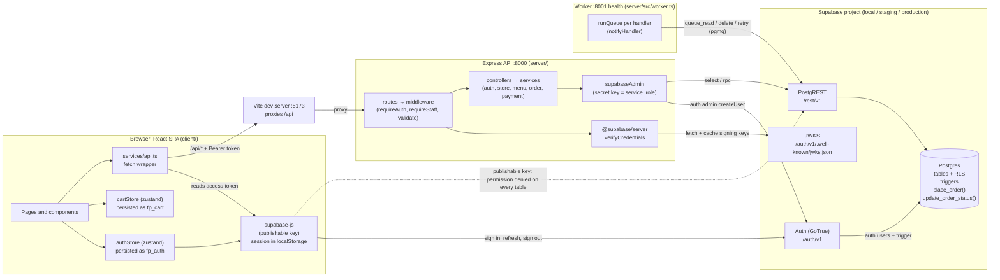

The browser talks to Supabase **only** to sign in, refresh its token and sign out. All data goes through the API. The publishable key shipped in the bundle cannot read or write any table (see [Access control](#11-access-control)).

The worker is a second process from the same image: it reads the pgmq queues in Postgres and has no HTTP surface but `GET /health` ([JOBS.md](JOBS.md#the-worker-process)).

The API logs every request with pino. Each request gets an id, echoed in the `x-request-id` response header, and every log line inside the request carries it; the client logs that id when a call fails. See [LOGGING.md](LOGGING.md).

---

## 2. Environments and configuration

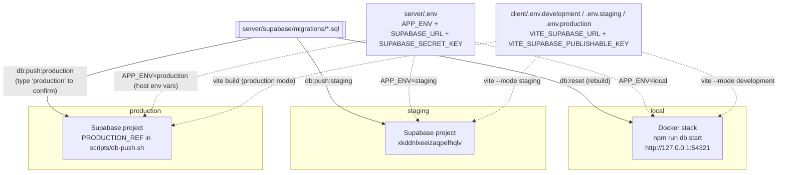

The rule that ties it together: **the API and the web app must point at the same project.** Tokens are signed per project, so a token from staging fails verification in an API pointed at local, and the result is "Your session has expired. Please sign in again." `start.sh` enforces this by reading `APP_ENV` and starting Vite in the matching mode.

Config is validated at startup ([server/src/utils/env.ts](../server/src/utils/env.ts)): the process exits with a list of problems if `APP_ENV`, `SUPABASE_URL` or `SUPABASE_SECRET_KEY` is missing or malformed. The client refuses to start or build without its two Supabase variables ([client/vite.config.ts](../client/vite.config.ts)). Every variable, the push flow and production setup are in [DEPLOYMENT.md](DEPLOYMENT.md).

---

## 3. Authentication

Supabase Auth owns identities and passwords. The API owns the **role**, stored in `profiles.role`, which only the secret key can change. Code: [client/src/features/auth/authStore.ts](../client/src/features/auth/authStore.ts), [client/src/services/auth.ts](../client/src/services/auth.ts), [server/src/middleware/auth.ts](../server/src/middleware/auth.ts), [server/src/services/auth.service.ts](../server/src/services/auth.service.ts).

### 3.1 App start and session restore

```mermaid
sequenceDiagram
  autonumber
  participant App as App.tsx
  participant Store as authStore
  participant LS as localStorage
  participant SB as supabase-js
  participant Auth as Supabase Auth
  participant API as Express API
  participant DB as Postgres

  App->>Store: module load
  Store->>LS: rehydrate fp_auth (user, token), synchronous
  Note over Store: Route guards can render straight away from the persisted token
  SB->>LS: load session sb-ref-auth-token
  Store->>SB: onAuthStateChange(listener)
  SB-->>Store: INITIAL_SESSION (session or null)
  alt no Supabase session (never signed in, signed out, or pre-Supabase login)
    Store->>Store: user = null, token = null
  else session present
    Store->>Store: token = session.access_token
  end
  App->>Store: useEffect → hydrate()
  Store->>SB: auth.getSession()
  opt access token expired
    SB->>Auth: POST /auth/v1/token?grant_type=refresh_token
    Auth-->>SB: new access + refresh token
  end
  alt no session
    Store->>Store: user = null, token = null
  else session
    Store->>LS: readLastActive() (fp_last_active)
    alt idle more than 7 days (SESSION_IDLE_TTL_MS)
      Store->>Store: clearSession(): signOut(local), clear fp_last_active
      Note over Store: no fp_auth.me call — the device is treated as signed out
    else within 7 days, or no fp_last_active record yet
      Store->>LS: markActive(): fp_last_active = now
      Store->>API: GET /api/auth/me (Bearer access token)
      API->>DB: profiles where id = sub
      alt 200
        API-->>Store: { user }
        Store->>Store: user = profile
      else 401 (account deleted or token rejected)
        API-->>Store: 401
        Store->>SB: signOut(local)
        Store->>Store: user = null, token = null
      else network or 5xx
        Note over Store: keep the persisted session so the app stays usable offline
      end
    end
  end
```

A tab coming back from hidden re-runs the same idle check (`document.addEventListener('visibilitychange', ...)` in
`authStore.ts`), so a device left in the background past its week is signed out the moment it is looked at again. See
[PERMISSIONS.md#session-lifetime](PERMISSIONS.md#session-lifetime).

### 3.2 Registration

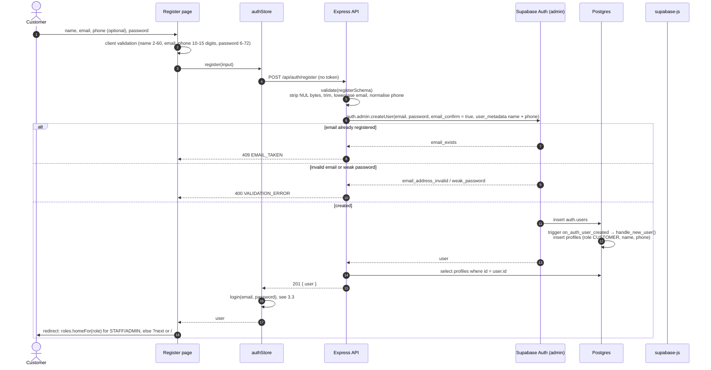

The account is created already confirmed and no email is sent, so the customer can order straight away. Direct sign-ups with the publishable key (`supabase.auth.signUp`) also get a CUSTOMER profile from the same trigger, but they skip the API's validation. That is why [DEPLOYMENT.md](DEPLOYMENT.md#production-first-time-setup) recommends turning off public sign-ups on hosted projects.

### 3.3 Sign-in

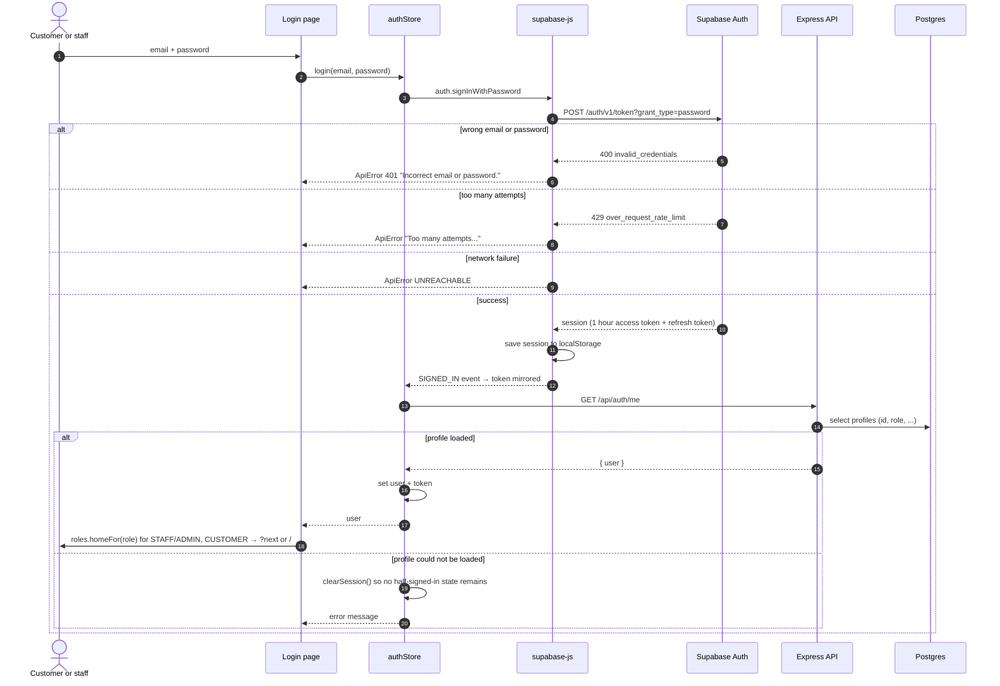

### 3.4 An authenticated API call

Every call to a protected route follows this path, on the client and then on the server.

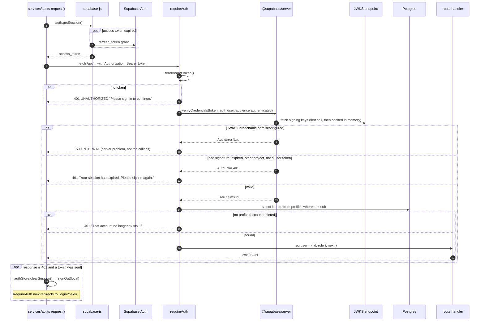

The role is read from `profiles` on every request, so promoting or demoting staff takes effect on the next request, without anyone signing in again.

### 3.5 Token refresh and sign-out

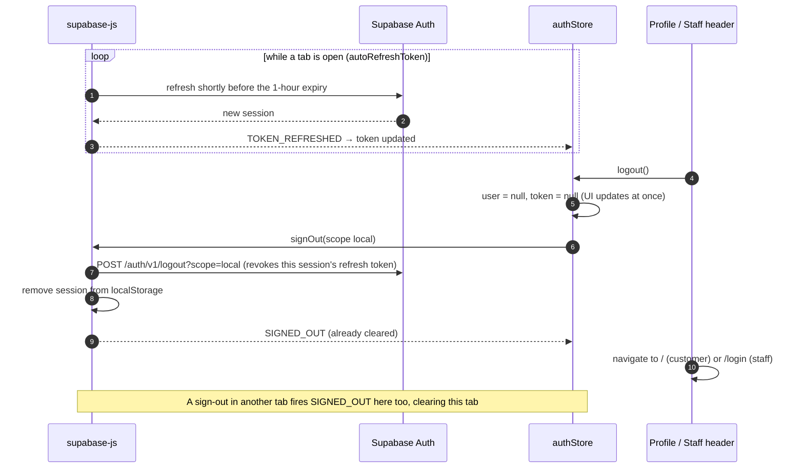

### 3.6 Route guards

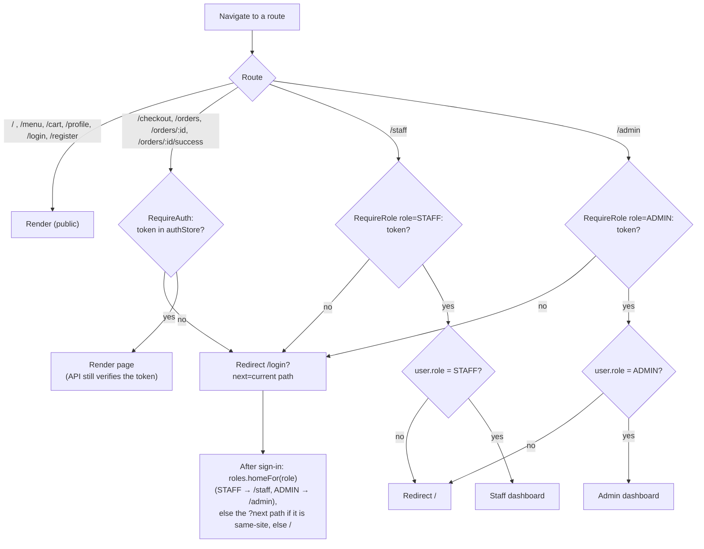

The guards only improve the UX. The API enforces the same rules with `requireAuth`, `requireStaff` and
`requireAdmin`.

---

## 4. Browsing the store and menu

Code: [client/src/features/menu/useStore.ts](../client/src/features/menu/useStore.ts), [client/src/features/menu/useMenu.ts](../client/src/features/menu/useMenu.ts), [server/src/services/store.service.ts](../server/src/services/store.service.ts), [server/src/services/menu.service.ts](../server/src/services/menu.service.ts).

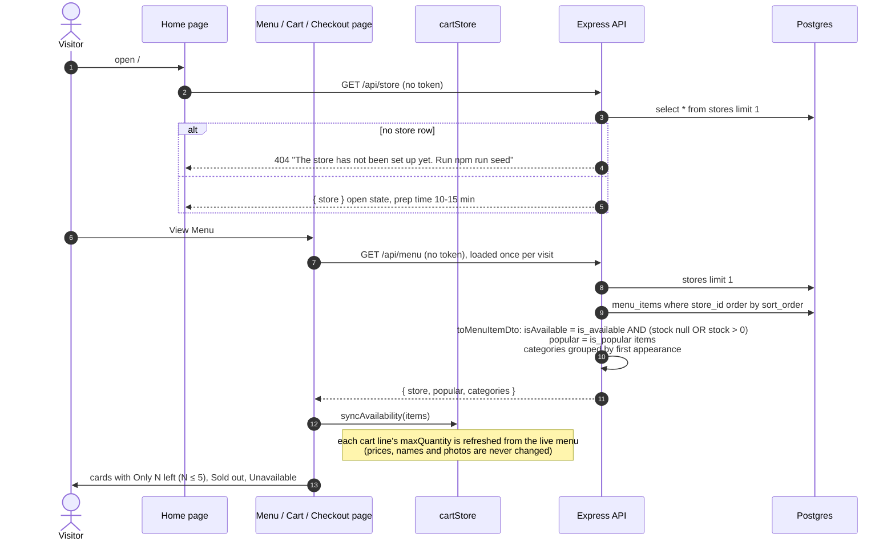

The menu is public and is not polled. The Cart and Checkout pages load it again on arrival, so stock limits are fresh right before paying.

---

## 5. Cart

The cart lives only in the browser (`fp_cart` in localStorage) and holds no server state. Code: [client/src/features/cart/cartStore.ts](../client/src/features/cart/cartStore.ts), [client/src/features/cart/cartRules.ts](../client/src/features/cart/cartRules.ts).

### 5.1 Adding and changing quantities

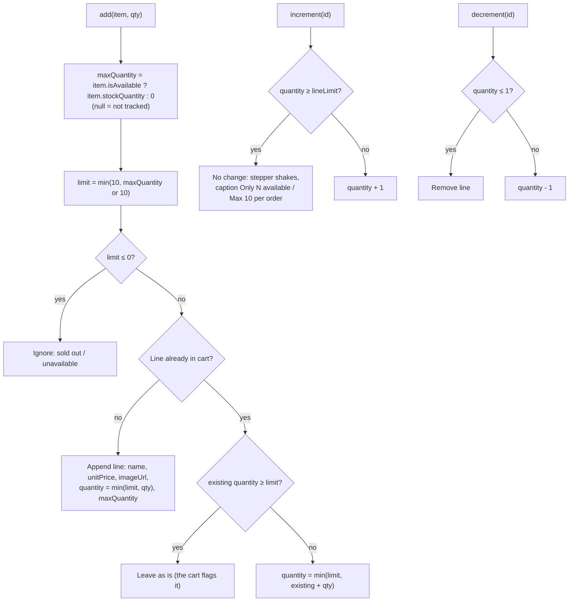

Count and total are always derived (`selectCount`, `selectTotal`) and never stored. The prices shown are the ones captured when the item was added. The server re-prices every line from the database at checkout.

### 5.2 A cart line going stale

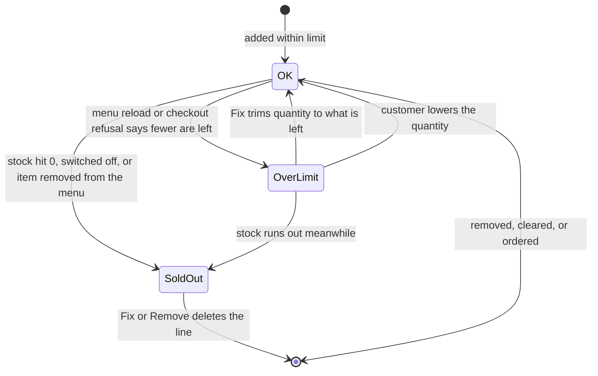

`lineProblem()` computes these states from `quantity` and `maxQuantity`. A flagged line gets a paprika ring and a label, and it blocks the Pay button with a sentence that names the item.

---

## 6. Checkout and placing an order

Code: [client/src/pages/Checkout.tsx](../client/src/pages/Checkout.tsx), [server/src/schemas/order.schema.ts](../server/src/schemas/order.schema.ts), [server/src/services/order.service.ts](../server/src/services/order.service.ts), `place_order` in [the migration](../server/supabase/migrations/20260925120000_init.sql).

### 6.1 End to end

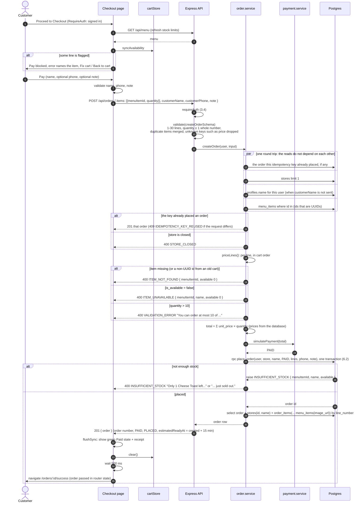

### 6.2 Inside `place_order`

One function call is one Postgres transaction. Any `raise` rolls back every stock decrement and insert made before it.

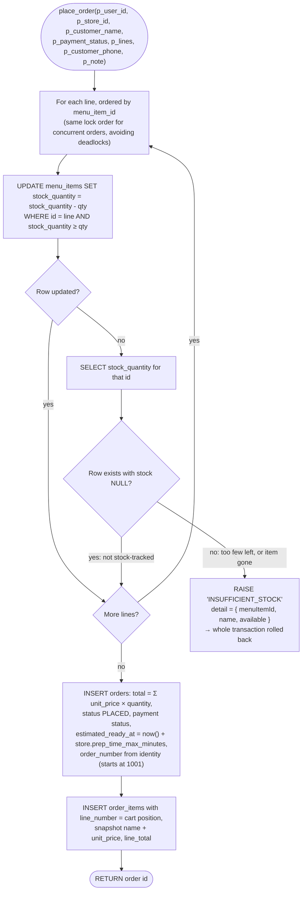

### 6.3 Recovering from a refusal in the browser

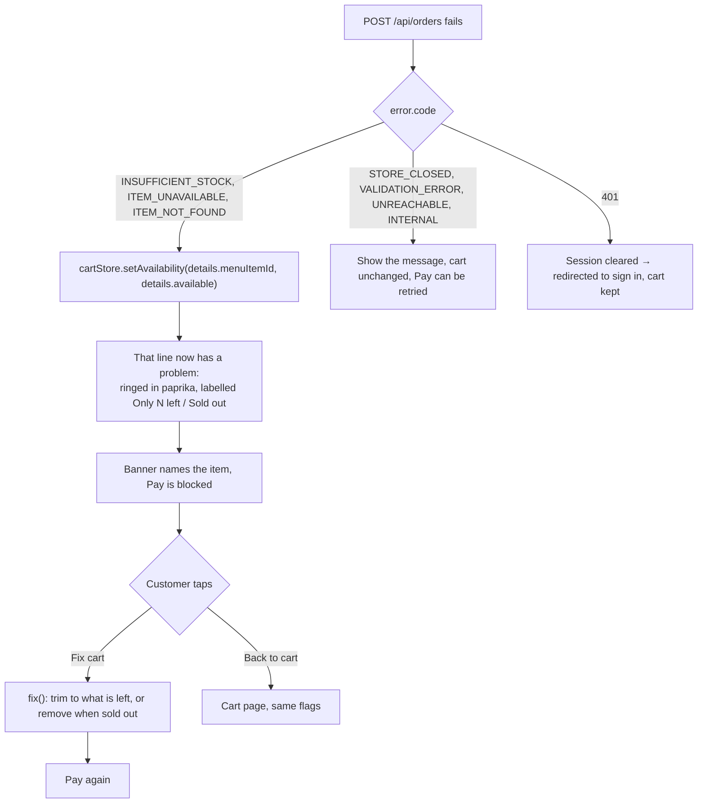

### 6.4 Two customers racing for the last unit

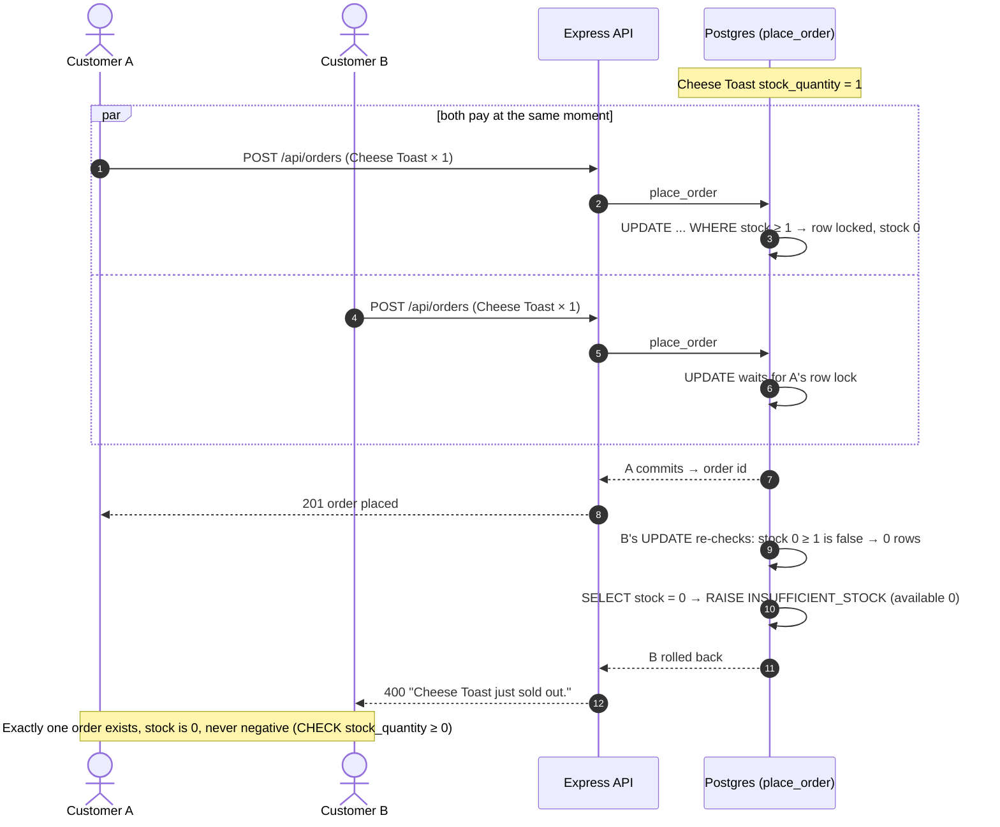

---

## 7. Customer order tracking, history and Order Again

Code: [client/src/lib/useResource.ts](../client/src/lib/useResource.ts), [client/src/features/orders/useOrder.ts](../client/src/features/orders/useOrder.ts), [client/src/features/orders/useOrders.ts](../client/src/features/orders/useOrders.ts), [client/src/features/cart/useReorder.ts](../client/src/features/cart/useReorder.ts).

### 7.1 Success screen and live tracking

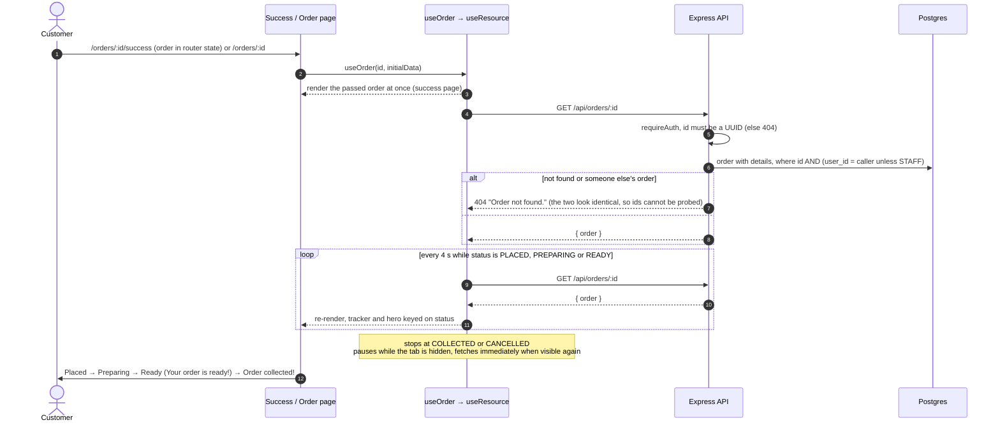

### 7.2 The polling engine (`useResource`)

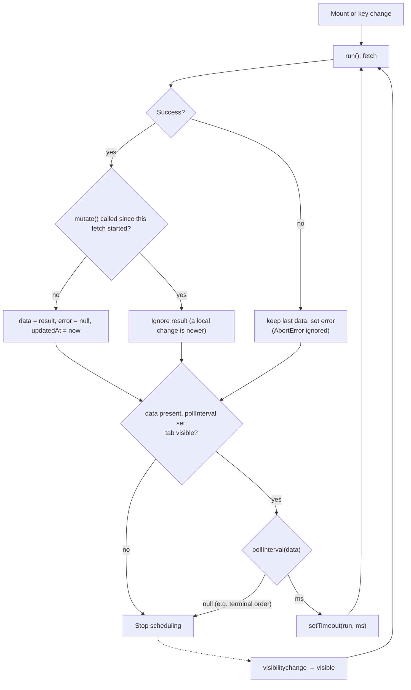

| Hook                              | Endpoint                          | Interval                         |
| --------------------------------- | --------------------------------- | -------------------------------- |
| `useOrder`                        | `GET /api/orders/:id`             | 4 s until COLLECTED or CANCELLED |
| `useOrders` (customer Orders tab) | `GET /api/orders`                 | 8 s                              |
| `useOrders` (staff board)         | `GET /api/orders`                 | 4 s                              |
| `useMenu`, `useStore`             | `GET /api/menu`, `GET /api/store` | once per mount                   |

### 7.3 Order history

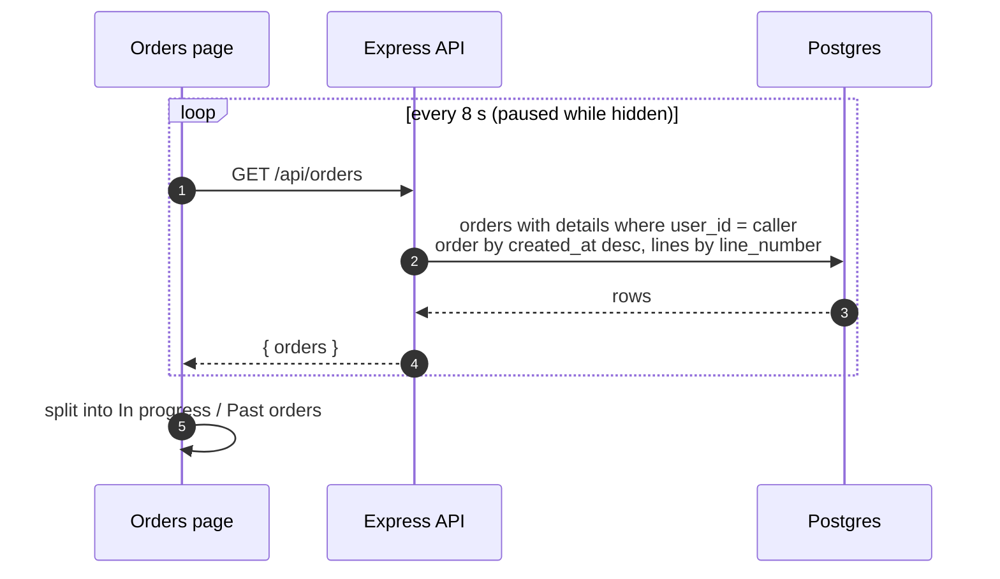

### 7.4 Order Again

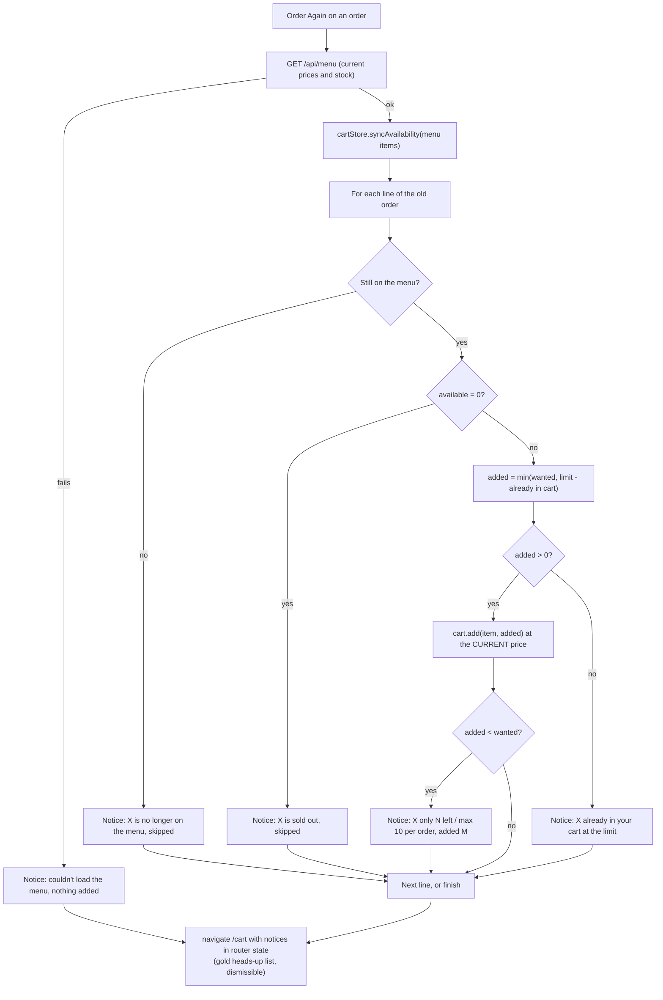

---

## 8. Staff dashboard and order status changes

Code: [client/src/pages/StaffDashboard.tsx](../client/src/pages/StaffDashboard.tsx), [client/src/features/orders/orderStatus.ts](../client/src/features/orders/orderStatus.ts), `updateOrderStatus` in [order.service.ts](../server/src/services/order.service.ts), `update_order_status` in [the migration](../server/supabase/migrations/20260925120000_init.sql).

### 8.1 The board

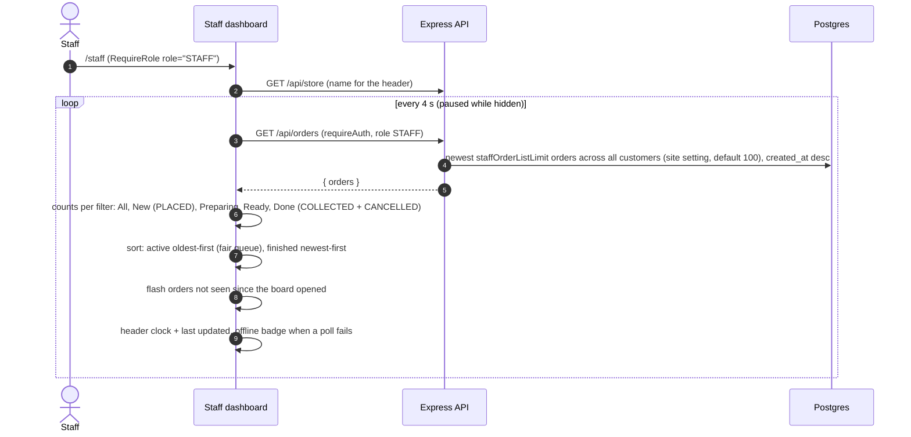

### 8.2 Changing a status

```mermaid
sequenceDiagram
  autonumber
  actor S as Staff
  participant B as Staff dashboard
  participant API as Express API
  participant Svc as order.service
  participant DB as Postgres

  S->>B: Start Preparing / Mark Ready / Mark Collected / Cancel order
  B->>B: mark card pending, clear its old error
  B->>API: PATCH /api/orders/:id/status { status }
  API->>API: requireAuth → requireStaff (else 403 FORBIDDEN)
  API->>API: validate: status is one of the 5 enum values (else 400)
  API->>Svc: updateOrderStatus(id, next)
  Svc->>Svc: id must be a UUID (else 404)
  Svc->>Svc: from = every status whose ALLOWED_TRANSITIONS include next
  Svc->>DB: rpc update_order_status(id, next, from), one transaction (8.3)
  alt order does not exist
    DB-->>Svc: raise NOT_FOUND
    Svc-->>B: 404
  else status already moved on
    DB-->>Svc: raise INVALID_STATUS_TRANSITION { orderNumber, current status }
    Svc-->>B: 409 "Order #1001 cannot move from READY to PREPARING."
    B->>B: show the message on the card, reload the list at once
  else updated
    Svc->>DB: select the order with details
    Svc-->>B: 200 { order }
    B->>B: mutate(): replace the card in the list
    opt new status no longer matches the active filter
      B->>B: 220 ms fade-out, then the card leaves
    end
  end
  Note over B: The customer's tracking page picks up the change on its next 4 s poll
```

### 8.3 Inside `update_order_status`, and two staff pressing at once

```mermaid
sequenceDiagram
  autonumber
  actor S1 as Staff device 1
  actor S2 as Staff device 2
  participant API as Express API
  participant DB as Postgres

  Note over DB: order 1001 is PLACED
  par both press Start Preparing
    S1->>API: PATCH status PREPARING
    API->>DB: UPDATE orders SET status = PREPARING<br/>WHERE id = X AND status = ANY(PLACED)
    DB->>DB: 1 row, locked until commit
  and
    S2->>API: PATCH status PREPARING
    API->>DB: same UPDATE, waits for the lock
  end
  DB-->>API: device 1 commits (updated_at set by trigger)
  API-->>S1: 200 { order PREPARING }
  DB->>DB: device 2 re-checks: status is now PREPARING, not in (PLACED) → 0 rows
  DB->>DB: SELECT status, order_number → RAISE INVALID_STATUS_TRANSITION
  API-->>S2: 409 "Order #1001 cannot move from PREPARING to PREPARING."

  Note over S1,DB: Cancelling (from PLACED or PREPARING) runs in the same transaction:
  S1->>API: PATCH status CANCELLED
  API->>DB: UPDATE ... WHERE status = ANY(PLACED, PREPARING)
  DB->>DB: UPDATE menu_items SET stock += SUM(order_items.quantity)<br/>WHERE stock_quantity IS NOT NULL (untracked items untouched)
  DB-->>API: committed, stock restored exactly once
  API-->>S1: 200 { order CANCELLED }
```

### 8.4 Order lifecycle

```mermaid
stateDiagram-v2
  [*] --> PLACED: customer pays (place_order), payment PAID
  PLACED --> PREPARING: staff Start Preparing
  PREPARING --> READY: staff Mark Ready
  READY --> COLLECTED: staff Mark Collected (customer picked up)
  PLACED --> CANCELLED: staff Cancel, stock restored
  PREPARING --> CANCELLED: staff Cancel, stock restored
  COLLECTED --> [*]
  CANCELLED --> [*]
```

`ALLOWED_TRANSITIONS` in [order.service.ts](../server/src/services/order.service.ts) is the single source of truth for these transitions. Anything not drawn here is a 409. The client's `STATUS_META` only decides which button to show.

### 8.5 Stock for one tracked item

```mermaid
stateDiagram-v2
  [*] --> InStock: seed or dashboard sets stock_quantity to N
  InStock --> InStock: order takes k (k ≤ stock), stock - k
  InStock --> LowStock: 1 to 5 left, menu shows Only N left
  LowStock --> InStock: a cancellation returns units
  LowStock --> SoldOut: last unit ordered, stock 0
  SoldOut --> LowStock: a cancellation returns units
  SoldOut --> SoldOut: order refused, INSUFFICIENT_STOCK
  InStock --> Untracked: stock_quantity set to NULL
  Untracked --> Untracked: orders never touch stock, only the 10 per order cap applies
```

---

## 9. Server request pipeline and error handling

Code: [server/src/app.ts](../server/src/app.ts), [server/src/routes/](../server/src/routes/), [server/src/middleware/](../server/src/middleware/), [server/src/utils/serializers.ts](../server/src/utils/serializers.ts). [server/src/server.ts](../server/src/server.ts) only calls `createApp()` from `app.ts`, listens on `PORT`, and on `SIGINT`/`SIGTERM` closes the server and flushes the logger (`utils/shutdown.ts`, shared with the worker). Module-by-module detail is in [BACKEND_STRUCTURE.md](BACKEND_STRUCTURE.md).

### 9.1 Pipeline

```mermaid
flowchart TD
  Req["HTTP request"] --> Pino["pino-http<br/>request id → x-request-id header, req.log"]
  Pino --> Cors["cors(CLIENT_ORIGIN)"]
  Cors --> Json["express.json (100 kB limit)"]
  Json --> Router{"/api router"}
  Router -->|"GET /health"| Health["{ ok: true }"]
  Router -->|"GET /store, GET /menu"| Public["controller → service"]
  Router -->|"POST /auth/register"| ValReg["validate(registerSchema)"] --> RegCtl["auth.controller.register"]
  Router -->|"GET /auth/me"| AuthMe["requireAuth"] --> MeCtl["auth.controller.me"]
  Router -->|"/orders/*"| AuthO["requireAuth (all order routes)"]
  AuthO -->|"POST /"| ValC["validate(createOrderSchema)"] --> CCtl["createOrder"]
  AuthO -->|"GET /"| ValQ["validate(listOrdersQuerySchema, query)"] --> LCtl["listOrders"]
  AuthO -->|"GET /:id"| GCtl["getOrder"]
  AuthO -->|"PATCH /:id/status"| Staff["requireStaff"] --> ValS["validate(updateOrderStatusSchema)"] --> UCtl["updateOrderStatus"]
  Public --> Svc["services → supabaseAdmin (PostgREST / rpc) → Postgres"]
  RegCtl --> Svc
  MeCtl --> Svc
  CCtl --> Svc
  LCtl --> Svc
  GCtl --> Svc
  UCtl --> Svc
  Svc --> Ser["serializers: snake_case rows → camelCase DTOs,<br/>timestamps → ISO 8601"]
  Ser --> Res["JSON response"]
  Router -->|"no match"| NF["notFoundHandler → 404 NOT_FOUND"]
  Svc -. "throws" .-> EH["errorHandler (9.2)"]
  AuthO -. "throws" .-> EH
  ValC -. "throws" .-> EH
```

`validate()` removes NUL characters from every string, parses with zod, and replaces `req.body` or `req.query` with the parsed value, so handlers only ever see validated, stripped data.

`pino-http` writes one access line per request: `debug` for successful reads, `info` for writes and failures. The error handler is the one place a failed request is logged (see [LOGGING.md](LOGGING.md)).

### 9.2 Error mapping

Every error reaches the client as `{ "error": { "code", "message", "details?" } }`, and the message is safe to show to the user.

```mermaid
flowchart TD
  E["Thrown error"] --> A{"AppError?"}
  A -->|"yes"| A1["its status + code + message (+ details for cart-line errors)"]
  A -->|"no"| Z{"ZodError?"}
  Z -->|"yes"| Z1["400 VALIDATION_ERROR, first issue as a sentence"]
  Z -->|"no"| U{"URIError?"}
  U -->|"yes"| U1["400 BAD_REQUEST malformed URL"]
  U -->|"no"| P{"PostgrestError?"}
  P -->|"22001"| P1["400 One of the values is too long"]
  P -->|"22021 / 22P05"| P2["400 Invalid characters in input"]
  P -->|"other"| I["500 INTERNAL, logged with stack"]
  P -->|"not a PostgrestError"| H{"body-parser error?"}
  H -->|"entity.too.large"| H1["413 PAYLOAD_TOO_LARGE"]
  H -->|"entity.parse.failed"| H2["400 VALIDATION_ERROR malformed body"]
  H -->|"other 4xx status"| H3["that status, BAD_REQUEST"]
  H -->|"none"| I
```

Database functions report expected failures as `raise exception` with the API code as the message and a JSON detail. The service turns those into `AppError`s before the error handler sees them:

| Raised by             | Message                                                  | Becomes                                 |
| --------------------- | -------------------------------------------------------- | --------------------------------------- |
| `place_order`         | `INSUFFICIENT_STOCK` + `{ menuItemId, name, available }` | 400 `INSUFFICIENT_STOCK` with `details` |
| `update_order_status` | `NOT_FOUND`                                              | 404 `NOT_FOUND`                         |
| `update_order_status` | `INVALID_STATUS_TRANSITION` + `{ orderNumber, status }`  | 409 `INVALID_STATUS_TRANSITION`         |

Every code, status and message: [API.md](API.md#errors).

---

## 10. Data model

Schema: [server/supabase/migrations/20260925120000_init.sql](../server/supabase/migrations/20260925120000_init.sql). Generated types: [server/src/types/database.ts](../server/src/types/database.ts) (`npm run db:types`).

```mermaid
erDiagram
  AUTH_USERS ||--|| PROFILES : "on_auth_user_created trigger"
  PROFILES o|--o| SITE_SETTINGS : updated_by
  PROFILES ||--o{ ORDERS : places
  STORES ||--o{ MENU_ITEMS : sells
  STORES ||--o{ ORDERS : receives
  ORDERS ||--|{ ORDER_ITEMS : contains
  MENU_ITEMS ||--o{ ORDER_ITEMS : "snapshotted in"

  AUTH_USERS {
    uuid id PK
    text email
    text encrypted_password
    jsonb raw_user_meta_data "name, phone at sign-up"
  }
  PROFILES {
    uuid id PK "FK auth.users, cascade delete"
    text name
    text email UK "kept in sync by trigger"
    text phone
    user_role role "CUSTOMER, STAFF or ADMIN"
    timestamptz created_at
  }
  SITE_SETTINGS {
    boolean id PK "always true"
    int customer_order_history_limit
    int staff_order_list_limit
    timestamptz updated_at
    uuid updated_by FK "nullable, ON DELETE SET NULL"
  }
  STORES {
    uuid id PK
    text name
    text tagline
    text description
    text image_url
    boolean is_open
    int prep_time_min_minutes
    int prep_time_max_minutes "drives estimated_ready_at"
  }
  MENU_ITEMS {
    uuid id PK
    uuid store_id FK
    text category
    text name
    text description
    int price "whole rupees, at least 0"
    text image_url
    boolean is_available
    boolean is_popular
    int sort_order
    int stock_quantity "NULL = untracked, never negative"
  }
  ORDERS {
    uuid id PK
    int order_number UK "identity from 1001"
    uuid user_id FK
    uuid store_id FK
    text customer_name
    text customer_phone
    text note
    int total "computed in place_order"
    payment_status payment_status "PENDING or PAID"
    order_status status "PLACED to COLLECTED or CANCELLED"
    timestamptz estimated_ready_at
    timestamptz created_at
    timestamptz updated_at "orders_set_updated_at trigger"
  }
  ORDER_ITEMS {
    uuid id PK
    uuid order_id FK "cascade delete"
    int line_number "cart order, unique per order"
    uuid menu_item_id FK
    text name "snapshot"
    int unit_price "snapshot"
    int quantity "at least 1"
    int line_total
  }
```

Five tables: `profiles` (one per Auth user, holds the role), `stores` (one row in V0), `menu_items` (with optional tracked stock), `orders` and `order_items` (name and price snapshotted at order time). Columns with their types, defaults and constraints, the indexes, triggers and the `place_order` / `update_order_status` / `reset_demo_orders` functions are in [SCHEMA.md](SCHEMA.md).

---

## 11. Access control

The browser's publishable key can touch nothing: RLS is on for every table with no policies, all table privileges are revoked from `anon` and `authenticated`, and only `service_role` (the API's secret key) may execute `place_order`, `update_order_status` and `reset_demo_orders`. Because the API's `supabaseAdmin` client bypasses RLS, the services decide who sees what and scope every per-user query themselves: customers see only their own orders, staff see all, and someone else's order returns the same 404 as a missing one. The role is only ever `profiles.role`, never the token or `user_metadata`. The access diagram, the route matrix and the client guards are in [PERMISSIONS.md](PERMISSIONS.md).

---

## 12. Operations

`./start.sh` starts the API and web app for `local` or `staging` in the matching Vite mode and refuses `production`. `npm run seed` resets the demo data (local and staging) or, with `--production`, loads the store and menu into an empty production project. Schema changes are append-only migrations in `server/supabase/migrations/`, rebuilt locally with `db:reset` and applied to hosted projects with `db:push:staging` / `db:push:production`. The flow diagrams for all four (`start.sh`, seeding, promoting a migration, first-time production setup), the environment variables and the build steps are in [DEPLOYMENT.md](DEPLOYMENT.md).
