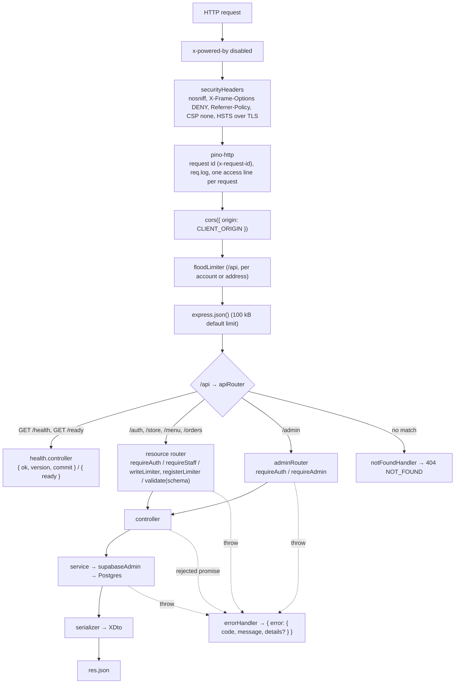

# Backend structure

The API in `server/`: Express 5, TypeScript, zod 4, Supabase (`@supabase/supabase-js`, `@supabase/server`), pino.
The HTTP contract is in [API.md](API.md), the database in [SCHEMA.md](SCHEMA.md), and the flows in
[ARCHITECTURE.md](ARCHITECTURE.md).

## Tree

```
server/
├── .env.example              copy to .env (see DEPLOYMENT.md)
├── package.json              scripts below
├── tsconfig.json             typecheck target: src/, scripts/ and test/
├── tsconfig.build.json        build target: src/ and scripts/ only (extends tsconfig.json, excludes test/ from dist/)
├── vitest.config.mts         test config (see TESTING.md)
├── eslint.config.mjs
├── scripts/
│   ├── seed.ts               demo reset (local/staging) or first-time production setup
│   ├── seed-data.ts          the typed fixtures it writes: STORE, MENU, DEMO_ACCOUNTS
│   └── db-push.sh            applies migrations to staging or production
├── Dockerfile                the API image (deps → build → runtime); DEPLOYMENT.md "Containers"
├── supabase/
│   ├── config.toml           local Supabase stack (API :54321, DB :54322, Studio :54323)
│   └── migrations/           schema, RLS, grants and database functions (SCHEMA.md)
├── src/
│   ├── server.ts             entry point: createApp().listen(PORT), keep-alive timeouts, graceful shutdown
│   ├── app.ts                createApp(): the whole middleware pipeline, no listen
│   ├── routes/               route tables: index.ts + one *.routes.ts per resource
│   ├── controllers/          thin handlers: read req → call a service → serialize → res.json
│   ├── services/             business logic and every database call
│   ├── jobs/                 the job runner (runner.ts) and one handler per queue (notify.ts); JOBS.md
│   ├── schemas/              zod request schemas
│   ├── middleware/           auth.ts, validate.ts, errorHandler.ts, clientVersion.ts, rateLimit.ts, securityHeaders.ts
│   ├── types/                API DTOs, generated database types, enums, AuthUser, Express augmentation
│   └── utils/                env, logger, Supabase client, errors, serializers, ids, cache, version
└── test/
    ├── setup/                api.ts, guard.ts, run-lock.ts, target.ts, helpers.ts (+ target.safe.test.ts)
    ├── api/                  one suite per router: admin, auth, health, menu, menu-cache, menu-cap, orders, store, caching, security-headers
    ├── unit/                 pure logic: cache, errors, schemas, serializers, validate, rate-limit, backoff
    └── logging.safe.test.ts
```

## Request pipeline

`server/src/server.ts` only loads `dotenv/config`, calls `createApp()` from `server/src/app.ts`, listens on
`env.PORT` with `keepAliveTimeout = KEEP_ALIVE_TIMEOUT_MS` (and `headersTimeout` 1 s above it), and on
`SIGINT`/`SIGTERM` stops accepting, lets in-flight requests finish, flushes the logger and exits (forced exit with code
1 after 10 s). `createApp()` never
calls `listen`, so tests drive it with Supertest.



| Step              | File                                | What it does                                                                                                                                                                                                                                                                                                     |
| ----------------- | ----------------------------------- | ---------------------------------------------------------------------------------------------------------------------------------------------------------------------------------------------------------------------------------------------------------------------------------------------------------------- |
| `securityHeaders` | `src/middleware/securityHeaders.ts` | browser-hardening headers on every response, HSTS only when `req.secure` ([API.md](API.md#headers-and-limits))                                                                                                                                                                                                   |
| `pino-http`       | `src/app.ts`                        | keeps a caller's `x-request-id` if it matches `^[\w.-]{1,64}$`, else a UUID; echoes it; access line at `debug` for successful GET/HEAD/OPTIONS, `info` otherwise                                                                                                                                                 |
| `cors`            | `src/app.ts`                        | one allowed origin, `env.CLIENT_ORIGIN`                                                                                                                                                                                                                                                                          |
| `floodLimiter`    | `src/middleware/rateLimit.ts`       | `RATE_LIMIT_IP_MAX` requests per window on `/api`, per signed-in account (the bearer token, checked once per request with `verifyBearer`, shared with `requireAuth`) or else per address, before the body is parsed; preflights are counted just before `cors()` (which answers them itself); 429 `RATE_LIMITED` |
| `express.json()`  | `src/app.ts`                        | parses JSON bodies; over 100 kB is 413, malformed is 400 (mapped in the error handler)                                                                                                                                                                                                                           |
| `apiRouter`       | `src/routes/index.ts`               | `/health`, `/ready`, then mounts `/auth`, `/store`, `/menu`, `/orders`, `/admin`                                                                                                                                                                                                                                 |
| `notFoundHandler` | `src/middleware/errorHandler.ts`    | 404 `NOT_FOUND` "No route matches <METHOD> <path>."                                                                                                                                                                                                                                                              |
| `errorHandler`    | `src/middleware/errorHandler.ts`    | maps any error to status + code + safe message; logs it once (5xx `error` with the stack, `invariant: true` for an `InvariantError`, 401/403/429 `warn`, other 4xx `info`; 426 and a repeat 429 in its window `debug`, via `AppError.logLevel`)                                                                  |

Express 5 forwards a rejected promise from an async handler to the error handler, so controllers and middleware have
no `try`/`catch` and throw `AppError`s directly. The error mapping is drawn in
[ARCHITECTURE.md](ARCHITECTURE.md#92-error-mapping) and listed in [API.md](API.md#errors). Logging rules:
[LOGGING.md](LOGGING.md).

## Module map

### routes/

| File              | Mounted at    | Routes                                                                                                               |
| ----------------- | ------------- | -------------------------------------------------------------------------------------------------------------------- |
| `index.ts`        | `/api`        | `GET /health`, `GET /ready` (probes first), then `clientVersionGate`; mounts the five routers                        |
| `auth.routes.ts`  | `/api/auth`   | `POST /register` (validate), `GET /me` (requireAuth)                                                                 |
| `store.routes.ts` | `/api/store`  | `GET /`                                                                                                              |
| `menu.routes.ts`  | `/api/menu`   | `GET /`                                                                                                              |
| `order.routes.ts` | `/api/orders` | `requireAuth` for all; `POST /`, `GET /` (query validate), `GET /:id`, `PATCH /:id/status` (requireStaff + validate) |
| `admin.routes.ts` | `/api/admin`  | `requireAuth` + `requireAdmin` for all; `GET /settings`, `PATCH /settings` (validate)                                |

### controllers/

One file per router. Each handler reads `req.body` / `req.query` / `req.params` / `currentUser(req)`, awaits one
service call, serializes with `utils/serializers.ts` and sends JSON. `order.controller.ts` also logs
`Order placed` and `Order status changed`, and `admin.controller.ts` logs `Site settings changed`, through
`req.log.info`. Typed with `BodyHandler` / `QueryHandler` from
`types/http.ts` so `req.body` and `req.query` carry the parsed schema type.

| File                   | Handlers                                                                               |
| ---------------------- | -------------------------------------------------------------------------------------- |
| `health.controller.ts` | `getHealth`, `getReady`, `readinessHandler(probe)` (the probe is injectable for tests) |
| `config.controller.ts` | `getConfig`                                                                            |
| `auth.controller.ts`   | `register`, `me`                                                                       |
| `store.controller.ts`  | `getStore`                                                                             |
| `menu.controller.ts`   | `getMenu`                                                                              |
| `order.controller.ts`  | `createOrder`, `listOrders`, `getOrder`, `updateOrderStatus`                           |
| `admin.controller.ts`  | `getSettings`, `updateSettings`                                                        |

### services/

| File                  | Exports                                                      | Notes                                                                                                                                                                                                                                                                                                                                                             |
| --------------------- | ------------------------------------------------------------ | ----------------------------------------------------------------------------------------------------------------------------------------------------------------------------------------------------------------------------------------------------------------------------------------------------------------------------------------------------------------- |
| `auth.service.ts`     | `register(input)`, `getProfile(id)`                          | `auth.admin.createUser` (confirmed); maps Supabase Auth error codes                                                                                                                                                                                                                                                                                               |
| `store.service.ts`    | `getStore()`, `getCachedStore()`                             | `getStore()`: first row of `stores`, 404 if none. `getCachedStore()`: the same read through `cached('store', PUBLIC_READ_TTL_MS, getStore)` for `GET /api/store` only; `createOrder`'s `is_open` check always calls the uncached `getStore()` (see [API.md#caching](API.md#caching))                                                                              |
| `menu.service.ts`     | `getMenu()`                                                  | items by `sort_order`, `popular`, categories grouped by first item; read through `cached('menu', PUBLIC_READ_TTL_MS, loadMenu)` (see [API.md#caching](API.md#caching))                                                                                                                                                                                            |
| `order.service.ts`    | `createOrder`, `listOrders`, `getOrder`, `updateOrderStatus` | holds `ALLOWED_TRANSITIONS`; reads both list limits from `settings.service.getSettings()` (`STAFF_LIST_LIMIT`/`CUSTOMER_LIST_LIMIT` constants were removed); calls the `place_order` / `update_order_status` RPCs and maps their `P0001` errors; `invalidate('menu')` after `createOrder` (any outcome) and after a cancel (see [API.md#caching](API.md#caching)) |
| `settings.service.ts` | `getSettings()`, `updateSettings(admin, input)`              | the single `site_settings` row. `getSettings()` is read through `cached('site_settings', PUBLIC_READ_TTL_MS, ...)`; `updateSettings()` writes `updated_by = admin.id` and calls `invalidate('site_settings')` (see [API.md#caching](API.md#caching))                                                                                                              |
| `config.service.ts`   | `getConfig()`                                                | the `ConfigDto` for `GET /api/config`, derived from the cached `getSettings()` and `env.SESSION_IDLE_DAYS` (no cache key of its own)                                                                                                                                                                                                                              |
| `payment.service.ts`  | `simulatePayment(amount)`                                    | always `PAID`; throws on a non-positive amount. The seam for a real gateway                                                                                                                                                                                                                                                                                       |

### schemas/

| File              | Exports                                                                                                                                                                                        |
| ----------------- | ---------------------------------------------------------------------------------------------------------------------------------------------------------------------------------------------- |
| `limits.ts`       | `LIMITS`                                                                                                                                                                                       | the name, note, password and phone bounds the other schemas use; mirrored in `client/src/config/fallbacks.json` (`validation`), parity-tested |
| `common.ts`       | `optionalField(schema)`, `phoneField`                                                                                                                                                          |
| `auth.schema.ts`  | `registerSchema`, `RegisterInput`                                                                                                                                                              |
| `order.schema.ts` | `MAX_QUANTITY_PER_ITEM = 10`, `MAX_ITEM_LINES_HARD = 100`, `createOrderSchema` (adds `lineCount`, the lines as sent), `updateOrderStatusSchema`, `listOrdersQuerySchema` and their input types |
| `admin.schema.ts` | `updateSettingsSchema`, `UpdateSettingsInput` (bounds mirror the `site_settings` check constraints, 1-200 / 1-500; refined so at least one field must be sent)                                 |

Field rules: [API.md](API.md#routes).

### middleware/

| File                 | Exports                                                                                                                                                                                                                                                                                                                                                                                                                                                                                                                                                 |
| -------------------- | ------------------------------------------------------------------------------------------------------------------------------------------------------------------------------------------------------------------------------------------------------------------------------------------------------------------------------------------------------------------------------------------------------------------------------------------------------------------------------------------------------------------------------------------------------- |
| `auth.ts`            | `requireAuth`, `requireStaff`, `requireAdmin`, `currentUser(req)`, `verifyBearer(req)` (the JWKS check, once per request, shared by `requireAuth` and `floodLimiter`)                                                                                                                                                                                                                                                                                                                                                                                   |
| `validate.ts`        | `validate(schema, source = 'body')`, `describeIssue(issue)`                                                                                                                                                                                                                                                                                                                                                                                                                                                                                             |
| `errorHandler.ts`    | `notFoundHandler`, `errorHandler`, `loggedAtDebug` (the responses logged at debug; `accessLevel` in `app.ts` reads it so their access line is debug too)                                                                                                                                                                                                                                                                                                                                                                                                |
| `rateLimit.ts`       | `createRateLimiter({ name, windowMs, limit, keyBy: 'user' \| 'ip' })` (`user`: `req.user`, else the verified bearer token, else the address) (express-rate-limit, in-process fixed windows, 429 `RATE_LIMITED` through the error handler with `Retry-After` and draft-7 `RateLimit` headers; `limit: 0` is a pass-through); `floodLimiter` (all of `/api`), `writeLimiter` (per user: order placement, status changes, settings), `registerLimiter` (per address). Sizes from `RATE_LIMIT_*` ([CONFIGURATION.md](CONFIGURATION.md#deployment-settings)) |
| `securityHeaders.ts` | `securityHeaders`: `X-Content-Type-Options`, `X-Frame-Options`, `Referrer-Policy`, a `default-src 'none'` CSP, and HSTS when `req.secure` ([API.md](API.md#headers-and-limits))                                                                                                                                                                                                                                                                                                                                                                         |
| `clientVersion.ts`   | `readClientVersion(req)`: the `X-Client-Version` header if it is a plain semver (≤ 32 chars), else `undefined`; `clientVersionGate`: 426 `CLIENT_OUTDATED` below `site_settings.min_client_version` ([API.md](API.md#client-version-gate))                                                                                                                                                                                                                                                                                                              |

`validate()` strips NUL bytes from every string, parses with zod, and replaces `req.body` (or shadows the
`req.query` getter with an own property) with the parsed value. On failure it throws a 400 `VALIDATION_ERROR` whose
message names the field.

### types/

| File           | Contents                                                                                                                              |
| -------------- | ------------------------------------------------------------------------------------------------------------------------------------- |
| `api.ts`       | response DTOs: `UserDto`, `StoreDto`, `MenuItemDto`, `MenuCategoryDto`, `MenuResponse`, `SiteSettingsDto`, `OrderItemDto`, `OrderDto` |
| `database.ts`  | generated by `npm run db:types`; do not edit by hand                                                                                  |
| `enums.ts`     | `Role`, `OrderStatus`, `PaymentStatus`, `ORDER_STATUSES` from the generated types                                                     |
| `auth.ts`      | `AuthUser { id, role }`                                                                                                               |
| `express.d.ts` | adds `req.user?: AuthUser`                                                                                                            |
| `http.ts`      | `BodyHandler<Body, Params>`, `QueryHandler<Query>`                                                                                    |

### utils/

| File             | Exports                                                                                                                                                                                                                                                                                                                                                                                                                                                                                                                 |
| ---------------- | ----------------------------------------------------------------------------------------------------------------------------------------------------------------------------------------------------------------------------------------------------------------------------------------------------------------------------------------------------------------------------------------------------------------------------------------------------------------------------------------------------------------------- |
| `env.ts`         | `env` (validated with zod at import; exits with a list of problems if invalid)                                                                                                                                                                                                                                                                                                                                                                                                                                          |
| `logger.ts`      | `logger` (pino), `REDACT_PATHS`, `LOG_SERIALIZERS` (`errWithCause`)                                                                                                                                                                                                                                                                                                                                                                                                                                                     |
| `supabase.ts`    | `supabaseAdmin` (secret key, bypasses RLS), `supabaseEnv`, `raisedByDatabase(err, code)`, `asDatabaseUnavailable(err)` (a transport failure as an `IntegrationError`)                                                                                                                                                                                                                                                                                                                                                   |
| `errors.ts`      | `ErrorCode`; the `details` shapes `ItemErrorDetails`, `FieldErrorDetails`, `ReplayedOrderDetails`, `RateLimitDetails`, the `ErrorDetails` union ([API.md](API.md#error-details)); `AppError` (optional `logLevel`), `IntegrationError`, `RetryableError`, `PermanentError`, `InvariantError`; factories `validationError`, `unauthorized`, `forbidden`, `notFound`, `payloadTooLarge`, `rateLimited(limiter, keyedBy, retryAfterSeconds, firstInWindow)`, `idempotencyKeyReused`, `clientOutdated`, `insufficientStock` |
| `serializers.ts` | `selectOrders()` (the one order query with lines, store and item photos), `OrderWithDetails`, `toUserDto`, `toStoreDto`, `toMenuItemDto`, `toOrderDto`, `isPurchasable`                                                                                                                                                                                                                                                                                                                                                 |
| `ids.ts`         | `isUuid(value)`                                                                                                                                                                                                                                                                                                                                                                                                                                                                                                         |
| `semver.ts`      | `parseSemver(version)`, `compareSemver(a, b)` on the numeric triple (prerelease ignored)                                                                                                                                                                                                                                                                                                                                                                                                                                |
| `version.ts`     | `APP_VERSION` (`package.json` in `process.cwd()`), `GIT_COMMIT` (env)                                                                                                                                                                                                                                                                                                                                                                                                                                                   |
| `cache.ts`       | `cached<T>(key, ttlMs, load)`, `invalidate(key?)`, `PUBLIC_READ_TTL_MS` (env, default 10000 ms) — in-process TTL cache for public reads; shares one pending load between concurrent misses; a failed load is never cached. See [API.md#caching](API.md#caching)                                                                                                                                                                                                                                                         |

### jobs/

| File        | Exports                                                                                                                                                                                                   |
| ----------- | --------------------------------------------------------------------------------------------------------------------------------------------------------------------------------------------------------- |
| `runner.ts` | `JobHandler<T>`, `QueueMessage<T>`, `JobContext`, `DomainEvent<T>`, `Backoff`; `backoffSeconds(attempt, backoff, random)`; `runQueue(handler, { signal, log, pollSeconds, now, random })`; `POLL_SECONDS` |
| `notify.ts` | `notifyHandler` (`q_notifications`)                                                                                                                                                                       |

How handlers and the runner behave: [JOBS.md](JOBS.md#handlers-and-the-runner).

## Adding an endpoint

The layers, in the order a request passes them:

1. `routes/<resource>.routes.ts`: the route, with `requireAuth` / `requireStaff` and `validate(schema)` as needed.
2. `schemas/<resource>.schema.ts`: the zod schema and its `z.infer` type.
3. `controllers/<resource>.controller.ts`: a thin handler, no `try`/`catch`.
4. `services/<resource>.service.ts`: the logic and the queries through `supabaseAdmin`, scoped by user where it
   matters (see [PERMISSIONS.md](PERMISSIONS.md#why-every-query-scopes-by-user)).
5. `utils/serializers.ts` + `types/api.ts`: row → DTO. Mirror the DTO in `client/src/types/api.ts`.
6. Errors: throw an `AppError` factory from `utils/errors.ts`; add a new code to `ErrorCode`.
7. Document it in [API.md](API.md) and add a suite under `server/test/api/`.

## Scripts

`server/package.json`:

| Script                                   | Runs                                                                                                                        |
| ---------------------------------------- | --------------------------------------------------------------------------------------------------------------------------- |
| `dev`                                    | `tsx watch src/server.ts`                                                                                                   |
| `build`                                  | `tsc -p tsconfig.build.json` → `dist/` (`src/` and `scripts/` only; tests never ship)                                       |
| `start`                                  | `node dist/src/server.js`                                                                                                   |
| `typecheck`                              | `tsc -p tsconfig.json --noEmit`                                                                                             |
| `lint`                                   | `eslint .`                                                                                                                  |
| `format` / `format:check`                | `prettier --write .` / `prettier --check .`                                                                                 |
| `test` / `test:watch`                    | `vitest run` / `vitest`                                                                                                     |
| `seed`                                   | `tsx scripts/seed.ts` (see [DEPLOYMENT.md](DEPLOYMENT.md#seeding))                                                          |
| `db:start` / `db:stop`                   | `supabase start` / `supabase stop`                                                                                          |
| `db:reset`                               | `supabase db reset` (rebuilds the local database from the migrations)                                                       |
| `db:new <name>`                          | `supabase migration new`                                                                                                    |
| `db:types`                               | `supabase gen types typescript --local > src/types/database.ts`                                                             |
| `db:push:staging` / `db:push:production` | `./scripts/db-push.sh staging` / `./scripts/db-push.sh production` (see [DEPLOYMENT.md](DEPLOYMENT.md#applying-migrations)) |

`scripts/seed.ts` and `scripts/db-push.sh` are described in [DEPLOYMENT.md](DEPLOYMENT.md).

## Tests

- Suites: `server/test/**/*.test.ts`, one file per router under `test/api/`. Staging-safe suites are named
  `*.safe.test.ts`.
- `test/setup/guard.ts` runs first and refuses any target but local Supabase (or staging with an explicit opt-in),
  then starts this file's API server (`test/setup/api.ts`) and stops it after.
- `test/setup/api.ts`: `api()`, the Supertest client for the current file. Full detail:
  [TESTING.md](TESTING.md#the-per-file-api-server).
- `test/setup/run-lock.ts`: a `globalSetup` that lets only one server test run happen on the machine at a time.
- `test/setup/helpers.ts`: `createTestUser`, `deleteTestUser`, `resetDemoData`.
- Files run one at a time (`fileParallelism: false`); `LOG_LEVEL` defaults to `silent` in tests.

Everything else about tests is in [TESTING.md](TESTING.md).
