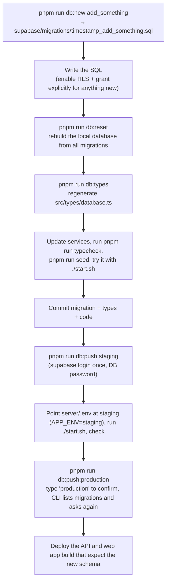
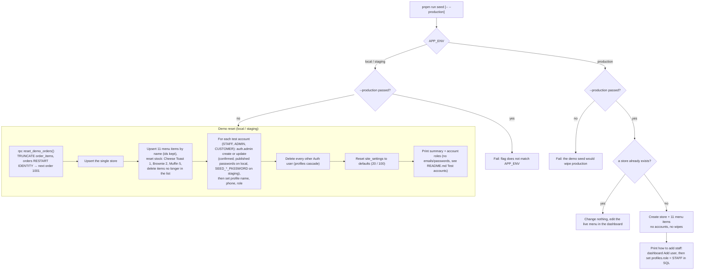
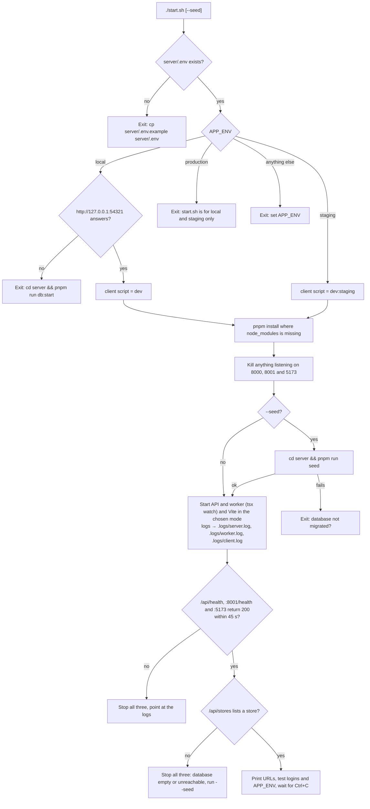
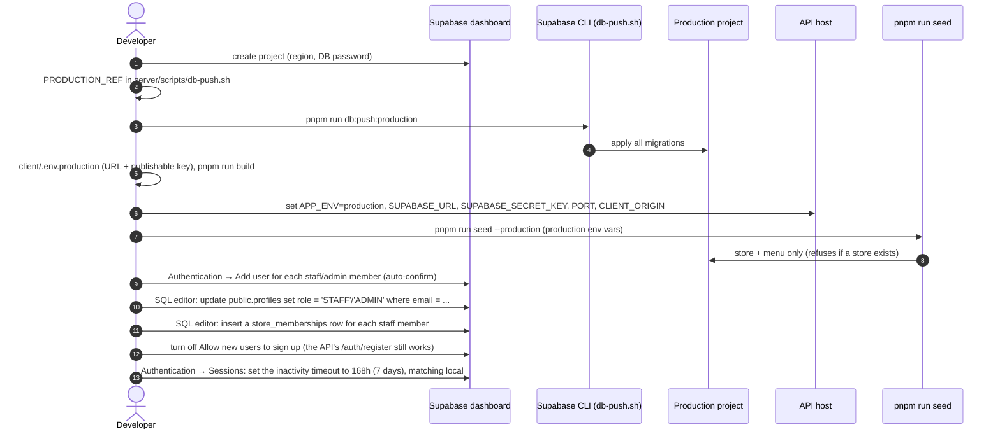

# Deployment

Environments, configuration, database changes and production setup. The environment diagram is in
[ARCHITECTURE.md](ARCHITECTURE.md#2-environments-and-configuration). Day-to-day local start-up is in the
[README](../README.md#quick-start).

> Production is changed by a person, never by an agent or a test run: `pnpm run db:push:production` and
> `pnpm run seed --production` are run by the user only. Tests run against local Supabase only
> ([TESTING.md](TESTING.md#the-test-target-guard-server)).

## Environments

| Environment  | Supabase project                                                                                       | Used by                                           |
| ------------ | ------------------------------------------------------------------------------------------------------ | ------------------------------------------------- |
| `local`      | Docker stack from `pnpm run db:start` (`http://127.0.0.1:54321`)                                       | day-to-day development, `./start.sh`, `pnpm test` |
| `staging`    | `xkddnlxeeizaqpefhqlv` (`https://xkddnlxeeizaqpefhqlv.supabase.co`)                                    | shared testing before release                     |
| `production` | a second hosted project; its ref goes in `PRODUCTION_REF` in `server/scripts/db-push.sh` (empty today) | the live app                                      |

Each environment is a separate Supabase project with its own database, users and keys. Project refs are not secret:
they are the subdomain of the project URL (`server/scripts/db-push.sh`).

### API and client must point at the same project

Access tokens are signed per project. A token from one project fails verification in an API pointed at another, and
the user sees "Your session has expired. Please sign in again." So:

- `server/.env` → `SUPABASE_URL` (and `APP_ENV`) and
- `client/.env.<mode>` → `VITE_SUPABASE_URL`

must name the same project. `start.sh` enforces this for local and staging by reading `APP_ENV` from `server/.env`
and starting Vite in the matching mode (`local` → `pnpm run dev`, `staging` → `pnpm run dev:staging`). It refuses
`APP_ENV=production`.

## Server environment variables

Read from `server/.env` (copy `server/.env.example`) or the host's environment. Validated at start-up by
`server/src/utils/env.ts`: on any problem the process prints `Invalid environment configuration. Check server/.env
(see .env.example):` with one line per variable and exits with code 1.

| Variable                                                                                                                                                                                | Required        | Default                                      | Rule                                                                       | Purpose                                                                                                                                                                                                                                                                                                                                                                                                        |
| --------------------------------------------------------------------------------------------------------------------------------------------------------------------------------------- | --------------- | -------------------------------------------- | -------------------------------------------------------------------------- | -------------------------------------------------------------------------------------------------------------------------------------------------------------------------------------------------------------------------------------------------------------------------------------------------------------------------------------------------------------------------------------------------------------- |
| `APP_ENV`                                                                                                                                                                               | yes             |                                              | `local`, `staging` or `production`                                         | which project this process talks to; `start.sh` picks the client mode from it; `pnpm run seed` refuses the demo reset on `production`; logger output and default level                                                                                                                                                                                                                                         |
| `SUPABASE_URL`                                                                                                                                                                          | yes             |                                              | a URL                                                                      | the project URL, e.g. `http://127.0.0.1:54321` or `https://<ref>.supabase.co`                                                                                                                                                                                                                                                                                                                                  |
| `SUPABASE_SECRET_KEY`                                                                                                                                                                   | yes             |                                              | starts with `sb_secret_` (legacy JWT keys are rejected)                    | the project's secret key (Project Settings → API Keys). Bypasses RLS. Never in the client or git                                                                                                                                                                                                                                                                                                               |
| `NODE_ENV`                                                                                                                                                                              | no              |                                              | any                                                                        | `production` in the API image (set by the Dockerfile): turns the pretty log transport off, so logs are JSON lines                                                                                                                                                                                                                                                                                              |
| `SUPABASE_JWKS_URL`                                                                                                                                                                     | no              | derived from `SUPABASE_URL`                  | a URL                                                                      | where to fetch the token signing keys when `SUPABASE_URL` is plain `http` on a host other than localhost (a container reaching the local stack at `host.docker.internal`); see [Containers](#signed-in-requests-from-a-container-supabase_jwks_url)                                                                                                                                                            |
| `SESSION_IDLE_DAYS`                                                                                                                                                                     | no              | `7`                                          | integer 1–90                                                               | days a sign-in survives without use, served as `session.idleDays` by `GET /api/config`; must equal `auth.sessions.inactivity_timeout` in `supabase/config.toml` (hosted Supabase Free has none, ADR-011) ([CONFIGURATION.md](CONFIGURATION.md#deployment-settings))                                                                                                                                            |
| `PORT`                                                                                                                                                                                  | no              | `8000`                                       | positive integer                                                           | API port. `start.sh` reads it for its probes and passes it to the web app's dev proxy (`VITE_API_PROXY_TARGET`)                                                                                                                                                                                                                                                                                                |
| `WORKER_HEALTH_PORT`                                                                                                                                                                    | no              | `8001`                                       | positive integer                                                           | The worker process's `GET /health` port ([JOBS.md](JOBS.md#the-worker-process)); the API never listens on it. `start.sh` probes and frees it like `PORT`                                                                                                                                                                                                                                                       |
| `PUBLIC_READ_TTL_MS`                                                                                                                                                                    | no              | `10000`                                      | integer 0–600000                                                           | how long public reads (menu, store, site settings) stay in the per-process cache (`utils/cache.ts`); 0 turns it off. Another instance may serve an admin's change up to this late                                                                                                                                                                                                                              |
| `TRUST_PROXY_HOPS`                                                                                                                                                                      | no              | `0`                                          | integer 0–10                                                               | proxies in front of the API whose `X-Forwarded-For` Express trusts for `req.ip` (`app.set('trust proxy', …)`); compose sets 1 for its nginx. 0 means `req.ip` is the socket peer and cannot be spoofed                                                                                                                                                                                                         |
| `CLIENT_ORIGIN`                                                                                                                                                                         | no              | `http://localhost:5173`                      | a URL                                                                      | the one origin CORS allows                                                                                                                                                                                                                                                                                                                                                                                     |
| `RATE_LIMIT_WINDOW_MS`, `RATE_LIMIT_IP_MAX`, `RATE_LIMIT_WRITE_MAX`, `RATE_LIMIT_REGISTER_MAX`, `RATE_LIMIT_CLIENT_ERRORS_MAX`, `RATE_LIMIT_INVITE_ACCEPT_MAX`, `RATE_LIMIT_UPLOAD_MAX` | no              | `60000`, `600`, `30`, `10`, `30`, `10`, `20` | integers; window 1000–3600000, limits ≥ 0 (0 = off)                        | the API's rate limits per fixed window: per signed-in account (else per address) on all of `/api`, per signed-in user on writes, per address on `POST /auth/register` and on `POST /client-errors`, per signed-in user on `POST /me/invites/accept` and on starting a photo upload ([CONFIGURATION.md](CONFIGURATION.md#deployment-settings), [API.md](API.md#headers-and-limits)). Counted per process        |
| `MEDIA_STORAGE`                                                                                                                                                                         | no              | `local` when `APP_ENV=local`, else `s3`      | `s3` or `local`; `local` refused when `APP_ENV=production` (the API exits) | where uploaded photos live (P3.3, ADR-006): S3 behind CloudFront, or a folder for development, served at `/media/*` ([API.md](API.md#photo-uploads))                                                                                                                                                                                                                                                           |
| `MEDIA_BUCKET`, `AWS_REGION`, `MEDIA_S3_ENDPOINT`, `MEDIA_UPLOAD_ORIGIN`                                                                                                                | for `s3`        | –, `ap-south-1`, –, –                        | a bucket name, a region, URLs                                              | the `s3` store ([Media storage](#media-storage)): its bucket (unset: every media call is a 503 and the API still starts), its region, an S3-compatible server instead of AWS (RustFS; unset on AWS), and the browser's view of that server when it differs from the API's (compose). Credentials: the SDK's default chain (the instance role on AWS; `AWS_ACCESS_KEY_ID` / `AWS_SECRET_ACCESS_KEY` for RustFS) |
| `MEDIA_LOCAL_DIR`                                                                                                                                                                       | no              | `.media`                                     | a path                                                                     | the folder `local` photos are written to (gitignored)                                                                                                                                                                                                                                                                                                                                                          |
| `GIT_COMMIT`                                                                                                                                                                            | no              | `unknown`                                    | non-empty string                                                           | the commit the build came from; reported by `GET /api/health`. Set by the image build (`--build-arg GIT_COMMIT`)                                                                                                                                                                                                                                                                                               |
| `KEEP_ALIVE_TIMEOUT_MS`                                                                                                                                                                 | no              | `65000`                                      | positive integer                                                           | idle keep-alive timeout; must exceed the load balancer's idle timeout (60 s on an ALB), or Node closes a connection the balancer is about to reuse and the request fails with a 502. `headersTimeout` is set 1 s above it                                                                                                                                                                                      |
| `LOG_LEVEL`                                                                                                                                                                             | no              | `debug` on `local`, else `info`              | `fatal`, `error`, `warn`, `info`, `debug`, `trace`, `silent`               | minimum log level (see [LOGGING.md](LOGGING.md#tuning-per-environment))                                                                                                                                                                                                                                                                                                                                        |
| `SEED_STAFF_PASSWORD`, `SEED_ADMIN_PASSWORD`, `SEED_CUSTOMER_PASSWORD`, `SEED_OWNER_PASSWORD`                                                                                           | seed on staging |                                              | 12+ characters each                                                        | read only by `pnpm run seed` (the API never needs them): the staging passwords of the demo accounts (the two brand owners share `SEED_OWNER_PASSWORD`); local uses the ones published in [README.md](../README.md#test-accounts). On staging the seed refuses to run (before wiping anything) and names the missing ones                                                                                       |

`server/.env.example` holds the local stack's default values; the local secret key there is the Supabase CLI's
fixed local default, printed by `pnpm run db:start`. Hosted keys go in `server/.env` (staging) or the host's
environment (production), never in git.

Other variables read outside `env.ts`:

| Variable                                                  | Read by                                                   | Purpose                                                                                                                                                                                   |
| --------------------------------------------------------- | --------------------------------------------------------- | ----------------------------------------------------------------------------------------------------------------------------------------------------------------------------------------- |
| `SUPABASE_DB_PASSWORD`                                    | Supabase CLI in `db-push.sh`                              | the hosted database password, instead of the interactive prompt                                                                                                                           |
| `TEST_TARGET`, `ALLOW_STAGING_TESTS`, `TEST_STAGING_HOST` | `server/test/setup/target.ts`, `server/vitest.config.mts` | which project a test run may touch; on `TEST_TARGET=staging`, `TEST_STAGING_HOST` must be set and match `SUPABASE_URL`'s host (see [TESTING.md](TESTING.md#the-test-target-guard-server)) |

## Client environment variables

Vite loads `client/.env.<mode>`. The values are public (they ship in the JS bundle), so the per-mode files are
committed. Never put a secret key (`sb_secret_…`) in any client file.

| Variable                        | Required | Purpose                                                                                                                               |
| ------------------------------- | -------- | ------------------------------------------------------------------------------------------------------------------------------------- |
| `VITE_SUPABASE_URL`             | yes      | the project the browser signs in to; same project as the API's `SUPABASE_URL`                                                         |
| `VITE_SUPABASE_PUBLISHABLE_KEY` | yes      | that project's publishable key (`sb_publishable_…`); RLS keeps it out of every table                                                  |
| `VITE_DEV_PORT`                 | no       | the dev server port (default 5173, `strictPort`); `start.sh` reads it                                                                 |
| `VITE_API_PROXY_TARGET`         | no       | where the dev server proxies `/api` (default `http://localhost:8000`; `start.sh` sets it from `server/.env`'s `PORT` when unset)      |
| `VITE_REQUEST_TIMEOUT_MS`       | no       | the client's request timeout in ms (default 15000)                                                                                    |
| `VITE_LOG_LEVEL`                | no       | `debug`, `info`, `warn`, `error` or `silent`; unset: `debug` in dev, `warn` in builds; `debug`/`info` are no-ops in production builds |

Types: `client/src/vite-env.d.ts`. Template: `client/.env.example`.

| File                      | Mode          | Used by                                          | In the repo                                      |
| ------------------------- | ------------- | ------------------------------------------------ | ------------------------------------------------ |
| `client/.env.development` | `development` | `pnpm run dev`                                   | yes                                              |
| `client/.env.staging`     | `staging`     | `pnpm run dev:staging`, `pnpm run build:staging` | yes                                              |
| `client/.env.production`  | `production`  | `pnpm run build`                                 | **no**, create it for the first production build |

`client/vite.config.ts` throws `Missing VITE_SUPABASE_URL, VITE_SUPABASE_PUBLISHABLE_KEY for mode "<mode>". Create
client/.env.<mode> (see client/.env.example).` when either required variable is missing, for the dev server and for
builds alike. `client/src/lib/supabaseClient.ts` throws when it first loads for the same reason.

The client calls the API at `/api` on its own origin (`BASE_URL` in `client/src/services/api.ts`). Only the Vite dev
server proxies `/api` to `http://localhost:8000`. A production host has to serve the API under `/api` on the client's
origin (and set `CLIENT_ORIGIN` to that origin); the web image's nginx does exactly that ([Containers](#containers)).
In the web image, each of these values can also be set at start ([runtime environment](#web-image-runtime-environment)).

## Builds

| Package | Command                  | Output         | Notes                                                                                                                          |
| ------- | ------------------------ | -------------- | ------------------------------------------------------------------------------------------------------------------------------ |
| server  | `pnpm run build`         | `server/dist/` | `tsc -p tsconfig.build.json` (`src/` and `scripts/` only, tests never ship); run with `pnpm start` (`node dist/src/server.js`) |
| client  | `pnpm run build`         | `client/dist/` | `tsc --noEmit` then `vite build` in production mode; **requires `client/.env.production`**                                     |
| client  | `pnpm run build:staging` | `client/dist/` | same, with `client/.env.staging`                                                                                               |

`pnpm start` does not load `tsx`; it needs `pnpm run build` first. `server.ts` loads `dotenv/config`, so a
`server/.env` is read if present; on a host, set the variables in its environment instead.

### Compressing photos before a build

`python3 client/scripts/optimize-images.py` (needs Pillow: `pip3 install pillow`) re-encodes every `<name>.jpg`
under `client/public/images/` in place (≤900px wide, progressive, quality 72 or lower, down to 50, until it fits the
~80 KB photo budget) and writes the `<name>-400.jpg`
thumbnail `FoodPhoto`'s `srcset` needs (`lib/photo.ts`). Run it once after adding or replacing a photo, before
committing — `client/src/lib/photo.test.ts` fails on a photo missing its thumbnail or over the budget; `--refit`
re-encodes the full-size photos that are over it. It skips a photo that already
has a thumbnail, so running it again never re-compresses (and degrades) an image twice. See
[FRONTEND_STRUCTURE.md#photo-thumbnails](FRONTEND_STRUCTURE.md#photo-thumbnails).

## Schema changes

Schema changes are SQL files in `server/supabase/migrations/`, applied in order everywhere. Once a migration has been
pushed, it is never edited: later changes go in a new file. The CLI records what it applied in each project's
`supabase_migrations` history table, so `db:push` only sends new files. Anything new must enable RLS and grant
explicitly (see [PERMISSIONS.md](PERMISSIONS.md#database)).

```bash
cd server
pnpm run db:new add_something       # creates supabase/migrations/<timestamp>_add_something.sql
pnpm run db:reset                   # local: rebuild the local database from all migrations (wipes local data)
pnpm run db:types                   # regenerate src/types/database.ts from the local database
pnpm run db:push:staging            # apply new migrations to staging
pnpm run db:push:production         # the same for production (user only)
```



`20260927094610_admin_settings_collected.sql` (the `ADMIN` role, `COMPLETED` → `COLLECTED`, `site_settings`) is
applied locally by `db:reset` already; staging needs `pnpm run db:push:staging` run once before a staging build (which
ships the renamed status and the admin dashboard) can be pointed at it.

`20261101131925_transitions_emit_events.sql` adds defaulted parameters (`p_actor`, `p_request_id`) to `place_order`
and `update_order_status`, so the API already deployed keeps working against it (its events carry no actor). Push the
migration first, then deploy the new API.

`20261101201251_audit_log.sql` is additive: the new table and triggers need no new API. An API deployed before it
updates `site_settings` without the `x-actor` headers, so those audit rows are recorded as `SYSTEM`. Push the
migration first, then deploy the new API.

### Applying migrations

`server/scripts/db-push.sh <staging|production>`:

1. `staging` uses `STAGING_REF`, `production` uses `PRODUCTION_REF`. Any other argument prints the usage and exits 1.
2. An empty ref (today: `PRODUCTION_REF`) stops with "PRODUCTION_REF is empty. Create the production project, then
   set it in server/scripts/db-push.sh."
3. For `production` it asks you to type `production`; anything else prints "Cancelled." and exits 1.
4. Runs `pnpm exec supabase db push --project-ref <ref>`. The CLI asks for the database password (or reads
   `SUPABASE_DB_PASSWORD`), lists the migrations it will apply, and asks before applying them.

One-time: `pnpm exec supabase login` (opens the browser).

## Seeding

Code: `server/scripts/seed.ts`. It seeds whichever project `server/.env` points at.



- **Demo reset** (`pnpm run seed`, `APP_ENV` local or staging): deletes every order, restarts numbering at #1001,
  updates the store, the 11 menu items and the three test accounts (staff, admin, customer) in place (their ids
  survive, so open browsers keep working), resets `site_settings` to its defaults (20 / 100), and deletes every
  other account.
- **Production setup** (`pnpm run seed --production`, `APP_ENV=production`): creates the store and menu only while
  production has no store. It creates no accounts and wipes nothing.

## Local and staging

- **Local**: `cd server && pnpm run db:start` (Docker) applies every migration. `cp server/.env.example server/.env`
  needs no edits. Then `./start.sh --seed` once, `./start.sh` after that. See the [README](../README.md#quick-start).
- **Staging, once**: `pnpm run db:push:staging`, then put the staging URL and secret key in `server/.env` with
  `APP_ENV=staging` and the four `SEED_*_PASSWORD`s (never the published demo passwords; see [server environment
  variables](#server-environment-variables)), and run `pnpm run seed` for the demo data.

### start.sh



## Production first-time setup

Run by the user, once.

1. Create a new project in the Supabase dashboard (a region near your users; save the database password).
2. Put its ref in `PRODUCTION_REF` in `server/scripts/db-push.sh`, then `pnpm run db:push:production`.
3. Create `client/.env.production` with its `VITE_SUPABASE_URL` and publishable key (see `client/.env.example`).
   `pnpm run build` refuses to run without it.
4. On the production API host set `APP_ENV=production`, `SUPABASE_URL`, `SUPABASE_SECRET_KEY`, `PORT`,
   `CLIENT_ORIGIN` and optionally `LOG_LEVEL`.
5. Load the store and menu once, with the production values in the environment: `pnpm run seed --production`. It
   only works while production has no store, and creates no accounts. The plain `pnpm run seed` refuses to run
   against production.
6. Create staff and admin accounts in the dashboard (Authentication → Add user, with auto-confirm), then in the SQL
   editor: `update public.profiles set role = 'STAFF' where email = '…';` for staff, plus their store's membership
   (`insert into public.store_memberships (user_id, store_id, role) select id, '<store id>', 'STAFF' from public.profiles where email = '…';`; without it their board is empty, [PERMISSIONS.md#store-roles](PERMISSIONS.md#store-roles)), or
   `update public.profiles set role = 'ADMIN' where email = '…';` for the site-wide developer/operator role (the
   `/admin` dashboard — see [PERMISSIONS.md#roles](PERMISSIONS.md#roles)).
7. Required in the dashboard (Authentication → Sign In / Providers): turn off **Allow new users to sign up**.
   Accounts are created by the API's `/auth/register` with the secret key, which still works. Left on, anyone can
   sign up directly with the publishable key (it ships in the bundle) and skip the API's checks on name, phone and
   password; local Supabase has it off already (`enable_signup = false`). The `handle_new_user` trigger bounds the
   profile either way ([SCHEMA.md](SCHEMA.md#profile_name-and-profile_phone)), but the setting is what keeps
   unchecked accounts out.
8. Recommended in the dashboard (Authentication → Sessions): set the same idle-session limit as local
   (see [Hosted session timeout](#hosted-session-timeout) below).



## Hosted session timeout

A sign-in lasts 7 days without use (`client/src/features/auth/sessionActivity.ts`, `server/supabase/config.toml`'s
`[auth.sessions] inactivity_timeout = "168h"` for the local stack — see
[PERMISSIONS.md#session-lifetime](PERMISSIONS.md#session-lifetime)). `config.toml` only configures the local Docker
stack. On a hosted project the same limit is **`inactivity_timeout`, a Pro-plan setting** (Authentication → Sessions),
not a config file. The project runs on Supabase Free ([ADR-011](adr/011-free-tiers.md)), so hosted staging and
production do not have it, and Supabase's refresh token does not expire on inactivity. The API enforces the limit
instead: `requireAuth` refuses a sign-in unused for `SESSION_IDLE_DAYS` and revokes it, so a copied refresh token
stops working on its next use, and refuses a signed-out or revoked sign-in whose access token has not expired
([PERMISSIONS.md](PERMISSIONS.md#session-lifetime)). It needs the
`session_activity` migration on the project; until it is pushed the check fails open and logs `error` "Session idle
check failed". `jwt_expiry` (the 1 h access token lifetime) is a project setting whose default already matches
`config.toml`'s `3600`.

## Containers

Two images, built from `server/Dockerfile` and `client/Dockerfile`. One image of each serves every environment:
the web image takes its Supabase values at start, not at build.

```bash
docker build -t fp-api --build-arg GIT_COMMIT=$(git rev-parse --short HEAD) server
docker build -t fp-web --build-arg GIT_COMMIT=$(git rev-parse --short HEAD) client
```

| Image    | Base                                                                                                    | Runs                                       | Port   | Health check                 | Size budget |
| -------- | ------------------------------------------------------------------------------------------------------- | ------------------------------------------ | ------ | ---------------------------- | ----------- |
| `fp-api` | `alpine:3.24` + the `node` binary from `node:24-alpine3.24` (deps → build → prod-deps → runtime stages) | `node dist/src/server.js` as `node`, PID 1 | `8000` | `GET /api/health` on `$PORT` | 300 MB      |
| `fp-web` | `nginxinc/nginx-unprivileged:1.31-alpine-slim` (mainline, uid 101)                                      | nginx serving `dist/` and proxying `/api/` | `8080` | `GET /healthz`               | 50 MB       |

- **Both** run `apk upgrade` in their final stage: an upstream image can lag Alpine's security releases by weeks
  (`nginx-unprivileged:1.31-alpine-slim` shipped 3 fixable CVEs the upgrade removes; the full `-alpine` image shipped
  52), and `security.yml` fails on any fixable CVE left in an image. The upgrade replaces only the outdated packages
  (under 2 MB). Both run as a non-root user named in the Dockerfile. The `images` CI job holds the sizes to the budgets
  above.
- **`fp-api`** installs with `pnpm install --frozen-lockfile --ignore-scripts` (corepack fetches the pinned pnpm; no install script runs, and the runtime stage has no package manager), keeps `dist/scripts` so staging can
  be seeded with `node dist/scripts/seed.js` (it refuses `APP_ENV=production`), and sets `NODE_ENV=production` and
  `GIT_COMMIT` from the build arg. Its runtime is plain Alpine with `libstdc++` and the `node` binary copied from the
  Node image, so npm, npx, corepack, pnpm and yarn never ship (260 MB instead of 309 MB, and their advisories with them);
  every `node:24-alpine3.24` and `alpine:3.24` in the Dockerfile must name the same Alpine release. Its environment is
  the [server table above](#server-environment-variables).
- **`fp-web`** builds with `pnpm run build:container` (`vite build --mode container`, placeholders from the committed
  `client/.env.container`; `vite.config.ts` skips its required-env check in that mode). At start the image's
  entrypoint renders `nginx/default.conf.template` and `nginx/security.conf.template` (substituting only variables
  that are set, so nginx's `$uri` survives), then `nginx/runtime-env.sh` writes `/runtime-env.js`.

### Web image runtime environment

| Variable                   | Required | Purpose                                                                                                                                                                                      |
| -------------------------- | -------- | -------------------------------------------------------------------------------------------------------------------------------------------------------------------------------------------- |
| `API_UPSTREAM`             | yes      | where `/api/` is proxied, e.g. `http://api:8000`; **no trailing slash** (nginx would strip `/api`)                                                                                           |
| `SUPABASE_URL`             | yes      | the project the browser signs in to (browser-side URL); also the CSP's `connect-src`                                                                                                         |
| `SUPABASE_PUBLISHABLE_KEY` | yes      | that project's publishable key                                                                                                                                                               |
| `MEDIA_UPSTREAM`           | yes      | where `/media/` is proxied with its path kept: the API (local storage) or the bucket server, e.g. `http://media:9000` for the bucket named `media`; on AWS CloudFront answers `/media` first |
| `MEDIA_UPLOAD_ORIGIN`      | no       | the bucket origin the browser posts uploads to; added to the CSP's `connect-src` (`img-src` stays `'self'`)                                                                                  |
| `LOG_LEVEL`                | no       | the browser console level (as `VITE_LOG_LEVEL`)                                                                                                                                              |
| `REQUEST_TIMEOUT_MS`       | no       | the client's request timeout (default 15000)                                                                                                                                                 |

`runtime-env.sh` refuses to start when a required value is empty or any value contains a quote, backslash or `<`. It
writes `window.__RUNTIME_ENV__ = {…}` to `/tmp/runtime-env/runtime-env.js` (uid 101 cannot write the html
directory); nginx serves it at `/runtime-env.js`, shadowing the empty `client/public/runtime-env.js` that
development uses. `index.html` loads it as a classic script before the app, and `lib/runtimeEnv.ts` reads each value
as runtime first, then the build's `VITE_` value.

### Web image headers

| Path                                         | `Cache-Control`                       | Why                                                                      |
| -------------------------------------------- | ------------------------------------- | ------------------------------------------------------------------------ |
| `/assets/*`                                  | `public, max-age=31536000, immutable` | Vite hashes these names; a changed file is a new URL                     |
| `/images/*`                                  | `public, max-age=604800` (a week)     | photos change rarely and are not fingerprinted                           |
| `/index.html`, SPA routes, `/runtime-env.js` | `no-cache`                            | a deploy or a config change must reach a returning visitor at once       |
| `/api/*`                                     | the API's own `no-cache`              | stock, menu and orders are always revalidated ([API.md](API.md#caching)) |

Every location also sends `X-Content-Type-Options: nosniff`, `X-Frame-Options: DENY`, `Referrer-Policy:
strict-origin-when-cross-origin`, `Permissions-Policy: camera=(self)`, `Strict-Transport-Security: max-age=86400`
(one day, so a wrong TLS setup is recoverable; raise it to a year once TLS has fronted staging for a while; browsers
ignore it over plain http) and, in P0, **`Content-Security-Policy-Report-Only`**: `default-src 'self';
script-src 'self'; style-src 'self' 'unsafe-inline' https://fonts.googleapis.com; font-src https://fonts.gstatic.com;
img-src 'self' data:; connect-src 'self' ${SUPABASE_URL}; frame-ancestors 'none'; base-uri 'self'`. The snippet is
included in each location because an `add_header` inside a location drops every inherited one. Moving the CSP to
enforcing is a user decision, once staging shows no reports. The image build pre-compresses the built JS, CSS, HTML, SVG and JSON at gzip level 9 (`gzip_static on` serves the
`.gz` twins); everything else, such as the API's JSON, is compressed on the fly at level 6.
`/manifest.webmanifest` is served as `application/manifest+json` (nginx's MIME table would say octet-stream;
the `images` CI job checks it). Request bodies are capped at 100 kB (`client_max_body_size`, the API's own limit) with the API's JSON 413 envelope,
and a client silent mid-body for 15 s is dropped (`client_body_timeout`); nginx buffers bodies before proxying, so a
slow upload never holds an API connection. `/api/` is proxied with HTTP/1.1, `X-Forwarded-For`,
`X-Forwarded-Proto` and a 30 s read timeout; the upstream gets its own host name, never the browser's `Host` (the API
builds nothing from it). The API
sends its own hardening headers on every response (`server/src/middleware/securityHeaders.ts`,
[API.md](API.md#headers-and-limits)), so it is safe when reached directly too; the `images` CI job checks both
images for `X-Frame-Options` and `nosniff`.

### Signed-in requests from a container (`SUPABASE_JWKS_URL`)

Found while testing the images against the local stack: with the API at
`SUPABASE_URL=http://host.docker.internal:54321`, every signed-in request failed with a 500 whose log says `A JWT
was provided but no JWKS is configured`, while public routes worked. `@supabase/server` derives the token signing
keys' URL (`<SUPABASE_URL>/auth/v1/.well-known/jwks.json`) only from an `https` or `localhost` URL, and
`host.docker.internal` is neither, so it had no keys to verify against. The API does not check the token's issuer.

The fix is `SUPABASE_JWKS_URL`: when set, `utils/supabase.ts` passes it to `@supabase/server` as an explicit `jwks`,
which skips the derivation. `compose.yaml` sets it to
`http://host.docker.internal:54321/auth/v1/.well-known/jwks.json`. Hosted projects need nothing: their URL is
`https`. (Host networking with `SUPABASE_URL=http://127.0.0.1:54321` also works on Linux, but not on Docker
Desktop, where "host" is Docker's VM.)

### Local compose

`compose.yaml` at the root runs both images against the Supabase stack on the host (Supabase itself stays on the host):

```bash
cd server && pnpm run db:start && pnpm run seed && cd ..
export SUPABASE_PUBLISHABLE_KEY=$(grep VITE_SUPABASE_PUBLISHABLE_KEY client/.env.development | cut -d= -f2)
GIT_COMMIT=$(git rev-parse --short HEAD) docker compose up --build web api worker     # http://localhost:8080
docker compose ps                                                             # all three (healthy)
```

| Service  | Image     | Port   | Environment (on top of `server/.env` for `api`)                                                                                                                                                    |
| -------- | --------- | ------ | -------------------------------------------------------------------------------------------------------------------------------------------------------------------------------------------------- |
| `api`    | `server/` | –      | `SUPABASE_URL=http://host.docker.internal:54321`, `SUPABASE_JWKS_URL` ([why](#signed-in-requests-from-a-container-supabase_jwks_url)), `CLIENT_ORIGIN=http://localhost:8080`, `TRUST_PROXY_HOPS=1` |
| `worker` | `server/` | –      | the `api` image with `command: node dist/src/worker.js` and the same environment; its own healthcheck on `GET /health` (`$WORKER_HEALTH_PORT`, default 8001) replaces the image's API one          |
| `web`    | `client/` | `8080` | `API_UPSTREAM=http://api:8000`, `SUPABASE_URL=http://127.0.0.1:54321` (the browser's view), `SUPABASE_PUBLISHABLE_KEY` from your shell                                                             |

`web` waits for `api` to be healthy (`depends_on: condition: service_healthy`), because nginx resolves the upstream
when it starts. The web container refuses to start without `SUPABASE_PUBLISHABLE_KEY`. Seed through the image with
`docker compose run --rm api node dist/scripts/seed.js`. The worker ([JOBS.md](JOBS.md#the-worker-process)) runs wherever the API runs; more than one replica is safe. `reconciler` is a commented placeholder for a later phase; `media` is RustFS ([Media storage](#media-storage)).

### Media storage

Photos (P3.3, ADR-006) live in the `s3` store everywhere but a developer's machine, where `MEDIA_STORAGE=local` (the
default when `APP_ENV=local`, so `start.sh` and `run.sh` need no Docker for it) keeps them in `MEDIA_LOCAL_DIR`.
The browser never sends a photo through the API in `s3` mode: `POST …/media/uploads` answers a presigned form for
the bucket that pins the key, the content type and the exact declared size for five minutes, so the bucket refuses
anything else; `complete` then checks the object's size and its first bytes (the form cannot pin the content), and
removes an object that fails. The bucket is private: in compose's bucket mode photos do not display until P3 PR 10
serves the variants. The API's role needs `s3:GetObject`, `s3:PutObject`, `s3:DeleteObject` and `s3:ListBucket`:
without `ListBucket` a missing key answers 403, which the API reports as 503 rather than "not uploaded yet".

Locally the S3-compatible server is **RustFS** (MinIO stopped publishing images), compose's `media` service, which the
server tests also use (CI starts the same image; locally the S3 cases skip when it is not running):

```bash
docker compose up -d media                         # RustFS on :9000, keys rustfsadmin / rustfsadmin
cd server && MEDIA_BUCKET=media MEDIA_S3_ENDPOINT=http://127.0.0.1:9000 \
  AWS_ACCESS_KEY_ID=rustfsadmin AWS_SECRET_ACCESS_KEY=rustfsadmin pnpm run media:bucket http://localhost:8080
# the bucket, and CORS for CLIENT_ORIGIN plus each origin given (here compose's web app)
```

To run the API against it, put `MEDIA_STORAGE=s3` and the same four values in `server/.env`. `media:bucket` refuses
production: on AWS the bucket, its CORS rule and CloudFront in front of `/media` are Terraform's (P8).

### build.sh and run.sh

The same compose file, one command per step, for the local stack (`dev`) or the staging project (`staging`):

```bash
./build.sh dev|staging            # builds fp-api:<env> and fp-web:<env> (GIT_COMMIT = short sha, -dirty if uncommitted)
./run.sh dev|staging              # api + worker + web, waits until all three are healthy
./run.sh dev|staging down|logs|ps|seed
```

|          | `dev`                                         | `staging`                                             |
| -------- | --------------------------------------------- | ----------------------------------------------------- |
| API env  | `server/.env` (`APP_ENV=local`)               | `server/.env.staging` (`APP_ENV=staging`, gitignored) |
| Web env  | `client/.env.development`                     | `client/.env.staging`                                 |
| Supabase | the host stack (`run.sh` starts it if needed) | the staging project; apply migrations first           |
| URL      | http://localhost:8080                         | http://localhost:8081                                 |

`scripts/docker-env.sh` (sourced by both) refuses a missing env file, a wrong `APP_ENV`, any `REPLACE_…` placeholder
left in the API env file, and a staging API and web pointed at different projects. Each environment is its own compose
project (`fp-dev`, `fp-staging`) with its own network, so both can run at once. It sets the variables `compose.yaml`
reads (`FP_ENV`, `API_ENV_FILE`, `API_SUPABASE_URL`, `API_SUPABASE_JWKS_URL`, `BROWSER_SUPABASE_URL`, `WEB_PORT`,
`SUPABASE_PUBLISHABLE_KEY`); unset, they default to the local stack above. `run.sh staging seed` asks before it
wipes the staging orders. Production is not a target: its images run on the production host.

### Running the images by hand

```bash
docker run --rm -p 8000:8000 --env-file server/.env --add-host host.docker.internal:host-gateway \
  -e SUPABASE_URL=http://host.docker.internal:54321 \
  -e SUPABASE_JWKS_URL=http://host.docker.internal:54321/auth/v1/.well-known/jwks.json fp-api
docker run --rm -p 8080:8080 -e API_UPSTREAM=http://host.docker.internal:8000 --add-host host.docker.internal:host-gateway \
  -e SUPABASE_URL=http://127.0.0.1:54321 -e SUPABASE_PUBLISHABLE_KEY=<local publishable key> fp-web
curl -i localhost:8080/runtime-env.js   # no-cache, the runtime values; /assets/* immutable; /menu serves index.html
```

`server/.env` works as a `--env-file` because its values are unquoted (Docker passes quotes through literally). The
image logs JSON lines even with `APP_ENV=local`: `NODE_ENV=production` turns pino-pretty (a dev dependency) off.
