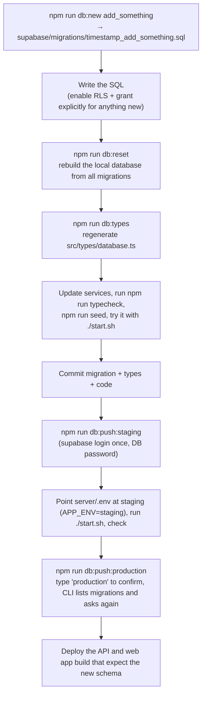
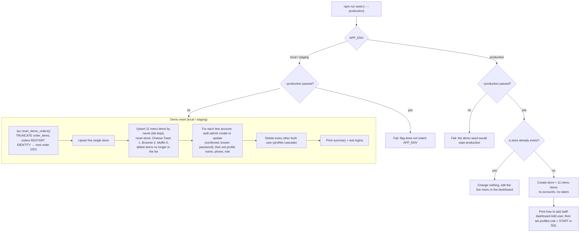
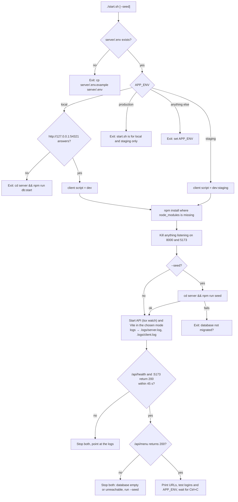
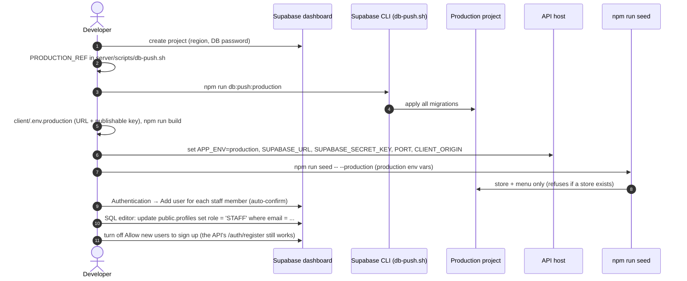

# Deployment

Environments, configuration, database changes and production setup. The environment diagram is in
[ARCHITECTURE.md](ARCHITECTURE.md#2-environments-and-configuration). Day-to-day local start-up is in the
[README](../README.md#quick-start).

> Production is changed by a person, never by an agent or a test run: `npm run db:push:production` and
> `npm run seed -- --production` are run by the user only. Tests run against local Supabase only
> ([TESTING.md](TESTING.md#the-test-target-guard-server)).

## Environments

| Environment  | Supabase project                                                                                       | Used by                                          |
| ------------ | ------------------------------------------------------------------------------------------------------ | ------------------------------------------------ |
| `local`      | Docker stack from `npm run db:start` (`http://127.0.0.1:54321`)                                        | day-to-day development, `./start.sh`, `npm test` |
| `staging`    | `xkddnlxeeizaqpefhqlv` (`https://xkddnlxeeizaqpefhqlv.supabase.co`)                                    | shared testing before release                    |
| `production` | a second hosted project; its ref goes in `PRODUCTION_REF` in `server/scripts/db-push.sh` (empty today) | the live app                                     |

Each environment is a separate Supabase project with its own database, users and keys. Project refs are not secret:
they are the subdomain of the project URL (`server/scripts/db-push.sh`).

### API and client must point at the same project

Access tokens are signed per project. A token from one project fails verification in an API pointed at another, and
the user sees "Your session has expired. Please sign in again." So:

- `server/.env` → `SUPABASE_URL` (and `APP_ENV`) and
- `client/.env.<mode>` → `VITE_SUPABASE_URL`

must name the same project. `start.sh` enforces this for local and staging by reading `APP_ENV` from `server/.env`
and starting Vite in the matching mode (`local` → `npm run dev`, `staging` → `npm run dev:staging`). It refuses
`APP_ENV=production`.

## Server environment variables

Read from `server/.env` (copy `server/.env.example`) or the host's environment. Validated at start-up by
`server/src/utils/env.ts`: on any problem the process prints `Invalid environment configuration. Check server/.env
(see .env.example):` with one line per variable and exits with code 1.

| Variable              | Required | Default                         | Rule                                                         | Purpose                                                                                                                                                               |
| --------------------- | -------- | ------------------------------- | ------------------------------------------------------------ | --------------------------------------------------------------------------------------------------------------------------------------------------------------------- |
| `APP_ENV`             | yes      |                                 | `local`, `staging` or `production`                           | which project this process talks to; `start.sh` picks the client mode from it; `npm run seed` refuses the demo reset on `production`; logger output and default level |
| `SUPABASE_URL`        | yes      |                                 | a URL                                                        | the project URL, e.g. `http://127.0.0.1:54321` or `https://<ref>.supabase.co`                                                                                         |
| `SUPABASE_SECRET_KEY` | yes      |                                 | starts with `sb_secret_` (legacy JWT keys are rejected)      | the project's secret key (Project Settings → API Keys). Bypasses RLS. Never in the client or git                                                                      |
| `PORT`                | no       | `8000`                          | positive integer                                             | API port. Keep 8000: `client/vite.config.ts` (proxy target) and `start.sh` hardcode it                                                                                |
| `CLIENT_ORIGIN`       | no       | `http://localhost:5173`         | a URL                                                        | the one origin CORS allows                                                                                                                                            |
| `LOG_LEVEL`           | no       | `debug` on `local`, else `info` | `fatal`, `error`, `warn`, `info`, `debug`, `trace`, `silent` | minimum log level (see [LOGGING.md](LOGGING.md#tuning-per-environment))                                                                                               |

`server/.env.example` holds the local stack's default values; the local secret key there is the Supabase CLI's
fixed local default, printed by `npm run db:start`. Hosted keys go in `server/.env` (staging) or the host's
environment (production), never in git.

Other variables read outside `env.ts`:

| Variable                             | Read by                                                   | Purpose                                                           |
| ------------------------------------ | --------------------------------------------------------- | ----------------------------------------------------------------- |
| `SUPABASE_DB_PASSWORD`               | Supabase CLI in `db-push.sh`                              | the hosted database password, instead of the interactive prompt   |
| `TEST_TARGET`, `ALLOW_STAGING_TESTS` | `server/test/setup/target.ts`, `server/vitest.config.mts` | which project a test run may touch (see [TESTING.md](TESTING.md)) |

## Client environment variables

Vite loads `client/.env.<mode>`. The values are public (they ship in the JS bundle), so the per-mode files are
committed. Never put a secret key (`sb_secret_…`) in any client file.

| Variable                        | Required | Purpose                                                                                                                               |
| ------------------------------- | -------- | ------------------------------------------------------------------------------------------------------------------------------------- |
| `VITE_SUPABASE_URL`             | yes      | the project the browser signs in to; same project as the API's `SUPABASE_URL`                                                         |
| `VITE_SUPABASE_PUBLISHABLE_KEY` | yes      | that project's publishable key (`sb_publishable_…`); RLS keeps it out of every table                                                  |
| `VITE_LOG_LEVEL`                | no       | `debug`, `info`, `warn`, `error` or `silent`; unset: `debug` in dev, `warn` in builds; `debug`/`info` are no-ops in production builds |

Types: `client/src/vite-env.d.ts`. Template: `client/.env.example`.

| File                      | Mode          | Used by                                        | In the repo                                      |
| ------------------------- | ------------- | ---------------------------------------------- | ------------------------------------------------ |
| `client/.env.development` | `development` | `npm run dev`                                  | yes                                              |
| `client/.env.staging`     | `staging`     | `npm run dev:staging`, `npm run build:staging` | yes                                              |
| `client/.env.production`  | `production`  | `npm run build`                                | **no**, create it for the first production build |

`client/vite.config.ts` throws `Missing VITE_SUPABASE_URL, VITE_SUPABASE_PUBLISHABLE_KEY for mode "<mode>". Create
client/.env.<mode> (see client/.env.example).` when either required variable is missing, for the dev server and for
builds alike. `client/src/lib/supabase.ts` throws at runtime for the same reason.

The client calls the API at `/api` on its own origin (`BASE_URL` in `client/src/services/api.ts`). Only the Vite dev
server proxies `/api` to `http://localhost:8000`. A production host has to serve the API under `/api` on the client's
origin (and set `CLIENT_ORIGIN` to that origin). The repo contains no hosting configuration for this.

## Builds

| Package | Command                 | Output         | Notes                                                                                      |
| ------- | ----------------------- | -------------- | ------------------------------------------------------------------------------------------ |
| server  | `npm run build`         | `server/dist/` | `tsc`; run with `npm start` (`node dist/src/server.js`)                                    |
| client  | `npm run build`         | `client/dist/` | `tsc --noEmit` then `vite build` in production mode; **requires `client/.env.production`** |
| client  | `npm run build:staging` | `client/dist/` | same, with `client/.env.staging`                                                           |

`npm start` does not load `tsx`; it needs `npm run build` first. `server.ts` loads `dotenv/config`, so a
`server/.env` is read if present; on a host, set the variables in its environment instead.

### Compressing photos before a build

`python3 client/scripts/optimize-images.py` (needs Pillow: `pip3 install pillow`) re-encodes every `<name>.jpg`
under `client/public/images/` in place (≤900px wide, quality 72, progressive) and writes the `<name>-400.jpg`
thumbnail `FoodPhoto`'s `srcset` needs (`lib/photo.ts`). Run it once after adding or replacing a photo, before
committing — `client/src/lib/photo.test.ts` fails on a photo missing its thumbnail. It skips a photo that already
has a thumbnail, so running it again never re-compresses (and degrades) an image twice. See
[FRONTEND_STRUCTURE.md#photo-thumbnails](FRONTEND_STRUCTURE.md#photo-thumbnails).

## Schema changes

Schema changes are SQL files in `server/supabase/migrations/`, applied in order everywhere. Once a migration has been
pushed, it is never edited: later changes go in a new file. The CLI records what it applied in each project's
`supabase_migrations` history table, so `db:push` only sends new files. Anything new must enable RLS and grant
explicitly (see [PERMISSIONS.md](PERMISSIONS.md#database)).

```bash
cd server
npm run db:new add_something       # creates supabase/migrations/<timestamp>_add_something.sql
npm run db:reset                   # local: rebuild the local database from all migrations (wipes local data)
npm run db:types                   # regenerate src/types/database.ts from the local database
npm run db:push:staging            # apply new migrations to staging
npm run db:push:production         # the same for production (user only)
```



### Applying migrations

`server/scripts/db-push.sh <staging|production>`:

1. `staging` uses `STAGING_REF`, `production` uses `PRODUCTION_REF`. Any other argument prints the usage and exits 1.
2. An empty ref (today: `PRODUCTION_REF`) stops with "PRODUCTION_REF is empty. Create the production project, then
   set it in server/scripts/db-push.sh."
3. For `production` it asks you to type `production`; anything else prints "Cancelled." and exits 1.
4. Runs `npx supabase db push --project-ref <ref>`. The CLI asks for the database password (or reads
   `SUPABASE_DB_PASSWORD`), lists the migrations it will apply, and asks before applying them.

One-time: `npx supabase login` (opens the browser).

## Seeding

Code: `server/scripts/seed.ts`. It seeds whichever project `server/.env` points at.



- **Demo reset** (`npm run seed`, `APP_ENV` local or staging): deletes every order, restarts numbering at #1001,
  updates the store, the 11 menu items and the two test accounts in place (their ids survive, so open browsers keep
  working), and deletes every other account.
- **Production setup** (`npm run seed -- --production`, `APP_ENV=production`): creates the store and menu only while
  production has no store. It creates no accounts and wipes nothing.

## Local and staging

- **Local**: `cd server && npm run db:start` (Docker) applies every migration. `cp server/.env.example server/.env`
  needs no edits. Then `./start.sh --seed` once, `./start.sh` after that. See the [README](../README.md#quick-start).
- **Staging, once**: `npm run db:push:staging`, then put the staging URL and secret key in `server/.env` with
  `APP_ENV=staging` and run `npm run seed` for the demo data.

### start.sh



## Production first-time setup

Run by the user, once.

1. Create a new project in the Supabase dashboard (a region near your users; save the database password).
2. Put its ref in `PRODUCTION_REF` in `server/scripts/db-push.sh`, then `npm run db:push:production`.
3. Create `client/.env.production` with its `VITE_SUPABASE_URL` and publishable key (see `client/.env.example`).
   `npm run build` refuses to run without it.
4. On the production API host set `APP_ENV=production`, `SUPABASE_URL`, `SUPABASE_SECRET_KEY`, `PORT`,
   `CLIENT_ORIGIN` and optionally `LOG_LEVEL`.
5. Load the store and menu once, with the production values in the environment: `npm run seed -- --production`. It
   only works while production has no store, and creates no accounts. The plain `npm run seed` refuses to run
   against production.
6. Create staff accounts in the dashboard (Authentication → Add user, with auto-confirm), then in the SQL editor:
   `update public.profiles set role = 'STAFF' where email = '…';`
7. Recommended in the dashboard (Authentication → Sign In / Providers): turn off **Allow new users to sign up**.
   Accounts are created by the API's `/auth/register` with the secret key, which still works; this closes direct
   sign-ups with the publishable key.



## Future: Docker + nginx

**Not in the repo yet — this section is future scope, not a description of anything that exists today.** The repo
currently contains no hosting configuration (see [Client environment variables](#client-environment-variables)); a
production host has to serve the API under `/api` on the client's own origin and the built `client/dist/` as static
files. The plan, when someone builds it:

- nginx in front of both: reverse-proxy `/api/*` to the Express server (`server/dist` under Node, `PORT` from its
  environment), and serve `client/dist/` for everything else, so the browser never needs CORS for same-origin `/api`
  calls (`CLIENT_ORIGIN` would still be set for any cross-origin caller).
- Cache headers nginx would add on top of the API's own `Cache-Control: no-cache` (see [API.md#caching](API.md#caching)):

  | Path                     | Header                                               | Why                                                                                  |
  | ------------------------ | ---------------------------------------------------- | ------------------------------------------------------------------------------------ |
  | `client/dist/assets/*`   | `Cache-Control: public, max-age=31536000, immutable` | Vite hashes these filenames; a changed file is a new URL, so caching forever is safe |
  | `client/dist/index.html` | `Cache-Control: no-cache`                            | must always be revalidated, or a deploy never reaches a returning visitor            |
  | `/images/*`              | `Cache-Control: public, max-age=604800` (a week)     | food and cafe photos change rarely and are not fingerprinted                         |
  | everything else          | unset — the API's own `no-cache` stands              | stock, menu and orders must always be revalidated                                    |

- gzip or brotli compression on nginx's static responses (Vite's build output is not pre-compressed).
- `client/.env.production` (see [Client environment variables](#client-environment-variables)) still has to exist
  before `npm run build` runs, wherever the build happens (CI or the host).

Docker is one route to package this (an nginx image plus a small Node image for the API); nothing here commits to
that container layout, only to what a production host has to do.
