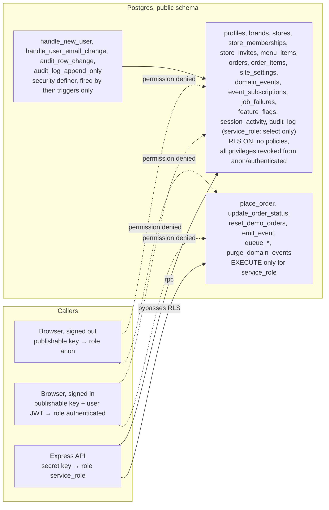

# Permissions

Who can do what, and where each rule is enforced. The auth flows (sign-in, session restore, an authenticated call)
are drawn in [ARCHITECTURE.md](ARCHITECTURE.md#3-authentication). Status codes and messages are in
[API.md](API.md#authentication).

## Roles

| Role       | Who                                                       | Can                                                                                                                                                                  |
| ---------- | --------------------------------------------------------- | -------------------------------------------------------------------------------------------------------------------------------------------------------------------- |
| anonymous  | anyone without a token                                    | read the store and menu, register, sign in                                                                                                                           |
| `CUSTOMER` | every new account (the `profiles.role` default)           | place orders, list and read their own orders                                                                                                                         |
| `STAFF`    | a store membership role only (no `profiles.role`)         | at their store: read its orders, change order status (see [Store roles](#store-roles))                                                                               |
| `ADMIN`    | accounts whose `profiles.role` was set to `ADMIN` by hand | read and edit the site settings (`GET`/`PATCH /api/admin/settings`), read the audit log (`GET /api/admin/audit`), flip feature flags (`PATCH /api/admin/flags/:key`) |

`ADMIN` is a **site-wide developer/operator role**, not a restaurant role: a separate track from `STAFF` with no
staff powers (an admin without a store standing gets 403 on a store's order routes like a customer) and no special powers over orders — an admin's own orders and profile
work exactly like a customer's. Its only privilege is the admin dashboard (`/admin`, the `site_settings` row); see
[SCHEMA.md](SCHEMA.md#site_settings).

- The role is `profiles.role` (enum `user_role`) and nothing else. It is never read from the token or from
  `user_metadata`: users can edit their own `user_metadata`, so it must never grant `ADMIN`.
- No application API route changes `profiles.role`. Only privileged database access (the secret key, or an
  administrator using the SQL editor) can change it.
- `requireAuth` reads the role from `profiles` on every request, so promoting or demoting someone takes effect on
  their next request without signing in again.
- Making someone staff: a membership of the store they work at (the profile stays `CUSTOMER`; the `STAFF` profile role was migrated away in P2 PR 16):
  `insert into public.store_memberships (user_id, store_id, role) select id, '<store id>', 'STAFF' from public.profiles where email = '…';` (`'MANAGER'` for a manager). Since P2 PR 09 a manager or the owner can invite people through the API instead ([Team invites and removals](#team-invites-and-removals)); the SQL stays as the fallback, for example for the first manager of a store. See
  [DEPLOYMENT.md](DEPLOYMENT.md#production-first-time-setup) and [Store roles](#store-roles)). `pnpm run seed` sets
  the demo staff accounts up the same way.
- Making someone an admin (production or otherwise): `update public.profiles set role = 'ADMIN' where email = '…';`
  in the SQL editor. `pnpm run seed` creates a demo admin account (`admin@campuscafe.local`) the same way, locally and
  on staging — with the published `admin123` locally and a required `SEED_ADMIN_PASSWORD` on staging. The STAFF
  and CUSTOMER demo accounts follow the same rule (`SEED_STAFF_PASSWORD`, `SEED_CUSTOMER_PASSWORD`), because a
  published staff password on shared staging would expose every customer's name, phone and notes (see
  [DEPLOYMENT.md](DEPLOYMENT.md#production-first-time-setup)).

## Store roles

Decision (ADR-001, P2.2): staff and managers are memberships of one store, not a site-wide profile role. Context: a
chain has several stores, and one person may work one of them. Decision: a `store_memberships` row
([SCHEMA.md](SCHEMA.md#store_memberships)) gives `STAFF` or `MANAGER` at one store, and the brand's owner
(`brands.owner_id`) is `OWNER` of every store of the brand with **no row**, so the last owner cannot be removed.
Consequence: a person's standing is per store; `profiles.role` is only `CUSTOMER` or `ADMIN` in practice (the enum still has `STAFF`, unused).

The caller's standings at a store are `OWNER` (owns the store's brand), their membership role and `ADMIN` (profile
role), in that order. `accessFor` picks the first standing that holds the requested capability, else the first standing
it has (so a visible store answers 403), else none. An ADMIN who is also a STAFF member therefore uses STAFF for
`orders.view` and ADMIN for `team.manageManagers`. The map is `MATRIX` in `server/src/domain/permissions.ts` (`can(access, capability)`,
`accessFor(user, store)`); a capability is added with the route that checks it.

| Capability            | STAFF | MANAGER | OWNER | ADMIN |
| --------------------- | ----- | ------- | ----- | ----- |
| `orders.view`         | yes   | yes     | yes   |       |
| `orders.transition`   | yes   | yes     | yes   |       |
| `store.pause`         | yes   | yes     | yes   | yes   |
| `hours.edit`          |       | yes     | yes   |       |
| `settings.edit`       |       | yes     | yes   |       |
| `menu.edit`           |       | yes     | yes   |       |
| `store.profile`       |       | yes     | yes   |       |
| `store.publish`       |       |         | yes   |       |
| `team.manageStaff`    |       | yes     | yes   | yes   |
| `team.manageManagers` |       |         | yes   | yes   |
| `audit.store`         |       | yes     | yes   | yes   |
| `stock.update`        | yes¹  | yes     | yes   |       |

`ADMIN` holds only `store.pause`, `team.*` and `audit.store`: no kitchen power of its own (an ADMIN with a store membership still has that membership's kitchen access).

`store.pause` guards `POST /stores/:storeId/pause` and `POST /stores/:storeId/resume` ([API.md](API.md#post-storesstoreidpause)); STAFF, MANAGER, OWNER and ADMIN may pause.

`menu.edit` guards the menu editor, `GET`, `POST`, `PATCH` and `DELETE /stores/:storeId/menu-items` ([API.md](API.md#get-storesstoreidmenu-items)); STAFF get 403.

`stock.update` guards `PATCH /stores/:storeId/menu-items/:itemId/stock`, `GET /stores/:storeId/stock` and `GET /stores/:storeId/stock-movements` ([API.md](API.md#patch-storesstoreidmenu-itemsitemidstock)). ¹ STAFF hold it only while the store's `staff_can_edit_stock` setting is on (the default); a manager or the owner turns it off in the store's settings, and staff then get 403. It is the one cell that depends on a store setting: `can(access, capability, rules)` takes the store's rules, `requireStore` passes them from the store row, and a caller that passes none gets the stricter answer. A brand template has no stock, so `stock.update` is not a template capability.

`store.profile` guards `PATCH /stores/:storeId/profile` ([API.md](API.md#patch-storesstoreidprofile)) and the manage screen's read of the store, `GET /stores/:storeId/manage` (`hours.edit` guards its hours read, `GET /stores/:storeId/manage/hours`); STAFF get 403. `store.publish` guards `POST /stores/:storeId/publish` and `/unpublish` ([API.md](API.md#post-storesstoreidpublish)) and is the OWNER's alone: making a store public or taking it down is the brand's call, so a MANAGER or an ADMIN cannot. `store.profile` is also a template capability (the owner edits the tagline and description new branches copy); `store.publish` is not. A published store cannot have its address cleared (400 on `addressLine`): unpublish first. Opening a branch (`POST /brands/:brandId/stores`) is not a store capability: the route checks that the brand is in the caller's `ownedBrandIds`, and everyone else, an admin included, gets 404.

`hours.edit` guards `PUT /stores/:storeId/hours` and the schedule-exception POST and DELETE ([API.md](API.md#put-storesstoreidhours)); STAFF get 403.

`requireStore(capability)` (`server/src/middleware/auth.ts`, after `requireAuth`) guards a route with `:storeId`:

- A malformed or unknown store id is 404 `NOT_FOUND`, and so is a store that is not `ACTIVE` when the caller has no
  access to it (a draft store does not exist to outsiders).
- A store the caller can see but lacks the capability for is 403 `FORBIDDEN`.
- A brand template (`stores.is_template`, [SCHEMA.md](SCHEMA.md#stores)) is 404 to everyone but the brand's owner,
  and to the owner too for any capability a copy does not inherit: only `settings.edit`, `menu.edit`, `store.profile` and `audit.store` reach it
  (`canAtTemplate` in `domain/permissions.ts`). A template has no kitchen and no team, so its orders, pause and team
  routes are 404, and no invite to it can be made.
- It sets `req.store` and `req.storeAccess`; `requestContext` then records `storeRole` in the actor, which the audit row
  stores as `actor_role` ([SCHEMA.md](SCHEMA.md#audit_row_change)).

`requireAuth` reads the caller's memberships and owned brands in the same `profiles` read (`req.user.memberships`,
`req.user.ownedBrandIds`), so a change applies on the next request. `GET /api/auth/me` returns them
([API.md](API.md#get-authme)).

## Team invites and removals

Code: `server/src/controllers/team.controller.ts`, `server/src/services/team.service.ts`. Every team route is behind
`requireStore('team.manageStaff')` (MANAGER, OWNER, ADMIN; STAFF get 403). The routes are in
[API.md](API.md#get-storesstoreidmembers).

- **Inviting or revoking an invite for a `STAFF`** needs only `team.manageStaff`. For a **`MANAGER`** it also needs
  `team.manageManagers` (OWNER, ADMIN), else 403.
- **Removing a `STAFF` member** needs `team.manageStaff`. Removing a **`MANAGER`** needs `team.manageManagers`, except
  that a manager may remove themselves (leave the team).
- `team.controller.managesManagers` re-checks `accessFor(user, store, 'team.manageManagers')` instead of reusing
  `req.storeAccess`, so an ADMIN who is also a MANAGER member is judged by the standing that holds the capability.
- The brand's owner has no membership, so no route can remove them. Removal takes effect on the person's next request.
- Accepting (`POST /api/me/invites/accept`) needs only a signed-in account whose email is the invite's, plus the
  token. Every refusal is 404 ([API.md](API.md#post-meinvitesaccept)); the role comes from the invite, never from the
  request.
- The invite table is reachable only through the API ([SCHEMA.md](SCHEMA.md#store_invites)).

Known limitation: an invite is bound to an email, but sign-up does not verify email ownership yet. Whoever holds the
token **and** registers with that email can accept it, so the token is the real secret: the inviter shares it out of
band, and it is shown once, stored only as a hash and never logged. Follow-up: verify the email at sign-up
([ROADMAP](../plans/ROADMAP.md)).

## Route matrix

| Route                                               | anonymous  | CUSTOMER                                                     | STAFF                                                | ADMIN                                                | Enforced by                                                                             |
| --------------------------------------------------- | ---------- | ------------------------------------------------------------ | ---------------------------------------------------- | ---------------------------------------------------- | --------------------------------------------------------------------------------------- |
| `GET /api/health`                                   | yes        | yes                                                          | yes                                                  | yes                                                  | –                                                                                       |
| `GET /api/ready`                                    | yes        | yes                                                          | yes                                                  | yes                                                  | –                                                                                       |
| `GET /api/config`                                   | yes        | yes                                                          | yes                                                  | yes                                                  | – (public: the same config for everyone; before the client version gate)                |
| `POST /api/client-errors`                           | yes        | yes                                                          | yes                                                  | yes                                                  | – (public: no token; before the client version gate; per-address `clientErrorLimiter`)  |
| `POST /api/auth/register`                           | yes        | yes                                                          | yes                                                  | yes                                                  | –                                                                                       |
| `GET /api/auth/me`                                  | 401        | own profile                                                  | own profile                                          | own profile                                          | `requireAuth`                                                                           |
| `POST /api/orders`                                  | 401        | yes                                                          | yes                                                  | yes                                                  | `requireAuth`                                                                           |
| `GET /api/orders`                                   | 401        | own orders                                                   | own orders                                           | own orders                                           | `requireAuth` + `order.service.listOrders`                                              |
| `GET /api/orders/:id`                               | 401        | own, or `orders.view` at its store; else 404                 | own, or `orders.view` at its store; else 404         | own, or `orders.view` at its store; else 404         | `requireAuth` + `order.service.getOrder`                                                |
| `GET /api/stores/:storeId/orders`                   | 401        | `orders.view` there, else 403 (404 if not visible)           | `orders.view` there, else 403 (404 if not visible)   | `orders.view` there, else 403 (404 if not visible)   | `requireAuth` + `requireStore('orders.view')`                                           |
| `PATCH /api/stores/:storeId/orders/:orderId/status` | 401        | `orders.transition` there; another store's order 404         | `orders.transition` there; another store's order 404 | `orders.transition` there; another store's order 404 | `requireAuth` + `requireStore('orders.transition')` + `order.service.updateOrderStatus` |
| `GET /api/admin/settings`                           | 401        | 403                                                          | 403                                                  | yes                                                  | `requireAuth` + `requireAdmin`                                                          |
| `PATCH /api/admin/settings`                         | 401        | 403                                                          | 403                                                  | yes                                                  | `requireAuth` + `requireAdmin`                                                          |
| `GET /api/stores/:storeId/audit`                    | 401        | 403                                                          | `audit.store` there (MANAGER, OWNER), else 403       | 403 unless a MANAGER/OWNER/ADMIN standing there      | `requireAuth` + `requireStore('audit.store')`                                           |
| `POST /api/stores/:storeId/pause`                   | 401        | `store.pause` there, else 403 (404 if not visible)           | `store.pause` there, else 403 (404 if not visible)   | `store.pause` (ADMIN), else 403 (404 if not visible) | `requireAuth` + `requireStore('store.pause')` + `writeLimiter`; `storePause.service`    |
| `POST /api/stores/:storeId/resume`                  | 401        | `store.pause` there, else 403 (404 if not visible)           | `store.pause` there, else 403 (404 if not visible)   | `store.pause` (ADMIN), else 403 (404 if not visible) | `requireAuth` + `requireStore('store.pause')` + `writeLimiter`; `storePause.service`    |
| `GET /api/stores/:storeId/members`                  | 401        | 403                                                          | `team.manageStaff` there (MANAGER, OWNER), else 403  | `team.manageStaff` (ADMIN), else 403                 | `requireAuth` + `requireStore('team.manageStaff')`                                      |
| `POST /api/stores/:storeId/invites`                 | 401        | 403                                                          | `team.manageStaff` there (MANAGER, OWNER), else 403  | `team.manageStaff` (ADMIN), else 403                 | same + `writeLimiter`; a `MANAGER` invite also needs `team.manageManagers`              |
| `DELETE /api/stores/:storeId/invites/:inviteId`     | 401        | 403                                                          | `team.manageStaff` there (MANAGER, OWNER), else 403  | `team.manageStaff` (ADMIN), else 403                 | same; a `MANAGER` invite also needs `team.manageManagers`                               |
| `DELETE /api/stores/:storeId/members/:membershipId` | 401        | 403                                                          | `team.manageStaff` there (MANAGER, OWNER), else 403  | `team.manageStaff` (ADMIN), else 403                 | same; a `MANAGER` member needs `team.manageManagers`, or is the caller                  |
| `POST /api/me/invites/accept`                       | 401        | yes, with the invite's token and email                       | yes, with the invite's token and email               | yes, with the invite's token and email               | `requireAuth` + `inviteAcceptLimiter`; every refusal 404                                |
| `GET /api/admin/audit`                              | 401        | 403                                                          | 403                                                  | yes                                                  | `requireAuth` + `requireAdmin`                                                          |
| `PATCH /api/admin/flags/:key`                       | 401        | 403                                                          | 403                                                  | yes (unknown key 404)                                | `requireAuth` + `requireAdmin`                                                          |
| `/staff` (client route, the switcher)               | → `/login` | the switcher (an account with no store sees how to join one) | the switcher                                         | the switcher                                         | `RequireMembership` (signed in only)                                                    |
| `/staff/:storeSlug` (client route, the board)       | → `/login` | → `/` (no membership at that store)                          | the board of the store                               | → `/` unless a member                                | `RequireMembership` (client only; the API checks `orders.view` per store)               |
| `/admin` (client route)                             | → `/login` | → `/`                                                        | → `/`                                                | renders `AdminPage`                                  | `RequireRole role="ADMIN"` (client only)                                                |

The STAFF column of the two store routes means a store standing (a membership or the brand's owner, whatever the
profile role); a CUSTOMER or ADMIN profile with that standing gets the same. `testStoreIsolation`
([TESTING.md](TESTING.md)) runs the tenant matrix on each store route.

Nothing stops a store member or `ADMIN` account from placing an order: `POST /api/orders` only requires a signed-in user.
`customerOrderHistoryLimit` is an editable `site_settings` value (default 20; the staff board's length is each store's own setting); see
[API.md#get-adminsettings](API.md#get-adminsettings).

## Server

Code: `server/src/middleware/auth.ts`.

- `requireAuth` verifies the bearer token against the project's JWKS (`verifyCredentials` from `@supabase/server`),
  loads `id, role` from `profiles`, and sets `req.user`. A token from another Supabase project fails verification.
  A valid token whose profile is gone is 401.
- `requireAdmin` must run after `requireAuth`. It returns 403 `FORBIDDEN` unless `req.user.role === 'ADMIN'`. It
  guards `adminRouter` (`adminRouter.use(requireAuth, requireAdmin)`), so a store member cannot reach `/api/admin/*` either.
- `currentUser(req)` reads `req.user` and throws 401 if a route forgot `requireAuth`.
- `orderRouter.use(requireAuth)` guards every path under `/api/orders`; `adminRouter.use(requireAuth, requireAdmin)`
  guards every path under `/api/admin`.

### Ownership: someone else's order is a 404

`order.service.getOrder` answers the order to the customer who placed it, or to a caller whose access at the order's
store holds `orders.view` (`accessToOrder`). Anyone else asking gets the same 404 `NOT_FOUND` "Order not found." as for
a missing id, and a non-UUID id is also 404. The cases look identical, so order ids cannot be probed. Never return 403
for another user's resource. `ADMIN` standing alone has no `orders.view`; an admin (or customer) with a store membership or brand ownership can also see orders at that store.

`updateOrderStatus` reads the order's store first and applies `orders.transition` there the same way (404), and on
the store route also requires the order to be of `:storeId`. `test/api/store-orders.test.ts` is the guard.

`listOrders` filters by `user_id` for everyone and applies `limit(settings.customer_order_history_limit)`; a store's board is `listStoreOrders` (`.eq('store_id', …)`, finished orders capped by the store's own `staff_order_list_limit`).

### Why every query scopes by user

The API has one Supabase client, `supabaseAdmin` (`server/src/utils/supabase.ts`), created with the secret key. It
runs as `service_role`, which bypasses RLS. The database therefore does not know who the caller is, and it will
return any row the query asks for. Every service that reads per-user data must filter by `req.user.id` itself
(`order.service.ts` is the pattern). A new query that forgets the filter leaks other users' data.

## Client

Code: `client/src/features/auth/RequireAuth.tsx`, `RequireRole.tsx`, `useAuthRedirect.ts`, `roles.ts`.

| Guard                                       | No token                               | Signed in, wrong role                                                                         | Matching role |
| ------------------------------------------- | -------------------------------------- | --------------------------------------------------------------------------------------------- | ------------- |
| `RequireAuth`                               | redirect to `/login?next=<path+query>` | render                                                                                        | render        |
| `RequireMembership` (`/staff[/:storeSlug]`) | redirect to `/login?next=<path+query>` | `/staff`: render; `/staff/:storeSlug`: redirect to `/` unless a membership matches that store | render        |
| `RequireRole role="ADMIN"`                  | redirect to `/login?next=<path+query>` | redirect to `/`                                                                               | render        |

`RequireStaff.tsx` was replaced by the generic `RequireRole.tsx` (one role prop instead of one component per role);
`/staff` renders `<RequireMembership>` (a store role from `user.memberships`, at the route's store) and `/admin` renders `<RequireRole role="ADMIN">`.

- Guards read `token` (and `user.role` for a role guard) from `authStore`, which mirrors the supabase-js session so
  the check is synchronous.
- Which routes use which guard: [FRONTEND_STRUCTURE.md](FRONTEND_STRUCTURE.md#routes).
- After sign-in or registration, `useAuthRedirect` sends every account to `?next` when `next` starts with `/` and not
  `//` (same-site paths only: an invite's `/join` comes back this way for staff too), otherwise to `roles.homeFor(user)`
  (`ADMIN` → `/admin`, an owner or manager → `/manage`, a store member → `/staff`, anyone else → `/`).
- On any 401 from the API for a request that carried a token, `services/api.ts` calls `authStore.clearSession()`, so
  the guard redirects to sign-in on the next render.
- The guards only improve the UX. The API enforces every rule again.

## Session lifetime

A sign-in lasts **7 days without use**; using the app (which refreshes the 1 h access token) restarts the week.

> **Decision.** **Context:** access tokens already expire in 1 h and refresh silently, but nothing capped how long an
> unused device stayed signed in — a lost or shared device stayed logged in forever. **Decision:** cap idle sessions
> at 7 days, enforced on both sides: `client/src/features/auth/sessionActivity.ts` tracks the last active time in
> `localStorage` (`fp_last_active`) and signs the device out locally (`clearSession()`, `signOut('local')`) once 7
> days pass with no activity; `server/supabase/config.toml`'s `[auth.sessions]` sets `inactivity_timeout = "168h"` so
> Supabase also expires the refresh token server-side (`jwt_expiry`, the 1 h access token lifetime, is unchanged).
> **Consequences:** a device idle for a week is signed out even if it never calls the API; on hosted projects the
> server-side half is missing, because `inactivity_timeout` is a Pro-plan setting and the project runs on Supabase
> Free ([ADR-011](adr/011-free-tiers.md), [DEPLOYMENT.md](DEPLOYMENT.md#hosted-session-timeout)), so the API checks
> it itself (below); a missing `fp_last_active` record (a session that predates this feature) counts as active, so the
> week starts fresh instead of expiring at once.

- `markActive()` runs on login and whenever `hydrate()` or a tab-visible check finds the session still within its
  week; `clearActivity()` runs on logout and on an idle-expired session.
- Coming back to a hidden tab counts as use: `authStore.ts`'s `visibilitychange` listener re-checks and either signs
  out (the week ran out in the background) or restarts it.
- **The server check** (every environment, Free included): `requireAuth` records each sign-in's last use per session
  (the token's `session_id`, table `session_activity`, [SCHEMA.md](SCHEMA.md#touch_session)) at most every 5 minutes
  per API process. A sign-in unused for `SESSION_IDLE_DAYS` gets 401 and is revoked with
  `auth.admin.signOut(token, 'local')`, so a copied refresh token stops working on its next use; the client then
  clears its session as on any 401. A signed-out or revoked sign-in gets the same 401 even while its access token
  (1 h) is still valid, at the latest 5 minutes after the sign-out on a process that had just checked it. Per session,
  not per user: a phone in use does not keep a stolen laptop session
  alive. A sign-in made before the check shipped starts its week at its first request. If the check cannot run (the
  database call fails) the request goes on: the token is still verified, and the client cap still holds.
- Client code: [COMPONENTS.md](COMPONENTS.md#featuresauth). Server config:
  [DEPLOYMENT.md](DEPLOYMENT.md#hosted-session-timeout).

## Database

Code: `server/supabase/migrations/` (every migration closes what it adds). Details in
[SCHEMA.md](SCHEMA.md#row-level-security-and-grants); `server/test/api/database-lockdown.test.ts` checks it for every
table and function.

- RLS is on for every table with **no policies**, and all table privileges are revoked from `anon` and
  `authenticated`. The publishable key in the browser bundle cannot read or write any row.
- `EXECUTE` on the RPCs is granted to `service_role` only. The trigger functions are callable by nobody; only their
  triggers run them.
- `audit_log` is append-only. Only its trigger writes it (as the owner); the secret key may read it but not insert,
  update or delete, and its own triggers refuse an update, delete or truncate even from the owner. An audited write
  names its actor through a transition function's `p_actor` or the `x-actor` header
  ([SCHEMA.md](SCHEMA.md#audit_row_change)); anything else is recorded as `SYSTEM`. Admins read it through
  `GET /api/admin/audit`; a store's MANAGER, OWNER and ADMIN read that store's rows through
  `GET /api/stores/:storeId/audit` (`audit.store`, the store filter forced from `req.store`).
- `feature_flags` is closed like every table; admins flip a flag through `PATCH /api/admin/flags/:key`, which names
  them in its audit row. A flip made in the SQL editor is recorded as `SYSTEM`, so production flags are flipped
  through the API.
- The queues (`pgmq` schema) and schedules (`cron` schema) are closed to `anon` and `authenticated` and not exposed
  through the Data API; the API and the worker reach the queues only through the `queue_*` wrappers
  ([JOBS.md](JOBS.md)).
- Default privileges are changed so tables and functions created by later migrations also start closed. A migration
  that needs something public must grant it explicitly (and should not: the browser talks to Supabase only for
  sign-in).
- The browser uses Supabase only to sign in, refresh the token and sign out (`client/src/lib/supabase.ts`, which loads supabase-js on first use).

## Sign-ups

- `POST /api/auth/register` creates accounts with the secret key (`auth.admin.createUser`, already confirmed). It
  applies the zod rules in `server/src/schemas/auth.schema.ts`.
- Direct sign-ups with the publishable key (`supabase.auth.signUp`) would skip those rules, so they are off: local
  Supabase has `[auth] enable_signup = false` in `server/supabase/config.toml` (`[auth.email] enable_signup` stays
  `true`: it switches the email provider itself, sign-in included), and a hosted
  project must turn off "Allow new users to sign up" (a required step, see
  [DEPLOYMENT.md](DEPLOYMENT.md#production-first-time-setup)). `/auth/register` keeps working:
  `auth.admin.createUser` is not a sign-up.
- Whichever way an account is made, the trigger bounds its profile: `handle_new_user` passes the metadata through
  `profile_name` and `profile_phone`, and `profiles` checks the result
  ([SCHEMA.md](SCHEMA.md#profile_name-and-profile_phone)).

## Secrets

- `SUPABASE_SECRET_KEY` (`sb_secret_…`) is server-only. It bypasses RLS. It must never reach the browser or git.
  `server/src/utils/env.ts` rejects a key that does not start with `sb_secret_`.
- `VITE_SUPABASE_PUBLISHABLE_KEY` is public: it ships in the JS bundle and is committed in `client/.env.<mode>`.
- The server log redacts the `Authorization` header, cookies, passwords, tokens, emails, phone numbers and
  `SUPABASE_SECRET_KEY` (see [LOGGING.md](LOGGING.md#never-logged)).
