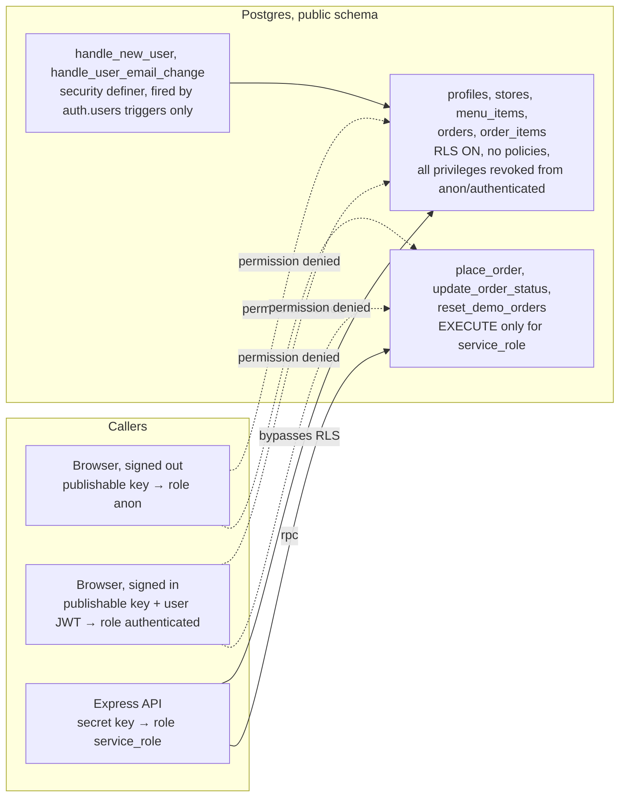

# Permissions

Who can do what, and where each rule is enforced. The auth flows (sign-in, session restore, an authenticated call)
are drawn in [ARCHITECTURE.md](ARCHITECTURE.md#3-authentication). Status codes and messages are in
[API.md](API.md#authentication).

## Roles

| Role       | Who                                                       | Can                                                            |
| ---------- | --------------------------------------------------------- | -------------------------------------------------------------- |
| anonymous  | anyone without a token                                    | read the store and menu, register, sign in                     |
| `CUSTOMER` | every new account (the `profiles.role` default)           | place orders, list and read their own orders                   |
| `STAFF`    | accounts whose `profiles.role` was set to `STAFF` by hand | read every order (newest 100 in the list), change order status |

- The role is `profiles.role` (enum `user_role`) and nothing else. It is never read from the token or from
  `user_metadata`: users can edit their own `user_metadata`, so it must never grant `STAFF`.
- Only the secret key can change `profiles.role`. There is no API route that changes a role.
- `requireAuth` reads the role from `profiles` on every request, so promoting or demoting someone takes effect on
  their next request without signing in again.
- Making someone staff: `update public.profiles set role = 'STAFF' where email = '…';` in the SQL editor (see
  [DEPLOYMENT.md](DEPLOYMENT.md#production-first-time-setup)). `npm run seed` sets the demo staff account's role the
  same way.

## Route matrix

| Route                          | anonymous | CUSTOMER            | STAFF             | Enforced by                                |
| ------------------------------ | --------- | ------------------- | ----------------- | ------------------------------------------ |
| `GET /api/health`              | yes       | yes                 | yes               | –                                          |
| `GET /api/store`               | yes       | yes                 | yes               | –                                          |
| `GET /api/menu`                | yes       | yes                 | yes               | –                                          |
| `POST /api/auth/register`      | yes       | yes                 | yes               | –                                          |
| `GET /api/auth/me`             | 401       | own profile         | own profile       | `requireAuth`                              |
| `POST /api/orders`             | 401       | yes                 | yes               | `requireAuth`                              |
| `GET /api/orders`              | 401       | own orders          | newest 100 of all | `requireAuth` + `order.service.listOrders` |
| `GET /api/orders/:id`          | 401       | own order, else 404 | any order         | `requireAuth` + `order.service.getOrder`   |
| `PATCH /api/orders/:id/status` | 401       | 403                 | yes               | `requireAuth` + `requireStaff`             |

Nothing stops a `STAFF` account from placing an order: `POST /api/orders` only requires a signed-in user.

## Server

Code: `server/src/middleware/auth.ts`.

- `requireAuth` verifies the bearer token against the project's JWKS (`verifyCredentials` from `@supabase/server`),
  loads `id, role` from `profiles`, and sets `req.user`. A token from another Supabase project fails verification.
  A valid token whose profile is gone is 401.
- `requireStaff` must run after `requireAuth`. It returns 403 `FORBIDDEN` unless `req.user.role === 'STAFF'`.
- `currentUser(req)` reads `req.user` and throws 401 if a route forgot `requireAuth`.
- `orderRouter.use(requireAuth)` guards every path under `/api/orders`.

### Ownership: someone else's order is a 404

`order.service.getOrder` adds `.eq('user_id', user.id)` unless the caller is `STAFF`. A customer asking for another
customer's order gets the same 404 `NOT_FOUND` "Order not found." as for a missing id, and a non-UUID id is also 404.
The two cases look identical, so order ids cannot be probed. Never return 403 for another user's resource.

`listOrders` filters by `user_id` for customers and applies `limit(100)` for staff.

### Why every query scopes by user

The API has one Supabase client, `supabaseAdmin` (`server/src/utils/supabase.ts`), created with the secret key. It
runs as `service_role`, which bypasses RLS. The database therefore does not know who the caller is, and it will
return any row the query asks for. Every service that reads per-user data must filter by `req.user.id` itself
(`order.service.ts` is the pattern). A new query that forgets the filter leaks other users' data.

## Client

Code: `client/src/features/auth/RequireAuth.tsx`, `RequireStaff.tsx`, `useAuthRedirect.ts`.

| Guard          | No token                               | Signed in, not staff | Staff  |
| -------------- | -------------------------------------- | -------------------- | ------ |
| `RequireAuth`  | redirect to `/login?next=<path+query>` | render               | render |
| `RequireStaff` | redirect to `/login?next=<path+query>` | redirect to `/`      | render |

- Both guards read `token` (and `user.role` for staff) from `authStore`, which mirrors the supabase-js session so the
  check is synchronous.
- Which routes use which guard: [FRONTEND_STRUCTURE.md](FRONTEND_STRUCTURE.md#routes).
- After sign-in or registration, `useAuthRedirect` sends `STAFF` to `/staff` and everyone else to `?next`, but only
  when `next` starts with `/` and not `//` (same-site paths only), otherwise to `/`.
- On any 401 from the API for a request that carried a token, `services/api.ts` calls `authStore.clearSession()`, so
  the guard redirects to sign-in on the next render.
- The guards only improve the UX. The API enforces every rule again.

## Database

Code: `server/supabase/migrations/20260925120000_init.sql`. Details in [SCHEMA.md](SCHEMA.md#row-level-security-and-grants).

- RLS is on for every table with **no policies**, and all table privileges are revoked from `anon` and
  `authenticated`. The publishable key in the browser bundle cannot read or write any row.
- `EXECUTE` on the RPCs is granted to `service_role` only. The trigger functions are callable by nobody; only their
  triggers run them.
- Default privileges are changed so tables and functions created by later migrations also start closed. A migration
  that needs something public must grant it explicitly (and should not: the browser talks to Supabase only for
  sign-in).
- The browser uses Supabase only to sign in, refresh the token and sign out (`client/src/lib/supabase.ts`).

## Sign-ups

- `POST /api/auth/register` creates accounts with the secret key (`auth.admin.createUser`, already confirmed). It
  applies the zod rules in `server/src/schemas/auth.schema.ts`.
- Direct sign-ups with the publishable key (`supabase.auth.signUp`) skip those rules but still get a `CUSTOMER`
  profile from the trigger. Local Supabase allows them (`enable_signup = true` in `server/supabase/config.toml`). On
  hosted projects the recommendation is to turn off "Allow new users to sign up" (see
  [DEPLOYMENT.md](DEPLOYMENT.md#production-first-time-setup)); `/auth/register` keeps working.

## Secrets

- `SUPABASE_SECRET_KEY` (`sb_secret_…`) is server-only. It bypasses RLS. It must never reach the browser or git.
  `server/src/utils/env.ts` rejects a key that does not start with `sb_secret_`.
- `VITE_SUPABASE_PUBLISHABLE_KEY` is public: it ships in the JS bundle and is committed in `client/.env.<mode>`.
- The server log redacts the `Authorization` header, cookies, passwords, tokens, emails, phone numbers and
  `SUPABASE_SECRET_KEY` (see [LOGGING.md](LOGGING.md#never-logged)).
