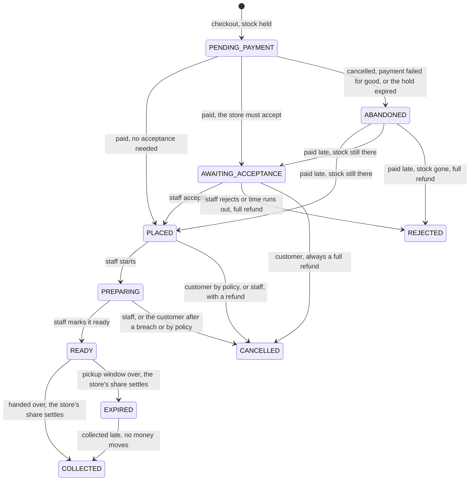

# P5 — Payments, escrow and refunds: implementation plan

The PR-by-PR plan for [ROADMAP.md P5](ROADMAP.md#p5--payments-escrow-and-refunds): a customer pays before the
kitchen starts, the stock is held while they pay, the money is refunded whenever the restaurant is at fault, and
every rupee is accounted for and reconciled. The roadmap says what P5 builds and why; this file says in which
order, in which pull requests, with which files, tests, docs and checks, and where P5 deliberately builds something
different from the roadmap's text (each with its reason and what picks it up). When a PR merges, tick its box here
and in the roadmap.

> **Status: proposal** (17 November 2026). P3 is in `dev` and released (0.2.1). **P4 has not decided anything yet**
> (ADR-003 is Proposed), so this plan is cut in two: PRs 01–21 are the same for every provider and both money
> models and can start now, against a fake gateway; the provider's adapter, payouts and go-live are
> [gated](#gates) on P4 and written as an outline. The user decided the plan's shape the same day
> ([Decisions](#decisions)).

## How the team works P5

The standing rules apply (CLAUDE.md §13–§21): PR titles `P5 PR <NN> — <title>`, the size limit of 70 changed files
or 5000 changed lines, and at most one schema-changing PR in flight. What differs from P2 and P3:

- **No phase branch** (the user, 17 November 2026). Every P5 PR goes **straight into `dev`**, as P8's do: it
  branches from a fresh `origin/dev` as `feat/p5-<NN>-<slug>`. Staging on AWS deploys every merge to `dev`
  ([ADR-007](../docs/adr/007-pilot-on-ec2-compose.md) as amended), so what a PR builds can be paid for on a real
  phone the day it merges. There is no phase PR at the end, and a migration is immutable from the moment its PR
  merges into `dev`.
- **Who merges** (the user, 17 November 2026). The agent merges a P5 PR into `dev` itself once `ci-ok` is green and
  CodeRabbit is clear, **except a money PR**: one that moves money or decides a refund (the ledger, checkout,
  confirm, webhooks, refunds, cancellation, settlement, reconciliation, the adapter, payouts). A money PR is
  opened, reported, and **waits for the user to review and merge it**. The [build order](#build-order) marks each
  PR. The permission covers P5's own PRs and nothing else on `dev`.
- **`dev` is never left broken.** With no phase branch to hide in, each PR leaves `dev` able to take an order: the
  old order route keeps working until the PR that replaces it (PR 13), unfinished behaviour sits behind its flag
  (off), and production, which may receive a release cut from `dev` at any time, runs with no payment provider
  and refuses checkout until [G3](#gates).
- **Who builds.** Almost every P5 PR is a price, stock or money path, or decides who may move an order, so the main
  agent builds it (CLAUDE.md §17). The four client PRs marked "implementer" go to a `sonnet` implementer.
- **Every money function is proven three ways** before its PR opens: a race test (`Promise.all` on the same
  order), a repeat test (the second call changes nothing and emits nothing), and the ledger's integrity check
  (PR 03) run at the end of the test file. Each such PR also gets a `claude-security` scan of its diff.
- **Every transition** sets `app.actor` and `app.request_id`, emits its event in the same transaction, and has its
  lifecycle walked against the local API with real tokens (CLAUDE.md §10, §14).
- **Staging is on AWS for P5** ([P4 plan](P4_PAYMENT_SELECTION.md#the-aws-staging-brought-forward)) and is exactly
  `dev`. Until it exists, staging is the local app against the staging project, with the fake gateway; P5's first
  PRs do not wait for it, and PR 10 (webhooks) is the first that is better tried there.

## Where P5 starts

What the code has today (`dev` at 592c885), and what P5 adds.

| Roadmap step        | Already in the code                                                                                                                                                                                                                                                                                                                                                                                    | Left for P5                                               |
| ------------------- | ------------------------------------------------------------------------------------------------------------------------------------------------------------------------------------------------------------------------------------------------------------------------------------------------------------------------------------------------------------------------------------------------------ | --------------------------------------------------------- |
| P5.1 gateway        | `simulatePayment()` (`services/payment.service.ts`) answers `PAID` for any positive amount, called by `createOrder` before `place_order`. `server/src/integrations/` holds only `media/` (`port.ts`, `local.ts`, `s3.ts`, `index.ts` picking by env). `IntegrationError` answers 503 `UPSTREAM_UNAVAILABLE`. No payment variable in `utils/env.ts`                                                     | the port, the fake, later the provider's adapter          |
| P5.2 lifecycle      | `order_status` is `PLACED, PREPARING, READY, COLLECTED, CANCELLED`; `payment_status` is `PENDING, PAID`. `ALLOWED_TRANSITIONS` lives in `order.service.ts`; one SQL function, `update_order_status(p_order_id, p_next_status, p_from_statuses[], …)`, moves an order, and the API passes the allowed sources in. Any member with `orders.transition` may make any move; a customer has no cancel route | the new states, one transition table, per-move rules      |
| P5.2 holds          | `place_order` takes stock line by line with a conditional decrement and records what each line took in `order_items.reserved_quantity` (0 for an untracked item); a cancel adds it back. Stock is taken at the moment the order is placed, and the order is `PLACED` at once                                                                                                                           | a hold with an expiry, released when unpaid               |
| P5.3 checkout       | `POST /api/orders` (body `idempotencyKey`, a uuid stored on the order; no header). The client clears the cart on the 2xx, shows "Paid" for 500 ms and goes to `/orders/:id/success`. Copy: "Payment is simulated in this preview build." `ConfigDto.payment` is always `null`                                                                                                                          | checkout, confirm, the return from the UPI app            |
| P5.4 webhooks       | no webhook route; `express.json()` is global and nothing is mounted before it; the client-version gate's comment already expects webhooks to be mounted ahead of it                                                                                                                                                                                                                                    | the inbox, the route, the worker's handler                |
| P5.5 acceptance     | nothing                                                                                                                                                                                                                                                                                                                                                                                                | all of it                                                 |
| P5.6 ledger         | nothing; money columns are paise `bigint` (ADR-004)                                                                                                                                                                                                                                                                                                                                                    | the ledger; payouts are [gated](#gates)                   |
| P5.7 refunds        | none: a cancelled order returns its stock and no money, because none was taken                                                                                                                                                                                                                                                                                                                         | all of it                                                 |
| P5.8 policies       | nothing                                                                                                                                                                                                                                                                                                                                                                                                | all of it                                                 |
| P5.9 SLA and pickup | `estimated_ready_at = now() + prep_time_max_minutes`, set once at insert; no ready time, no deadline                                                                                                                                                                                                                                                                                                   | the promise, the breach, the pickup window                |
| P5.10 reconciler    | no `reconciler.ts`; ADR-005 names the process and a lease, and no lease exists in code or SQL                                                                                                                                                                                                                                                                                                          | the process, its sweeps, the settlement match             |
| Jobs                | the outbox (`emit_event` → pgmq), `q_notifications` (`order.*`, a handler that only logs) and `q_media`; the runner retries with backoff and dead-letters into `job_failures`; three pg_cron jobs, all nightly. `docs/JOBS.md` says the first every-minute schedule ships a cleanup of `cron.job_run_details`                                                                                          | `q_payments`, `q_reconciliation`, one per-minute schedule |
| Flags and settings  | one flag, `modifiers`; flags take per-store rules (`rules.storeIds`). Site settings are columns of `site_settings`, store settings columns of `stores` with bounds in `STORE_SETTING_BOUNDS`                                                                                                                                                                                                           | three flags, the settings named below                     |
| Client              | `orderStatus.ts` renders an unknown status as "Updating…" and keeps polling; the staff card has one primary action and an inline cancel; `OrderSuccess` and `Order` pages; the cart is `fp_cart` v3, the checkout draft `fp_checkout` v1                                                                                                                                                               | the payment states, acceptance, cancel, late and expired  |

## Gates

P4 decides three things P5 cannot guess ([P4 plan](P4_PAYMENT_SELECTION.md#gates-p4-holds-over-p5)). Nothing else
waits.

| Gate | Lifted by                                                                                                         | What waits                                                                                                                                |
| ---- | ----------------------------------------------------------------------------------------------------------------- | ----------------------------------------------------------------------------------------------------------------------------------------- |
| G1   | ADR-003 accepted                                                                                                  | [a real provider in production](#after-g1-the-providers-adapter): the winner completed, the two losers deleted, production's secret names |
| G2   | the CA's answer on the money model, recorded in PAYMENT_OPTIONS.md and confirmed by the user (ADR-003 repeats it) | [payouts](#after-g2-payouts-an-outline): payout accounts, the payout strategy, the restaurant's view                                      |
| G3   | the merchant account approved, with live keys                                                                     | [go-live](#after-g3-go-live) for any store                                                                                                |

Until G1 lifts, local, CI and staging run the **fake gateway**, which behaves like a provider end to end: a session
to open, a status to read, signed webhooks, refunds. Production refuses the fake and runs with
`PAYMENT_PROVIDER=none`, under which every checkout answers 409 `PAYMENTS_NOT_ENABLED`: production takes no orders
through P5's flow until G3. That is by design (it is dark until the pilot), and it is what lets a release be cut
from `dev` at any point of the phase.

## Build order

"Merge" says who merges the PR into `dev` ([How the team works P5](#how-the-team-works-p5)).

| #   | PR                                                      | Step       | Depends on | Built by    | Merge | Size (files / lines) |
| --- | ------------------------------------------------------- | ---------- | ---------- | ----------- | ----- | -------------------- |
| 01  | The gateway port and the fake gateway                   | P5.1       | –          | main        | agent | 16 / 620             |
| 02  | Lifecycle v2: the states and one transition table       | P5.2       | –          | main        | agent | 14 / 420             |
| 03  | The ledger                                              | P5.6       | –          | main        | user  | 10 / 620             |
| 04  | Cancellation policies: versions, templates, rules       | P5.8       | 02         | main        | agent | 16 / 720             |
| 05  | Holds in SQL: checkout, abandon, expiry                 | P5.2       | 02, 04     | main        | user  | 10 / 800             |
| 06  | The checkout API                                        | P5.3       | 01, 05     | main        | user  | 16 / 700             |
| 07  | Refunds, requested                                      | P5.7       | 03, 06     | main        | user  | 10 / 520             |
| 08  | `confirm_payment`                                       | P5.2, P5.3 | 03, 07     | main        | user  | 10 / 820             |
| 09  | The confirm API, and the old order route on top of it   | P5.3       | 08         | main        | user  | 16 / 640             |
| 10  | The webhook inbox                                       | P5.4       | 09         | main        | user  | 14 / 620             |
| 11  | The refund job                                          | P5.7       | 07, 10     | main        | user  | 12 / 560             |
| 12  | Client: checkout v2                                     | P5.3       | 09         | main        | agent | 20 / 760             |
| 13  | Contract: the simulated order route retires             | P5.3       | 12         | main        | agent | 30 / 500             |
| 14  | Acceptance: accept, reject, time out                    | P5.5       | 08, 11     | main        | user  | 14 / 620             |
| 15  | Client: acceptance on the board and the order page      | P5.5       | 14         | implementer | agent | 16 / 600             |
| 16  | Cancelling: the customer by policy, the store by reason | P5.8, P5.7 | 04, 11     | main        | user  | 14 / 640             |
| 17  | Client: the policy editor, and cancel on the order page | P5.8       | 16         | implementer | agent | 20 / 780             |
| 18  | The promise, the breach, the pickup window, settlement  | P5.9, P5.6 | 03, 16     | main        | user  | 14 / 760             |
| 19  | Client: late and not collected                          | P5.9       | 18         | implementer | agent | 14 / 480             |
| 20  | The reconciler: its process and its sweeps              | P5.10      | 11, 18     | main        | user  | 16 / 680             |
| 21  | Reconciliation: the settlement match and its exceptions | P5.10      | 20         | main        | user  | 16 / 760             |

Why this order. The three foundations come first and touch no behaviour: the port (01), the states (02) and the
ledger (03), the ledger early because it is the piece every later money function writes to and the one where a
mistake is dearest. Policies (04) come before checkout because checkout snapshots the policy the customer agreed
to. Then one path is built end to end: hold (05), checkout (06), refunds as rows (07, because a late payment that
finds no stock must refund), confirm (08, 09), webhooks (10), the refund job (11), the client (12), and the old
route's removal (13). After PR 13 a customer pays with the fake gateway and the order runs the old lifecycle with
real holds. Acceptance (14, 15), cancelling (16, 17) and the deadlines (18, 19) each add one branch to that path,
and reconciliation (20, 21) closes it. The four tracks after PR 13 are independent apart from the dependencies
shown.

## Cross-cutting decisions

- **One lifecycle, no simulated side door.** After PR 13 there is one way to place an order: checkout, pay,
  confirm. Outside production the payment is the fake gateway's; there is no "pay at the counter" and no flag that
  skips payment ([D12](#decisions)).
- **A hold is the order itself, not a second table.** `order_items.reserved_quantity` already records what each
  line took from stock. An order in `PENDING_PAYMENT` with `hold_expires_at` is the hold; releasing it adds the
  quantities back and zeroes them, exactly as a cancel does today. The roadmap's `stock_reservations` table is not
  built ([differences](#where-p5-differs-from-the-roadmap)).
- **One transition table, enforced twice.** `server/src/domain/orderMachine.ts` holds every move, who may make it
  and from where; the SQL functions enforce the same sources with conditional updates under a row lock. A move
  with a side effect (money, stock, a deadline) is its own SQL function wrapping the same guarded update; a plain
  move keeps `update_order_status`.
- **The server decides money, in SQL.** A refund's amount is computed in SQL from the order's own total. The policy
  engine (`domain/cancellation.ts`, pure, property-tested) decides only the _percentage_ and whether the customer
  may cancel; SQL applies it under the lock, refuses a percentage outside 0–100, and forces 100% for every
  restaurant-fault reason.
- **Only an order with a `PAID` payment row has money.** `post_order_settled`, every refund request and every
  other ledger posting act only on an order that has a `payments` row in state `PAID`. Orders placed before PR 08
  were never charged and have no `PAYMENT_CONFIRMED` posting, so collecting, rejecting or cancelling one moves
  status and stock only; `ledger_integrity()` skips them by the same test.
- **`payments.state` is the truth about a payment.** `orders.payment_status` stays `PENDING | PAID` (the API field
  the client already reads) and is set by `confirm_payment`; it gains no new values. Refunds are their own rows.
- **Every payment records its provider.** Status checks, refunds and reconciliation use the payment's own provider,
  never the current default. With one provider, the default is the environment's `PAYMENT_PROVIDER`; the site
  setting and the per-store override arrive with the second provider (P5.12).
- **The browser's return is never trusted.** Confirm reads the status from the gateway, server to server; the
  webhook and the reconciler call the same `confirmPaidOrder()` service and the same SQL function, so a duplicate
  or late signal changes nothing.
- **Gateway calls happen outside the database transaction**, each carrying our own id (the order id, the refund
  id) so a retry cannot create a second charge or refund, and each looked up before it is retried.
- **One schedule runs every deadline.** pg_cron calls `run_order_deadlines()` once a minute; it runs the sweeps in
  order (expired holds, acceptance time-outs, SLA breaches, pickup windows), each its own function taking `p_now`
  so tests inject the clock. One job instead of four keeps `cron.job_run_details` at 1,440 rows a day, and PR 05
  ships its nightly cleanup (ADR-011; `docs/JOBS.md`).
- **Money in paise, everywhere inside** (ADR-004). New API fields carry paise and are named `…Paise`. Only an
  adapter converts to its provider's unit.
- **No card, VPA or bank detail is stored**, and a webhook's payload is stripped of personal fields before it is
  kept. Nothing about a payment is logged beyond ids, the provider, the operation, the latency and the outcome
  (CLAUDE.md §19).
- **Caching** (CLAUDE.md §2c). Orders, payments and refunds are never cached. The policy travels in the store
  payload, so a policy write invalidates `store:<id>`, `stores:list` and `menu:<storeId>`, with the test that fails
  without it.
- **Backward compatibility.** The phase removes `POST /api/orders` and adds statuses an old client cannot act on,
  so PR 13's merge comes with a `min_client_version` bump (a user step). Fields are added, never renamed.
- **Free tier** (ADR-011). `payment_events` is purged after 30 days like `domain_events`; queue messages carry ids
  only; the ledger is three narrow tables and is never purged.

## The model P5 builds

`PENDING_PAYMENT` and `ABANDONED` orders are never listed: not on a staff board, not in a customer's history. Only
their owner reaches one, by id, from the checkout they just started.

New columns on `orders`, each added by the PR that first writes it: `hold_expires_at` (05); `cancellation_policy_id`
and `policy_snapshot` (05); `paid_at`, `acceptance_deadline`, `promised_ready_at`, `sla_deadline`, `commission_bps`
(08); `status_reason`, `status_note` (14); `sla_breached_at`, `ready_at`, `pickup_deadline`, `settled_at` (18).

New tables: `fake_gateway_orders` (01), the ledger's three (03), `cancellation_policies` (04), `payments` (06),
`refunds` (07), `payment_events` (10), `recon_runs`, `recon_items`, `recon_exceptions` (21). Every one has RLS on
with no policy and is granted to `service_role` only, like every table since V0.

**Settings P5 adds**, each with its check constraint, its bound in TypeScript, the parity test and its row in
`docs/CONFIGURATION.md`:

| Setting                        | Tier                       | Default                      | Bounds                                        | PR  |
| ------------------------------ | -------------------------- | ---------------------------- | --------------------------------------------- | --- |
| `hold_ttl_seconds`             | site                       | 600                          | 120–1800                                      | 05  |
| `max_cancellation_fee_percent` | site                       | 50                           | 0–100                                         | 04  |
| `default_commission_bps`       | site                       | 0                            | 0–5000                                        | 08  |
| `commission_bps`               | store, set by the operator | null (the site)              | 0–5000                                        | 08  |
| `acceptance_mode`              | store                      | `LIMITED_ITEMS`              | the enum                                      | 08  |
| `acceptance_timeout_seconds`   | store                      | 300                          | 60–900                                        | 08  |
| `sla_buffer_minutes`           | store                      | 10                           | 0–60                                          | 08  |
| `pickup_window_minutes`        | store                      | 30                           | 10–240                                        | 18  |
| `RATE_LIMIT_WEBHOOK_MAX`       | deployment                 | 600 per window               | –                                             | 10  |
| `PAYMENT_PROVIDER`             | deployment                 | `fake`; `none` in production | `none`, `fake`; P4 adds the sandbox providers | 01  |

**Flags** (migration rows, off): `real_payments` (per store: with a real provider configured, only a flagged store
can check out; the fake ignores it), `acceptance_flow`, `cancellation_by_customer`.

**Capabilities P5 adds** to `domain/permissions.ts`:

| Capability                   | STAFF | MANAGER | OWNER | Platform ADMIN |
| ---------------------------- | ----- | ------- | ----- | -------------- |
| `policy.edit`                | ✗     | ✓       | ✓     | ✗              |
| `orders.transition` (exists) | ✓     | ✓       | ✓     | ✗              |

Accept, reject and a store's cancel use the existing `orders.transition`: staff can already cancel an order, and a
refund follows from the move by rule, not by the member's choice. The refund and reconciliation routes in PR 21 are
`requireRole('ADMIN')`.

## Where P5 differs from the roadmap

Approved with the plan. Each row is written into the roadmap's P5 section by the PR that builds it.

| Roadmap says                                                                                  | P5 does                                                                                                                                                                                                                                     | Picked up by                                       |
| --------------------------------------------------------------------------------------------- | ------------------------------------------------------------------------------------------------------------------------------------------------------------------------------------------------------------------------------------------- | -------------------------------------------------- |
| P5.2 a `stock_reservations` table (`HELD`, `COMMITTED`, `RELEASED`), with a `deal_id`         | not built: `order_items.reserved_quantity` plus `orders.hold_expires_at` is the hold; deals are deferred                                                                                                                                    | deals, if they need a reservation of their own     |
| P5.2 one SQL function per transition, eight of them                                           | a function for each move that has a side effect (`confirm_payment`, `abandon_checkout`, `accept_order`, `reject_order`, `cancel_order`, `ready_order`, `collect_order`, `expire_order`); a plain move (`start`) keeps `update_order_status` | P6.4 gives every move its own route                |
| P5.2 `payment_status` gains `FAILED`, `PARTIALLY_REFUNDED`, `REFUNDED`                        | unchanged (`PENDING`, `PAID`); `payments.state` and the `refunds` rows carry the rest                                                                                                                                                       | –                                                  |
| P5.2 a `restore_stock_on_prep_cancel` setting                                                 | one fixed rule: stock returns on a cancel or rejection before `PREPARING`, never after                                                                                                                                                      | a store that asks                                  |
| P5.2 four per-minute pg_cron jobs                                                             | one, `run_order_deadlines()`, calling the four sweeps                                                                                                                                                                                       | –                                                  |
| P5.1 an in-memory fake                                                                        | the fake keeps its orders in a table: the API, the worker and the reconciler are three processes and must see the same payment                                                                                                              | –                                                  |
| P5.1 `listSettlements` and `VendorSplits` on the port from the start                          | `listSettlements` arrives with its consumer (PR 21); `VendorSplits` only if ADR-003 names model A                                                                                                                                           | PR 21; gate G2                                     |
| P5.1 `active_payment_provider` as a site setting with a per-store override                    | `PAYMENT_PROVIDER` in the environment; each payment records its provider                                                                                                                                                                    | P5.12, with the second provider                    |
| P5.3 `Idempotency-Key` header                                                                 | the body field `idempotencyKey` the app already uses, now required                                                                                                                                                                          | –                                                  |
| P5.3 `POST /api/checkout/quote`                                                               | not built: the client prices from the menu (the server still answers `PRICE_CHANGED`), and the policy travels in the store payload                                                                                                          | P6.1, when the cart has an ETA of its own to quote |
| P5.3 502 `PAYMENT_UNAVAILABLE`                                                                | 503 `PAYMENT_UNAVAILABLE` with `Retry-After`, as every integration failure answers                                                                                                                                                          | –                                                  |
| P5.5 partial acceptance: one line marked unavailable and refunded                             | deferred (the user): the store rejects the whole order and the customer is refunded in full                                                                                                                                                 | after the pilot                                    |
| P5.5 deal lines skip acceptance                                                               | no deals                                                                                                                                                                                                                                    | with deals                                         |
| P5.6 both payout strategies, payout accounts, the `/manage` payouts view                      | the ledger only; payouts are an outline until the CA answers (the user)                                                                                                                                                                     | gate G2                                            |
| P5.7 refund states `REQUESTED, PROCESSING, PROCESSED, RETRYING, MANUAL_REVIEW`                | four: a failed attempt goes back to `REQUESTED` with its attempt counted                                                                                                                                                                    | –                                                  |
| P5.7 refunds after the order has settled; `ADMIN_ADJUSTMENT`                                  | not built: every automatic refund happens before settlement                                                                                                                                                                                 | P7.4 (manual refunds), with payouts                |
| P5.7 instant refunds                                                                          | normal refunds only (roadmap decision 4's default)                                                                                                                                                                                          | a measured need                                    |
| P5.8 `GET /api/stores/:storeRef/cancellation-policy` and `GET /api/orders/:id/cancel-preview` | the policy is a field of the store payload; the preview is a field of the owner's order DTO (`cancel`), recomputed on each read                                                                                                             | –                                                  |
| P5.9 `auto_cancel_after_breach_minutes`                                                       | not built (the roadmap has it off by default)                                                                                                                                                                                               | a store that asks                                  |
| P5.9 an expired order creates surplus lots; late pickup "until the surplus is used"           | no surplus (deferred, the user); a late pickup stays possible while the order is `EXPIRED`, at the staff's judgement                                                                                                                        | after the pilot                                    |
| P5.9 the reminder ten minutes before the pickup deadline                                      | the deadline is stored; the reminder is a notification                                                                                                                                                                                      | P6.3                                               |
| P5.10 the reconciler holds a `reconciler` lease                                               | it consumes its own queue, `q_reconciliation`; a message is visible to one consumer at a time, which is the lease (ADR-005 as amended by the user, 17 November 2026)                                                                        | a second host, if the queue ever is not enough     |
| P5.10 exceptions "into the admin console queue"                                               | admin API routes and an alarm; no screen                                                                                                                                                                                                    | P7.4                                               |
| P5.11 the `/legal/*` pages                                                                    | built in P4, for the merchant application                                                                                                                                                                                                   | –                                                  |
| P3.6 surplus and deals, "behind P5.9"                                                         | deferred past the pilot (the user)                                                                                                                                                                                                          | its own plan                                       |
| A5 events for every state                                                                     | emitted as built; `order.*` already reaches `q_notifications`, whose handler only logs until P6.3                                                                                                                                           | P6.3                                               |

## The pull requests

### PR 01 — The gateway port and the fake gateway (P5.1)

- [x] Merged

The payment gateway port, the fake provider (with its `fake_gateway_orders` table and local pay page) and the
`PAYMENT_PROVIDER` setting, refused in production, are in place (#159).

Now documented in: [PAYMENTS "The port"](../docs/PAYMENTS.md#the-port),
[PAYMENTS "The fake provider"](../docs/PAYMENTS.md#the-fake-provider),
[PAYMENTS "Choosing a provider"](../docs/PAYMENTS.md#choosing-a-provider).

Merged pull requests are collapsed to a summary and links; their full specifications are in this file's history.

### PR 02 — Lifecycle v2: the states and one transition table (P5.2)

- [ ] Merged

`/before-write`: schema-guard, expected EXTEND (`order_status`).

Migration `<ts>_order_status_v2_values.sql`, on its own because Postgres will not use a new enum value in the
transaction that adds it (the `20260927094610` migration notes the same): `PENDING_PAYMENT`,
`AWAITING_ACCEPTANCE`, `REJECTED`, `EXPIRED`, `ABANDONED`.

Server:

- `server/src/domain/orderMachine.ts` replaces `ALLOWED_TRANSITIONS`: for each move, the source states, the target
  and who may make it (`STAFF`, `CUSTOMER`, `SYSTEM`), from [the diagram](#the-model-p5-builds).
  `ACTIVE_STATUSES` and `TERMINAL_STATUSES` derive from it; `statusesLeadingTo` and the staff status route read it.
  Nothing writes a new state yet, so behaviour is unchanged.
- the order lists (a store's board, a customer's history) exclude `PENDING_PAYMENT` and `ABANDONED` in the query.

Client: `OrderStatus` and `STATUS_META` gain the five states with their labels and customer copy
(`features/orders/orderStatus.ts`), so nothing shows as "Updating…" once a later PR writes them; the staff filters
ignore the two hidden states.

Tests: `test/unit/orderMachine.test.ts`, the full matrix (every pair of states × every actor is allowed or
refused, and the table has no state without an exit except the terminal ones); a parity test holds the client's
`OrderStatus` to the enum.

Docs: `docs/ARCHITECTURE.md` (the lifecycle diagram), `docs/SCHEMA.md`, `docs/API.md` (the statuses).
Intent: `--server minor --client patch`.

### PR 03 — The ledger (P5.6)

- [ ] Merged (the user merges)

`/before-write`: schema-guard, expected NEW TABLE ×3.

Migration `<ts>_ledger.sql`, the roadmap's three tables as written (`ledger_accounts` with
`unique nulls not distinct (type, store_id)`, `ledger_transactions` with a unique `idempotency_key`,
`ledger_entries`), plus:

- `post_journal(p_kind, p_order_id, p_lines jsonb, p_idempotency_key, p_external_ref) returns uuid`: the only
  writer. It refuses lines whose debits and credits differ, a non-positive amount or an unknown account type
  (`P0001`), returns the existing transaction for a repeated key, and creates a store's `VENDOR_PAYABLE` account on
  first use;
- a trigger that refuses any update or delete of an entry or a transaction;
- the view `ledger_balances` (per account), and `ledger_integrity() returns setof` violations: an unbalanced
  transaction, a negative `CUSTOMER_FUNDS` or `REFUNDS_PAYABLE`, an order whose postings do not sum to what its
  state implies. Tests call it; the reconciler runs it nightly (PR 21).

No route reads the ledger in this PR.

Tests: `test/api/ledger.test.ts`: balanced lines post, unbalanced are refused and leave nothing; a repeated key
posts once under `Promise.all`; an entry cannot be changed; a `fast-check` property that any sequence of valid
postings conserves the total.

Docs: `docs/PAYMENTS.md` (accounts, the posting table from the roadmap, the rule that only SQL transitions post),
`docs/SCHEMA.md`. Intent: `--server minor`.

### PR 04 — Cancellation policies: versions, templates, rules (P5.8)

- [ ] Merged

`/before-write`: schema-guard, expected NEW TABLE (`cancellation_policies`); reuse-scout, expected EXTEND
(`requireStore`, the store serializer, the template copy functions). Skill: `/new-endpoint`.

Migration `<ts>_cancellation_policies.sql`: the roadmap's table (versions per store, one active), the site setting
`max_cancellation_fee_percent`, and `set_cancellation_policy(p_store_id, p_template, p_rules, p_summary, p_actor,
p_request_id)`, which writes the next version, activates it and emits `policy.changed`. A store with no row uses
`STANDARD`, as version 0. `create_store_from_template` and the template push copy the active policy.

Server:

- `domain/cancellation.ts`, pure: the four templates' rules, `validateRules` (the guardrails: before acceptance is
  always free, `READY` never cancellable by the customer, the fee never above the site maximum), `summarise(rules)`
  (the customer's sentence, generated, never typed) and `evaluateCancellation(snapshot, order, actor, now)` →
  `{ allowed, refundPercent, reasonCode }`;
- `PUT /api/stores/:storeId/cancellation-policy` (`requireStore('policy.edit')`, `writeLimiter`): a template, or
  `CUSTOM` with rules for `PLACED` and `PREPARING`;
- `StoreDto.cancellationPolicy: { version, template, summary, rules }` on the store and menu payloads.

Tests: properties of the evaluator (a restaurant-fault reason is always 100%; the percentage is monotonic
non-increasing along the stages; the fee never exceeds the maximum); the route's matrix with `testStoreIsolation`;
the cache test (a `PUT` shows on the next store read).

Docs: `docs/API.md`, `docs/SCHEMA.md`, `docs/PERMISSIONS.md`, `docs/CONFIGURATION.md`. Intent: `--server minor`.

### PR 05 — Holds in SQL: checkout, abandon, expiry (P5.2)

- [ ] Merged (the user merges)

`/before-write`: schema-guard, expected EXTEND (`orders`, `site_settings`), three new functions.

Migration `<ts>_checkout_holds.sql`:

- `orders.hold_expires_at`, `cancellation_policy_id`, `policy_snapshot`; `site_settings.hold_ttl_seconds`; an index
  on `hold_expires_at where status = 'PENDING_PAYMENT'`;
- `create_checkout(…)`: `place_order`'s body, moved, with three changes: the order is `PENDING_PAYMENT` with
  `hold_expires_at = now() + p_hold_seconds`; it takes `p_policy_version` and raises `POLICY_CHANGED` when the
  store's active version differs, else stores the snapshot; it has no `p_payment_status`. It emits
  `order.checkout_started`. Stock, pricing, modifiers, the open and pause checks and the idempotency lock are
  `place_order`'s, unchanged;
- `place_order` becomes a thin wrapper (call `create_checkout`, then mark the order `PLACED` and paid, emit
  `order.placed`), so there is one body and the old route still works until PR 09;
- `abandon_checkout(p_order_id, p_reason, p_actor, p_request_id, p_release_key boolean default false)`: under the
  order's lock, a `PENDING_PAYMENT` order becomes `ABANDONED`, its stock goes back and each line's
  `reserved_quantity` becomes 0, and when `p_release_key` is true its `idempotency_key` is set to null, except that
  with `p_release_key` it refuses (returns false, changes nothing) when a payment is attached to the order (PR 06's
  migration adds that check); a repeat is a no-op with no event;
- `expire_holds(p_now, p_limit)`: abandons orders whose hold has passed, `for update skip locked`, a bounded batch;
- `run_order_deadlines()` calling it, scheduled every minute as `order-deadlines`, and
  `purge_cron_history()` (keeps two days of `cron.job_run_details`), scheduled nightly.

Tests (`test/api/checkout-holds.test.ts`, at the RPC): two checkouts for the last unit under `Promise.all`, one
wins; an expired hold returns its stock exactly once, with an injected clock; abandon twice; a hold released while
a second checkout waits lets it through; `POLICY_CHANGED`; the old route still places an order.

Docs: `docs/SCHEMA.md`, `docs/JOBS.md` (the schedule, the cleanup), `docs/CONFIGURATION.md`, `docs/PAYMENTS.md`.
Intent: `--server minor`.

### PR 06 — The checkout API (P5.3)

- [ ] Merged (the user merges)

`/before-write`: reuse-scout, expected EXTEND (`createOrder`'s pre-checks, `createOrderSchema`); schema-guard,
expected NEW TABLE (`payments`). Skills: `/new-endpoint`, `agent-skills:api-and-interface-design`.

Migration `<ts>_payments.sql`: `payment_state` and `payments` as the roadmap has them (`order_id` unique,
`gateway_order_id` unique, `provider`, `amount_paise`, `state`, `method`, `paid_at`, `refunded_paise`), and
`attach_payment(p_order_id, p_provider, p_gateway_order_id, p_amount_paise)`, which takes the order's row lock and
refuses any order that is not `PENDING_PAYMENT`. The same migration re-creates `abandon_checkout` so that, with
`p_release_key`, it changes nothing and returns false when a `payments` row exists for the order. Both functions
take the order's lock, so one of them always goes first.

Server:

| Method + path                  | Guard                         | Does                                                                                                                                                                                                                                                                                                               |
| ------------------------------ | ----------------------------- | ------------------------------------------------------------------------------------------------------------------------------------------------------------------------------------------------------------------------------------------------------------------------------------------------------------------ |
| `POST /api/checkout`           | `requireAuth`, `writeLimiter` | `createOrder`'s checks (lines limit, open state, friendly pricing errors), then `create_checkout`, then `gateway.createOrder` **outside the transaction**, then `attach_payment`. Answers `201 { order, payment: { provider, session, expiresAt } }`. `storeId`, `idempotencyKey` and `policyVersion` are required |
| `POST /api/orders/:id/abandon` | `requireAuth`, the owner      | `abandon_checkout`; someone else's order is 404; an order past `PENDING_PAYMENT` is 409 `INVALID_STATUS_TRANSITION`                                                                                                                                                                                                |

- If the gateway call fails, the service abandons the checkout at once, but only an order with no payment attached,
  and answers 503 `PAYMENT_UNAVAILABLE`. That abandonment also clears the order's `idempotency_key`
  (`abandon_checkout` takes `p_release_key`), so a retry with the same key starts a fresh checkout and gets a session
  instead of replaying an order that can no longer be paid; a checkout the customer abandons keeps its key. When
  another request with the same key has already attached a payment, `abandon_checkout` with `p_release_key` changes
  nothing and returns false; this request still answers 503 `PAYMENT_UNAVAILABLE`, and the order stays payable
  through the session the other request holds. If the process dies between the two calls, the hold expires by
  itself.
- A replay of the same key answers the same order and a session for it while that order is still `PENDING_PAYMENT`
  (the gateway's create is idempotent on our order id). With a real provider configured, a store without
  `real_payments` answers 409 `PAYMENTS_NOT_ENABLED`, as every store does when the provider is `none`; the check
  comes before any stock is held.
- The order DTO gains `holdExpiresAt` and `payment: { state, provider } | null`, for the owner.

Tests: the endpoint matrix (auth, bounds, another user's order 404, the business refusals); the gateway failing
releases the stock, and a retry with the same key then succeeds with a new order and a session; a replay; two
requests with the same key, one attaches and the other's gateway call fails, leave the order `PENDING_PAYMENT` with
its key, its stock and its session; a rate-limited caller; the DTO parity with the client's `Order`.

Docs: `docs/API.md` (routes, the new codes `PAYMENT_UNAVAILABLE`, `PAYMENTS_NOT_ENABLED`, `POLICY_CHANGED`,
`CHECKOUT_EXPIRED`), `docs/SCHEMA.md`, `docs/PAYMENTS.md` (the checkout sequence). Intent: `--server minor`.

### PR 07 — Refunds, requested (P5.7)

- [ ] Merged (the user merges)

`/before-write`: schema-guard, expected NEW TABLE (`refunds`).

Migration `<ts>_refunds.sql`: `refund_state` (`REQUESTED`, `PROCESSING`, `PROCESSED`, `MANUAL_REVIEW`),
`refund_reason` (the roadmap's list without `LINE_UNAVAILABLE` and `ADMIN_ADJUSTMENT`), the `refunds` table, and
`request_refund(p_order_id, p_amount_paise, p_reason, p_actor, p_request_id) returns uuid`: it locks the payment
row, refuses an unpaid payment and anything above what is left (the amount, less refunded, less pending), inserts
the row, posts `REFUND_REQUESTED` to the ledger (`CUSTOMER_FUNDS` → `REFUNDS_PAYABLE`) and emits
`refund.requested`. It is called by transition functions inside their own transaction, never by a route.

Tests: two requests that together exceed the payment, under `Promise.all`, and one is refused; the ledger balances
after each; an unpaid order cannot be refunded. The executor is PR 11; until then a requested refund waits.

Docs: `docs/PAYMENTS.md` (the refund states and reasons), `docs/SCHEMA.md`. Intent: `--server minor`.

### PR 08 — `confirm_payment` (P5.2, P5.3)

- [ ] Merged (the user merges)

`/before-write`: schema-guard, expected EXTEND (`orders`, `stores`, `site_settings`), two new functions. This is
the function the whole phase hangs on, so it is written once with every branch it will need, each switched by a
parameter, instead of being re-created by four later PRs (P3 re-created `place_order` three times).

Migration `<ts>_confirm_payment.sql`:

- `orders.paid_at`, `acceptance_deadline`, `promised_ready_at`, `sla_deadline`, `commission_bps`; the store and
  site settings marked 08 in [the table](#the-model-p5-builds); the three flag rows;
- `confirm_payment(p_order_id, p_provider, p_gateway_order_id, p_amount_paise, p_method, p_paid_at,
p_acceptance_enabled boolean, p_promised_minutes integer default null, p_actor, p_request_id) returns text`
  (the order's status afterwards). Under the order's lock:
  1. a payment already `PAID` returns the status and emits nothing;
  2. an amount that is not the order's total raises `PAYMENT_AMOUNT_MISMATCH` and changes nothing;
  3. an `ABANDONED` order takes its stock again with the same conditional decrement, all lines or none: when any
     line fails, the lines already taken go back to stock and their `reserved_quantity` returns to 0, and then the
     order becomes `REJECTED` (`STOCK_UNAVAILABLE_AFTER_PAYMENT`), the payment is marked `PAID`,
     `orders.payment_status` is `PAID`, the ledger gets `PAYMENT_CONFIRMED`, and `request_refund` asks for the whole
     amount (`LATE_PAYMENT`);
  4. otherwise the payment is `PAID`, `orders.payment_status` is `PAID`, the commission is snapshotted, the promise
     is `now() + coalesce(p_promised_minutes, prep_time_max_minutes)` with `sla_deadline` one buffer later, and
     the ledger gets `PAYMENT_CONFIRMED` (`GATEWAY_CLEARING` → `CUSTOMER_FUNDS`);
  5. the order goes to `AWAITING_ACCEPTANCE` (with its deadline) when `p_acceptance_enabled` and the store's mode
     asks for it (`ALL`, or `LIMITED_ITEMS` and some line has `reserved_quantity > 0`), else to `PLACED`; it
     emits `payment.confirmed` and `order.awaiting_acceptance` or `order.placed`;
- `mark_payment_failed(…)`: the payment is `FAILED`; the order stays `PENDING_PAYMENT` so the customer may retry
  while the hold lasts.

`p_promised_minutes` is null throughout P5 (P6.1 passes the ETA); `p_acceptance_enabled` is false until PR 14
turns the flag's reading on.

Tests (`test/api/confirm-payment.test.ts`, at the RPC): confirm twice and concurrently, one event and one journal;
the amount mismatch; a late payment with stock left, and with the last unit gone (refund row for the full amount,
ledger balanced, the order's `payment_status` `PAID`); a late payment for a two-line order whose second line is
sold out leaves the first line's stock and `reserved_quantity` as they were; the acceptance branch for a
tracked-stock line under each mode; the failed-then-paid retry; `ledger_integrity()` empty at the end.

Docs: `docs/PAYMENTS.md` (the function's branches), `docs/SCHEMA.md`, `docs/CONFIGURATION.md`.
Intent: `--server minor`.

### PR 09 — The confirm API, and the old order route on top of it (P5.3)

- [ ] Merged (the user merges)

Skill: `/new-endpoint`.

Server:

- `confirmPaidOrder(orderId, source)` in `payment.service.ts`: reads the payment's status from **its own
  provider**, then calls `confirm_payment` or `mark_payment_failed`. The confirm route, the webhook handler (PR 10)
  and the reconciler (PR 20) all call it;
- `POST /api/orders/:id/payment/confirm` (`requireAuth`, the owner, `writeLimiter`): paid → the order; still
  pending at the gateway → 409 `PAYMENT_NOT_COMPLETED`; failed → the order, still `PENDING_PAYMENT`, with
  `payment.state = 'FAILED'`; the hold gone and nothing paid → 409 `CHECKOUT_EXPIRED`;
- `POST /api/orders/:id/payment/session` (the owner): a session for the same order while the hold lasts ("Try
  again");
- `POST /api/orders` now runs checkout, has the fake approve, and confirms: one code path. It answers 410 `GONE`
  unless the provider is the fake, so it can never be a free order. `simulatePayment` and the `place_order` wrapper
  are deleted (`<ts>_drop_place_order.sql`);
- test helpers: `placePaidOrder()` in `test/setup/helpers.ts`, and the tests that only need "an order" move to it.

Tests: the confirm matrix (another user's order 404; each gateway answer); a confirm racing the fake's own
callback; the lifecycle walk (checkout → pay → confirm → `PLACED` → collected) with its `domain_events` rows.

Docs: `docs/API.md`, `docs/PAYMENTS.md`, `docs/TESTING.md` (the helper). Intent: `--server minor`.

### PR 10 — The webhook inbox (P5.4)

- [ ] Merged (the user merges)

`/before-write`: schema-guard, expected NEW TABLE (`payment_events`). Skills:
`agent-skills:security-and-hardening`.

Migration `<ts>_payment_events.sql`: the roadmap's inbox table (`unique (provider, provider_event_id)`), the queue
`q_payments` subscribed to `payment.webhook_received` and `refund.requested`, and a 30-day purge beside
`purge_domain_events`.

Server:

- `POST /api/webhooks/:provider`, mounted in `app.ts` **before** the flood limiter, the body-size pre-check,
  `express.json()` and the client-version gate, with `express.raw({ type: 'application/json', limit: '256kb' })`.
  An unknown provider is 404. `gateway.verifyWebhook(raw, headers)` decides; a bad signature is 400, a `warn` line
  and nothing stored. A valid event is stripped of personal fields, inserted (a duplicate is ignored by the unique
  key), emitted as `payment.webhook_received`, and answered 200. It has a limiter of its own, `webhookLimiter`, per
  IP address with a high ceiling (`RATE_LIMIT_WEBHOOK_MAX`, in `utils/env.ts` beside the other limits). A
  provider's burst passes; a flood from one address is answered 429; a provider retries a refused delivery and the
  reconciler (PR 20) covers one that never arrives. The work per request is already bounded (256 KB, and the
  signature is checked before anything is stored). Rate rules at the edge are P9.3's;
- `jobs/payments.ts`, `paymentsHandler` on `q_payments`: for a payment event, `confirmPaidOrder`; for a refund
  event, the refund's status (PR 11). An event for an order we do not know is recorded with its outcome and
  dropped;
- the fake posts its signed webhook when its page is used.

Tests: a valid, an invalid, a replayed and an out-of-order event (failed after paid changes nothing); a body
changed after signing; a 300 KB body; a flood from one address is answered 429 while a valid event from another
address is still accepted; the route answers without a token and without a client version; the handler
is safe to run twice.

Docs: `docs/PAYMENTS.md` (the inbox), `docs/API.md`, `docs/JOBS.md` (`q_payments`), `docs/LOGGING.md` (what a
webhook line may carry). Intent: `--server minor`.

### PR 11 — The refund job (P5.7)

- [ ] Merged (the user merges)

Migration `<ts>_refund_execution.sql`: `begin_refund_attempt(p_refund_id)` (`REQUESTED` → `PROCESSING`, counts the
attempt, and returns `MANUAL_REVIEW` once the attempts reach the maximum, a platform constant with its parity
test); `mark_refund_processed(p_refund_id, p_gateway_refund_id)` (posts `REFUND_PROCESSED`, adds to
`payments.refunded_paise`, emits `refund.processed`; a repeat is a no-op); `mark_refund_retry(p_refund_id,
p_error)`.

Server, in `paymentsHandler`: on `refund.requested`, look the refund up at the gateway **by our refund id first**;
create it only if it is not there; `PROCESSED` marks it, a pending answer leaves it `PROCESSING` for the
provider's webhook or the reconciler, a retryable failure throws `RetryableError` (the runner backs off), and the
last attempt leaves it `MANUAL_REVIEW` with an `error` log line. The handler's backoff runs from 5 minutes to 6
hours over 8 attempts.

The owner's order DTO gains `refunds: [{ amountPaise, state, reason, reference, requestedAt, processedAt }]`.

Tests: the gateway refuses twice then accepts, one refund at the provider; a job run twice creates one; the
exhausted refund is `MANUAL_REVIEW` and the ledger still shows the money in `REFUNDS_PAYABLE`; a processed refund
balances.

Docs: `docs/PAYMENTS.md`, `docs/JOBS.md`, `docs/API.md` (the DTO). Intent: `--server minor`.

### PR 12 — Client: checkout v2 (P5.3)

- [ ] Merged

Skills: `agent-skills:frontend-ui-engineering`; `frontend-design:frontend-design` for the confirming and
not-completed states. The main agent builds it: it drives the money path.

- `services/checkout.ts`: `createCheckout`, `confirmPayment`, `newPaymentSession`, `abandonCheckout`.
- `pages/Checkout.tsx`: Pay calls `createCheckout`, **keeps the cart**, records the order id in the `fp_checkout`
  draft, and leaves for the session's URL. The page shows the store's policy line ("Cancellation: … · View
  policy") and sends its version; `POLICY_CHANGED` shows the new line and asks again. The "Payment is simulated"
  line goes; with the fake provider the page says "Test payment: no money moves".
- `pages/Order.tsx`, for a `PENDING_PAYMENT` order: "Confirming your payment…" on arrival, one `confirmPayment`,
  then the order's own poll; it never asks for a second payment without having asked the server first. A failed
  or unfinished payment shows "Payment not completed" with **Try again** (a new session while the hold lasts) and
  **Cancel** (abandon). `CHECKOUT_EXPIRED` goes back to the cart, which is intact.
- the cart is cleared when the order page first sees the order paid, not when checkout starts.
- `/orders/:id/success` redirects to the order page (the route stays, so no client major).

Tests: the checkout and order pages' units (each outcome); `e2e/checkout.spec.ts` with the API mocked: pay and
return to a placed order; fail, try again, pay; let the hold expire and find the cart whole; Android Back from the
confirming state. The visual gate at 390px throttled and 1280px; `perf-auditor` on the checkout and order routes.

Docs: `docs/FRONTEND_STRUCTURE.md`, `docs/COMPONENTS.md`. Intent: `--client minor`.

### PR 13 — Contract: the simulated order route retires (P5.3)

- [ ] Merged

`POST /api/orders` and `createOrder` are removed; the tests that exercised the route itself are rewritten against
`/api/checkout`; the client's `createOrder` service and `CreateOrderInput` go. If the call sites pass the size
limit, the PR is split by test folder. `docs/API.md` records the removal and the client version that needs it;
`README.md`'s "What V0 deliberately leaves out" loses its payments line only when G1 lifts.

Tests: a guard that fails if any source file still names `place_order` or `simulatePayment`.
Intent: `--server minor --client patch`.

A user step rides on this merge: raise `min_client_version` on staging to the client version that carries PR 12,
since an older client's order request now has no route.

### PR 14 — Acceptance: accept, reject, time out (P5.5)

- [ ] Merged (the user merges)

Migration `<ts>_acceptance.sql`: `orders.status_reason`, `status_note`; `accept_order` (`AWAITING_ACCEPTANCE` →
`PLACED`); `reject_order(p_order_id, p_reason, p_note, …)` (stock back, `request_refund` for the whole amount with
`REJECTED_BY_STORE`); `expire_acceptance(p_now, p_limit)` (the same rejection with `ACCEPTANCE_TIMEOUT`), added to
`run_order_deadlines()`.

Server: `POST /api/stores/:storeId/orders/:orderId/accept` and `/reject` (`requireStore('orders.transition')`,
`writeLimiter`; reject takes `reason` in `OUT_OF_STOCK | TOO_BUSY | CLOSING | OTHER` and a note of at most 200
characters); the API reads `acceptance_flow` and passes it to `confirm_payment`; the three acceptance settings
join the store settings route. The order DTO gains `acceptanceDeadline` and, when rejected, `statusReason`.

Tests: the two routes' matrices with `testStoreIsolation`; accept racing the time-out, one wins; a rejection
refunds in full and returns the stock; a repeat of either is 200 with no event; the lifecycle walk.

Docs: `docs/API.md`, `docs/SCHEMA.md`, `docs/PAYMENTS.md`, `docs/CONFIGURATION.md`. Intent: `--server minor`.

### PR 15 — Client: acceptance on the board and the order page (P5.5)

- [ ] Merged

An implementer builds it. `StaffOrderCard` gains the awaiting state: a countdown to the deadline, **Accept** as the
primary action and **Reject** opening a reason picker (reusing `ConfirmSheet`, extended with a `children` slot);
`OUT_OF_STOCK` offers "Mark sold out" through the existing stock route. `StaffFilters` gains "To accept", first,
with its count. The order page shows "Waiting for {store} to confirm (2:31 left)… you get a full refund
automatically if they can't", and a rejected order shows the reason and the refund's state. The acceptance
settings appear in `/manage` → Settings.

Tests: the card's states; the countdown stops at zero and the next poll moves the card; `e2e/acceptance.spec.ts`
(mocked): accept, and reject with a reason. Visual gate; `docs/COMPONENTS.md`. Intent: `--client minor`.

### PR 16 — Cancelling: the customer by policy, the store by reason (P5.8, P5.7)

- [ ] Merged (the user merges)

Migration `<ts>_cancel_order.sql`: `cancel_order(p_order_id, p_expected_status, p_actor_kind, p_refund_percent,
p_reason, p_note, p_actor, p_request_id)`. Under the lock it requires the order to be in `p_expected_status`
(else `INVALID_STATUS_TRANSITION`: the state moved while the customer was deciding), returns stock only before
`PREPARING`, **forces 100% for a store's cancel and for any cancel after a breach**, computes the refund in SQL
from `total_paise` and the percentage, calls `request_refund` only when the computed refund is above zero (a policy
that keeps the whole amount creates no refund row), and when a fee is kept posts it to the ledger (the store keeps
the fee less commission, the platform the commission on it). The refund and the fee's posting happen only for an
order with a `PAID` payment row (the cross-cutting rule); cancelling an order without one moves status and stock
only. It replaces the `CANCELLED` branch of `update_order_status`.

Server:

- `POST /api/orders/:id/cancel` (the owner, `writeLimiter`, behind `cancellation_by_customer`): evaluates the
  order's **snapshot**, never the store's current policy, and passes the percentage and the status it saw;
- `POST /api/stores/:storeId/orders/:orderId/cancel` (`orders.transition`): a reason and a note; always a full
  refund; the old `PATCH …/status` with `CANCELLED` maps onto it;
- the owner's order DTO gains `cancel: { allowed, refundPaise, refundPercent } | null`, recomputed on each read.

Tests: every template at every stage gives the documented amount; a cancel racing "start preparing" either
refunds by the earlier stage or is refused, never both; the fee's ledger lines; a cancellation that refunds
nothing posts the fee and creates no refund; cancelling an order with no `PAID` payment row under a policy that
keeps a fee posts nothing to the ledger; a store's cancel is always 100%; another customer's order is 404.

Docs: `docs/API.md`, `docs/PAYMENTS.md` (the fee's postings), `docs/PERMISSIONS.md`. Intent: `--server minor`.

### PR 17 — Client: the policy editor, and cancel on the order page (P5.8)

- [ ] Merged

An implementer builds it. `/manage/:storeSlug/policy` (a new tab, `policy.edit`): the three templates as choices
with their generated sentence, and **Custom**: for "Placed" and "Preparing", whether the customer may cancel, a
free window in minutes, and the refund percentage, with the live sentence the customer will read. The order page
gains **Cancel order** with the amount that comes back before the tap ("You'll get ₹195 back"), behind the flag.

Tests: `policyRules.test.ts` (the sentence for each template; the client's bounds equal the server's);
`e2e/manage.spec.ts` gains the editor; the leave warning on a dirty form. Visual gate; `docs/COMPONENTS.md`,
`docs/FRONTEND_STRUCTURE.md`. Intent: `--client minor`.

### PR 18 — The promise, the breach, the pickup window, settlement (P5.9, P5.6)

- [ ] Merged (the user merges)

Migration `<ts>_order_deadlines.sql`:

- `orders.sla_breached_at`, `ready_at`, `pickup_deadline`, `settled_at`; `stores.pickup_window_minutes`;
- `ready_order` (sets `ready_at` and `pickup_deadline`); `collect_order` (from `READY` or `EXPIRED`; posts
  `ORDER_SETTLED` unless the order already settled when it expired); `expire_order`; the staff status route calls
  these for `READY` and `COLLECTED`;
- `post_order_settled(p_order_id)` (it does nothing for an order with no `PAID` payment row, see the cross-cutting
  rule): `CUSTOMER_FUNDS` → the store's `VENDOR_PAYABLE` and `PLATFORM_REVENUE`, split
  by the order's snapshotted `commission_bps`, on what is left after refunds;
- `detect_sla_breaches(p_now, p_limit)` (flags `PLACED` and `PREPARING` orders past `sla_deadline`, emits
  `order.sla_breached`) and `expire_pickup_windows(p_now, p_limit)` (`READY` past its deadline → `EXPIRED`, settled,
  `order.expired`), both added to `run_order_deadlines()`.

Server: a customer's cancel after a breach is allowed and 100% whatever the policy says; the order DTO gains
`promisedReadyAt`, `slaBreachedAt`, `readyAt`, `pickupDeadline`. `estimatedReadyAt` stays and equals the promise.

Tests: each sweep with an injected clock, run twice; a store is credited exactly once across "expired, then
collected late"; settlement after a partial refund pays on the remainder; the invariants (vendor share plus
commission equals the total less refunds; a store is credited only for `COLLECTED` or `EXPIRED`), as properties; an
order placed before the ledger existed is collected, and another is cancelled, with no posting and no refund row,
and `ledger_integrity()` stays empty.

Docs: `docs/PAYMENTS.md`, `docs/SCHEMA.md`, `docs/JOBS.md`, `docs/API.md`, `docs/CONFIGURATION.md`.
Intent: `--server minor`.

### PR 19 — Client: late and not collected (P5.9)

- [ ] Merged

An implementer builds it. The order page: a late banner with "Cancel for a full refund" after a breach; at
`READY`, "Collect by 1:45 pm"; at `EXPIRED`, "Not collected. The café has been paid; if you're on your way, talk
to them." The checkout shows "Collect within 30 minutes of it being ready". The staff card: a "Late" badge, and
"Collected late" on an expired order. The pickup window joins `/manage` → Settings.

Tests: the copy for each state; times in the device's zone; the visual gate. Intent: `--client minor`.

### PR 20 — The reconciler: its process and its sweeps (P5.10)

- [ ] Merged (the user merges)

`/before-write`: reuse-scout, expected REUSE (`jobs/runner.ts`, the worker's health server).

- `server/src/reconciler.ts`: a third entry point of the same image (the command picks it, as it picks `worker`),
  running the same runner over one handler on `q_reconciliation`. pgmq shows a message to one consumer at a time,
  which is the reconciler's lease ([ADR-005](../docs/adr/005-modular-monolith-three-processes.md) as amended on
  17 November 2026). `compose.yaml` gains the service; `infra/host/compose.prod.yml` gains it in P8's next PR,
  with a memory limit.
- **The fourth container is measured on staging's host before production gets it.** If the four do not fit in
  1 GB, the host goes to `t4g.small` (one Terraform variable, about $4 a month more per host, put to the user with
  the numbers and applied to staging first). The reconciler's work is never moved into the worker (the user, ADR-005
  as amended).
- Migration `<ts>_reconciliation_queue.sql`: the queue, its subscription to `recon.*`, and a cron `recon-sweep`
  every 10 minutes emitting `recon.sweep`.
- `jobs/reconcile.ts`, the sweeps, each healing only through the functions a webhook would have used:
  - payments not `PAID` past their hold, with a gateway order: read the status, then confirm (a missed webhook) or
    leave abandoned;
  - refunds `PROCESSING` for over an hour: look them up; `REQUESTED` with no message in flight: emit again;
  - a `REJECTED` or `CANCELLED` paid order with no refund row: log at `error` and record an exception (it is a
    bug, and nothing heals it automatically);
  - a `COLLECTED` or `EXPIRED` order unsettled for 15 minutes: settle it.
- Every action carries `actor.type = 'RECONCILER'`.

Tests: each sweep finds its injected case and fixes it once; a healthy database is left untouched; two reconcilers
started together do not double-act.

Docs: `docs/PAYMENTS.md`, `docs/JOBS.md`, `docs/ARCHITECTURE.md` (three processes), `docs/DEPLOYMENT.md`.
Intent: `--server minor`.

### PR 21 — Reconciliation: the settlement match and its exceptions (P5.10)

- [ ] Merged (the user merges)

Migration `<ts>_reconciliation.sql`: `recon_runs` (unique per provider and day), `recon_items`,
`recon_exceptions`; a nightly `recon.settlement` event.

Server:

- the port gains `listSettlements({ from, to })`; the fake builds its report from its own table, and tests inject
  mismatches into it;
- the nightly handler matches a day's report against `payments` and `refunds` item by item (`MATCHED`,
  `MISSING_OURS`, `MISSING_THEIRS`, `AMOUNT_MISMATCH`, `STATE_MISMATCH`), posts matched fees and the GST on them
  (`GATEWAY_FEES`), runs `ledger_integrity()`, and records every mismatch or violation as an exception with an
  `error` log line (P8.7 alarms on it);
- admin routes (`requireRole('ADMIN')`, no screen until P7.4): `GET /api/admin/recon/exceptions`,
  `POST /api/admin/recon/exceptions/:id/resolve` (a note, audited), `GET /api/admin/refunds?state=`,
  `POST /api/admin/refunds/:id/retry` (a `MANUAL_REVIEW` refund back to `REQUESTED`, audited).

Tests: a clean day matches entirely; each injected mismatch is caught and named; a run repeated for the same day
changes nothing; the admin routes' matrix.

Docs: `docs/PAYMENTS.md` (reconciliation, the runbook for each exception kind), `docs/API.md`, `docs/SCHEMA.md`,
`docs/JOBS.md`. Intent: `--server minor`.

## After G1: the provider's adapter

Written out in full by [P4's step 6](P4_PAYMENT_SELECTION.md#step-6--the-decision-written-in-p47) once ADR-003
names the provider. By then the three sandbox adapters are already in `dev`, each a reviewed PR with the port's
contract suite and its webhook fixtures ([P4's step 5](P4_PAYMENT_SELECTION.md#step-5--the-sandbox-spike)), and
none of them can be selected in production. In outline, one money PR (the user merges):

- **the two adapters that lost are deleted**, with their values in `PAYMENT_PROVIDER`, their key names in
  `utils/env.ts`, their hosts in the CSP and their handling in the client;
- **the winner is completed for production**: `productionProblems` now accepts it with live keys, refuses sandbox
  keys in production, and every other environment refuses live keys; the secret's names are listed for
  [P8.6](ROADMAP.md#p86-secrets-and-configuration);
- `listSettlements` against the provider's report, for PR 21's match;
- the provider's hosts in CLAUDE.md §9, and the session mode the spike chose made the only one.

## After G2: payouts, an outline

Not planned in detail (the user, 17 November 2026): the CA's answer decides which half is built. The ledger
already holds what each store is owed (`VENDOR_PAYABLE`), so either half only moves it out.

| Piece                    | Model B (merchant of record)                                                                                | Model A (the provider's split)                                                                     |
| ------------------------ | ----------------------------------------------------------------------------------------------------------- | -------------------------------------------------------------------------------------------------- |
| Who the store is to us   | a supplier with a bank account, verified by penny drop                                                      | a vendor at the provider, with its KYC there                                                       |
| `payout_accounts`        | last 4 digits, IFSC, verification time; full numbers at the payouts provider or encrypted                   | the provider's vendor id and KYC state                                                             |
| The strategy             | `ScheduledBankPayouts`: a daily run sums each store's payable to a cut-off and sends one transfer per store | `SplitHoldPayouts`: split-after-payment on `order.collected` / `order.expired`, with our reference |
| New port                 | `PayoutSender`                                                                                              | `VendorSplits`                                                                                     |
| Ledger                   | `VENDOR_PAID` when the transfer is confirmed                                                                | `VENDOR_PAID` when the provider confirms the split                                                 |
| Reconciler               | transfers sent and not confirmed                                                                            | the hold watchdog: alert days before the provider's cap                                            |
| Restaurant's view        | `/manage/:storeSlug/payouts`: held, payable, paid out, refunds, statements                                  | the same view                                                                                      |
| Refunds after settlement | netted into the next payout                                                                                 | recovered by the provider from the next settlement                                                 |

Both keep one `PayoutStrategy` interface (`release`, `onRefund`), so moving from B to A later is a second
implementation plus onboarding, as the roadmap intends. Expect four to six money PRs.

## After G3: go-live

The roadmap's P5.11, as a checklist the user runs: the provider dashboard's live keys and webhook URL per
environment; the test-mode plan on staging (success, failure, pending-then-success, abandoned; duplicate and
out-of-order webhooks; full and partial refunds; a share settled on collection and on a no-show; a dry-run
reconciliation of the test days); `real_payments` on for one store; one small real order from a low-end phone;
a person reading the daily reconciliation for the first two weeks; the CA's sign-off on invoicing. P5.12
(switching providers after the promotion) stays the roadmap's checklist: nothing is built for it until a second
provider is real.

## CLAUDE.md edits, aggregated

- §2: the order lifecycle line (the new states; who may cancel).
- §9: the provider's hosts (with the adapter PR).
- §10: payment rules: gateway calls outside the transaction with our own id; only SQL transitions post to the
  ledger; refunds only through `request_refund`.
- `.claude/rules/backend.md` §10, §14 (the lifecycle walk's new steps) and §2c (what is never cached).

## ADRs this plan touches

| ADR                 | What P5 does with it                                                                                                             | Needs the user                    |
| ------------------- | -------------------------------------------------------------------------------------------------------------------------------- | --------------------------------- |
| 003 aggregator      | builds what it fixed for any provider; the adapter waits for its acceptance                                                      | acceptance (P4)                   |
| 004 money           | follows it: paise inside, new API fields named `…Paise`                                                                          | no                                |
| 005 three processes | adds the reconciler as amended on 17 November 2026: its lease is its queue, and the host is sized up before a process is dropped | done (the user, 17 November 2026) |
| 002 outbox          | two more queues, one per-minute schedule with its cleanup                                                                        | no                                |
| 011 free tiers      | inbox purge, ids-only messages, one schedule; staging on AWS, brought forward and reviewed in early February 2027                | done (the user, 17 November 2026) |
| 009 rate limits     | webhooks are outside the flood limiter and have a per-address limiter of their own; checkout and confirm use `writeLimiter`      | no                                |

## Decisions

| #   | Decision                                             | Answer or default                                                                                                                 | Applies to |
| --- | ---------------------------------------------------- | --------------------------------------------------------------------------------------------------------------------------------- | ---------- |
| D1  | The provider (roadmap decision 1)                    | **open**, decided in P4; the fake until then                                                                                      | G1         |
| D2  | The money model (roadmap decision 3)                 | **open until the CA answers** (the user, 17 November 2026); payouts stay an outline                                               | G2         |
| D3  | Where sandbox webhooks are tested (P8 D12)           | **answered (the user, 17 November 2026):** an AWS staging, brought forward                                                        | 10, G1     |
| D4  | Commission (roadmap decision 2)                      | a default: a site rate with a per-store override, snapshotted on the order; the platform bears gateway fees; the rate starts at 0 | 08, 18     |
| D5  | Refund speed (roadmap decision 4)                    | a default: normal refunds                                                                                                         | 11         |
| D6  | How a cancellation fee is split (roadmap decision 5) | a default: the store keeps the fee less commission                                                                                | 16         |
| D7  | Collecting after the window (roadmap decision 6)     | a default: yes, while the order is `EXPIRED`, at the staff's judgement; no money moves                                            | 18         |
| D8  | Surplus lots and deals (P3.6)                        | **answered (the user, 17 November 2026):** deferred past the pilot                                                                | –          |
| D9  | Partial line refunds                                 | **answered (the user, 17 November 2026):** deferred past the pilot                                                                | –          |
| D10 | Custom cancellation rules                            | **answered (the user, 17 November 2026):** built (PRs 04, 17)                                                                     | 04, 17     |
| D11 | Who merges work PRs                                  | **answered (the user, 17 November 2026):** the agent merges P5's PRs into `dev`, except money PRs, which wait for the user        | all        |
| D12 | Paying at the counter for a pickup order             | a default: no. Every pickup order is prepaid; outside production the fake gateway stands in                                       | 13         |
| D13 | How long a hold lasts                                | a default: 10 minutes (`hold_ttl_seconds`, 2 to 30 minutes), revisited with the spike's numbers                                   | 05         |
| D14 | Which orders need acceptance, and for how long       | a default: orders with a stock-tracked line (`LIMITED_ITEMS`), 5 minutes                                                          | 08, 14     |
| D15 | The default cancellation policy                      | a default: `STANDARD` (free for 2 minutes after paying, then 50%, none once preparing)                                            | 04         |
| D16 | The SLA buffer and the pickup window                 | defaults: 10 minutes and 30 minutes, per store                                                                                    | 08, 18     |
| D17 | A phase branch for P5                                | **answered (the user, 17 November 2026):** none. Every PR goes straight into `dev`, so staging is always exactly `dev`            | all        |
| D18 | What production runs before a provider is live       | a default: `PAYMENT_PROVIDER=none`; checkout answers 409 `PAYMENTS_NOT_ENABLED` until G3                                          | 01, 06     |
| D19 | If four containers do not fit the 1 GB host          | **answered (the user, 17 November 2026):** the host goes to `t4g.small`; the reconciler is never folded into the worker (ADR-005) | 20         |
| D20 | The spike's three sandbox adapters                   | **answered (the user, 17 November 2026):** merged into `dev`, dark, by P4; the two that lose are deleted after ADR-003            | G1         |

## Closing P5

There is no phase PR. Once every box of PRs 01–21 is ticked: on a fresh `origin/dev`, the gate in both packages,
`pnpm run e2e:chromium`, the WebKit smoke, a full `claude-security` scan and `/break` (the phase is money from end
to end), with fixes as normal PRs into `dev`, merged by the same rule. The gated work follows the same way, as PRs
into `dev`, each of them a money PR.

The milestone check (M5) on staging, in test mode: a customer pays and collects; an unpaid checkout gives its
stock back; a limited item waits for the café and a rejection refunds in full; a customer cancels and gets what
the policy said; an order runs late and is cancelled for a full refund; a no-show settles to the café; a day
reconciles with nothing unexplained. With the fake first, and again with the provider's sandbox after G1.

## User steps (cannot be done from the repository)

- Review and merge each money PR into `dev`.
- ~~Amend ADR-005~~ (done 17 November 2026: the reconciler's lease is its queue; the host is sized up before a
  process is dropped).
- Raise `min_client_version` (Admin → site settings) on staging when PR 13 merges, and on production with the
  release that carries it: an older client cannot pay.
- Until the staging deploy migrates by itself: `pnpm run db:push:staging` after each migration PR merges.
- Approve the host's move to `t4g.small` if PR 20's measurement asks for it.
- Turn `acceptance_flow` and `cancellation_by_customer` on per store when each is ready to try
  (`PATCH /api/admin/flags/<key>`).
- Set the commission (site default; a store's override by SQL until P7.4's console).
- P4's steps, which lift the gates.

## Risks and gotchas

- **Double charge, double refund, lost refund.** The three failures that cost money. Each has its guard: create
  and refund carry our own id and are looked up before a retry; confirm and the refund marks are idempotent under
  a lock; the reconciler finds a paid order with no refund row. `/break` at the close attacks exactly these.
- **`confirm_payment` is written once, with parameters.** If a later PR finds it needs a branch that is not
  there, it re-creates the function from the merged body, as P3 did with `place_order`; P6 does so once, for the
  pickup token.
- **A payment can arrive after the hold expired.** The order is `ABANDONED` and its stock may be sold. PR 08
  decides the outcome inside one lock; the row lock also serialises it against the expiry sweep.
- **The gateway call is outside the transaction.** A crash between `create_checkout` and the gateway leaves a
  hold that expires; a crash after the gateway and before `attach_payment` leaves a gateway order we do not know,
  which nobody can pay because the client never got its session.
- **Every minute, on the free tier.** One schedule, bounded batches, `skip locked`, and the cleanup of
  `cron.job_run_details`. A paused Free project runs no schedule: holds would never expire on a paused staging,
  which the hosted worker on AWS staging prevents.
- **The fake is reachable outside production.** Its pay page lets anyone with an order's gateway id mark it paid.
  That is its purpose on local and staging; the production refusal in `productionProblems` and the unmounted route
  are both tested.
- **A 1 GB host runs four containers after PR 20.** Each has a memory limit, and PR 20 measures them on staging
  first. If they do not fit, the host is sized up to `t4g.small` (ADR-005 and ADR-011 as amended); the reconciler
  stays its own process.
- **`dev` carries half-built payments for the whole phase.** That is the price of trying each PR on staging. The
  guards: flags off by default, the old order route alive until PR 13, and production on `PAYMENT_PROVIDER=none`,
  so a release cut mid-phase changes nothing a customer can reach. A PR that would leave `dev` unable to take an
  order on staging is not merged until the PR that completes it is ready too.
- **The ledger's account names follow model A's wording** (`VENDOR_PAYABLE`, `PLATFORM_REVENUE`). Under model B
  the CA may name them differently; the structure, and every posting, stays.
- **Stock no longer returns on a cancel from `PREPARING`.** A deliberate change from V0, written into
  `docs/API.md` by PR 16.
- **PR 13 rewrites many tests.** `placePaidOrder()` arrives in PR 09 so the move is spread over two PRs.
- **CSP is still Report-Only.** A redirect checkout needs no new `connect-src`; an SDK does. Turning the policy
  on stays on P8's dark-period checklist, and the pay flow joins it.
